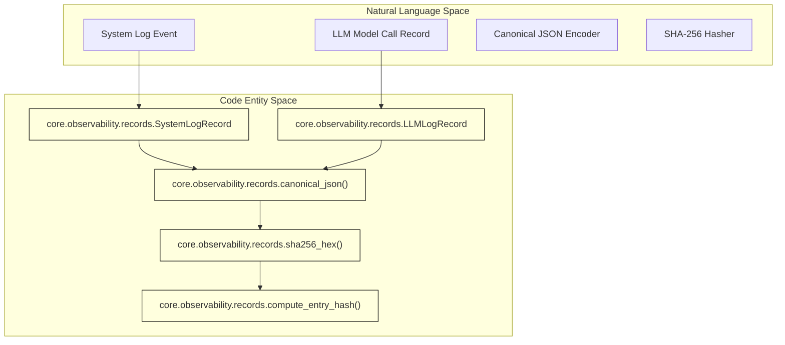
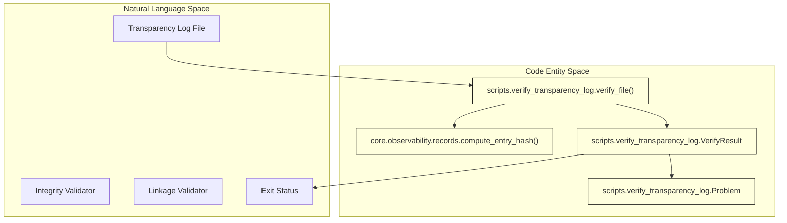

<!-- source: DeepWiki mcp.deepwiki.com · repo HKUDS/DeepCode · page 2.8 Observability and Transparency Log · fetched 2026-11-09 -->

# Observability and Transparency Log

<details>
<summary>Relevant source files</summary>

The following files were used as context for generating this wiki page:

- [core/observability/bus.py](core/observability/bus.py)
- [core/observability/llmops.py](core/observability/llmops.py)
- [core/observability/records.py](core/observability/records.py)
- [scripts/verify_transparency_log.py](scripts/verify_transparency_log.py)
- [tests/test_cli_logging_bootstrap.py](tests/test_cli_logging_bootstrap.py)
- [tests/test_llmops.py](tests/test_llmops.py)
- [tests/test_transparency_log.py](tests/test_transparency_log.py)

</details>


## Purpose and Scope

The `core/observability/` package provides DeepCode's centralized logging, sink wiring, structured log record schemas, LLMOps metering/tracing, and the tamper-evident transparency log hash chain [core/observability/bus.py:1-31, core/observability/records.py:1-17]. It bridges standard library logging and Loguru sinks, routes logs globally and per-task, and enables forensic auditing of LLM model interactions.

---

## 1. The Event Bus and Log Sinks (`core/observability/bus.py`)

The event bus architecture revolves around a module-level, idempotent setup function `setup_logging()` that configures Loguru sinks and intercepts Python standard library log records [core/observability/bus.py:1-92, core/observability/bus.py:125-144].

### Loguru Wiring & Standard Library Bridge

Because portions of the application and third-party libraries emit logs via Python's built-in `logging` module, DeepCode uses a custom `_StdlibBridgeHandler` to capture standard library log records and route them through Loguru's active sinks without misattributing call stacks [core/observability/bus.py:58-92].

```mermaid
graph TD
    subgraph "Natural Language Space"
        A["Standard Library Logger"]
        B["Loguru Logger Calls"]
        C["Console Sink"]
        D["Global JSONL Sink"]
        E["Per-Task JSONL Sink"]
    end

    subgraph "Code Entity Space"
        F["logging.Handler" --> G["_StdlibBridgeHandler.emit()"]]
        G --> H["_loguru_logger.opt()"]
        H --> I["core.observability.bus.setup_logging()"]
        I --> J["logs/server-{date}.jsonl"]
        I --> K["deepcode_lab/tasks/<task_id>/logs/system.jsonl"]
    end

    A --> F
    B --> H
    H --> C
    H --> D
    H --> E

    style F fill:none,stroke:#000,stroke-width:1px
    style G fill:none,stroke:#000,stroke-width:1px
    style H fill:none,stroke:#000,stroke-width:1px
    style I fill:none,stroke:#000,stroke-width:1px
    style J fill:none,stroke:#000,stroke-width:1px
    style K fill:none,stroke:#000,stroke-width:1px
```

*Sources:* `core/observability/bus.py:58-92`, `core/observability/bus.py:125-144`

---

## 2. Structured Record Schemas (`core/observability/records.py`)

DeepCode emits structured log streams using plain Python `dataclass` instances rather than Pydantic to maintain zero validation overhead on hot logging paths [core/observability/records.py:1-6].

### Core Record Classes

* **`SystemLogRecord`**: Captures generic Loguru-derived log events with support for `task_id`, `session_id`, log levels, and exception tracebacks [core/observability/records.py:86-110].
* **`LLMLogRecord`**: Captures individual model invocation requests, responses, durations, token counts, and transparency log metadata [core/observability/records.py:113-157].



*Sources:* `core/observability/records.py:33-110`, `core/observability/records.py:113-157`

---

## 3. Transparency Log and Hash Chain (`DEEPCODE_TRANSPARENCY_LOG=1`)

To protect against a malicious model router or proxy between the agent harness and model providers (which could rewrite tool calls or log credentials), DeepCode features an optional append-only transparency log [core/observability/bus.py:20-31, core/observability/records.py:7-17].

### Write-Time Hashing Mechanics

When `DEEPCODE_TRANSPARENCY_LOG=1` is active, every `LLMLogRecord` appended to `llm.jsonl` is linked into a cryptographic hash chain at write time [core/observability/bus.py:20-24, tests/test_transparency_log.py:69-76]:

$$\text{entry\_hash} = \text{SHA256}(\text{canonical\_json}(\text{payload}) \mathbin{\Vert} \text{prev\_hash})$$

* **`canonical_json()`**: Generates deterministic byte sequences by sorting dictionary keys and stripping whitespace, ensuring cross-platform serialization stability [core/observability/records.py:33-46].
* **`prev_hash`**: Contains the `entry_hash` of the preceding log line (`""` for the genesis record) [core/observability/records.py:70-83].
* **Tail Recovery**: On process restart, the bus reads the tail of the target `llm.jsonl` file to recover the last `entry_hash` without buffering the entire log [core/observability/bus.py:113-117].

*Sources:* `core/observability/bus.py:20-31`, `core/observability/records.py:33-83`, `tests/test_transparency_log.py:69-76`

---

## 4. Transparency Log Verification (`scripts/verify_transparency_log.py`)

The verification script `scripts/verify_transparency_log.py` inspects `llm.jsonl` files to audit integrity and linkage [scripts/verify_transparency_log.py:1-120].



### Validation Checks
1. **Integrity Check**: Recomputes `entry_hash` from the record payload and compares it against the stored `entry_hash` [scripts/verify_transparency_log.py:101-164].
2. **Linkage Check**: Confirms that each entry's `prev_hash` matches the preceding entry's stored `entry_hash`, preventing line deletion, reordering, or substitution [scripts/verify_transparency_log.py:165-177].

*Sources:* `scripts/verify_transparency_log.py:101-177`

---

## 5. LLMOps Metering and Tracing (`core/observability/llmops.py`)

The `llmops` module aggregates `llm.jsonl` records to compute cost, latency distributions, and call statuses [core/observability/llmops.py:1-20].

### Cost and Latency Calculation

* **Cost Aggregation**: Token usage counts are multiplied by list prices fetched from the model catalog (`core.providers.catalog.resolve_model_info`) [core/observability/llmops.py:8-13, core/observability/llmops.py:121-137]. Unpriced models increment `unpriced_calls` so overall usage is never understated [core/observability/llmops.py:10-11, core/observability/llmops.py:130-136].
* **Latency Percentiles**: Computes `p50`, `p95`, and `max` over `duration_ms` samples [core/observability/llmops.py:13-14, core/observability/llmops.py:141-152].

*Sources:* `core/observability/llmops.py:1-175`, `tests/test_llmops.py:30-62`

---

