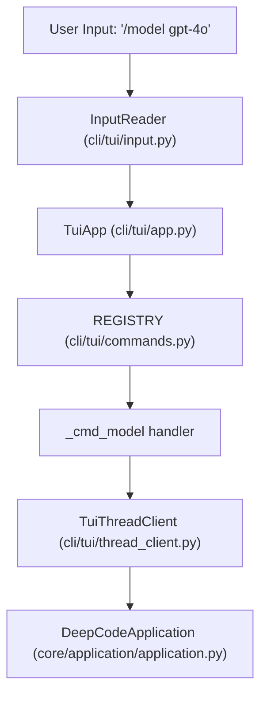
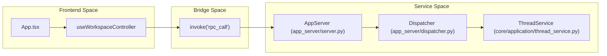

<!-- source: DeepWiki mcp.deepwiki.com · repo HKUDS/DeepCode · page 3 Interfaces · fetched 2026-11-09 -->

# Interfaces

Relevant source files

The following files were used as context for generating this wiki page:

- [cli/schedule_cli.py](cli/schedule_cli.py)
- [cli/tui/app.py](cli/tui/app.py)
- [cli/tui/commands.py](cli/tui/commands.py)
- [cli/tui/input.py](cli/tui/input.py)
- [cli/tui/renderer.py](cli/tui/renderer.py)
- [cli/tui/session_bridge.py](cli/tui/session_bridge.py)
- [cli/tui/theme.py](cli/tui/theme.py)
- [cli/tui/thread_client.py](cli/tui/thread_client.py)
- [deepcode.py](deepcode.py)
- [desktop/README.md](desktop/README.md)
- [desktop/src/App.tsx](desktop/src/App.tsx)
- [desktop/src/app/appearance.ts](desktop/src/app/appearance.ts)
- [desktop/src/app/i18n.ts](desktop/src/app/i18n.ts)
- [desktop/src/app/useAppearance.ts](desktop/src/app/useAppearance.ts)
- [desktop/src/features/thread/ConversationSplitter.module.css](desktop/src/features/thread/ConversationSplitter.module.css)
- [desktop/src/features/thread/ConversationSplitter.test.tsx](desktop/src/features/thread/ConversationSplitter.test.tsx)
- [desktop/src/features/thread/ConversationSplitter.tsx](desktop/src/features/thread/ConversationSplitter.tsx)
- [desktop/src/features/thread/conversationWidthResize.test.ts](desktop/src/features/thread/conversationWidthResize.test.ts)
- [desktop/src/features/thread/conversationWidthResize.ts](desktop/src/features/thread/conversationWidthResize.ts)
- [tests/test_git_command_url.py](tests/test_git_command_url.py)
- [tests/test_tui.py](tests/test_tui.py)
- [tools/code_reference_indexer.py](tools/code_reference_indexer.py)
- [tools/git_command.py](tools/git_command.py)
- [tools/pdf_converter.py](tools/pdf_converter.py)

DeepCode provides multiple interactive surfaces and integration channels for its agentic coding kernel. While the underlying execution engine and session storage remain unified, interfaces range from high-velocity terminal workflows to cross-platform desktop applications, web workbenches, automated headless CLI jobs, and structured JSON-RPC APIs. 

All interfaces communicate with the same underlying infrastructure, sharing session history, provider configurations, and tool permissions through the session store and application services layer [deepcode.py:1-35](), [cli/tui/thread_client.py:39-74]().

## Interface Matrix

| Interface | Primary Use Case | Technology | Key Components |
| :--- | :--- | :--- | :--- |
| **Interactive TUI** | Natural language coding & REPL | Python (`Rich`, `PromptToolkit`) | `TuiApp`, `EventRenderer`, `commands.py` |
| **Headless CLI** | CI/CD, automation, and batch tasks | Python (`Argparse`) | `deepcode exec`, `headless_turn.py`, `goal_runner.py` |
| **Desktop App** | Visual workbench, review & settings | Tauri (React, Rust, Python Sidecar) | `AppServer`, `DesktopSidebar`, `Composer` |
| **Web Workbench** | Browser-based shared shell access | React, WebSockets, Python Surface | `web_cli.py`, `web_surface.py`, `webMain.tsx` |
| **App Server** | Programmatic & remote access protocol | JSON-RPC 2.0 over stdio | `app_server/server.py`, `app_server/dispatcher.py` |
| **Voice Dictation** | Push-to-talk speech-to-text input | MLX / OpenAI-compatible endpoint | `DictationService`, `useDictation` |

---

## 3.1 Interactive TUI

The interactive terminal UI provides a REPL loop for free-form multi-turn coding sessions [cli/tui/app.py:1-17](). It features an event-sourced rendering architecture where agent actions, thinking deltas, and tool executions are dynamically painted onto the terminal using `Rich` [tests/test_tui.py:1-54](). Users can steer conversations using slash commands registered declaratively [cli/tui/commands.py:1-10](), utilize smart input completion for `@path` file references [cli/tui/app.py:50-51](), and inspect execution profiles [cli/tui/thread_client.py:39-105]().

For details, see [Interactive TUI](#3.1).

Sources: [cli/tui/app.py:1-17](), [cli/tui/commands.py:1-10](), [cli/tui/thread_client.py:39-105]()

---

## 3.2 Headless and Automation CLI

For non-interactive environments, CI/CD pipelines, and background workflows, DeepCode provides headless execution commands [deepcode.py:124-177](). Commands like `deepcode exec`, `deepcode loop`, and `deepcode schedule` allow agents to operate as batch workers or autonomous loop runners, streaming structured JSON events for telemetry and test-driven verification [tests/test_tui.py:1-7]().

For details, see [Headless and Automation CLI](#3.2).

Sources: [deepcode.py:124-177](), [tests/test_tui.py:1-7]()

---

## 3.3 Desktop Application

The Tauri-based Desktop workbench offers a visual multi-process environment combining a React frontend, a Rust Tauri shell, and a Python App Server sidecar [desktop/README.md:1-25](). It surfaces the same canonical sessions, skills, automations, and permission models as the CLI [desktop/README.md:1-12](). Key subsystems include the `Composer`, conversation renderers, and dedicated settings management [desktop/src/App.tsx:1-50]().

* **Desktop Settings and Provider Configuration**: Manages credential CRUD, write-only keys, model discovery, validation probes, appearance preferences, and internationalization tokens [desktop/src/app/i18n.ts:1-50](), [desktop/src/app/appearance.ts:1-70]().
* **Desktop Automations, Goals and Presets**: Surfaces background goals, occurrence schedules, approval inspector cards, and runtime notices [desktop/src/App.tsx:70-120]().

For details, see [Desktop Application](#3.3).

Sources: [desktop/README.md:1-25](), [desktop/src/App.tsx:1-50](), [desktop/src/app/appearance.ts:1-70]()

---

## 3.4 App Server JSON-RPC Protocol

The App Server provides a bidirectional JSON-RPC 2.0 communication channel over stdio [desktop/README.md:1-163](). It structures interaction into distinct RPC namespaces (`thread/*`, `turn/*`, `file/*`, `mcp/*`) and handles runtime probing, event notifications, error retry semantics, and state projection from the underlying JSONL `SessionStore` into SQLite.

For details, see [App Server JSON-RPC Protocol](#3.4).

Sources: [desktop/README.md:1-163]()

---

## 3.5 Web Workbench

The `deepcode web` browser client exposes the workbench interface over web surfaces [deepcode.py:173-176](). Utilizing `cli/web_cli.py`, `app_server/web_surface.py`, and WebSocket transport layers, it renders the shared React shell (`desktop/src/webMain.tsx`) inside standard browsers while retaining full background service integration.

For details, see [Web Workbench](#3.5).

Sources: [deepcode.py:173-176]()

---

## 3.6 Voice Dictation

Voice dictation enables push-to-talk speech-to-text transcription within input components. Powered by `DictationService`, it supports local `parakeet-mlx` runners or OpenAI-compatible transcription endpoints, respecting strict egress policies and exposing `dictation/status` and `dictation/transcribe` RPC routes alongside the React `useDictation` hook.

For details, see [Voice Dictation](#3.6).

---

## Interface to Code Mapping

The following diagrams map natural language interaction spaces to their corresponding backend code entities across different interfaces.

### TUI Input to REPL Execution Flow

Sources: [cli/tui/app.py:70-135](), [cli/tui/commands.py:1-40](), [cli/tui/thread_client.py:39-75]()

### Desktop RPC and Sidecar Dispatch Flow

Sources: [desktop/src/App.tsx:70-120](), [cli/tui/thread_client.py:39-75]()

---
**Child Pages:**
* [Interactive TUI](#3.1)
* [Headless and Automation CLI](#3.2)
* [Desktop Application](#3.3)
* [App Server JSON-RPC Protocol](#3.4)
* [Web Workbench](#3.5)
* [Voice Dictation](#3.6)

---

