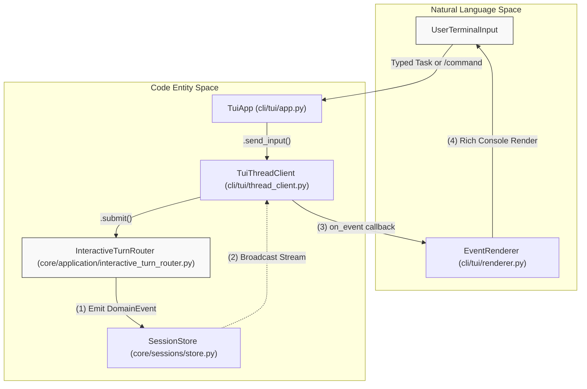
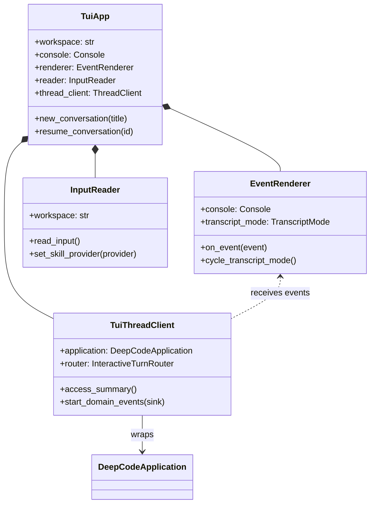

<!-- source: DeepWiki mcp.deepwiki.com · repo HKUDS/DeepCode · page 3.1 Interactive TUI · fetched 2026-11-09 -->

# Interactive TUI

Relevant source files

The following files were used as context for generating this wiki page:

- [cli/schedule_cli.py](cli/schedule_cli.py)
- [cli/tui/animation.py](cli/tui/animation.py)
- [cli/tui/app.py](cli/tui/app.py)
- [cli/tui/commands.py](cli/tui/commands.py)
- [cli/tui/goal_controller.py](cli/tui/goal_controller.py)
- [cli/tui/input.py](cli/tui/input.py)
- [cli/tui/renderer.py](cli/tui/renderer.py)
- [cli/tui/session_bridge.py](cli/tui/session_bridge.py)
- [cli/tui/text.py](cli/tui/text.py)
- [cli/tui/theme.py](cli/tui/theme.py)
- [cli/tui/thread_client.py](cli/tui/thread_client.py)
- [core/private_storage.py](core/private_storage.py)
- [core/schedule/monitor.py](core/schedule/monitor.py)
- [docs/guide/getting-started.md](docs/guide/getting-started.md)
- [docs/guide/goals-and-headless.md](docs/guide/goals-and-headless.md)
- [docs/guide/sessions.md](docs/guide/sessions.md)
- [docs/guide/the-tui.md](docs/guide/the-tui.md)
- [pyproject.toml](pyproject.toml)
- [tests/application/test_automation_goal_runs.py](tests/application/test_automation_goal_runs.py)
- [tests/persistence/test_database.py](tests/persistence/test_database.py)
- [tests/test_private_storage.py](tests/test_private_storage.py)
- [tests/test_private_storage_acl_once.py](tests/test_private_storage_acl_once.py)
- [tests/test_private_storage_windows.py](tests/test_private_storage_windows.py)
- [tests/test_schedule_monitor.py](tests/test_schedule_monitor.py)
- [tests/test_tui.py](tests/test_tui.py)

The terminal user interface (TUI) provides a high-fidelity, free-form, multi-turn coding environment designed for interactive terminal workflows. It acts as an event-sourced command-line client over the core application runtime, offering full parity with desktop and web workbenches while retaining low-latency terminal execution.

Sources: [cli/tui/app.py:1-17](), [docs/guide/the-tui.md:1-6]()

---

## Architecture and Event Pipeline

The TUI cleanly separates the **Application Services** (the core execution engine) from the **Terminal Rendering Layer** (the view). Every pixel rendered in the terminal represents a projection of the `DomainEvent` or event stream produced during agent execution.

### Subsystem Component Roles

| Class / Module | File Path | Responsibility |
| :--- | :--- | :--- |
| `TuiApp` | [cli/tui/app.py:69-118]() | Main REPL loop, application state coordinator, session lifecycle, and slash command dispatcher. |
| `TuiThreadClient` | [cli/tui/thread_client.py:39-68]() | CLI adapter over the shared `DeepCodeApplication` instance; handles project trust checks and event subscriptions. |
| `EventRenderer` | [cli/tui/renderer.py:1-25]() | Consumes streaming events and renders them via `rich` console outputs with customized formatting. |
| `InputReader` | [cli/tui/input.py:1-30]() | Manages `prompt_toolkit` input sessions, line editing, prompt history, and tab completion. |
| `SessionBridge` | [cli/tui/session_bridge.py:1-35]() | Manages session storage persistence, disk activity leases, and transaction states for resuming threads. |

### Event-Sourced Rendering Flow

The TUI relies entirely on asynchronous event streams rather than polling state. The following diagram maps user interactions in Natural Language Space to concrete classes and functions in Code Entity Space:

Sources: [cli/tui/app.py:89-95](), [cli/tui/thread_client.py:172-188](), [cli/tui/renderer.py:1-25](), [core/events/protocol.py:1-16]()

---

## REPL Loop, Controls, and Slash Commands

The main entry loop is driven by `TuiApp`, which reads input via `InputReader`, parses control flows, and delegates slash commands to the registry defined in `cli/tui/commands.py`.

### Keyboard Controls and Interactivity
Three primary keyboard combinations govern real-time session manipulation:
1.  **`Esc`**: Interrupts the running turn immediately via an interrupt signal without terminating the application process [docs/guide/the-tui.md:12]().
2.  **`Ctrl+O`**: Cycles through transcript detail levels (`normal` → `verbose` → `summary`) [docs/guide/the-tui.md:13]().
3.  **`Ctrl+D`**: Gracefully terminates the REPL session (`/exit`), leaving background tasks running if detached [docs/guide/the-tui.md:14]().

### Slash Command Registry
Slash commands are registered declaratively as `Command` items in `cli/tui/commands.py`. Each entry defines a usage pattern, help description, and an asynchronous handler function [cli/tui/commands.py:30-39]().

| Slash Command | Handler / Action | Description |
| :--- | :--- | :--- |
| `/new [title]` | [cli/tui/commands.py:69-75]() | Starts a fresh conversation thread within the active workspace. |
| `/resume [id]` | [cli/tui/commands.py:161-173]() | Resumes a prior session ID or opens the interactive picker widget. |
| `/model` | [cli/tui/app.py:131-133]() | Displays or switches the active model provider and connection ID. |
| `/permissions` | [cli/tui/thread_client.py:144-152]() | Adjusts execution security presets (`ask`, `read-only`, `full-access`). |
| `/skills` | [cli/tui/commands.py:1-35]() | Enumerates discovered agent skills and capabilities. |
| `/mcp` | [tests/test_tui.py:217-228]() | Manages Model Context Protocol servers and authorization status. |

Sources: [cli/tui/app.py:1-17](), [cli/tui/commands.py:30-66](), [docs/guide/the-tui.md:8-48]()

---

## Specialized Widgets, Text Budgeting, and Animations

To fit rich UI elements inside arbitrary terminal dimensions without breaking layout integrity, the TUI implements dedicated widgets and cell-fitting helpers.

### The Picker Widget
The interactive `Picker` (`cli/tui/picker.py`) powers selection menus for `/resume`, `/model`, and `/skills`. It implements fuzzy filtering, multi-scope grouping (e.g., local directory vs. all recent sessions), and rich metadata display (such as relative message age and counts) [cli/tui/commands.py:175-194]().

### Text Cell Budgeting and Folding
Truncation and path folding are centralized in `cli/tui/text.py`. The renderer enforces cell-width budgets using `rich.cells.cell_len` to correctly handle multi-byte characters and ANSI escape codes. Path folding shortens lengthy workspace paths with tilde expansions (`~`) before rendering table rows or status lines [cli/tui/commands.py:98-103]().

### Code Entity Subsystem Mapping

Sources: [cli/tui/app.py:69-124](), [cli/tui/thread_client.py:39-94](), [cli/tui/renderer.py:1-30](), [cli/tui/input.py:1-40]()

---

## Thread Client, Session Bridge, and `@path` Expansion

### Thread Client Integration
The TUI interfaces with application services through `TuiThreadClient` or `ServiceThreadClient`, which wrap `DeepCodeApplication` and manage asynchronous event subscriptions [cli/tui/app.py:110-128](). These clients handle project trust verification [cli/tui/thread_client.py:75-88](), execution profile resolution [cli/tui/thread_client.py:101](), and live turn routing via `InteractiveTurnRouter` [cli/tui/thread_client.py:89-92]().

### Session Bridge
`SessionBridge` coordinates disk persistence between session logs and the local SQLite projection store [cli/tui/session_bridge.py:1-40](). It acquires file activity leases (`FileLease`) via `SessionStore` to prevent concurrent modification conflicts across multiple client processes [cli/tui/app.py:146-164]().

### `@path` Inline File Expansion
Users can attach file contents directly into messages by typing `@path/to/file` [docs/guide/the-tui.md:51-56](). 
*   **Implementation**: `expand_file_refs` parses user strings for `@path` tokens and dynamically loads file content into the prompt context prior to submission [cli/tui/input.py:49-55]().
*   **Safety Guards**: The completer automatically skips sensitive directories and control paths such as `.git`, `.venv`, and `node_modules` [cli/tui/input.py:38-45]().

Sources: [cli/tui/app.py:138-164](), [cli/tui/thread_client.py:39-105](), [cli/tui/input.py:30-100](), [docs/guide/the-tui.md:49-65]()

---

