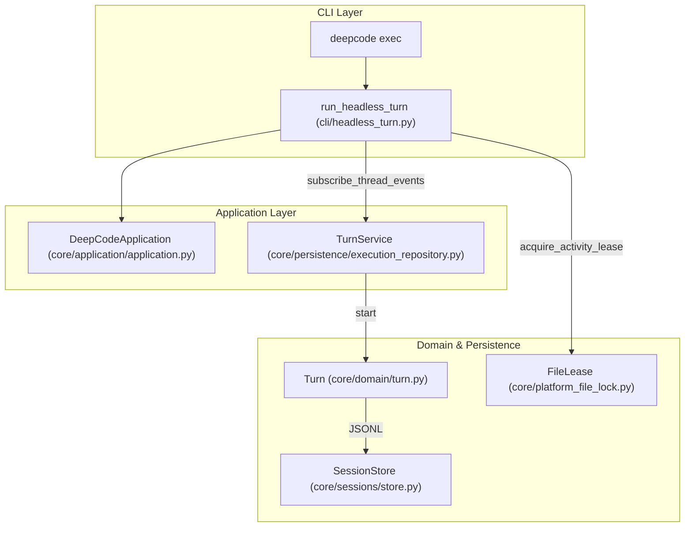
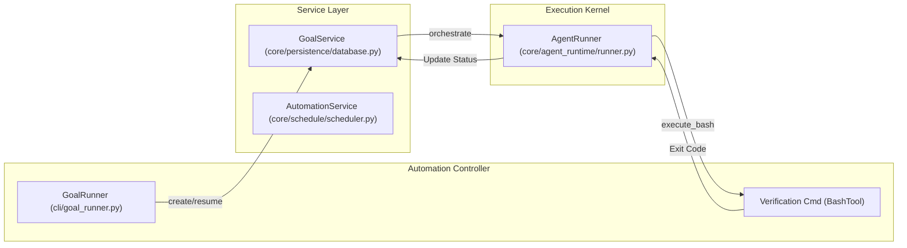

<!-- source: DeepWiki mcp.deepwiki.com · repo HKUDS/DeepCode · page 3.2 Headless and Automation CLI · fetched 2026-11-09 -->

# Headless and Automation CLI

Relevant source files

The following files were used as context for generating this wiki page:

- [.github/workflows/pypi-publish.yml](.github/workflows/pypi-publish.yml)
- [cli/__init__.py](cli/__init__.py)
- [cli/exec_cli.py](cli/exec_cli.py)
- [cli/goal_runner.py](cli/goal_runner.py)
- [cli/headless_turn.py](cli/headless_turn.py)
- [cli/loop_cli.py](cli/loop_cli.py)
- [core/application/thread_service.py](core/application/thread_service.py)
- [core/events/__init__.py](core/events/__init__.py)
- [core/events/llm_events.py](core/events/llm_events.py)
- [core/events/parts.py](core/events/parts.py)
- [core/events/protocol.py](core/events/protocol.py)
- [core/platform_file_lock.py](core/platform_file_lock.py)
- [docs/HEADLESS_AND_AUTOMATION.md](docs/HEADLESS_AND_AUTOMATION.md)
- [scripts/verify_python_distribution.py](scripts/verify_python_distribution.py)
- [tests/application/test_default_agent_preset.py](tests/application/test_default_agent_preset.py)
- [tests/application/test_one_way_data_flow.py](tests/application/test_one_way_data_flow.py)
- [tests/test_agent_session.py](tests/test_agent_session.py)
- [tests/test_exec_cli.py](tests/test_exec_cli.py)
- [tests/test_llm_events.py](tests/test_llm_events.py)
- [tests/test_loop_cli.py](tests/test_loop_cli.py)
- [tests/test_python_distribution_release.py](tests/test_python_distribution_release.py)
- [tests/test_tui_thread_client.py](tests/test_tui_thread_client.py)

This page documents the non-interactive entry points for DeepCode, specifically focusing on `deepcode exec` for one-shot headless turns and `deepcode loop` for goal-driven automated verification. These tools are built atop the same `DeepCodeApplication` services used by the TUI and Desktop, ensuring consistent behavior across all interfaces.

## Overview

DeepCode provides a robust headless interface for CI/CD integration, scripting, and long-running autonomous tasks. Unlike the interactive TUI, the headless CLI commands are designed for programmatic consumption (via JSON streaming) and autonomous loop execution (via goal refereeing).

- **`deepcode exec`**: Executes a single Turn within a Session. It can start new sessions or resume existing ones, streaming events to `stdout` as JSONL or human-readable text [cli/exec_cli.py:1-127]().
- **`deepcode loop`**: Executes a "Goal" that persists across multiple turns. It uses a verification command (e.g., a test suite) to determine when the objective is met [cli/loop_cli.py:1-13](), [cli/goal_runner.py:1-12]().
- **`deepcode schedule` / `deepcode automation`**: Manages recurring automations and background tasks through the `AutomationService`.

Sources: [cli/exec_cli.py:1-17](), [cli/loop_cli.py:1-13](), [cli/goal_runner.py:1-26](), [cli/headless_turn.py:1-25]()

---

## Headless Turn Execution (`deepcode exec`)

The `deepcode exec` command is the primary tool for one-shot agent interactions. It wraps `cli/headless_turn.py` to orchestrate a durable Turn on the shared runtime.

### Execution Logic
When a headless turn is triggered, the system:
1. **Initializes the Application**: Opens `DeepCodeApplication` with a `headless` host surface and `inherit_default_preset=False` to prevent interactive presets from stripping necessary tools [cli/headless_turn.py:48-57](), [cli/headless_turn.py:92-95]().
2. **Resolves Workspace and Project**: Locates the project and ensures it is in a `TRUSTED` state [cli/headless_turn.py:76-81]().
3. **Acquires Session Lease**: Obtains an activity lease from the `SessionStore` to prevent concurrent modifications [cli/headless_turn.py:133-135]().
4. **Starts Turn**: Submits the prompt to `TurnService.start()`. The execution blocks until a terminal state (`task_complete` or `error`) is reached [cli/headless_turn.py:136-169]().

### Data Flow: Headless Turn
The following diagram illustrates the flow from a CLI command to the underlying domain entities.

Sources: [cli/headless_turn.py:53-172](), [cli/exec_cli.py:128-144](), [core/application/application.py:1-50]()

---

## Goal-Driven Verify Loop (`deepcode loop`)

The `deepcode loop` command implements a durable objective-seeking behavior. It is managed by `cli/goal_runner.py` and utilizes the `ThreadGoal` domain object.

### The Verify Loop Pattern
The "loop" differs from a standard turn by incorporating a referee (a `completion_evidence_command`). The agent is instructed that its work is only complete when this command exits with code 0.

- **Objective Augmentation**: The user's prompt is wrapped with instructions regarding the verification command [cli/goal_runner.py:86-92]().
- **Goal Lifecycle**: The `GoalService` creates a `ThreadGoal` with `start=True`, which triggers the `AgentRunner` to work until the objective is satisfied or the `token_budget` is exhausted [cli/goal_runner.py:125-160]().
- **Persistence**: Goals are stored in the SQLite database and can be resumed across process restarts using `--resume <session_id>` [cli/goal_runner.py:37-46](), [cli/goal_runner.py:112-148]().

### Goal Execution Architecture

Sources: [cli/goal_runner.py:70-138](), [core/domain/thread_goal.py:1-24](), [core/agent_runtime/runner.py:1-50]()

---

## CI/CD and JSON Streaming

For automation, `deepcode exec` supports a `--json` flag that switches the output from human-readable terminal formatting to a stream of JSON-serialized events.

### Event Serialization
Every event produced by the agent kernel (e.g., `tool_started`, `agent_message_delta`, `task_complete`) is passed through `serialize_event` and printed to `stdout` [cli/exec_cli.py:122-124](). This allows external tools to monitor progress, extract generated code, or trigger external workflows based on specific tool calls.

### Approval Handling in Headless Mode
When an agent performs a sensitive operation (e.g., deleting a file) that requires approval:
- **Non-interactive (CI)**: If `stdin` is not a TTY, the `_approval_decider` automatically denies the request to prevent hangs, unless the session is running with an `ExecutionAccessPreset` that grants `full-access` [cli/exec_cli.py:81-92]().
- **Interactive Headless**: If a TTY is present, the CLI prompts the user for a one-time or session-wide approval [cli/exec_cli.py:93-106]().

Sources: [cli/exec_cli.py:80-105](), [cli/exec_cli.py:121-125](), [core/events/__init__.py:1-30]()

---

## Scheduling and Background Tasks

The scheduling commands interface with the `AutomationService` to manage tasks that run without direct user supervision.

- **Automation Occurrence**: Represents a single execution instance of a scheduled automation [core/persistence/automation_repository.py:1-37]().
- **Autodream**: A specialized background task that performs memory consolidation and `MEMORY.md` updates by analyzing past turns in a session [core/loop/autodream.py:1-40]().

Sources: [cli/schedule_cli.py:1-50](), [core/schedule/scheduler.py:1-30](), [core/loop/autodream.py:1-40]()

---

