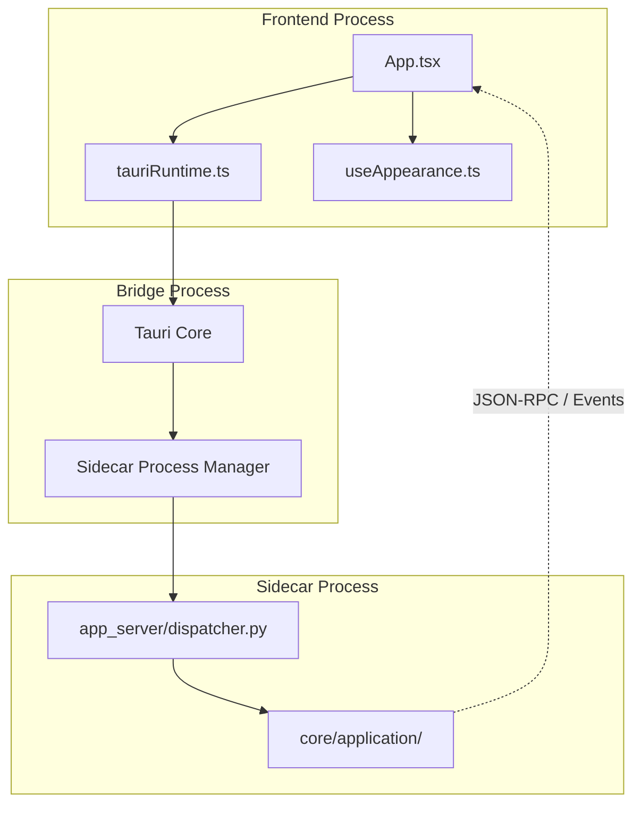

<!-- source: DeepWiki mcp.deepwiki.com · repo HKUDS/DeepCode · page 3.3 Desktop Application · fetched 2026-11-09 -->

# Desktop Application

Relevant source files

The following files were used as context for generating this wiki page:

- [.gitattributes](.gitattributes)
- [app_server/protocol/methods.py](app_server/protocol/methods.py)
- [app_server/protocol/retry.py](app_server/protocol/retry.py)
- [core/application/errors.py](core/application/errors.py)
- [core/dictation/audio.py](core/dictation/audio.py)
- [desktop/README.md](desktop/README.md)
- [desktop/src-tauri/tauri.conf.json](desktop/src-tauri/tauri.conf.json)
- [desktop/src/App.module.css](desktop/src/App.module.css)
- [desktop/src/App.tsx](desktop/src/App.tsx)
- [desktop/src/app/appearance.ts](desktop/src/app/appearance.ts)
- [desktop/src/app/i18n.ts](desktop/src/app/i18n.ts)
- [desktop/src/app/useAppearance.ts](desktop/src/app/useAppearance.ts)
- [desktop/src/components/RuntimeNotice.module.css](desktop/src/components/RuntimeNotice.module.css)
- [desktop/src/features/execution/ApprovalCard.module.css](desktop/src/features/execution/ApprovalCard.module.css)
- [desktop/src/features/execution/Composer.module.css](desktop/src/features/execution/Composer.module.css)
- [desktop/src/features/execution/Composer.tsx](desktop/src/features/execution/Composer.tsx)
- [desktop/src/features/execution/itemPresentation.ts](desktop/src/features/execution/itemPresentation.ts)
- [desktop/src/features/goal/GoalRail.module.css](desktop/src/features/goal/GoalRail.module.css)
- [desktop/src/features/inspector/Inspector.module.css](desktop/src/features/inspector/Inspector.module.css)
- [desktop/src/features/management/ManagementWorkspace.module.css](desktop/src/features/management/ManagementWorkspace.module.css)
- [desktop/src/features/navigation/DesktopSidebar.module.css](desktop/src/features/navigation/DesktopSidebar.module.css)
- [desktop/src/features/navigation/DesktopSidebar.tsx](desktop/src/features/navigation/DesktopSidebar.tsx)
- [desktop/src/features/navigation/SessionRow.module.css](desktop/src/features/navigation/SessionRow.module.css)
- [desktop/src/features/navigation/SessionRow.tsx](desktop/src/features/navigation/SessionRow.tsx)
- [desktop/src/features/thread/ConversationSplitter.module.css](desktop/src/features/thread/ConversationSplitter.module.css)
- [desktop/src/features/thread/ConversationSplitter.test.tsx](desktop/src/features/thread/ConversationSplitter.test.tsx)
- [desktop/src/features/thread/ConversationSplitter.tsx](desktop/src/features/thread/ConversationSplitter.tsx)
- [desktop/src/features/thread/MarkdownContent.module.css](desktop/src/features/thread/MarkdownContent.module.css)
- [desktop/src/features/thread/ThreadConversation.module.css](desktop/src/features/thread/ThreadConversation.module.css)
- [desktop/src/features/thread/ThreadConversation.tsx](desktop/src/features/thread/ThreadConversation.tsx)
- [desktop/src/features/thread/ThreadHeader.module.css](desktop/src/features/thread/ThreadHeader.module.css)
- [desktop/src/features/thread/TurnBlock.tsx](desktop/src/features/thread/TurnBlock.tsx)
- [desktop/src/features/thread/conversationWidthResize.test.ts](desktop/src/features/thread/conversationWidthResize.test.ts)
- [desktop/src/features/thread/conversationWidthResize.ts](desktop/src/features/thread/conversationWidthResize.ts)
- [tests/test_config_layering.py](tests/test_config_layering.py)

The DeepCode Desktop Application is a high-performance workbench built on **Tauri 2**, providing a rich graphical interface for the agentic coding kernel [desktop/README.md:3-6](). It unifies conversation history with structured tool progress, approvals, Git review, files, terminals, tests, Artifacts, and provider settings [desktop/README.md:8-10](). Work started in the CLI can be resumed seamlessly in the Desktop application without converting or copying sessions [desktop/README.md:10-11]().

---

## 1. Architecture: The Three-Process Boundary

The Desktop application operates across three distinct process boundaries to ensure UI responsiveness, native system access, and background agent performance [desktop/README.md:3-11]().

*   **React Frontend:** Responsible for information architecture, state management, and workspace rendering via `App` [desktop/src/App.tsx:70-74]() and `DesktopSidebar` [desktop/src/features/navigation/DesktopSidebar.tsx]().
*   **Rust Bridge:** Manages application lifecycle, window management, native filesystem dialogs, and the embedded sidecar binary (`tauri.conf.json`).
*   **Python App Server Sidecar:** Runs the agent execution loop, session persistence, and domain services, communicating with the frontend over JSON-RPC 2.0 via `stdio` [app_server/protocol/methods.py:1-109]().

**Sources:** [desktop/src/App.tsx:70-74](), [desktop/README.md:3-11](), [app_server/protocol/methods.py:1-109]().

---

## 2. Information Architecture and Thread Workspace

The Desktop workbench is organized into key operational domains, managed via `DesktopSidebar` and rendered in the main workspace [desktop/src/App.tsx:124-189]().

### The Composer and Turn Orchestration
The `Composer` handles user prompt entry, file attachments via `onPickContextFiles`, and skill selection [desktop/src/features/execution/Composer.tsx:81-127](). It manages `ExecutionAccessPreset` levels (`full_auto`, `ask`, `plan`) to govern agent autonomy per turn [desktop/src/features/execution/Composer.tsx:190-209]().

### Conversation Rendering and Splitter
Conversations are rendered as sequences of turn blocks alongside a responsive conversation splitter (`ConversationSplitter`) that calculates column width dynamically [desktop/src/features/thread/ConversationSplitter.tsx:48-65]() using `conversationWidthResize.ts` utilities [desktop/src/features/thread/conversationWidthResize.ts:70-74](). Appearance preferences and widths are synchronized across local storage [desktop/src/app/appearance.ts:21-76]().

**Sources:** [desktop/src/App.tsx:124-189](), [desktop/src/features/execution/Composer.tsx:81-127](), [desktop/src/features/thread/ConversationSplitter.tsx:48-65](), [desktop/src/features/thread/conversationWidthResize.ts:70-74]().

---

## 3. Appearance, Customization, and Internationalization

Desktop provides comprehensive local customization for themes, fonts, column widths, and interface languages [desktop/src/app/appearance.ts:54-76](), [desktop/src/app/i18n.ts:1-20]().

*   **Theme & Typography Engine:** Managed by `useAppearance` [desktop/src/app/useAppearance.ts:85-103](), supporting presets (`system`, `light`, `dark`, `paper`, `midnight`, `claude`, `claude-dark`, `contrast`, and imported VS Code themes) [desktop/src/app/appearance.ts:31-40]().
*   **Internationalization (i18n):** Localized via `i18next` (`desktop/src/app/i18n.ts`), supporting English as the source of truth and localized translations such as Simplified Chinese (`zh-CN`) [desktop/src/app/i18n.ts:4-24]().

**Sources:** [desktop/src/app/appearance.ts:31-76](), [desktop/src/app/useAppearance.ts:85-103](), [desktop/src/app/i18n.ts:1-24]().

---

## Child Pages

For granular technical documentation on specific Desktop subsystems, refer to the following child pages:

*   **[Desktop Settings and Provider Configuration](#3.3.1)** — Detailed documentation on provider CRUD operations, write-only credential storage, model discovery, theme tokens, and modal management.
*   **[Desktop Automations, Goals and Presets](#3.3.2)** — Covers the Automations page, `GoalRail`, preset pickers, inspector approval cards, and runtime notices mirroring CLI domain objects.

---

