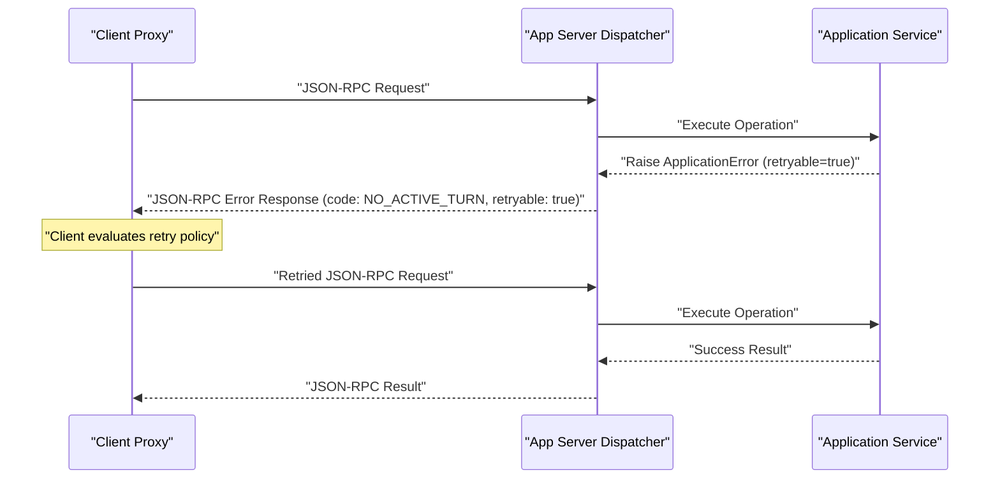

<!-- source: DeepWiki mcp.deepwiki.com · repo HKUDS/DeepCode · page 3.4 App Server JSON-RPC Protocol · fetched 2026-11-09 -->

# App Server JSON-RPC Protocol

<details>
<summary>Relevant source files</summary>

The following files were used as context for generating this wiki page:

- [app_server/dispatcher.py](app_server/dispatcher.py)
- [app_server/protocol/methods.py](app_server/protocol/methods.py)
- [app_server/protocol/retry.py](app_server/protocol/retry.py)
- [app_server/runtime_probe.py](app_server/runtime_probe.py)
- [app_server/server.py](app_server/server.py)
- [core/application/errors.py](core/application/errors.py)
- [core/application/turn_projection.py](core/application/turn_projection.py)
- [core/application/views.py](core/application/views.py)
- [core/dictation/audio.py](core/dictation/audio.py)
- [desktop/scripts/verify-release-bundle.py](desktop/scripts/verify-release-bundle.py)
- [desktop/src/app/useWorkspaceController.ts](desktop/src/app/useWorkspaceController.ts)
- [desktop/src/app/workspaceState.test.ts](desktop/src/app/workspaceState.test.ts)
- [desktop/src/app/workspaceState.ts](desktop/src/app/workspaceState.ts)
- [desktop/src/features/execution/Composer.tsx](desktop/src/features/execution/Composer.tsx)
- [desktop/src/generated/app-server.ts](desktop/src/generated/app-server.ts)
- [protocol/app-server.schema.json](protocol/app-server.schema.json)
- [tests/app_server/test_preset_methods.py](tests/app_server/test_preset_methods.py)
- [tests/app_server/test_runtime_probe.py](tests/app_server/test_runtime_probe.py)
- [tests/application/test_turn_service.py](tests/application/test_turn_service.py)
- [tests/test_config_layering.py](tests/test_config_layering.py)

</details>


The DeepCode App Server is a long-lived Python process that provides a high-level service boundary for the DeepCode Desktop application, web workbench, and other programmatic clients. It implements a bidirectional **JSON-RPC 2.0** protocol over `stdio`, allowing clients to orchestrate agent sessions, manage workspace security, and interact with the multi-agent kernel without direct coupling to Python internals. Its core logic and transport handling reside in `app_server/server.py` and `app_server/dispatcher.py` [app_server/dispatcher.py:1-14]().

---

## 1. Protocol Schema and Architecture

The wire protocol and data contracts are defined by a canonical JSON schema at `protocol/app-server.schema.json`, which describes method parameters, results, and asynchronous notification types [protocol/app-server.schema.json:1-23](). This schema serves as the source of truth for the generated TypeScript client bindings in `desktop/src/generated/app-server.ts` [desktop/src/generated/app-server.ts:1-2]().

The server lifecycle is managed via `AppServer` in `app_server/server.py`, which reads JSON-RPC frames from `stdin`, passes them to `app_server/dispatcher.py`, and writes responses and notifications to `stdout` [app_server/dispatcher.py:1-14]().

**Diagram: App Server Request Flow & Entity Mapping**
```mermaid
graph TD
    subgraph "Client Space (TypeScript)"
        "Desktop_UI[React]" -- "useWorkspaceController" --> "Client_Proxy[app-server.ts]"
        "Client_Proxy" -- "JSON-RPC Request" --> "Tauri_Bridge[Rust]"
    end

    subgraph "Process Boundary (stdio)"
        "Tauri_Bridge" -- "stdin" --> "Server_Loop[server.py]"
    end

    subgraph "App Server Space (Python)"
        "Server_Loop" -- "Request Object" --> "Dispatcher[dispatcher.py]"
        "Dispatcher" -- "Method Routing" --> "Handlers[rpc_methods]"
        "Handlers" -- "Invoke" --> "App_Layer[DeepCodeApplication]"
    end

    subgraph "Core Entity Space"
        "App_Layer" --> "ThreadService[core/application/]"
        "App_Layer" --> "TurnService[core/application/]"
        "App_Layer" --> "LLMConfigurationService[core/application/]"
    end
```
Sources: [app_server/server.py:1-40](), [app_server/dispatcher.py:1-16](), [desktop/src/app/useWorkspaceController.ts:137-176]()

---

## 2. RPC Namespaces and Methods

Method names are organized into domain-specific namespaces defined in `app_server/protocol/methods.py` [app_server/protocol/methods.py:1-109](). The dispatcher routes these requests to underlying application services [app_server/dispatcher.py:1-16]().

### 2.1 Core Method Namespaces

| Namespace | Key Methods | Description |
|:---|:---|:---|
| **Project** | `project/list`, `project/add`, `project/read`, `project/update`, `project/remove` | Manages workspaces and trust states [app_server/protocol/methods.py:5-9](). |
| **Settings & Provider** | `settings/read`, `settings/update`, `provider/list`, `provider/upsert`, `provider/test` | Configures layered settings and LLM credentials [app_server/protocol/methods.py:10-20](). |
| **Thread & Turn** | `thread/start`, `turn/start`, `turn/steer`, `thread/permission/update` | Orchestrates conversation threads and agent turns [app_server/protocol/methods.py:53-78](). |
| **MCP & Skills** | `mcp/list`, `mcp/upsert`, `skills/list`, `skill/read` | Manages Model Context Protocol servers and agent skills [app_server/protocol/methods.py:25-45](). |
| **Workflow & Automation** | `workflow/start`, `workflow/read`, `automation/create`, `automation/run` | Executes structured multi-agent workflows and scheduled tasks [app_server/protocol/methods.py:47-52, 82-87](). |
| **File, Git & Terminal** | `file/read`, `file/write`, `git/status`, `terminal/create` | Provides filesystem, source control, and shell execution capabilities [app_server/protocol/methods.py:92-105](). |
| **Dictation** | `dictation/status`, `dictation/transcribe` | Handles speech-to-text audio transcription [app_server/protocol/methods.py:108-109](). |

Sources: [app_server/protocol/methods.py:1-109](), [app_server/dispatcher.py:1-58]()

---

## 3. Retry Logic and Error Handling

The protocol incorporates robust error handling and retry metadata. Application errors inherit from `ApplicationError` in `core/application/errors.py`, defining machine-readable error codes (e.g., `TURN_NOT_STEERABLE`, `NO_ACTIVE_TURN`, `CONFLICT`) and a `retryable` boolean flag [core/application/errors.py:9-24, 135-139, 238](). Retry capabilities and backoff strategies are defined in `app_server/protocol/retry.py` [app_server/dispatcher.py:19]().

**Diagram: Error and Retry Lifecycle**

Sources: [app_server/dispatcher.py:10-15](), [core/application/errors.py:9-24, 135-139]()

---

## 4. Event Notifications and Streaming

Asynchronous events from the agent runner are pushed to clients via event notifications. The server uses explicit view projectors in `core/application/views.py` to serialize domain objects (such as `Item`, `Turn`, `Thread`, and `Approval`) into wire-safe dictionaries before emission [core/application/views.py:1-22]().

Sources: [core/application/views.py:1-22](), [core/application/turn_projection.py:47-83]()

---

## 5. Runtime Probe

The App Server includes a diagnostic module (`app_server/runtime_probe.py`) that verifies runtime dependencies, optional imports, provider availability, bundled MCP presets, and built-in skills upon startup or health checks [tests/app_server/test_runtime_probe.py:4-40]().

Sources: [app_server/runtime_probe.py:1-50](), [tests/app_server/test_runtime_probe.py:4-40]()

---

## 6. Generated TypeScript Client

Clients such as the Desktop workbench (`desktop/`) interact with the App Server through strongly typed proxies generated from `protocol/app-server.schema.json` into `desktop/src/generated/app-server.ts` [protocol/app-server.schema.json:1-5](), [desktop/src/generated/app-server.ts:1-88](). This file exports TypeScript interfaces like `MethodParams`, `MethodResults`, and `Notifications`, ensuring compile-time safety across the IPC boundary [desktop/src/generated/app-server.ts:88-92]().

Sources: [protocol/app-server.schema.json:1-23](), [desktop/src/generated/app-server.ts:1-92]()

---

