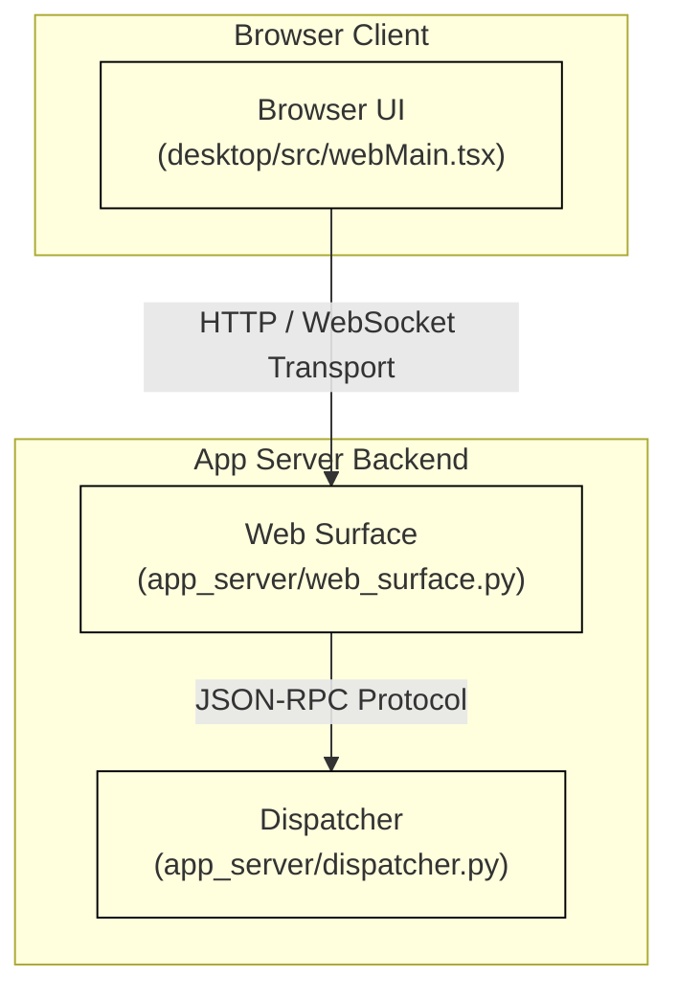
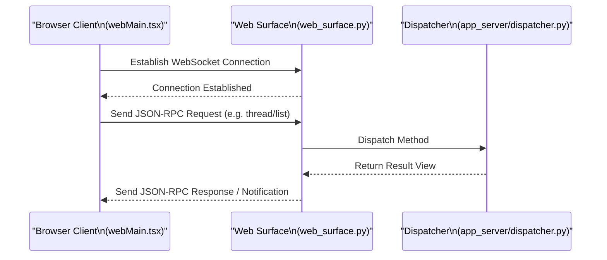
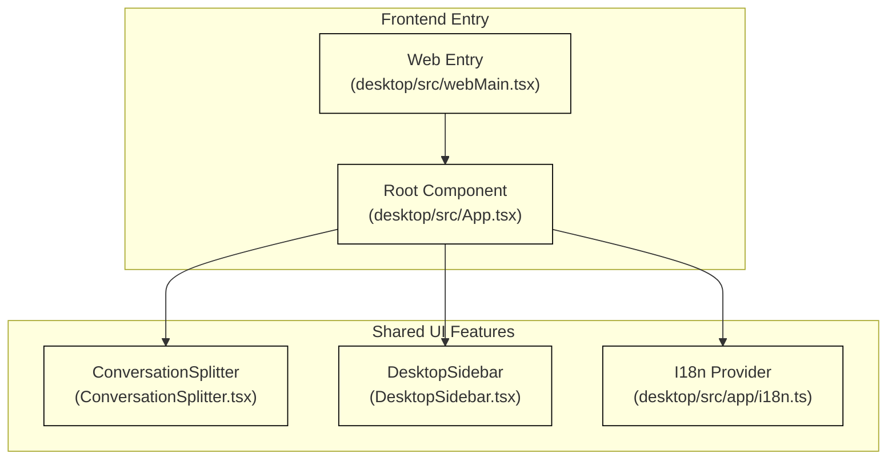
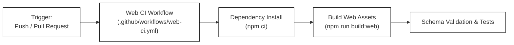

<!-- source: DeepWiki mcp.deepwiki.com · repo HKUDS/DeepCode · page 3.5 Web Workbench · fetched 2026-11-09 -->

# Web Workbench

Relevant source files

The following files were used as context for generating this wiki page:

- [.github/actions/ci-scope/action.yml](.github/actions/ci-scope/action.yml)
- [.github/workflows/linting.yaml](.github/workflows/linting.yaml)
- [.github/workflows/web-ci.yml](.github/workflows/web-ci.yml)
- [app_server/dispatcher.py](app_server/dispatcher.py)
- [desktop/README.md](desktop/README.md)
- [desktop/scripts/build-sidecar.py](desktop/scripts/build-sidecar.py)
- [desktop/src/App.tsx](desktop/src/App.tsx)
- [desktop/src/app/appearance.ts](desktop/src/app/appearance.ts)
- [desktop/src/app/i18n.ts](desktop/src/app/i18n.ts)
- [desktop/src/app/useAppearance.ts](desktop/src/app/useAppearance.ts)
- [desktop/src/features/thread/ConversationSplitter.module.css](desktop/src/features/thread/ConversationSplitter.module.css)
- [desktop/src/features/thread/ConversationSplitter.test.tsx](desktop/src/features/thread/ConversationSplitter.test.tsx)
- [desktop/src/features/thread/ConversationSplitter.tsx](desktop/src/features/thread/ConversationSplitter.tsx)
- [desktop/src/features/thread/conversationWidthResize.test.ts](desktop/src/features/thread/conversationWidthResize.test.ts)
- [desktop/src/features/thread/conversationWidthResize.ts](desktop/src/features/thread/conversationWidthResize.ts)
- [desktop/src/generated/app-server.ts](desktop/src/generated/app-server.ts)
- [protocol/app-server.schema.json](protocol/app-server.schema.json)
- [scripts/ci/requirements.in](scripts/ci/requirements.in)
- [tests/test_desktop_release_scripts.py](tests/test_desktop_release_scripts.py)

The Web Workbench provides browser-based access to the DeepCode interface. It bridges standard web browsers to the local App Server using WebSocket and HTTP transport layers, sharing the core React UI components with the Tauri desktop workbench.

---

## 1. Overview and Server Surface

The Web Workbench is initialized via the CLI command handled in `cli/web_cli.py`, which provisions or connects to the local background service and launches the embedded or standalone HTTP/WebSocket server defined in `app_server/web_surface.py`. The server exposes static assets from `app_server/web_assets` [desktop/scripts/build-sidecar.py:25-25]() and upgrades client connections for real-time JSON-RPC messaging.

Sources: [desktop/scripts/build-sidecar.py:25-25](), [app_server/dispatcher.py:1-58]()

---

## 2. WebSocket Transport and RPC Protocol

Client-server communication over the web surface relies on a persistent WebSocket connection that multiplexes canonical JSON-RPC messages [protocol/app-server.schema.json:1-23](). The dispatcher in `app_server/dispatcher.py` handles method routing for projects, threads, turns, models, and skills, validating incoming parameters and translating domain errors into standard RPC error codes.

Sources: [app_server/dispatcher.py:1-76](), [protocol/app-server.schema.json:1-23]()

---

## 3. Frontend Shell and React Integration

The web frontend uses a shared React shell located under the desktop/web source tree. Entry point `desktop/src/webMain.tsx` mounts the core `<App />` component [desktop/src/App.tsx:70-75]() alongside i18n configurations [desktop/src/app/i18n.ts:24-30]() and appearance/theme contexts [desktop/src/app/appearance.ts:31-52](). Because the UI is decoupled from Tauri native bindings when running in `web` mode, it communicates strictly through the JSON-RPC WebSocket client contract [desktop/src/generated/app-server.ts:88-92]().

Sources: [desktop/src/App.tsx:70-124](), [desktop/src/app/i18n.ts:12-23](), [desktop/src/app/appearance.ts:31-52](), [desktop/src/generated/app-server.ts:88-92]()

---

## 4. Web CI/CD Workflow

Web workbench assets are validated, built, and packaged via the GitHub Actions workflow defined in `.github/workflows/web-ci.yml`. This workflow ensures that frontend compilation using Node.js, TypeScript type-checking against `app-server.schema.json`, and bundling rules succeed prior to releasing platform sidecars or Python distributions [desktop/README.md:27-40]().

Sources: [.github/workflows/web-ci.yml:1-35](), [desktop/README.md:27-40]()

---

