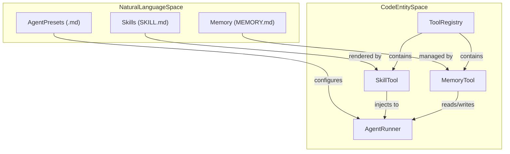
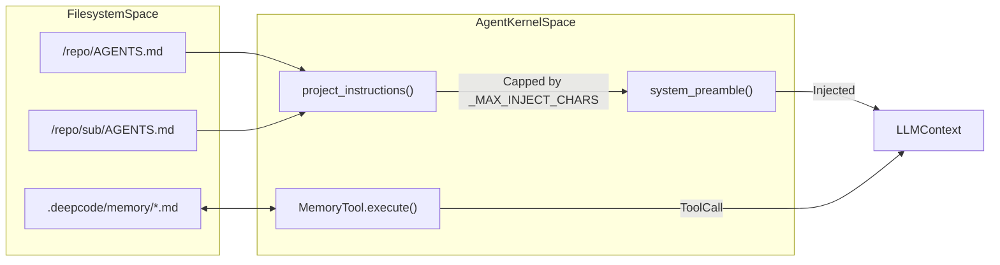

<!-- source: DeepWiki mcp.deepwiki.com · repo HKUDS/DeepCode · page 4 Skills, Memory, and Agent Presets · fetched 2026-11-09 -->

# Skills, Memory, and Agent Presets

Relevant source files

The following files were used as context for generating this wiki page:

- [MANIFEST.in](MANIFEST.in)
- [core/agent_presets/__init__.py](core/agent_presets/__init__.py)
- [core/agent_presets/builtin/code-reader.md](core/agent_presets/builtin/code-reader.md)
- [core/agent_presets/builtin/minimal.md](core/agent_presets/builtin/minimal.md)
- [core/agent_runtime/tools/base.py](core/agent_runtime/tools/base.py)
- [core/application/skill_service.py](core/application/skill_service.py)
- [core/domain/execution_security.py](core/domain/execution_security.py)
- [core/harness/memory.py](core/harness/memory.py)
- [core/harness/skills.py](core/harness/skills.py)
- [core/loop/autodream.py](core/loop/autodream.py)
- [core/mcp/tools.py](core/mcp/tools.py)
- [core/skills/__init__.py](core/skills/__init__.py)
- [core/skills/builtin/skill-creator/scripts/quick_validate.py](core/skills/builtin/skill-creator/scripts/quick_validate.py)
- [core/skills/catalog.py](core/skills/catalog.py)
- [core/skills/management.py](core/skills/management.py)
- [core/skills/metadata.py](core/skills/metadata.py)
- [core/skills/models.py](core/skills/models.py)
- [core/skills/prompting.py](core/skills/prompting.py)
- [core/skills/runtime.py](core/skills/runtime.py)
- [docs/SKILLS_PRODUCT_ARCHITECTURE.md](docs/SKILLS_PRODUCT_ARCHITECTURE.md)
- [setup.py](setup.py)
- [tests/test_autodream.py](tests/test_autodream.py)
- [tests/test_compaction_memory.py](tests/test_compaction_memory.py)
- [tests/test_memory.py](tests/test_memory.py)
- [tests/test_memory_layers.py](tests/test_memory_layers.py)
- [tests/test_tool_description_quality.py](tests/test_tool_description_quality.py)

DeepCode manages durable agent knowledge through three distinct layers: **Skills** (reusable playbooks), **Memory** (project-specific and persistent notes), and **Agent Presets** (named compositions of tools and personas). These systems ensure that agent intelligence is not limited to a single conversation but grows with the workspace and user preferences.

## Knowledge Layer Overview

DeepCode bridges the gap between static code and active reasoning by layering context across multiple subsystems:

Sources: [core/harness/memory.py:1-22](), [core/harness/skills.py:122-130]()

## Child Pages

### [Skills System](#4.1)
The Skills system provides a catalog of reusable "playbooks" stored under `core/skills/`. Skills are identified by a `SkillKey` and organized in a scope hierarchy (project, user, or system-builtin).
*   **Format**: Defined via `SKILL.md` files containing YAML frontmatter for metadata and Markdown for instructions [core/harness/skills.py:70-81]().
*   **Discovery**: The `SkillCatalog` handles discovery across multiple trust roots [core/harness/skills.py:13-17]().
*   **Execution**: Agents use the `SkillTool` to load instructions or search package resources dynamically [core/harness/skills.py:122-143]().
*   For details, see [Skills System](#4.1).

### [Agent Memory](#4.2)
DeepCode implements a two-layer memory system managed in `core/harness/memory.py` to provide standing guidance and cross-session persistence.
*   **Project Instructions**: Discovers `AGENTS.md`, `DEEPCODE.md`, or `CLAUDE.md` from the repository root down to the workspace [core/harness/memory.py:5-9]().
*   **Persistent Notes**: The `MemoryTool` allows agents to read and write to `<workspace>/.deepcode/memory/` [core/harness/memory.py:11-15]().
*   **Autodream**: A background consolidation pass that maintains the `MEMORY.md` index to survive session restarts [core/loop/autodream.py:1-15]().
*   For details, see [Agent Memory](#4.2).

### [Agent Presets](#4.3)
Agent Presets in `core/agent_presets/` define named compositions of tools, personas, and security policies.
*   **Presets**: Built-in presets like `minimal` and `code-reader` provide optimized starting points for different tasks [setup.py:92-94]().
*   **Discovery**: Presets are discovered across trust roots, including project-specific configurations and user-global settings.
*   **Snapshots**: The `ExecutionSecurityProfile` and related configuration snapshots capture the state of a preset for consistent execution within a `Turn` [core/domain/execution_security.py:185-201]().
*   For details, see [Agent Presets](#4.3).

Sources: [core/harness/memory.py:1-34](), [core/harness/skills.py:13-81](), [setup.py:92-94]()

## Memory and Instruction Flow

The following diagram illustrates how instructions and persistent memory interact with the filesystem and the agent prompt budget.

Sources: [core/harness/memory.py:43-57](), [core/harness/memory.py:112-114](), [core/harness/memory.py:180-182]()

## Summary of Durable Knowledge Layers

| Layer | Storage Location | Primary Purpose | Code Reference |
| :--- | :--- | :--- | :--- |
| **Skills** | `core/skills/builtin/`, `~/.deepcode/skills/` | Reusable capabilities and domain playbooks. | [core/harness/skills.py:29-68]() |
| **Project Memory** | `AGENTS.md` (Repo Root) | Standing rules for a specific codebase. | [core/harness/memory.py:36]() |
| **Persistent Memory** | `.deepcode/memory/MEMORY.md` | Learning user preferences and project facts. | [core/harness/memory.py:34]() |
| **Presets** | `core/agent_presets/builtin/` | Pre-configured toolsets and security modes. | [setup.py:92-94]() |

Sources: [core/harness/memory.py:1-22](), [core/harness/skills.py:29-68](), [setup.py:79-95]()

---

