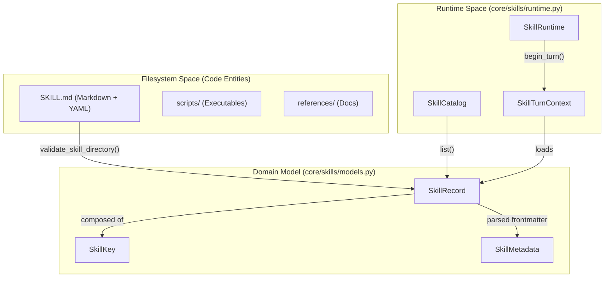
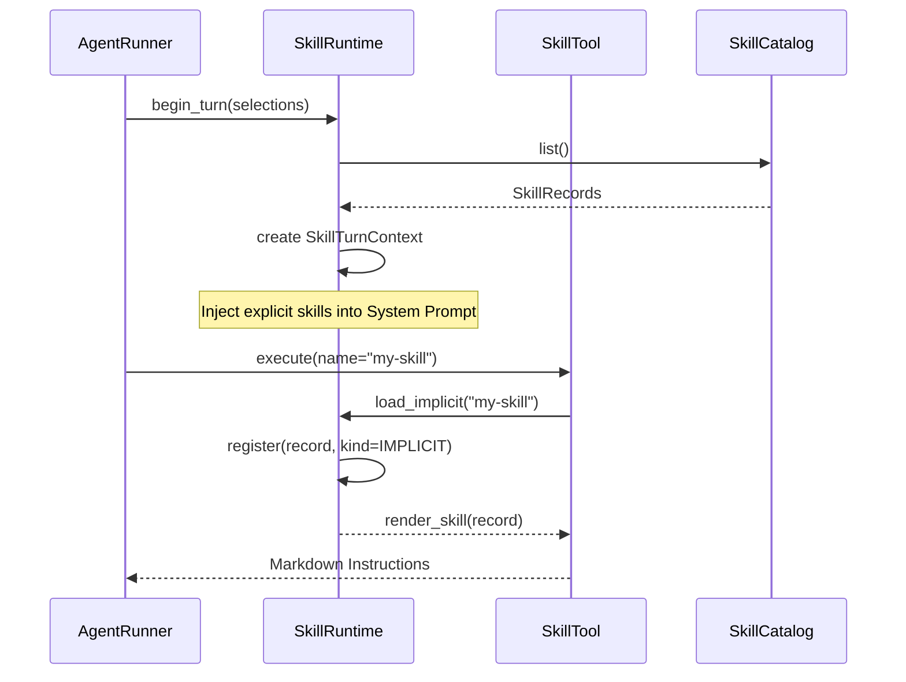

<!-- source: DeepWiki mcp.deepwiki.com · repo HKUDS/DeepCode · page 4.1 Skills System · fetched 2026-11-09 -->

# Skills System

Relevant source files

The following files were used as context for generating this wiki page:

- [core/application/skill_service.py](core/application/skill_service.py)
- [core/harness/skills.py](core/harness/skills.py)
- [core/plugins/mcp.py](core/plugins/mcp.py)
- [core/skills/__init__.py](core/skills/__init__.py)
- [core/skills/aggregation.py](core/skills/aggregation.py)
- [core/skills/builtin/skill-creator/scripts/init_skill.py](core/skills/builtin/skill-creator/scripts/init_skill.py)
- [core/skills/builtin/skill-creator/scripts/quick_validate.py](core/skills/builtin/skill-creator/scripts/quick_validate.py)
- [core/skills/capabilities.py](core/skills/capabilities.py)
- [core/skills/catalog.py](core/skills/catalog.py)
- [core/skills/management.py](core/skills/management.py)
- [core/skills/metadata.py](core/skills/metadata.py)
- [core/skills/models.py](core/skills/models.py)
- [core/skills/prompting.py](core/skills/prompting.py)
- [core/skills/runtime.py](core/skills/runtime.py)
- [docs/LOCAL_PLUGINS.md](docs/LOCAL_PLUGINS.md)
- [docs/SKILLS_PRODUCT_ARCHITECTURE.md](docs/SKILLS_PRODUCT_ARCHITECTURE.md)
- [tests/test_plugins.py](tests/test_plugins.py)

The Skills catalog (`core/skills/`) provides a mechanism for durable, reusable agent playbooks and specialized toolsets. Skills are collections of instructions and resources that can be injected into an agent's context to guide behavior for specific tasks or domains [docs/SKILLS_PRODUCT_ARCHITECTURE.md:1-6](). Unlike standard system prompts, Skills support a hierarchical scope (Project, User, System) and can narrow the agent's available toolset to ensure safety and focus [docs/SKILLS_PRODUCT_ARCHITECTURE.md:15-17]().

Sources: [docs/SKILLS_PRODUCT_ARCHITECTURE.md:1-17](), [core/skills/models.py:1-10]()

---

## Core Identity and Scope

A Skill is uniquely identified by a `SkillKey`, which encapsulates its scope, source root, absolute file path, and relative path [core/skills/models.py:166-173](). The system generates an opaque `skillId` (e.g., `sk_...`) using a SHA-256 hash over these fields [core/skills/models.py:176-189](). This prevents filesystem paths from leaking across protocol boundaries or to external clients [docs/SKILLS_PRODUCT_ARCHITECTURE.md:28-44]().

### Scope Hierarchy
DeepCode discovers Skills across three levels of trust, with higher-priority levels shadowing lower ones [docs/SKILLS_PRODUCT_ARCHITECTURE.md:47-54]():

1.  **Project**: Located in `.agents/skills/` (or compatibility roots `.deepcode/skills/`, `.claude/skills/`) within the workspace [core/skills/models.py:30-34](), [docs/SKILLS_PRODUCT_ARCHITECTURE.md:47-54]().
2.  **User**: Located in `~/.agents/skills/` (and user-level compatibility roots) for cross-project availability [docs/SKILLS_PRODUCT_ARCHITECTURE.md:52-53]().
3.  **System**: Built-in skills bundled with the DeepCode distribution [docs/SKILLS_PRODUCT_ARCHITECTURE.md:54]().

### Data Flow: Discovery to Runtime
This diagram bridges physical file entities to the core domain models and runtime classes.

**Figure 1: Skill Entity Mapping (Natural Language to Code Space)**

Sources: [core/skills/models.py:166-232](), [core/skills/runtime.py:46-62](), [core/skills/catalog.py:16-17]()

Sources: [core/skills/models.py:166-189](), [docs/SKILLS_PRODUCT_ARCHITECTURE.md:28-54]()

---

## The SKILL.md Format

Every Skill resides in a dedicated directory containing a mandatory `SKILL.md` file [core/harness/skills.py:79-81](). This file uses YAML frontmatter for structured metadata and Markdown for execution instructions.

### Frontmatter Fields
*   `name`: A lowercase slug identity that must match its parent directory name [docs/LOCAL_PLUGINS.md:47-49]().
*   `description`: A concise summary used by the Skill picker and agent catalog [core/skills/builtin/skill-creator/scripts/init_skill.py:26-28]().
*   `allowed-tools`: An optional sequence of tool names. When active, it restricts the agent to *only* these tools (plus the core `skill` tool) [core/skills/runtime.py:82-84]().

### Resource Directories
Skills can include optional subdirectories to supply supplementary assets without bloating the primary prompt [core/skills/builtin/skill-creator/scripts/init_skill.py:73-108]():
*   `scripts/`: Executable scripts (Python, Bash) that can be run or inspected [core/skills/builtin/skill-creator/scripts/init_skill.py:77-86]().
*   `references/`: Detailed documentation loaded into context dynamically via the `skill` tool [core/skills/builtin/skill-creator/scripts/init_skill.py:88-96]().
*   `assets/`: Boilerplate code, templates, or binary files intended for production output rather than context injection [core/skills/builtin/skill-creator/scripts/init_skill.py:98-106]().

Sources: [core/harness/skills.py:79-81](), [core/skills/builtin/skill-creator/scripts/init_skill.py:26-108](), [core/skills/runtime.py:82-84]()

---

## Local Plugin Packages (Agent Plugins 1.0)

DeepCode supports the **Agent Plugins 1.0** format, which packages Skills and Model Context Protocol (MCP) servers into distributable local plugin bundles [docs/LOCAL_PLUGINS.md:18-29]().

### Plugin Structure
A plugin directory contains a `plugin.json` manifest and a fixed `skills/` subdirectory [docs/LOCAL_PLUGINS.md:20-29](). It may also contain an optional `mcp.json` file for tool contributions [core/plugins/mcp.py:79-82]().

| Component | File Path | Role |
| :--- | :--- | :--- |
| **Manifest** | `plugin.json` | Metadata declaration (name, version, schema) [docs/LOCAL_PLUGINS.md:33-38](). |
| **Skills** | `skills/` | Fixed parent directory containing individual Skill subdirectories [docs/LOCAL_PLUGINS.md:41-43](). |
| **MCP** | `mcp.json` | Server declarations for stdio/HTTP MCP capabilities [core/plugins/mcp.py:108-112](). |

### Plugin-MCP Security Boundary
The `mcp.json` configuration is parsed and validated independently (`core/plugins/mcp.py`) [docs/LOCAL_PLUGINS.md:54-58](). Because literal `env` and `headers` values in `mcp.json` are distributable package data rather than a secure secret store, DeepCode issues warnings if plaintext credentials are detected, advising users to bind secrets via runtime configuration or `credentialEnv` instead [core/plugins/mcp.py:152-185](), [docs/LOCAL_PLUGINS.md:60-64]().

Sources: [docs/LOCAL_PLUGINS.md:18-71](), [core/plugins/mcp.py:79-185]()

---

## Skill Runtime and Progressive Disclosure

The `SkillRuntime` class governs skill resolution and progressive disclosure across agent turns [core/skills/runtime.py:90-92]().

### Invocation Flow
When an agent session begins a turn, a `SkillTurnContext` is instantiated [core/skills/runtime.py:64-88](). Skills enter the turn via two paths:
1.  **Explicit**: Pre-selected by the user prior to turn execution (e.g., via CLI `--skill` or the Desktop Composer).
2.  **Implicit**: Discovered and loaded by the agent mid-turn using the `SkillTool` [core/harness/skills.py:122-186]().

**Figure 2: Skill Invocation Sequence (User/Agent to Runtime Space)**

Sources: [core/skills/runtime.py:64-88](), [core/harness/skills.py:143-186](), [core/skills/prompting.py:25-29]()

Sources: [core/skills/runtime.py:90-150](), [core/harness/skills.py:122-186]()

---

## Management Services and CLI Commands

Cross-process local Skill management is centralized in `LocalSkillManager` and exposed through application services and the command line [core/skills/management.py:1-30](), [core/application/skill_service.py:84-85]().

### Application and Management Services
*   `LocalSkillManager`: Handles local catalog CRUD operations, imports, and directory validation under workspace roots [core/skills/management.py:29-51]().
*   `SkillService`: Acts as the frontend-neutral application adapter, enforcing project trust boundaries before exposing skill instructions [core/application/skill_service.py:84-149]().

### CLI Commands
*   `deepcode skill list`: Displays active, shadowed, and invalid skills in the current workspace [core/harness/skills.py:55-58]().
*   `deepcode plugin add <path>`: Registers a local plugin directory in the registry without copying source files [docs/LOCAL_PLUGINS.md:95-105]().
*   `deepcode skill-creator`: A built-in skill that uses `init_skill.py` to scaffold new skill directory structures and templates [core/skills/builtin/skill-creator/scripts/init_skill.py:5-14]().

Sources: [core/skills/management.py:29-178](), [core/application/skill_service.py:84-205](), [core/skills/builtin/skill-creator/scripts/init_skill.py:5-14](), [docs/LOCAL_PLUGINS.md:95-105]()

---

