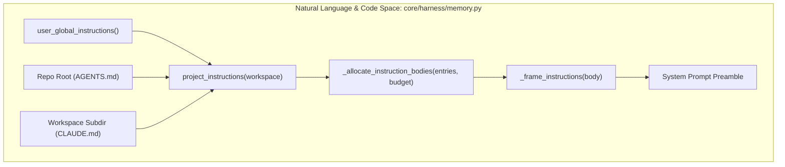
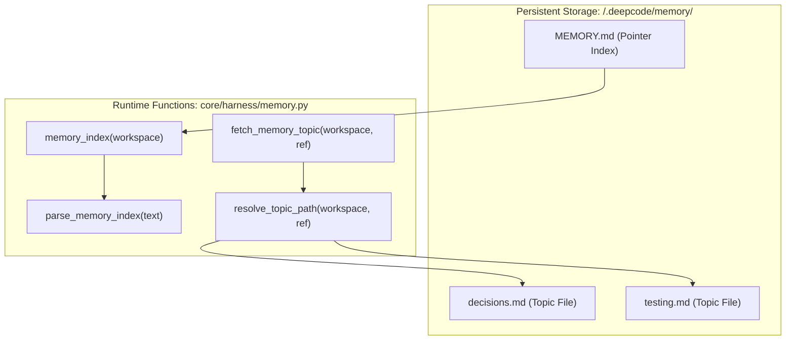
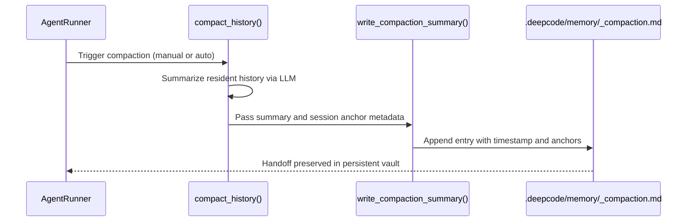

<!-- source: DeepWiki mcp.deepwiki.com · repo HKUDS/DeepCode · page 4.2 Agent Memory · fetched 2026-11-09 -->

# Agent Memory

Relevant source files

The following files were used as context for generating this wiki page:

- [core/agent_runtime/tools/base.py](core/agent_runtime/tools/base.py)
- [core/domain/execution_security.py](core/domain/execution_security.py)
- [core/harness/memory.py](core/harness/memory.py)
- [core/loop/autodream.py](core/loop/autodream.py)
- [core/mcp/tools.py](core/mcp/tools.py)
- [tests/test_autodream.py](tests/test_autodream.py)
- [tests/test_compaction_memory.py](tests/test_compaction_memory.py)
- [tests/test_manual_compact.py](tests/test_manual_compact.py)
- [tests/test_memory.py](tests/test_memory.py)
- [tests/test_memory_layers.py](tests/test_memory_layers.py)
- [tests/test_tool_description_quality.py](tests/test_tool_description_quality.py)

## Purpose and Scope

This page documents the agent memory architecture implemented in `core/harness/memory.py` and `core/loop/autodream.py`. DeepCode employs a two-layer memory system providing agents with standing project guidance (project instructions) and dynamic cross-session knowledge (persistent memory). This system guarantees that agents respect repository-specific conventions while retaining durable facts, architectural decisions, and compacted session handoffs across conversations [core/harness/memory.py:1-34]().

---

## 1. Project Instructions (Static Guidance Layer)

The static instruction layer discovers repository rules by traversing upward from the current workspace to the repository root, allowing nested subdirectories to inherit broad project instructions while incorporating local overrides [core/harness/memory.py:5-10]().

*   **Discovery Files**: The system searches for `AGENTS.md`, `DEEPCODE.md`, or `CLAUDE.md` in priority order [core/harness/memory.py:50]().
*   **Repository Root Markers**: Traversal stops at marker boundaries such as `.git` [core/harness/memory.py:53]().
*   **User-Global Rules**: Standing personal instructions located at user-level paths (`~/.deepcode/AGENTS.md` or `~/.claude/CLAUDE.md`) are loaded as a baseline [core/harness/memory.py:56]().
*   **Exclusions**: Instruction files matching glob patterns specified in `DEEPCODE_INSTRUCTION_EXCLUDES` are filtered out via `_instruction_excluded` [core/harness/memory.py:64-126]().

**Sources:** [core/harness/memory.py:5-10](), [core/harness/memory.py:38-126](), [core/harness/memory.py:159-178]()

---

## 2. Persistent Memory and Pointer Index Architecture

Persistent memory lives inside `<workspace>/.deepcode/memory/` and is structured into three layers [core/harness/memory.py:11-28]():

1.  **The Pointer Index (`MEMORY.md`)**: Injected into the system prompt every turn, capped at `_MAX_INDEX_LINES` (200 lines) and `_MAX_INDEX_BYTES` (25,000 bytes) [tests/test_memory_layers.py:66-70](). It holds pointers formatted as `- [Title](topic.md) — hook` where lines exceeding `_POINTER_MAX_CHARS` (150 chars) are treated as raw prose facts rather than pointers [tests/test_memory_layers.py:76-96]().
2.  **Topic Files**: Detailed Markdown files stored in the same directory, read on-demand via `fetch_memory_topic` [core/harness/memory.py:23-24]().
3.  **Consolidation Pass**: Offline processing (`consolidate_memory_index`) that reorganizes pointers and purges stale facts [core/harness/memory.py:25-27]().

**Sources:** [core/harness/memory.py:11-28](), [tests/test_memory_layers.py:66-96]()

---

## 3. MemoryTool Operations and Security

Agents manipulate persistent memory through the `MemoryTool` class [core/harness/memory.py:32](). 

| Action | Code Function / Handler | Description |
| :--- | :--- | :--- |
| `write` | `MemoryTool.execute(action="write", ...)` | Creates or overwrites a memory topic file or `MEMORY.md`. |
| `read` | `MemoryTool.execute(action="read", ...)` | Fetches the contents of a specific topic file. |
| `append` | `MemoryTool.execute(action="append", ...)` | Appends prose or pointers to an existing file. |
| `list` | `MemoryTool.execute(action="list", ...)` | Lists all files present in `.deepcode/memory/`. |
| `delete` | `MemoryTool.execute(action="delete", ...)` | Removes a topic file from storage. |

Security enforcement is handled by `resolve_topic_path` and path checks, which strictly reject path traversal attempts (e.g., `../escape.md`), absolute paths, and escaping symlinks [tests/test_memory_layers.py:153-188]().

**Sources:** [core/harness/memory.py:32](), [tests/test_memory.py:105-144](), [tests/test_memory_layers.py:153-188]()

---

## 4. Compaction-as-Memory Sink

To prevent valuable context from disappearing during history compaction, DeepCode implements a compaction-as-memory sink [tests/test_compaction_memory.py:1-7](). When `AgentRunner.compact_history` compresses a conversation, the handoff summary is automatically deposited into the memory vault via `write_compaction_summary` [tests/test_compaction_memory.py:30-44]().

*   **Anchor Metadata**: Deposited summaries include session keys, phases (`auto`/`manual`), timestamps, and volume metrics [tests/test_compaction_memory.py:30-44]().
*   **Opt-Out Control**: Controlled by `DEEPCODE_COMPACTION_MEMORY` (default enabled) [tests/test_compaction_memory.py:74-84]().

**Sources:** [tests/test_compaction_memory.py:1-85]()

---

## 5. Autodream Memory Consolidation Pass

Over numerous sessions, persistent memory accumulates duplicates and drift. The `autodream` module (`core/loop/autodream.py`) provides an offline consolidation loop [core/loop/autodream.py:1-15]().

*   **Execution Flow**: `consolidate_memory` instantiates a single-turn agent session using `build_agent_session`, supplying the specialized prompt `_CONSOLIDATE_PROMPT` restricted exclusively to the `memory` tool [core/loop/autodream.py:26-90]().
*   **Pass Steps**: Orient (`memory list`) → Gather (`memory read`) → Consolidate (merge/prune) → Rewrite (`MEMORY.md`) [core/loop/autodream.py:26-34]().
*   **Result Metrics**: Returns an `AutodreamResult` containing `notes_before`, `notes_after`, summary, and `index_consolidated` status [core/loop/autodream.py:37-46]().

**Sources:** [core/loop/autodream.py:1-104](), [tests/test_autodream.py:1-66]()

---

