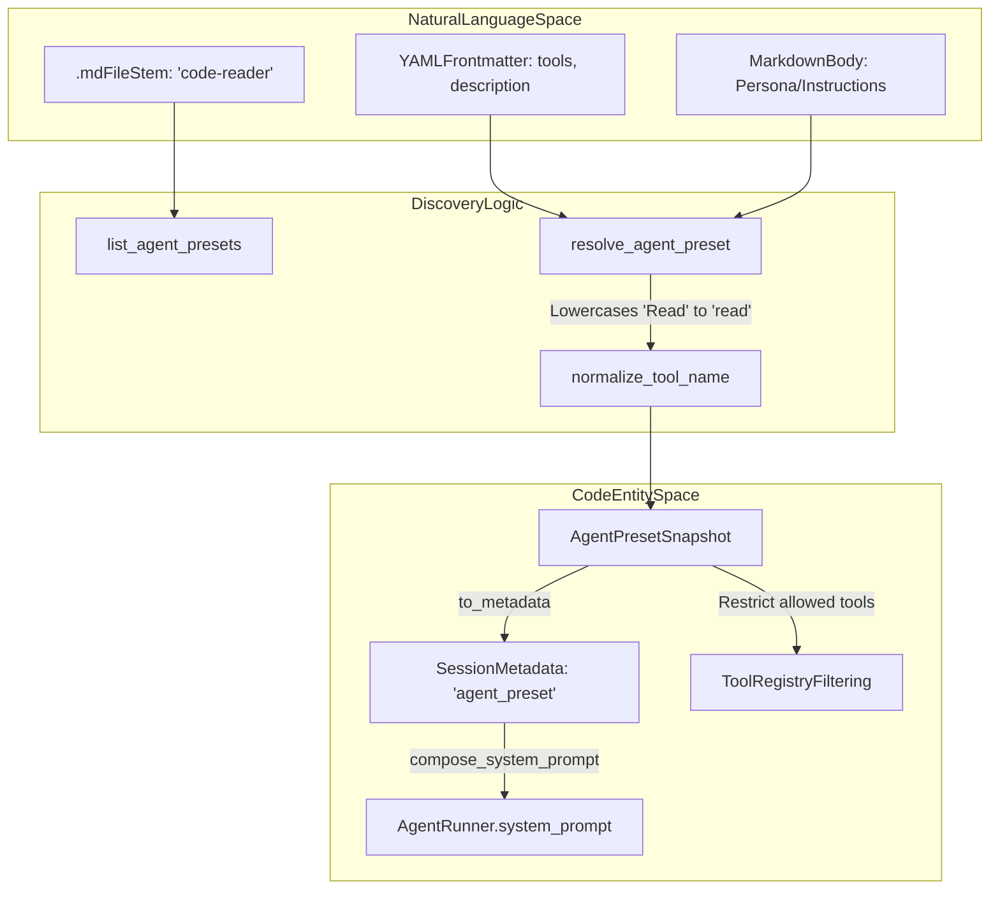
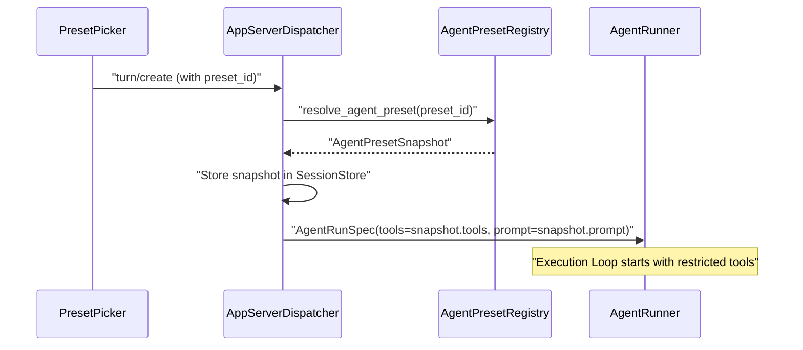

<!-- source: DeepWiki mcp.deepwiki.com · repo HKUDS/DeepCode · page 4.3 Agent Presets · fetched 2026-11-09 -->

# Agent Presets

Relevant source files

The following files were used as context for generating this wiki page:

- [MANIFEST.in](MANIFEST.in)
- [core/agent_presets/__init__.py](core/agent_presets/__init__.py)
- [core/agent_presets/builtin/code-reader.md](core/agent_presets/builtin/code-reader.md)
- [core/agent_presets/builtin/minimal.md](core/agent_presets/builtin/minimal.md)
- [desktop/src/assets/flaticon/README.md](desktop/src/assets/flaticon/README.md)
- [desktop/src/assets/flaticon/robot.png](desktop/src/assets/flaticon/robot.png)
- [desktop/src/features/presets/PresetPicker.module.css](desktop/src/features/presets/PresetPicker.module.css)
- [desktop/src/features/presets/PresetPicker.test.tsx](desktop/src/features/presets/PresetPicker.test.tsx)
- [desktop/src/features/presets/PresetPicker.tsx](desktop/src/features/presets/PresetPicker.tsx)
- [desktop/src/features/presets/usePresetCatalog.ts](desktop/src/features/presets/usePresetCatalog.ts)
- [setup.py](setup.py)
- [tests/test_agent_presets.py](tests/test_agent_presets.py)

The Agent Preset system in `core/agent_presets/` provides a mechanism for defining named configurations that compose a specific **Persona** (system instructions) with a restricted or specialized **Tool Set** [core/agent_presets/__init__.py:1-14](). Presets allow users to switch between different agent "personalities"—such as a read-only investigator or a full-access developer—without manually configuring permissions or prompts for every session [tests/test_agent_presets.py:1-17]().

This leaf page details the preset discovery logic across trust roots, Markdown+YAML frontmatter format, mechanical tool name normalization, durable snapshot lifecycles, built-in presets (`minimal` and `code-reader`), and Python packaging configuration via `MANIFEST.in` and `setup.py` [core/agent_presets/__init__.py:1-34](), [MANIFEST.in:31](), [setup.py:94]().

## Core Architecture and Discovery

The system is designed around **Discovery**, **Normalization**, and **Snapshotting**. Presets are defined as Markdown files with YAML frontmatter, allowing for easy portability and compatibility with foreign dialects like Claude Code [tests/test_agent_presets.py:86-99]().

### Preset Discovery and Trust Roots
DeepCode discovers presets by walking a hierarchy of trust-ranked roots [tests/test_agent_presets.py:5-7](). When duplicate IDs are found, the nearest root to the project wins [tests/test_agent_presets.py:74-84]().

1.  **Project**: `.agents/presets/` (or legacy directories) within the workspace [tests/test_agent_presets.py:76-77, 107-112]().
2.  **User**: `~/.agents/presets/` or paths rooted in `DEEPCODE_HOME` [tests/test_agent_presets.py:43-47, 110-112]().
3.  **System/Built-in**: Bundled presets shipped within the Python package at `core/agent_presets/builtin/` [setup.py:94](), [tests/test_agent_presets.py:61-71]().

### Package Distribution via MANIFEST and setup.py
To ensure built-in presets are correctly bundled into source distributions and binary builds, package manifests explicitly declare asset inclusion rules:
*   `MANIFEST.in` includes `recursive-include core/agent_presets/builtin *` [MANIFEST.in:31]().
*   `setup.py` designates package data under `core.agent_presets`: `["builtin/*.md"]` [setup.py:94]().

**Figure 1: Natural Language Space to Code Entity Space**

Sources: [core/agent_presets/__init__.py](), [tests/test_agent_presets.py:31-39, 138-144, 167-176](), [setup.py:94](), [MANIFEST.in:31]()

## File Format and Dialect Normalization

Presets use a Markdown format where the file stem (e.g., `minimal.md`) acts as the unique identifier [tests/test_agent_presets.py:105-117](). Frontmatter cannot override the file stem ID, protecting against trust spoofing [tests/test_agent_presets.py:19-20]().

### YAML Frontmatter
The frontmatter defines the agent's capabilities:
*   **name**: The display name shown in UIs [tests/test_agent_presets.py:116]().
*   **tools**: A list of allowed tool names, `[]` for no tools, or `'*'` for all tools [tests/test_agent_presets.py:146-160]().
*   **description**: A short summary of the preset's purpose [tests/test_agent_presets.py:79]().

### Tool Name Normalization
To maintain interoperability with Claude Code, DeepCode implements `normalize_tool_name`. It mechanically transforms TitleCase tool names into the snake_case used by the DeepCode `ToolRegistry` [tests/test_agent_presets.py:86-99, 138-144]().

| Foreign Dialect (Claude Code) | DeepCode Native |
| :--- | :--- |
| `Read` | `read` |
| `WebFetch` | `web_fetch` |
| `bash` | `bash` |
| `mcp__github__createIssue` | `mcp__github__createIssue` (Verbatim) |

Sources: [tests/test_agent_presets.py:138-144, 86-99]()

## Built-in Presets

DeepCode ships with two canonical presets under `core/agent_presets/builtin/` [tests/test_agent_presets.py:67-71]().

| Preset ID | Purpose | Tools |
| :--- | :--- | :--- |
| `minimal` | A lightweight agent with basic file access (`read`, `write`, `edit`, `bash`, `grep`, `glob`) [core/agent_presets/builtin/minimal.md:1-9](). | `read`, `write`, `edit`, `bash`, `grep`, `glob` |
| `code-reader` | A safe, non-mutating investigator for code exploration [core/agent_presets/builtin/code-reader.md:1-11](). | `read`, `grep`, `glob`, `skill` |

Sources: [core/agent_presets/builtin/minimal.md:1-9](), [core/agent_presets/builtin/code-reader.md:1-11](), [tests/test_agent_presets.py:67-71]()

## Implementation Details

### AgentPresetSnapshot Lifecycle
The `AgentPresetSnapshot` class handles the transition from static configuration to active session state [tests/test_agent_presets.py:167-170]().

*   **Metadata Storage**: Snapshots are serialized using `to_metadata()` and stored under the `METADATA_KEY` (`agent_preset`) on the canonical session [core/agent_presets/__init__.py:60-61, 132-139]().
*   **Prompt Composition**: The `compose_system_prompt(base)` method appends the preset's persona to the system's base instructions or replaces them based on `prompt_mode` [core/agent_presets/__init__.py:169-176]().
*   **Locking**: In the Desktop UI, once a thread has its first `Turn`, the preset is locked and cannot be changed [desktop/src/features/presets/PresetPicker.tsx:10-11, 74]().

### UI Integration: PresetPicker
The Desktop application uses the `PresetPicker` component and `usePresetCatalog` hook to allow users to select an agent persona before starting a conversation [desktop/src/features/presets/PresetPicker.tsx:30-37](), [desktop/src/features/presets/usePresetCatalog.ts:30-34]().

**Figure 2: Preset Selection to Runtime Injection**

Sources: [desktop/src/features/presets/PresetPicker.tsx:63-66](), [core/agent_presets/__init__.py](), [tests/test_agent_presets.py:12-16](), [desktop/src/features/presets/usePresetCatalog.ts:82-97]()

### Error Handling
The system distinguishes between two error kinds:
1.  **UnknownPresetError**: Raised when a requested ID is not found in any trust root. The error message includes the available roster to aid debugging [tests/test_agent_presets.py:132-136]().
2.  **BrokenPresetError**: Raised when a file exists but is malformed (e.g., invalid YAML). Broken presets are listed in the roster with their error reason but cannot be used to start a session [tests/test_agent_presets.py:119-130](), [desktop/src/features/presets/PresetPicker.tsx:57-59]().

Sources: [core/agent_presets/__init__.py:68-85](), [tests/test_agent_presets.py:34-35, 119-136]()

---

