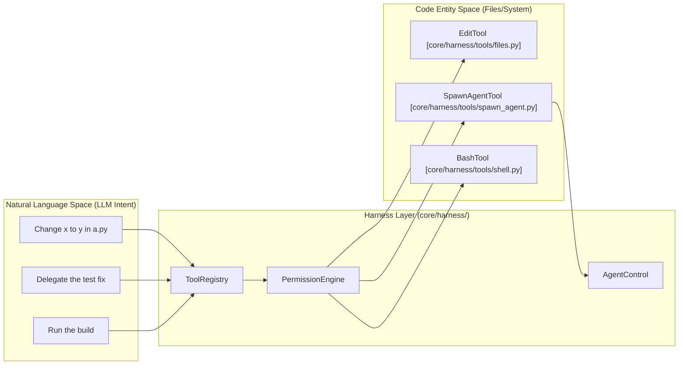
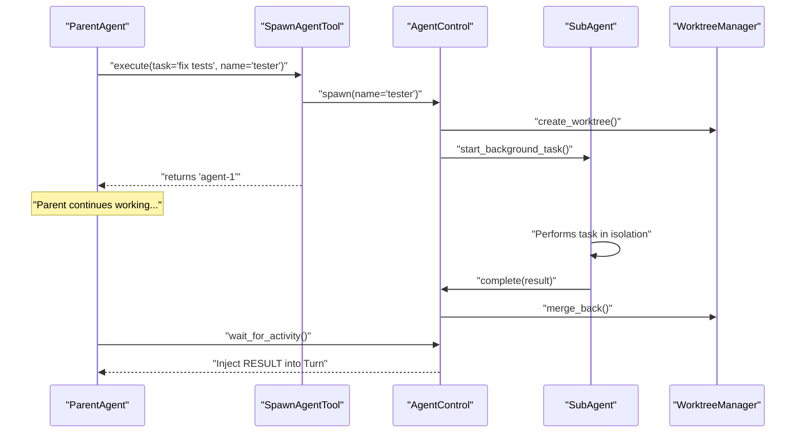

<!-- source: DeepWiki mcp.deepwiki.com · repo HKUDS/DeepCode · page 5 Agent Harness and Tools · fetched 2026-11-09 -->

# Agent Harness and Tools

Relevant source files

The following files were used as context for generating this wiki page:

- [core/agent_setup.py](core/agent_setup.py)
- [core/harness/agents/control.py](core/harness/agents/control.py)
- [core/harness/agents/structured_result.py](core/harness/agents/structured_result.py)
- [core/harness/collaboration.py](core/harness/collaboration.py)
- [core/harness/permissions.py](core/harness/permissions.py)
- [core/harness/snapshot.py](core/harness/snapshot.py)
- [core/harness/tools/__init__.py](core/harness/tools/__init__.py)
- [core/harness/tools/plan.py](core/harness/tools/plan.py)
- [core/harness/tools/spawn_agent.py](core/harness/tools/spawn_agent.py)
- [core/harness/tools/user_input.py](core/harness/tools/user_input.py)
- [tests/test_collaboration.py](tests/test_collaboration.py)
- [tests/test_harness_permissions.py](tests/test_harness_permissions.py)
- [tests/test_native_file_tools.py](tests/test_native_file_tools.py)
- [tests/test_skills.py](tests/test_skills.py)
- [tests/test_snapshot.py](tests/test_snapshot.py)
- [tests/test_spawn_agent.py](tests/test_spawn_agent.py)
- [tests/test_subagent_composition.py](tests/test_subagent_composition.py)
- [tests/test_subagent_conversation.py](tests/test_subagent_conversation.py)
- [tests/test_subagent_late_result.py](tests/test_subagent_late_result.py)

The agent harness layer (`core/harness/`) provides the execution environment where the LLM interacts with the physical world. It translates high-level model intents into concrete actions—such as editing files, running shell commands, or spawning sub-agents—while enforcing a strict security and permission boundary.

## Harness Architecture

The harness bridges the "Natural Language Space" (where the LLM operates) and the "Code Entity Space" (where files and processes exist). It uses a `ToolRegistry` to expose capabilities to the `AgentSession`.

### Mapping Space: Model Intent to Code Entities

Sources: [core/agent_setup.py:34-51](), [core/harness/tools/__init__.py:48-154](), [core/harness/permissions.py:161-196]()

---

## Native Tool Suite

DeepCode provides a suite of native tools optimized for reliability and workspace safety. Unlike generic MCP tools, these are tightly integrated with the harness's fuzzy matching and path fencing logic.

*   **File Operations**: `ReadTool`, `WriteTool`, and `EditTool` provide the primary interface for codebase modification [core/harness/tools/files.py](). The `EditTool` uses a fuzzy replacement engine to handle whitespace and indentation drift [core/harness/tools/replace.py:7-9]().
*   **Shell and Search**: `BashTool` provides terminal access with output capping [core/harness/tools/shell.py](), while `GrepTool` and `GlobTool` enable high-speed codebase navigation [core/harness/tools/search.py]().
*   **Context Management**: `MemoryTool` manages persistent project notes in `MEMORY.md` [core/harness/memory.py](), and `UpdatePlanTool` allows the agent to track multi-step progress [core/harness/tools/plan.py]().

For details, see [Native Tool Suite](#5.1).

Sources: [core/harness/tools/__init__.py:1-45](), [core/agent_setup.py:57-59]()

---

## Sub-Agent Spawning and Collaboration

DeepCode supports model-driven concurrent delegation via the `AgentControl` interface. This allows a parent agent to spawn specialized sub-agents for parallel tasks.

### Collaboration Lifecycle

Sources: [core/harness/agents/control.py:1-21](), [core/harness/tools/spawn_agent.py:1-12]()

*   **Concurrency**: Up to `MAX_CONCURRENT_SUBAGENTS` (default 5) can run simultaneously [core/harness/agents/control.py:44]().
*   **Isolation**: Sub-agents typically run in isolated git worktrees to prevent conflicting file writes [core/harness/agents/control.py:15-17]().
*   **Structured Results**: Parents can enforce an `output_schema` to ensure sub-agents return machine-readable JSON [core/harness/agents/structured_result.py:30-35]().

For details, see [Sub-Agent Spawning and Collaboration](#5.2).

Sources: [core/harness/agents/control.py:132-167](), [core/harness/tools/spawn_agent.py:100-154]()

---

## Harness Hook System

The `HooksEngine` allows external scripts to intercept and modify the agent's execution loop. This is used for environment discovery, observability, and custom policy enforcement.

*   **Lifecycle Events**: Hooks fire at `PreToolUse`, `PostToolUse`, `SessionStart`, and `Stop` [core/harness/hooks/__init__.py:1-6]().
*   **Intervention**: A hook can `block` an action, `updated_input` to rewrite tool arguments, or inject `additional_contexts` into the agent's history [core/agent_setup.py:83-120]().
*   **Discovery**: The system automatically scans for `hooks.json` in the workspace root [core/harness/hooks/discovery.py]().

For details, see [Harness Hook System](#5.3).

Sources: [core/harness/hooks/__init__.py:1-33](), [core/agent_setup.py:62-81]()

---

## Code Mode

Code Mode is a specialized tool (`CodeModeTool`) that allows the LLM to write and execute a Python script to orchestrate other tools. This enables complex, batched operations (like "refactor all 50 files") in a single turn.

*   **Policy Enforcement**: Every tool call made by the Python script is still routed through the `PermissionEngine` and `HooksEngine` [core/agent_setup.py:70-75]().
*   **Approval**: If the code attempts an action requiring permission (decision `ask`), the execution pauses to invoke the `approval_callback` [core/agent_setup.py:95-112]().

Sources: [core/agent_setup.py:62-134]()

---

