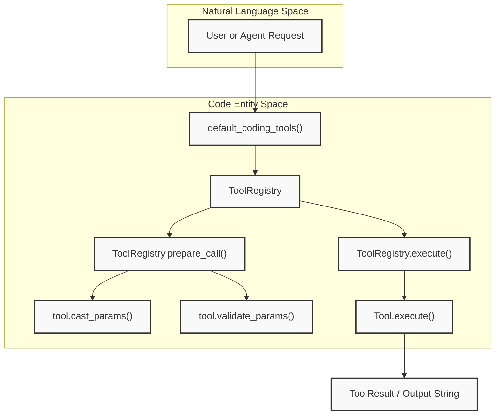
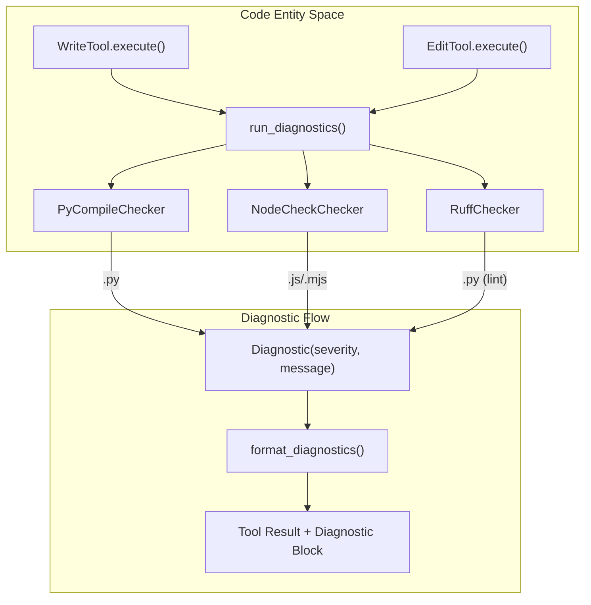
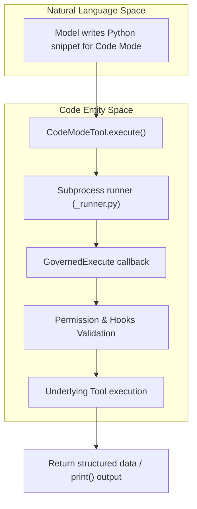

<!-- source: DeepWiki mcp.deepwiki.com · repo HKUDS/DeepCode · page 5.1 Native Tool Suite · fetched 2026-11-09 -->

# Native Tool Suite

Relevant source files

The following files were used as context for generating this wiki page:

- [core/agent_runtime/tools/registry.py](core/agent_runtime/tools/registry.py)
- [core/harness/agents/external_backend.py](core/harness/agents/external_backend.py)
- [core/harness/code_mode/tool.py](core/harness/code_mode/tool.py)
- [core/harness/collaboration.py](core/harness/collaboration.py)
- [core/harness/env_sanitize.py](core/harness/env_sanitize.py)
- [core/harness/hooks/execution.py](core/harness/hooks/execution.py)
- [core/harness/permissions.py](core/harness/permissions.py)
- [core/harness/tools/__init__.py](core/harness/tools/__init__.py)
- [core/harness/tools/diagnostics.py](core/harness/tools/diagnostics.py)
- [core/harness/tools/files.py](core/harness/tools/files.py)
- [core/harness/tools/plan.py](core/harness/tools/plan.py)
- [core/harness/tools/replace.py](core/harness/tools/replace.py)
- [core/harness/tools/shell.py](core/harness/tools/shell.py)
- [core/harness/tools/user_input.py](core/harness/tools/user_input.py)
- [tests/test_collaboration.py](tests/test_collaboration.py)
- [tests/test_command_guard_egress.py](tests/test_command_guard_egress.py)
- [tests/test_diagnostics.py](tests/test_diagnostics.py)
- [tests/test_env_sanitize.py](tests/test_env_sanitize.py)
- [tests/test_fuzzy_replace.py](tests/test_fuzzy_replace.py)
- [tests/test_harness_permissions.py](tests/test_harness_permissions.py)
- [tests/test_loop_detector.py](tests/test_loop_detector.py)
- [tests/test_native_file_tools.py](tests/test_native_file_tools.py)
- [tests/test_semantic_hint.py](tests/test_semantic_hint.py)
- [tests/test_shell_search_tools.py](tests/test_shell_search_tools.py)
- [tests/test_skills.py](tests/test_skills.py)
- [utils/loop_detector.py](utils/loop_detector.py)

The Native Tool Suite comprises a set of high-performance, built-in tools registered in `core/harness/tools/`. Unlike MCP-based tools which operate over a protocol boundary, these tools are implemented directly in Python using the `Tool` base class [core/harness/tools/__init__.py:4-9](). They provide the core primitives for file manipulation, shell execution, searching, and agent state management with built-in security fencing and reliability features like fuzzy string replacement and output capping.

## Core Architecture and Registration

Native tools are assembled into a `ToolRegistry` instance via the `default_coding_tools` factory function [core/harness/tools/__init__.py:48-57](). This registry is consumed by the `AgentSession` or runtime runner to expose capabilities to the LLM.

### Native Tool Map

| Tool Name | Implementation Class | Primary Responsibility |
| :--- | :--- | :--- |
| `read` | `ReadTool` | Line-numbered file reading with offset/limit [core/harness/tools/files.py:1] |
| `write` | `WriteTool` | Atomic file creation/overwrite with diagnostics |
| `edit` | `EditTool` | Fuzzy string replacement using matching strategies [core/harness/tools/__init__.py:7-9]() |
| `apply_patch` | `ApplyPatchTool` | Unified diff patch application |
| `bash` | `BashTool` | Sandboxed shell execution with interactive preflight [core/harness/tools/shell.py:1-22]() |
| `grep` | `GrepTool` | Fast regex-based content search [core/harness/tools/search.py:1] |
| `glob` | `GlobTool` | Recursive file pattern matching [core/harness/tools/search.py:1] |
| `web_fetch` | `WebFetchTool` | Web content retrieval [core/harness/tools/web.py:1] |
| `memory` | `MemoryTool` | Persistent project-level note management [core/harness/memory.py:1] |
| `update_plan`| `UpdatePlanTool` | Management of the agent's internal TODO list [core/harness/tools/plan.py:1] |
| `code` | `CodeModeTool` | Code mode subprocess orchestrator for multi-step batching [core/harness/code_mode/tool.py:98-143]() |

Sources: [core/harness/tools/__init__.py:48-154](), [core/agent_runtime/tools/registry.py:69-123]()

## File Manipulation, Patching, and Fuzzy Replace

The file tools (`read`, `write`, `edit`, `apply_patch`) resolve paths against the session workspace root. By default, `WriteTool`, `EditTool`, and `ApplyPatchTool` refuse to operate on paths outside this root unless the `ExecutionSecurityProfile` is set to `UNRESTRICTED` [core/harness/tools/__init__.py:94-116]().

### Fuzzy Edit Engine
The `EditTool` utilizes a sophisticated `replace` function that implements nine matching strategies to handle whitespace drift, indentation changes, and partial matches [core/harness/tools/replace.py:19-24](). This ensures that even if the agent provides an imprecise `old_string`, the edit can still succeed without triggering immediate failures.

### Post-Write Diagnostics Loop
After every `write` or `edit` operation, the suite runs a diagnostics loop to catch syntax errors immediately [core/harness/tools/diagnostics.py:1-5]().

Sources: [core/harness/tools/diagnostics.py:1-5](), [core/harness/tools/files.py:1-10](), [tests/test_diagnostics.py:93-119]()

## Bash Shell and Sandboxing

The `BashTool` executes shell commands within a platform-specific sandbox backend managed by `core/harness/sandbox.py` [core/harness/tools/shell.py:1-41]().

### Sandbox Backends
1. **macOS (Seatbelt):** Uses `sandbox-exec` with a deny-default policy, re-granting necessary syscalls and fencing writes to the workspace.
2. **Linux (Bubblewrap):** Uses `bwrap` for mount-namespace isolation and network unsharing.
3. **Windows (Job Object):** Provides process-tree isolation to ensure no orphaned descendants survive.

### Reliability and Security Controls
* **Interactive Preflight:** Refuses commands known to hang (e.g., `npm init` without `-y`) by checking against `_INTERACTIVE_SCAFFOLDS` [core/harness/tools/shell.py:45-66]().
* **Output Capping:** If output exceeds 30,000 characters (`_MAX_OUTPUT_CHARS`), it is spilled to a temporary file, and the agent receives a truncated preview with a file pointer [core/harness/tools/shell.py:42]().
* **Command Guard Integration:** `screen_all` (`core.harness.command_guard`) screens against destructive commands, remote script piping, and typosquatted package installs [core/harness/tools/shell.py:9-19]().
* **Environment Sanitization:** Optional credential scrubbing via `child_env` (`core.harness.env_sanitize`) prevents ambient API keys from leaking into shell execution streams [core/harness/env_sanitize.py:1-33]().

Sources: [core/harness/tools/shell.py:1-176](), [core/harness/env_sanitize.py:1-85]()

## Search, Web, and Code Mode Tools

### Search and Web Tools
* **GrepTool & GlobTool:** Provide recursive pattern matching and regular expression search across the workspace [core/harness/tools/search.py:1]().
* **WebFetchTool:** Allows the agent to query HTTP/HTTPS endpoints for external documentation or resources [core/harness/tools/web.py:1]().

### Code Mode (`CodeModeTool`)
`CodeModeTool` allows the agent to write a single Python program that invokes multiple tools as programmatic functions (`read()`, `write()`, `bash()`, etc.) [core/harness/code_mode/tool.py:1-143](). This runs inside a sandboxed subprocess (`_runner.py`), enabling loops, batching, and conditionals within a single conversational turn while routing each function call back through the parent's permission and hook layers.

Sources: [core/harness/code_mode/tool.py:1-143](), [core/harness/tools/__init__.py:48-154]()

## Specialized Tools

### Memory, Planning, and User Input
* **MemoryTool:** Persists cross-session notes under `.deepcode/memory/` [core/harness/tools/__init__.py:60-64]().
* **UpdatePlanTool:** Provides a structured mechanism for the agent to maintain an internal TODO list across turns [core/harness/tools/plan.py:1]().
* **RequestUserInputTool:** Conditionally registered when an interactive frontend is present (`ask_user` callback provided), allowing the agent to prompt human operators when blocked [core/harness/tools/user_input.py:1]().
* **SpawnAgentTool / WaitAgentTool:** Enables hierarchical delegation to sub-agents with strict tool allowlist validation [core/harness/tools/__init__.py:138-149]().

Sources: [core/harness/tools/__init__.py:60-154](), [core/harness/tools/user_input.py:1]()

---

