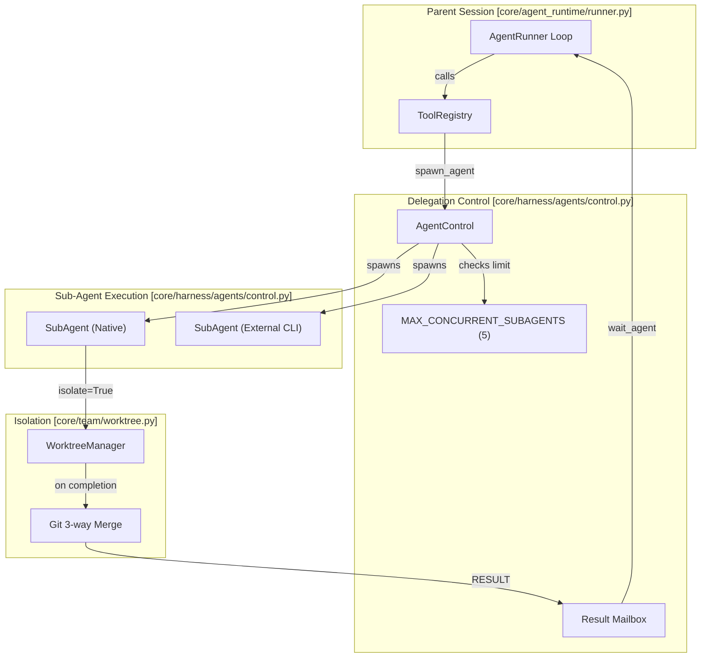
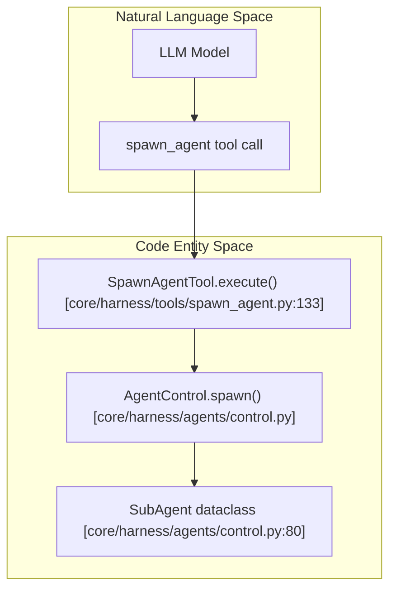
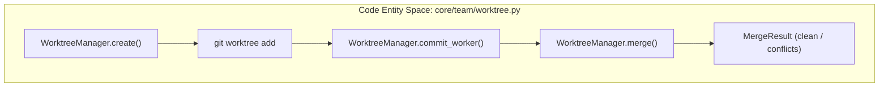
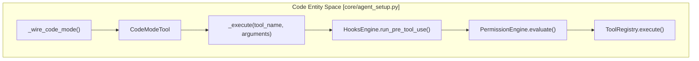

<!-- source: DeepWiki mcp.deepwiki.com · repo HKUDS/DeepCode · page 5.2 Sub-Agent Spawning and Collaboration · fetched 2026-11-09 -->

# Sub-Agent Spawning and Collaboration

Relevant source files

The following files were used as context for generating this wiki page:

- [cli/mcp_server.py](cli/mcp_server.py)
- [core/agent_setup.py](core/agent_setup.py)
- [core/harness/agents/__init__.py](core/harness/agents/__init__.py)
- [core/harness/agents/control.py](core/harness/agents/control.py)
- [core/harness/agents/structured_result.py](core/harness/agents/structured_result.py)
- [core/harness/code_mode/__init__.py](core/harness/code_mode/__init__.py)
- [core/harness/code_mode/_runner.py](core/harness/code_mode/_runner.py)
- [core/harness/tools/spawn_agent.py](core/harness/tools/spawn_agent.py)
- [core/team/__init__.py](core/team/__init__.py)
- [core/team/worktree.py](core/team/worktree.py)
- [tests/test_code_mode.py](tests/test_code_mode.py)
- [tests/test_mcp_server.py](tests/test_mcp_server.py)
- [tests/test_spawn_agent.py](tests/test_spawn_agent.py)
- [tests/test_subagent_composition.py](tests/test_subagent_composition.py)
- [tests/test_subagent_conversation.py](tests/test_subagent_conversation.py)
- [tests/test_subagent_late_result.py](tests/test_subagent_late_result.py)
- [tests/test_team_worktree.py](tests/test_team_worktree.py)

## Purpose and Scope
This page details DeepCode's sub-agent spawning, multi-agent collaboration, worktree isolation, structured result extraction, external backend adapters, code mode execution, and agent setup composition. DeepCode supports model-driven delegation, allowing a primary agent to spawn concurrent sub-agents for specialized subtasks [core/harness/agents/control.py:1-21](), execute python code blocks in code mode [core/agent_setup.py:65-79](), and enforce strict permissions and security postures across all agent boundaries.

---

## 1. Collaboration Architecture and Control Flow

Delegation is governed by `AgentControl` defined in `core/harness/agents/control.py`. Spawning a sub-agent is **non-blocking**: it launches a background asynchronous task, returns its identifier immediately, and coordinates concurrent executions up to a session limit (`MAX_CONCURRENT_SUBAGENTS`) [core/harness/agents/control.py:41-45]().

**Sources**: [core/harness/agents/control.py:1-45](), [core/harness/tools/spawn_agent.py:1-12](), [core/team/worktree.py:1-14]()

---

## 2. The Spawn Toolset and Agent Control

The `spawn_agent` tool and associated utilities are implemented in `core/harness/tools/spawn_agent.py` and `core/harness/agents/control.py`.

### Key Tool Parameters
- `name`: A short stable label for the subtask, acting as a deduplication key. Re-spawning an active or completed task name throws a `DuplicateAgentError` [core/harness/agents/control.py:65-68](), [core/harness/tools/spawn_agent.py:36-45]().
- `task`: Self-contained instructions for the sub-agent [core/harness/tools/spawn_agent.py:46-50]().
- `isolate`: Runs the sub-agent in an isolated git worktree with automatic merge-back and conflict detection (defaults to `True`) [core/harness/tools/spawn_agent.py:51-56]().
- `fork_turns`: Determines conversation inheritance (`none`, `all`, or last `N` turns) [core/harness/tools/spawn_agent.py:57-62]().
- `backend`: Specifies execution via `native`, `codex`, or `claude-code` [core/harness/tools/spawn_agent.py:63-73]().

**Sources**: [core/harness/tools/spawn_agent.py:36-154](), [core/harness/agents/control.py:79-112]()

---

## 3. Worktree Isolation (`core/team/worktree.py`)

Parallel isolation between workers is provided by `WorktreeManager` in `core/team/worktree.py`. Each worker checks out a separate `git worktree` off the base repository [core/team/worktree.py:1-8]().

### Merge and Conflict Detection
When a worker completes, `WorktreeManager.merge()` executes a git 3-way merge back into the base repository [core/team/worktree.py:69-103](). If overlapping edits occur on the same lines, git reports a content conflict, which is captured in a `MergeResult` rather than performing a silent overwrite [core/team/worktree.py:58-63](). Additionally, build artifacts and scratch directories (`.deepcode/`, `__pycache__/`, etc.) are ignored via local `.git/info/exclude` rules to prevent merge blockages [core/team/worktree.py:28-54]().

**Sources**: [core/team/worktree.py:1-165](), [tests/test_team_worktree.py:1-123]()

---

## 4. Structured Result Extraction and Composition

When a parent session requires structured data from a sub-agent rather than free-form prose, it supplies an `output_schema` [core/harness/agents/structured_result.py]().

- **Forced Capture Tool**: The sub-agent is registered with a `submit_result` tool whose input parameters mirror the provided JSON Schema [core/harness/agents/structured_result.py:22]().
- **Composition**: Sub-agents can be customized with an additional system prompt section (`persona`), a narrowed allowlist of tools (`tool_names`), and a structured output schema [core/harness/agents/control.py:85-90](). External backends reject these compositions loudly at spawn time rather than ignoring them [core/harness/agents/control.py:69-77]().

**Sources**: [core/harness/agents/control.py:79-112](), [tests/test_subagent_composition.py:1-110]()

---

## 5. External Backend Adapters

Delegation supports external CLI backends alongside the native Python runtime [core/harness/agents/control.py:69-77]().

| Backend | Driver / Implementation | Behavior |
| :--- | :--- | :--- |
| `native` | `AgentSession` | Full conversational support, shared environment, structured output schema, transcripts [core/agent_setup.py:1-7]() |
| `codex` | `CodexCli` | Invokes external `codex exec`, returns `--output-last-message` |
| `claude-code` | `ClaudeCodeCli` | Invokes external `claude -p`, parses JSON output for success status |

Environment variables matching sensitive patterns (`KEY`, `PASSWORD`, `TOKEN`) are scrubbed before invoking external CLI backends to prevent credential leakage [core/harness/agents/external_backend.py:42-47]().

**Sources**: [core/harness/agents/control.py:69-77]()

---

## 6. Code Mode Runner and Tool Wiring (`core/agent_setup.py`)

Code mode (`C5b`) allows the agent to execute a Python program that orchestrates file, search, and shell tools in a single turn [core/agent_setup.py:57-79]().

### Execution Flow in Code Mode
1. The model invokes the `code` tool with a Python snippet [core/agent_setup.py:125-136]().
2. Each internal tool call made by the script passes through the standard governance pipeline: `PreToolUse` hook evaluation -> permission check (`allow`/`deny`/`ask`) -> execution via `tool_registry` -> `PostToolUse` hook handling [core/agent_setup.py:86-123]().
3. This guarantees that code mode never bypasses security policies or approval callbacks [core/agent_setup.py:75-79]().

**Sources**: [core/agent_setup.py:65-136](), [tests/test_code_mode.py:1-100]()

---

## 7. Concurrency, Depth, and Safety Controls

To maintain system stability and bound resource usage, DeepCode enforces several safety invariants:
- **Concurrency Bound**: Active sub-agents are strictly capped by `MAX_CONCURRENT_SUBAGENTS` (default: 5) [core/harness/agents/control.py:41-45]().
- **Recursion Guard**: Sub-agent sessions are spawned with recursion disabled (`allow_spawn=False`), preventing infinite delegation trees (depth = 1) [core/harness/agents/control.py:19-21]().
- **Deduplication**: Re-spawning a task name or identical task text while running or completed raises a `DuplicateAgentError` [core/harness/agents/control.py:65-68](), [tests/test_spawn_agent.py:122-142]().

**Sources**: [core/harness/agents/control.py:41-77](), [tests/test_spawn_agent.py:61-142]()

---

