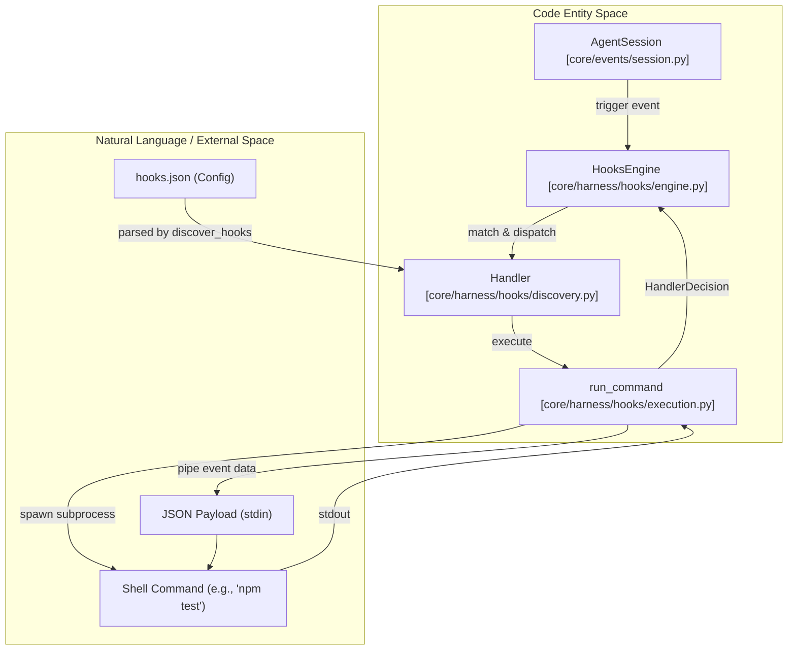
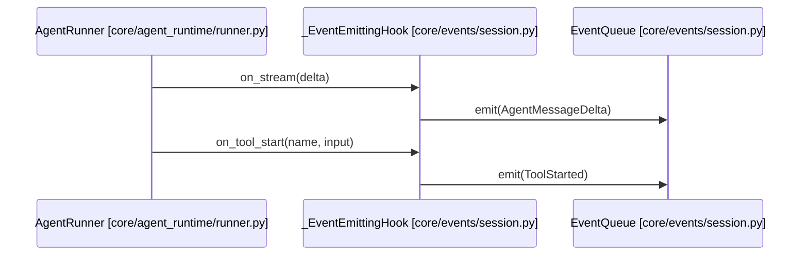

<!-- source: DeepWiki mcp.deepwiki.com · repo HKUDS/DeepCode · page 5.3 Harness Hook System · fetched 2026-11-09 -->

# Harness Hook System

Relevant source files

The following files were used as context for generating this wiki page:

- [core/agent_runtime/runner.py](core/agent_runtime/runner.py)
- [core/events/session.py](core/events/session.py)
- [core/harness/agents/external_backend.py](core/harness/agents/external_backend.py)
- [core/harness/code_mode/tool.py](core/harness/code_mode/tool.py)
- [core/harness/env_sanitize.py](core/harness/env_sanitize.py)
- [core/harness/hooks/__init__.py](core/harness/hooks/__init__.py)
- [core/harness/hooks/discovery.py](core/harness/hooks/discovery.py)
- [core/harness/hooks/engine.py](core/harness/hooks/engine.py)
- [core/harness/hooks/events.py](core/harness/hooks/events.py)
- [core/harness/hooks/execution.py](core/harness/hooks/execution.py)
- [core/harness/tools/shell.py](core/harness/tools/shell.py)
- [tests/test_command_guard_egress.py](tests/test_command_guard_egress.py)
- [tests/test_env_sanitize.py](tests/test_env_sanitize.py)
- [tests/test_hooks.py](tests/test_hooks.py)
- [tests/test_session_end_lifecycle.py](tests/test_session_end_lifecycle.py)
- [tests/test_shell_search_tools.py](tests/test_shell_search_tools.py)

The **Harness Hook System** is a Claude-Code-compatible pipeline located in `core/harness/hooks/` that enables external shell commands to intercept, block, rewrite, or augment agent behavior at key lifecycle seams [core/harness/hooks/__init__.py:1-11](). By providing a standard interface for external scripts, the system supports automated linting, security scanning, and custom permission policies without modifying the underlying agent kernel.

---

## Hook Pipeline Architecture

The system is organized into three primary layers: **Discovery**, **Engine**, and **Execution**. Hooks are discovered from configuration files, managed by a per-session engine, and executed as isolated subprocesses.

### Discovery Hook
The discovery process scans for `hooks.json` or `settings.json` files in a strict precedence order, allowing global (user) and local (project) overrides [core/harness/hooks/discovery.py:66-74]():
1. **User**: `~/.deepcode/hooks.json`
2. **Project**: `<workspace>/.deepcode/hooks.json`
3. **Compatibility**: `<workspace>/.claude/settings.json`

The `discover_hooks` function parses these files into `Handler` objects, which bind shell commands to specific lifecycle events [core/harness/hooks/discovery.py:77-98]().

### The Hooks Engine
The `HooksEngine` is instantiated once per session [core/harness/hooks/engine.py:88-102](). It serves as the dispatcher that matches events to the correct handlers and folds their decisions using defined rules [core/harness/hooks/engine.py:1-16]().

**Folding Logic**:
When multiple hooks fire for a single event, the engine folds their results:
* **Blocks**: If *any* hook returns a block signal, the action is blocked, and the first reason wins [core/harness/hooks/engine.py:35-42]().
* **Additional Contexts**: Accumulates all `additional_contexts` returned across all firing hooks [core/harness/hooks/engine.py:38]().
* **Updated Input**: Takes the `updated_input` rewrite from the *last* hook to successfully complete [core/harness/hooks/engine.py:39]().

### Execution and Composition
Hooks are executed via `run_command`, which feeds a JSON payload into the command's `stdin` and parses `stdout` for a `HandlerDecision` based on an exit-code protocol (exit 0 for valid JSON decision, exit 2 for blocking with stderr as the reason) [core/harness/hooks/execution.py:1-15]().

Title: Hook Pipeline Architecture Data Flow

Sources: [core/harness/hooks/discovery.py:1-98](), [core/harness/hooks/engine.py:1-125](), [core/harness/hooks/execution.py:1-112]()

---

## Lifecycle Events

The system supports a set of events mirroring the reference agent's vocabulary [core/harness/hooks/events.py:27-39]().

| Event Name | Trigger Point | Capability |
| :--- | :--- | :--- |
| `SessionStart` | When a session begins | Inject global context/instructions [core/harness/hooks/events.py:11](). |
| `UserPromptSubmit` | Every time the user sends a message | Block or augment the user's prompt [core/harness/hooks/events.py:12](). |
| `PreToolUse` | Before a tool (e.g., `Bash`) runs | Block execution or rewrite tool parameters [core/harness/hooks/events.py:13](). |
| `PostToolUse` | After a tool returns | Inject feedback or error messages [core/harness/hooks/events.py:14](). |
| `PreCompact` | Before conversation summarization | Attach context to survive the compaction [core/harness/hooks/events.py:31](). |
| `Stop` | When the agent finishes its turn | Force the agent to continue (block stop) [core/harness/hooks/events.py:15](). |
| `SessionEnd` | When the session terminates | Cleanup or final reporting [core/harness/hooks/events.py:34](). |

Sources: [core/harness/hooks/events.py:1-39]()

---

## Event Hook & Observability

The `_EventEmittingHook` class (defined in `core/events/session.py`) acts as a bridge between the internal `AgentRunner` execution loop and the observability bus [core/events/session.py:104-116](). It transforms kernel callbacks into domain events in real time [core/events/session.py:13-16]().

### Data Flow: Kernel to Bus
1. The `AgentRunner` executes a tool call or model request [core/agent_runtime/runner.py:1-67]().
2. It invokes hook callbacks such as `on_stream` or tool execution markers [core/events/session.py:152-165]().
3. `_EventEmittingHook` captures these callbacks and emits protocol events like `AgentMessageDelta` or `ToolStarted` [core/events/session.py:159-165]().
4. Events flow onto the session queue for consumption by frontends and logging sinks [core/events/session.py:4-8]().

Title: Event Emitting Hook Sequence

Sources: [core/events/session.py:1-165](), [core/agent_runtime/runner.py:1-67]()

---

## Execution Hook and Security

The `PermissionRequest` event is integrated into the execution approval path [core/harness/hooks/events.py:29]().

### Permission and Approval Flow
When a tool requires validation:
1. The engine dispatches a `PermissionRequest` event to configured handlers [core/harness/hooks/engine.py:78-84]().
2. A hook can return an `allow` or `deny` decision via its `HandlerDecision` [core/harness/hooks/execution.py:44-55]().
3. If a hook allows the action, manual approvals are bypassed. If denied, the action is blocked immediately [core/harness/hooks/engine.py:78-84]().

### SessionEnd Lifecycle
The `SessionEnd` hook fires exactly once during `AgentSession.aclose()` or upon receiving a `Shutdown` operation [tests/test_session_end_lifecycle.py:91-105](). It utilizes a bounded timeout (default 2 seconds, maximum 60 seconds) to ensure that cleanup scripts do not hang application shutdown [core/harness/hooks/discovery.py:41-42]().

Sources: [core/harness/hooks/engine.py:78-84](), [core/harness/hooks/execution.py:44-55](), [core/harness/hooks/discovery.py:40-42](), [tests/test_session_end_lifecycle.py:91-105]()

---

## PreCompact Hook and Context Survival

The `PreCompact` hook plays a critical role during conversation compaction [core/agent_runtime/runner.py:84-88](). When the prompt nears the context token limit, the agent condenses history.

* **Mechanism**: The `PreCompact` hook provides `additional_contexts` to preserve ephemeral state [core/agent_runtime/runner.py:91-97]().
* **Re-injection**: These contexts are bundled into a bounded `[PreCompact checkpoint]` message and re-injected into the prompt sequence following summarization [core/agent_runtime/runner.py:97-132]().
* **Safety Limits**: Checkpoints are capped at 8,000 characters total (with a 2,000-character per-context limit) to prevent runaway hooks from overflowing the cleared context window [core/agent_runtime/runner.py:98-99]().

Sources: [core/agent_runtime/runner.py:84-132](), [tests/test_session_end_lifecycle.py:202-213]()

---

