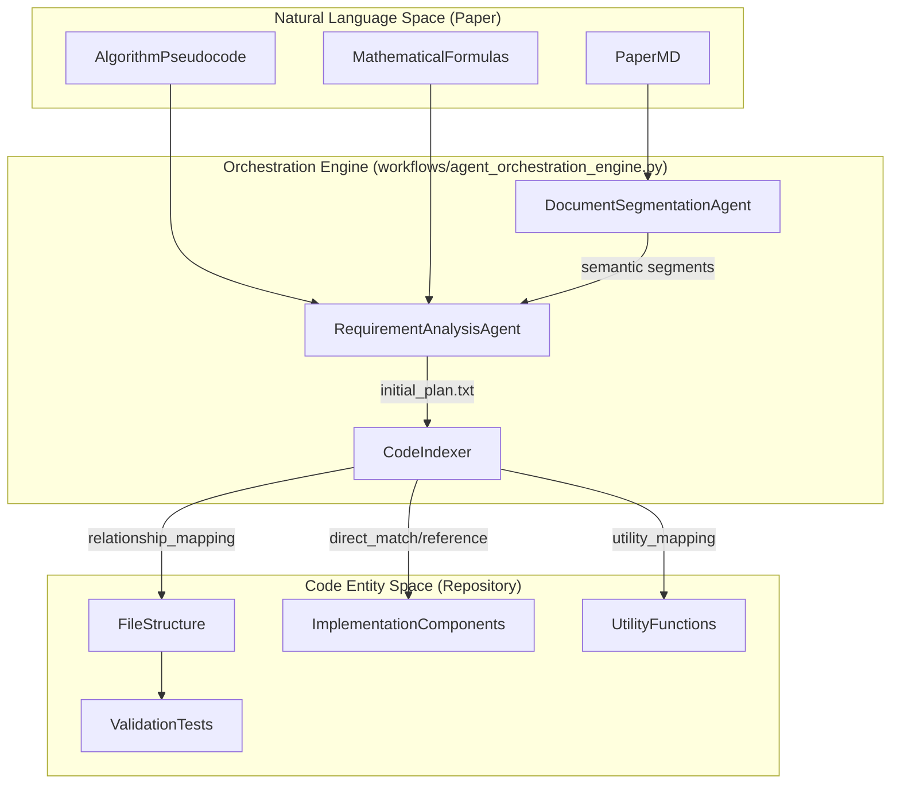
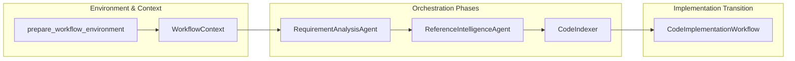

<!-- source: DeepWiki mcp.deepwiki.com · repo HKUDS/DeepCode · page 6 Paper2Code Research Pipeline · fetched 2026-11-09 -->

# Paper2Code Research Pipeline

Relevant source files

The following files were used as context for generating this wiki page:

- [prompts/code_prompts.py](prompts/code_prompts.py)
- [tools/code_indexer.py](tools/code_indexer.py)
- [tools/pdf_downloader.py](tools/pdf_downloader.py)
- [utils/file_processor.py](utils/file_processor.py)
- [workflows/__init__.py](workflows/__init__.py)
- [workflows/agent_orchestration_engine.py](workflows/agent_orchestration_engine.py)
- [workflows/codebase_index_workflow.py](workflows/codebase_index_workflow.py)
- [workflows/environment.py](workflows/environment.py)
- [workflows/workflow_context.py](workflows/workflow_context.py)

The Paper2Code Research Pipeline is DeepCode's flagship agentic workflow designed to transform academic research papers into functional, executable codebases. It utilizes a multi-agent orchestration engine to handle the complexities of academic document parsing, algorithmic extraction, reference discovery, and systematic code implementation.

For deep technical details on specific components, refer to the following child pages:
- [Orchestration Engine and Pipeline Phases](#6.1) — Detailed breakdown of the pipeline phases, `WorkflowContext`, environment preparation, planning retry mechanisms, and the 5-section YAML plan (`workflows/agent_orchestration_engine.py`) [workflows/agent_orchestration_engine.py:1-27]().
- [Code Implementation Workflow](#6.2) — Workspace initialization via `StructureGeneratorAgent`, the `AgentRunner`-based iteration loop, mechanical completion checks, and the loop detector (`workflows/code_implementation_workflow.py`) [workflows/__init__.py:17-28]().
- [Concise Memory Agent](#6.3) — Write-file-based memory optimization utilizing `implement_code_summary.md`, clean-slate message rebuilding, and LLM file summaries (`workflows/agents/memory_agent_concise.py`).
- [Document Processing and Code Indexing](#6.4) — PDF downloading with `_SafeResolver`, Docling/pypdf fallback, document segmentation strategies, and `CodeIndexer` relationship mapping (`tools/code_indexer.py`, `tools/pdf_downloader.py`) [tools/pdf_downloader.py:1-70](), [tools/code_indexer.py:30-68]().

## Pipeline Architecture

The pipeline is orchestrated by the `AgentOrchestrationEngine` defined in `workflows/agent_orchestration_engine.py`. It coordinates specialized agents to navigate the translation from Natural Language Space (research papers, pseudocode, formulas) to Code Entity Space (repository structure, implementation components, utilities, and validation tests).

### From Research to Code Entities
This diagram maps how concepts in research papers are parsed and transformed into concrete code entities through the orchestration pipeline.

**Sources**: [workflows/agent_orchestration_engine.py:1-27](), [tools/code_indexer.py:30-68](), [workflows/workflow_context.py:1-45]()

## The 7-Phase Workflow and Context Management

The pipeline executes across structured phases managed by `WorkflowContext` (`workflows/workflow_context.py`), which allocates isolated per-task directories under `deepcode_lab/tasks/` [workflows/workflow_context.py:61-105]().

| Phase | Module / Agent | Responsibility | Key Output Artifact |
|:---|:---|:---|:---|
| **1. Input Acquisition** | `FileProcessor` / `_SafeResolver` | Resolve URL or local file path and fetch artifact. | `paper.pdf` / `paper.md` [tools/pdf_downloader.py:72-101]() |
| **2. Preprocessing** | `DocumentSegmentationAgent` | Semantic boundary detection and token optimization. | `document_index.json` [workflows/agent_orchestration_engine.py:152-190]() |
| **3. Infrastructure** | `prepare_workflow_environment` | Synthesize isolated task workspace and directories. | `deepcode_lab/tasks/<prefix>_<id>/` [workflows/environment.py:61-126]() |
| **4. Code Planning** | `RequirementAnalysisAgent` | Extract algorithms, equations, and system architecture. | `initial_plan.txt` (YAML) [prompts/code_prompts.py:122-184]() |
| **5. Ref Discovery** | `ReferenceIntelligenceAgent` | Identify 5 most relevant references with GitHub repos. | `reference.txt` [prompts/code_prompts.py:19-89]() |
| **6. Repo Acquisition** | `GithubDownloadAgent` | Clone reference repositories for pattern analysis. | `code_base/` directory [prompts/code_prompts.py:91-119]() |
| **7. Code Indexing** | `CodeIndexer` | Map reference code patterns to target structure. | `codebase_index_report.txt` [tools/code_indexer.py:58-67]() |

**Sources**: [workflows/environment.py:61-126](), [workflows/workflow_context.py:61-146](), [tools/code_indexer.py:58-67]()

### Multi-Agent Orchestration Flow
The orchestration engine handles environment preparation, execution retries, and coordinates the hand-off to code generation workflows.

**Sources**: [workflows/agent_orchestration_engine.py:48-74](), [workflows/environment.py:61-90]()

## Summary of Sub-Topics

- **Orchestration Engine and Pipeline Phases**: Focuses on `workflows/agent_orchestration_engine.py`, managing environment setup, planning retries, and completeness scoring. See [Orchestration Engine and Pipeline Phases](#6.1).
- **Code Implementation Workflow**: Details `CodeImplementationWorkflow` and `StructureGeneratorAgent` for workspace initialization and execution loops. See [Code Implementation Workflow](#6.2).
- **Concise Memory Agent**: Covers write-file-based memory optimization, clean-slate message rebuilding, and LLM file summaries. See [Concise Memory Agent](#6.3).
- **Document Processing and Code Indexing**: Explains PDF downloading (`_SafeResolver`), document segmentation, and `CodeIndexer` relationship mapping. See [Document Processing and Code Indexing](#6.4).

---

