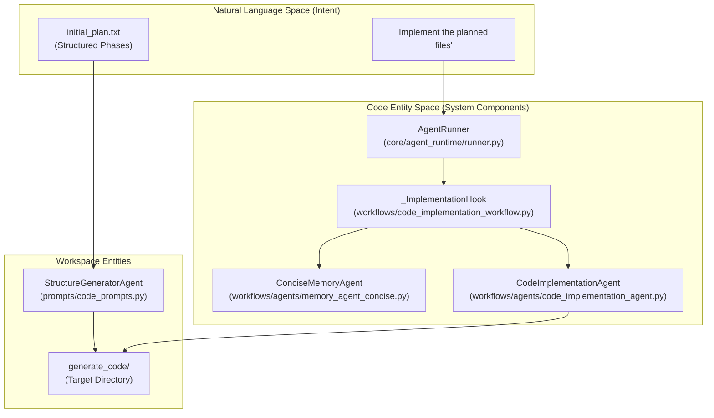
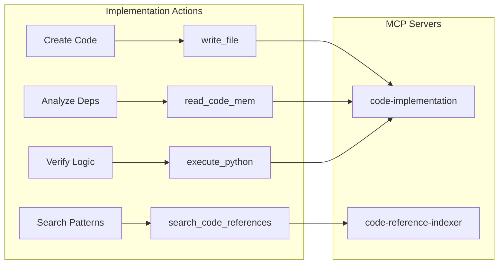

<!-- source: DeepWiki mcp.deepwiki.com · repo HKUDS/DeepCode · page 6.2 Code Implementation Workflow · fetched 2026-11-09 -->

# Code Implementation Workflow

Relevant source files

The following files were used as context for generating this wiki page:

- [core/agent_runtime/tools/alias.py](core/agent_runtime/tools/alias.py)
- [core/agent_runtime/tools/registry.py](core/agent_runtime/tools/registry.py)
- [core/compat/agent.py](core/compat/agent.py)
- [tests/phase9_progress_test.py](tests/phase9_progress_test.py)
- [tests/test_code_implementation_workspace.py](tests/test_code_implementation_workspace.py)
- [tests/test_loop_detector.py](tests/test_loop_detector.py)
- [tests/test_semantic_hint.py](tests/test_semantic_hint.py)
- [tests/test_unified_impl_workflow.py](tests/test_unified_impl_workflow.py)
- [tools/document_segmentation_server.py](tools/document_segmentation_server.py)
- [utils/llm_utils.py](utils/llm_utils.py)
- [utils/loop_detector.py](utils/loop_detector.py)
- [workflows/agents/code_implementation_agent.py](workflows/agents/code_implementation_agent.py)
- [workflows/agents/document_segmentation_agent.py](workflows/agents/document_segmentation_agent.py)
- [workflows/agents/memory_agent_concise.py](workflows/agents/memory_agent_concise.py)
- [workflows/code_implementation_workflow.py](workflows/code_implementation_workflow.py)

## Purpose and Scope

The **Code Implementation Workflow** is the execution engine responsible for transforming a structured implementation plan into functional source code. It constitutes Phase 8 of the DeepCode research-to-code pipeline [workflows/code_implementation_workflow.py:1-25]().

As of the V2 unification, the workflow runs on the core `AgentRunner` kernel [workflows/code_implementation_workflow.py:4-10](). This unifies bespoke, hand-rolled execution loops into a standardized architecture that leverages `AgentHook` for domain-specific steering, `ConciseMemoryAgent` for context optimization, and dynamic tool schemas sourced directly from MCP servers via `ToolRegistry` [workflows/code_implementation_workflow.py:4-13](), [core/agent_runtime/tools/registry.py:12-25]().

Sources: [workflows/code_implementation_workflow.py:1-25](), [core/agent_runtime/tools/registry.py:12-25]()

---

## Workflow Variants and Tool Surfaces

DeepCode provides a unified implementation class (`CodeImplementationWorkflow`) that adapts its tool surface and prompts based on whether code indexing is enabled:

| Feature | Standard Implementation | Indexed Implementation (`enable_indexing=True`) |
| :--- | :--- | :--- |
| **Tool Surface** | Full tool set (`read_file`, `write_file`, `execute_python`, `execute_bash`, `search_code_references`, etc.) [workflows/code_implementation_workflow.py:65-77]() | Minimalist tool set (`write_file`, `search_code_references`) [workflows/code_implementation_workflow.py:78-81]() |
| **System Prompt** | `GENERAL_CODE_IMPLEMENTATION_SYSTEM_PROMPT` [workflows/code_implementation_workflow.py:53]() | `PURE_CODE_IMPLEMENTATION_SYSTEM_PROMPT_INDEX` [workflows/code_implementation_workflow.py:54]() |
| **Execution Focus** | Iterative file-by-file development and validation | Pattern-based implementation via reference search and targeted writes |

Sources: [workflows/code_implementation_workflow.py:14-16](), [workflows/code_implementation_workflow.py:52-81]()

---

## Architecture and Data Flow

The implementation workflow bridges the high-level **Natural Language Space** (plans and instructions) to the **Code Entity Space** (files, tools, and MCP servers).

### System Mapping: Intent to Implementation
This diagram maps high-level user intent to the specific Python components, agent loops, and execution hooks that govern the implementation phase.

Sources: [workflows/code_implementation_workflow.py:4-25](), [workflows/code_implementation_workflow.py:96-116]()

---

## Workflow Lifecycle and Execution Loop

### 1. Workspace Initialization
Before the execution loop starts, the workflow ensures the target directory structure exists. If missing, it invokes the `StructureGeneratorAgent` using the `STRUCTURE_GENERATOR_PROMPT` to initialize directories and skeleton files defined in the plan [workflows/code_implementation_workflow.py:55-56]().

### 2. The `AgentRunner` Kernel and Shared Run State
The implementation phase runs inside an `AgentRunner` loop capped by execution limits (`_MAX_ITERATIONS = 800`, `_MAX_WALL_SECONDS = 7200`) [workflows/code_implementation_workflow.py:90-91](). Mutable execution state is tracked via the `_RunState` dataclass:
*   **State Management**: Coordinates the `ConciseMemoryAgent`, `CodeImplementationAgent`, `LoopDetector`, and `ProgressTracker` [workflows/code_implementation_workflow.py:96-116]().
*   **Steering & Guidance**: Injects mode-specific guidance texts (`_GuidanceTexts`) into the agent stream depending on success, error, or tool absence [workflows/code_implementation_workflow.py:106-171]().
*   **Progress Heartbeat**: Emits progress events via `emit_progress` to keep UI clients updated without interrupting execution [workflows/code_implementation_workflow.py:117-123]().

### 3. Mechanical Completion Check
Unlike standard chatbot loops that terminate when the model declares completion, the code implementation workflow terminates exclusively through a **mechanical check**: the loop continues until every file parsed from the initial reproduction plan exists on disk (`get_unimplemented_files()`) [workflows/code_implementation_workflow.py:23-24]().

Sources: [workflows/code_implementation_workflow.py:27-123](), [workflows/code_implementation_workflow.py:134-171]()

---

## Memory Optimization and the `ConciseMemoryAgent`

To prevent context window saturation during long development runs, the `ConciseMemoryAgent` executes a **clean-slate memory strategy**:
*   **Trigger**: Activated immediately after each `write_file` tool call [workflows/agents/memory_agent_concise.py:71-76]().
*   **Data Retention**: Discards past conversational turns and old tool histories, retaining only the system prompt, initial plan, and the current round's tool results from essential tools (`read_code_mem`, `read_file`, `write_file`, `execute_python`, `execute_bash`, `search_code`) [workflows/agents/memory_agent_concise.py:9-16]().
*   **Knowledge Base**: Maintains `implement_code_summary.md` to record module interfaces, constraints, and dependencies so downstream components retain architectural context without bloated token counts [workflows/agents/memory_agent_concise.py:96-98]().

Sources: [workflows/agents/memory_agent_concise.py:1-41](), [workflows/agents/memory_agent_concise.py:71-76]()

---

## Utility Components and Safeguards

### Loop Detection and Progress Tracking
The execution engine employs dedicated safeguards to prevent stalls, infinite loops, and API timeouts:
*   **`LoopDetector`**: Monitors tool history for repeated call patterns (e.g., calling the same tool $\ge 5$ times consecutively) and enforces time-per-file limits [utils/loop_detector.py:12-43](), [utils/loop_detector.py:88-96]().
*   **Stall Threshold & LLM Offset**: Uses a 300-second stall threshold (`stall_threshold`) combined with `note_llm_wait()` to subtract slow LLM round-trip times from the stall budget, preventing transient network delays from triggering false aborts [utils/loop_detector.py:27-40](), [utils/loop_detector.py:133-144]().
*   **`ProgressTracker`**: Tracks unique file completions and maps progress relative to the initial plan [utils/loop_detector.py:58-73]().

### Tool Registry and MCP Server Integration
Tool schemas are dynamically loaded from MCP servers via `ToolRegistry` [core/agent_runtime/tools/registry.py:12-25]().

Sources: [utils/loop_detector.py:12-144](), [core/agent_runtime/tools/registry.py:12-25](), [workflows/code_implementation_workflow.py:65-88]()

---

