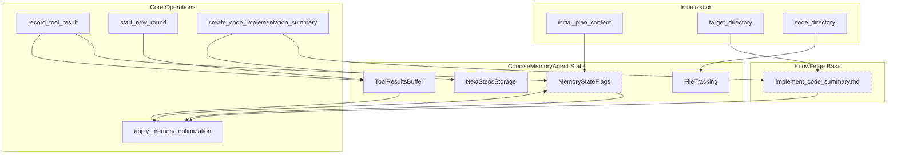
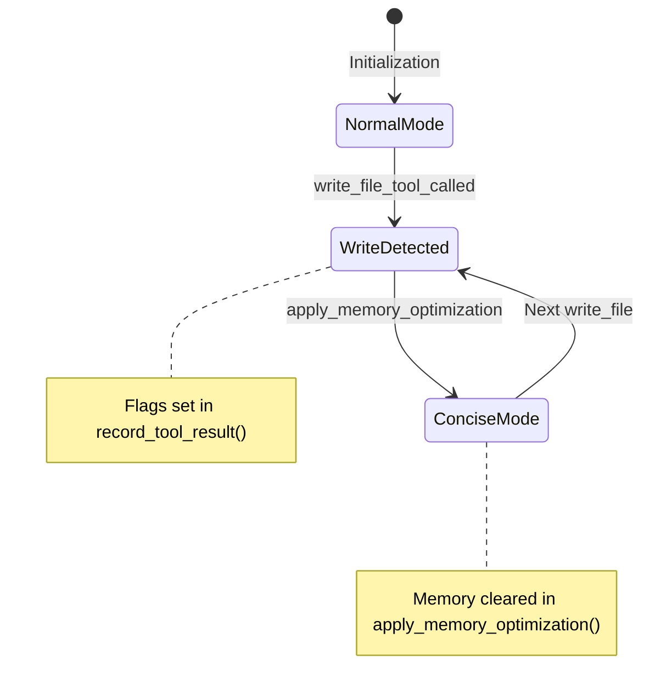
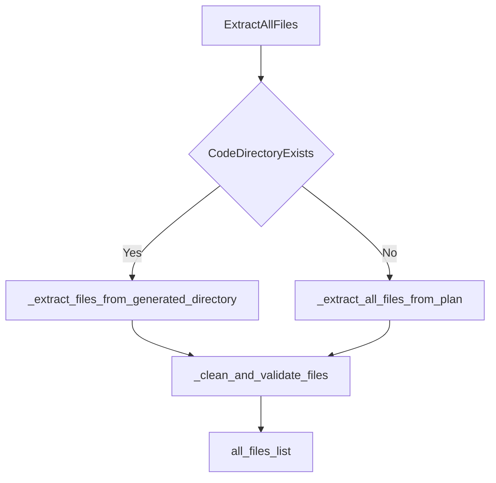
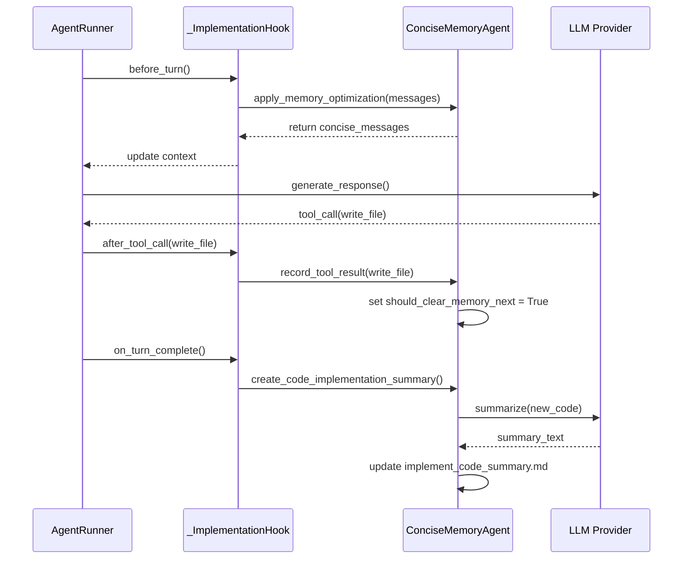

<!-- source: DeepWiki mcp.deepwiki.com · repo HKUDS/DeepCode · page 6.3 Concise Memory Agent · fetched 2026-11-09 -->

# Concise Memory Agent

Relevant source files

The following files were used as context for generating this wiki page:

- [tools/document_segmentation_server.py](tools/document_segmentation_server.py)
- [utils/llm_utils.py](utils/llm_utils.py)
- [workflows/agents/code_implementation_agent.py](workflows/agents/code_implementation_agent.py)
- [workflows/agents/document_segmentation_agent.py](workflows/agents/document_segmentation_agent.py)
- [workflows/agents/memory_agent_concise.py](workflows/agents/memory_agent_concise.py)
- [workflows/code_implementation_workflow.py](workflows/code_implementation_workflow.py)

## Purpose and Scope

The `ConciseMemoryAgent` implements a write-file-based memory optimization strategy for systematic code generation workflows within `workflows/code_implementation_workflow.py`. It prevents token overflow during large codebase implementation by clearing conversation history after each file write while preserving essential context: the system prompt, initial plan, and current round tool results. This agent accumulates implementation knowledge in a persistent markdown file (`implement_code_summary.md`) that serves as a Knowledge Base for subsequent file generation.

In the `DeepCode` architecture, this agent is utilized by the `CodeImplementationWorkflow` class to steer long-running implementation loops where context window limits would otherwise be exceeded.

Sources: [workflows/agents/memory_agent_concise.py:1-17](), [workflows/code_implementation_workflow.py:18-25]()

---

## Architecture Overview

The `ConciseMemoryAgent` coordinates memory optimization by tracking implementation progress, managing conversation context, and generating LLM-powered summaries of completed files via methods defined in `workflows/agents/memory_agent_concise.py`.

**Core Class:** `ConciseMemoryAgent` [workflows/agents/memory_agent_concise.py:27-41]()

**Initialization Parameters:**
- `initial_plan_content`: Content of `initial_plan.txt` containing the phase structure and implementation plan [workflows/agents/memory_agent_concise.py:55-55]().
- `target_directory`: Base directory for saving implementation summaries [workflows/agents/memory_agent_concise.py:82-86]().
- `code_directory`: The specific path where generated code resides [workflows/agents/memory_agent_concise.py:88-90]().
- `default_models`: LLM configuration for different providers used during summarization [workflows/agents/memory_agent_concise.py:65-69]().

Sources: [workflows/agents/memory_agent_concise.py:43-117]()

---

## Memory Management Strategy

### Write-File-Based Optimization Trigger

The agent uses a write-file-based trigger for memory optimization. When the `write_file` tool is called, the agent sets internal flags that trigger clean-slate message rebuilding in the next iteration.

**Key State Variables:**
- `last_write_file_detected`: Tracks if `write_file` was called in the current iteration [workflows/agents/memory_agent_concise.py:72-74]().
- `should_clear_memory_next`: A flag that signals the runner to collapse history in the next round [workflows/agents/memory_agent_concise.py:75-75]().
- `current_round`: An internal counter for tracking implementation cycles [workflows/agents/memory_agent_concise.py:76-76]().

Sources: [workflows/agents/memory_agent_concise.py:71-76](), [workflows/code_implementation_workflow.py:38-40]()

---

## Core Components

### 1. Essential Tools Tracking

During memory optimization, the agent discards conversational clutter but preserves the results of essential tools from the current round, providing immediate context for the next generation step.

| Tool Category | Essential Tools |
| :--- | :--- |
| **File Operations** | `read_code_mem`, `read_file`, `write_file` |
| **Code Analysis** | `search_code`, `search_reference_code`, `get_file_structure` |
| **Execution** | `execute_python`, `execute_bash` |

Sources: [workflows/agents/memory_agent_concise.py:37-41]()

### 2. Knowledge Base (`implement_code_summary.md`)

The Knowledge Base is a persistent markdown file functioning as long-term memory for the implementation workflow. It is updated after each successful file write.

- **File Path:** `{target_directory}/implement_code_summary.md` [workflows/agents/memory_agent_concise.py:96-98]().
- **Content:** Contains LLM-generated summaries including core purpose, public interface, and dependencies.
- **Read Optimization:** The `read_code_mem` tool specifically targets this file to provide an overview of completed work without loading all file contents into context [workflows/code_implementation_workflow.py:68]().

Sources: [workflows/agents/memory_agent_concise.py:96-98](), [workflows/code_implementation_workflow.py:68]()

---

## Implementation Tracking and Summarization

### File Extraction and Progress

The agent parses the implementation plan and the file system to maintain a source of truth for completion.

- **Mechanical Completion:** The implementation run ends only when every file parsed from the plan exists on disk [workflows/code_implementation_workflow.py:23-24]().
- **Path Normalization:** The `normalize_file_path` function ensures stable keys across different OS environments and relative paths [workflows/agents/memory_agent_concise.py:120-152]().

Sources: [workflows/agents/memory_agent_concise.py:93](), [workflows/agents/memory_agent_concise.py:120-152](), [workflows/code_implementation_workflow.py:23-24]()

### LLM Summarization Pipeline

After a `write_file` operation, the implementation workflow coordinates with `ConciseMemoryAgent` to generate a summary:
1. **Trigger:** `write_file` execution is detected via `record_tool_result` [workflows/agents/memory_agent_concise.py:1506-1510]().
2. **LLM Call:** The agent calls the LLM using specialized prompts to analyze the newly written code.
3. **Extraction:** The response is parsed into sections (Core Purpose, Public Interface, Internal Dependencies, Next Steps).
4. **Persistence:** The summary is appended to `implement_code_summary.md`.

Sources: [workflows/agents/memory_agent_concise.py:994-1071](), [workflows/agents/memory_agent_concise.py:1322-1361]()

---

## Context Management

### Clean-Slate Rebuilding

When `apply_memory_optimization` is invoked, the agent discards previous conversation turns, replacing them with a condensed context structure:
- **System Prompt:** Original instructions [workflows/agents/memory_agent_concise.py:1584-1586]().
- **Initial Plan:** Content of `initial_plan.txt` [workflows/agents/memory_agent_concise.py:1592-1600]().
- **Progress Report:** Lists of implemented and unimplemented files [workflows/agents/memory_agent_concise.py:1602-1620]().
- **Knowledge Base:** Full content of `implement_code_summary.md` [workflows/agents/memory_agent_concise.py:1622-1632]().
- **Current Results:** Results from essential tools executed in the current round only [workflows/agents/memory_agent_concise.py:1644-1677]().

### Emergency Trim Threshold

To prevent context window overflow if the summarized context grows excessively large, the agent monitors implemented file counts. The emergency trim threshold is configured via `_EMERGENCY_TRIM_THRESHOLD = 50` in `workflows/code_implementation_workflow.py` [workflows/code_implementation_workflow.py:92]().

Sources: [workflows/code_implementation_workflow.py:92](), [workflows/agents/memory_agent_concise.py:1546-1679]()

---

## Integration and Data Flow

The `ConciseMemoryAgent` is managed by `CodeImplementationWorkflow` through an `AgentHook` implementation.

Sources: [workflows/code_implementation_workflow.py:38-40](), [workflows/code_implementation_workflow.py:96-115](), [workflows/agents/memory_agent_concise.py:1477-1536]()

---

