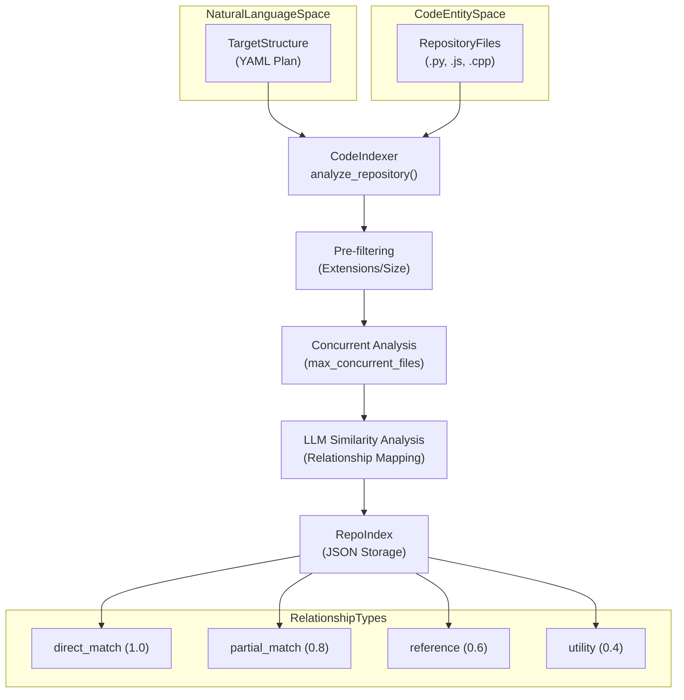
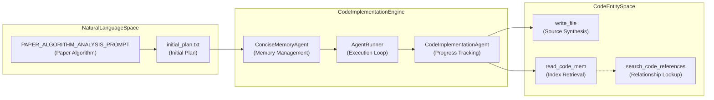

<!-- source: DeepWiki mcp.deepwiki.com · repo HKUDS/DeepCode · page 6.4 Document Processing and Code Indexing · fetched 2026-11-09 -->

# Document Processing and Code Indexing

Relevant source files

The following files were used as context for generating this wiki page:

- [deepcode.py](deepcode.py)
- [prompts/code_prompts.py](prompts/code_prompts.py)
- [tests/test_code_indexer_concurrent.py](tests/test_code_indexer_concurrent.py)
- [tests/test_code_indexer_output.py](tests/test_code_indexer_output.py)
- [tests/test_git_command_url.py](tests/test_git_command_url.py)
- [tools/code_indexer.py](tools/code_indexer.py)
- [tools/code_reference_indexer.py](tools/code_reference_indexer.py)
- [tools/git_command.py](tools/git_command.py)
- [tools/pdf_converter.py](tools/pdf_converter.py)
- [tools/pdf_downloader.py](tools/pdf_downloader.py)
- [utils/file_processor.py](utils/file_processor.py)
- [workflows/__init__.py](workflows/__init__.py)
- [workflows/agent_orchestration_engine.py](workflows/agent_orchestration_engine.py)
- [workflows/codebase_index_workflow.py](workflows/codebase_index_workflow.py)

## Purpose and Scope

This document details the document processing and code indexing subsystems of DeepCode. These systems bridge the gap between "Natural Language Space" (research papers, documentation) and "Code Entity Space" (repositories, source files). The document processor handles multi-format acquisition and semantic segmentation, while the `CodeIndexer` builds a relationship map between external codebases and the target implementation plan.

---

## Document Processing Subsystem

The document processing system standardizes external inputs (PDFs, URLs) into a machine-readable format and applies semantic segmentation to handle documents exceeding LLM context limits.

### Acquisition and Conversion

DeepCode uses a multi-stage acquisition pipeline defined in `tools/pdf_downloader.py`. It features a security-hardened downloader and a fallback-based conversion chain.

#### Safe Resolution and Acquisition
To prevent SSRF and DNS-rebinding attacks during paper acquisition, the system utilizes a `_SafeResolver` [tools/pdf_downloader.py:72-101]() that ensures connections only resolve to public IP addresses [tools/pdf_downloader.py:103-113]().

#### Conversion Fallback Chain
Documents are converted to Markdown using a tiered approach:
1.  **Docling**: Primary advanced converter for PDF, DOCX, and HTML with image extraction capabilities [tools/pdf_downloader.py:189-205]().
2.  **pypdf**: Fallback text-only extraction if Docling is unavailable [tools/pdf_downloader.py:56-65]().

### Intelligent Segmentation

The `DocumentSegmentationAgent` coordinates with the `document-segmentation` MCP server to split large documents into semantically coherent chunks.

**Segmentation Decision Flow:**
The system evaluates document size against a threshold (default 50,000 chars) defined in `DeepCodeConfig` [utils/llm_utils.py:71-87](). If the document exceeds this limit, `should_use_document_segmentation` returns `True` [utils/llm_utils.py:89-110](), triggering adaptive prompts and server configurations [utils/llm_utils.py:113-163]().

Sources: [tools/pdf_downloader.py:72-205](), [utils/llm_utils.py:71-163](), [workflows/agents/document_segmentation_agent.py:16-50]()

---

## Code Indexing and Relationship Mapping

The `CodeIndexer` [tools/code_indexer.py:68-191]() analyzes existing repositories to identify reusable components and map them to the implementation plan generated by the `AgentOrchestrationEngine`.

### Core Indexing Architecture

Title: Core Indexing Architecture and Data Flow

Sources: [tools/code_indexer.py:30-67](), [tools/code_indexer.py:177-191]()

### Key Components and Data Structures

#### 1. FileRelationship
Represents a semantic link between a repository file and a target file in the implementation plan [tools/code_indexer.py:30-41]().
*   **Confidence Score**: 0.0 to 1.0 based on similarity.
*   **Relationship Types**: `direct_match`, `partial_match`, `reference`, `utility`.

#### 2. FileSummary
Metadata and structural analysis for each repository file, including functions, concepts, and dependencies [tools/code_indexer.py:43-55]().

#### 3. CodeIndexer Implementation
*   **Pre-filtering**: Skips directories like `node_modules` or `__pycache__` and enforces `max_file_size` (default 1MB) [tools/code_indexer.py:146-161]().
*   **Concurrency**: Supports parallel file analysis via `enable_concurrent_analysis` and `max_concurrent_files` (default 5) [tools/code_indexer.py:193-201]().
*   **Scoring**: Uses a `min_confidence_score` (default 0.3) to filter out weak relationships [tools/code_indexer.py:177-182]().

Sources: [tools/code_indexer.py:30-201]()

---

## Bridge: Natural Language to Code Entity Space

The implementation phase uses these indexes to steer the `AgentRunner`. The `ConciseMemoryAgent` and `CodeImplementationAgent` interact with these indexed entities to perform file-by-file synthesis.

### Entity Association Diagram

Title: Natural Language Space to Code Entity Space Bridge

Sources: [workflows/code_implementation_workflow.py:18-25](), [workflows/agents/memory_agent_concise.py:27-41](), [workflows/agents/code_implementation_agent.py:33-43]()

### Implementation Workflow with Indexing

When `enable_indexing` is active in the `CodeImplementationWorkflow` [workflows/code_implementation_workflow.py:14-16](), the agent uses a restricted toolset (`_INDEXED_TOOL_NAMES`) focused on relationship lookup:
*   `write_file`: For synthesizing new code [workflows/code_implementation_workflow.py:79]().
*   `search_code_references`: For querying the `CodeIndexer` results [workflows/code_implementation_workflow.py:80]().

The `ConciseMemoryAgent` maintains the "Knowledge Base" (`implement_code_summary.md`) [workflows/agents/memory_agent_concise.py:95-98](), which serves as the persistent memory bridge, ensuring that every `write_file` call is informed by previous architectural decisions and indexed references [workflows/agents/memory_agent_concise.py:71-76]().

Sources: [workflows/code_implementation_workflow.py:1-93](), [workflows/agents/memory_agent_concise.py:1-119]()

---

