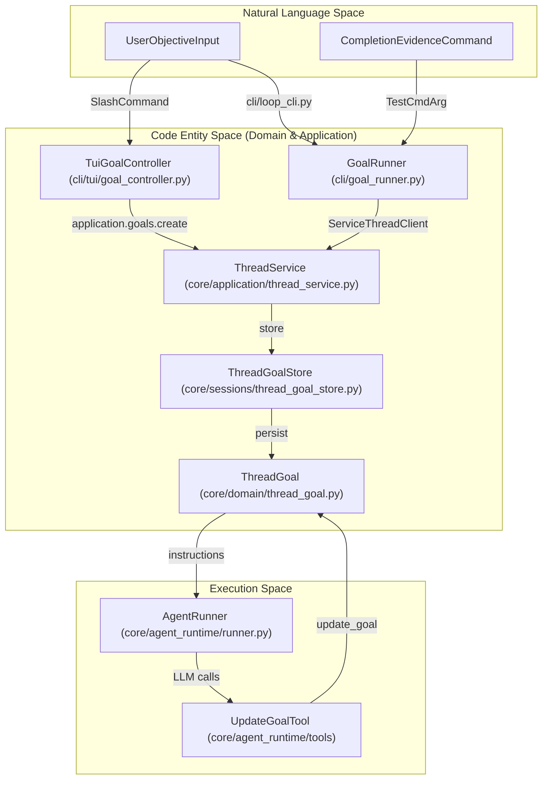

<!-- source: DeepWiki mcp.deepwiki.com · repo HKUDS/DeepCode · page 7.1 Goals and the Verify Loop · fetched 2026-11-09 -->

# Goals and the Verify Loop

Relevant source files

The following files were used as context for generating this wiki page:

- [cli/goal_runner.py](cli/goal_runner.py)
- [cli/headless_turn.py](cli/headless_turn.py)
- [cli/loop_cli.py](cli/loop_cli.py)
- [cli/tui/goal_controller.py](cli/tui/goal_controller.py)
- [core/agent_runtime/tools/__init__.py](core/agent_runtime/tools/__init__.py)
- [core/application/goal_extension.py](core/application/goal_extension.py)
- [core/application/thread_service.py](core/application/thread_service.py)
- [core/platform_file_lock.py](core/platform_file_lock.py)
- [core/sessions/thread_goal_store.py](core/sessions/thread_goal_store.py)
- [tests/application/test_default_agent_preset.py](tests/application/test_default_agent_preset.py)
- [tests/application/test_one_way_data_flow.py](tests/application/test_one_way_data_flow.py)
- [tests/test_loop_cli.py](tests/test_loop_cli.py)
- [tests/test_tui_thread_client.py](tests/test_tui_thread_client.py)

## Purpose and Scope

The Goal system in DeepCode provides a mechanism for durable, long-running objectives that persist across multiple turns, interruptions, and application restarts. Unlike a standard conversational turn, a Goal represents a specific technical target (e.g., "refactor the auth module") that the agent actively tracks until completion.

The **Verify Loop** (`deepcode loop`) is a specialized execution mode that pairs a Goal with a verification command (referee). It creates an agentic feedback loop where the agent attempts to satisfy the goal, runs the test command to gather evidence, and continues iterating until the objective is met or resources are exhausted.

Sources: [cli/loop_cli.py:1-13](), [cli/goal_runner.py:1-4]()

---

## The Goal Domain Object and Stores

The core state of an objective is managed by the `ThreadGoal` domain object. Goals are strictly associated with a `Thread` (Session) and maintain their own lifecycle status.

### Goal Lifecycle Status
The status of a goal is defined in `ThreadGoalStatus` [core/domain/thread_goal.py:24-34]():
- **ACTIVE**: The agent is currently working toward the objective.
- **PAUSED**: Work is suspended but the objective is preserved.
- **COMPLETE**: The agent has reported success, often verified by a test command.
- **BLOCKED**: The agent has identified a terminal issue it cannot resolve.
- **BUDGET_LIMITED**: The goal was terminated because it hit a token or iteration limit.

### Data Persistence via `ThreadGoalStore`
Goals are persisted via the append-only `ThreadGoalStore` in `core/sessions/thread_goal_store.py`, which records events and snapshots in the canonical JSONL ledger `goal.jsonl` within each session directory [core/sessions/thread_goal_store.py:28-72](). The store provides guarded access across process boundaries and handles turn settlements to prevent duplicate runtime accounting [core/sessions/thread_goal_store.py:83-164]().

Sources: [core/domain/thread_goal.py:24-34](), [core/sessions/thread_goal_store.py:28-191]()

---

## Goal Architecture and Data Flow

The Goal system bridges the high-level user objective with the low-level `AgentRunner` execution loop through application-level services and stores.

### Natural Language to Code Entity Space

Sources: [cli/tui/goal_controller.py:31-57](), [cli/goal_runner.py:60-160](), [core/sessions/thread_goal_store.py:65-94](), [core/domain/thread_goal.py:24-34]()

---

## The Verify Loop (`deepcode loop`)

The `deepcode loop` command, implemented in `cli/loop_cli.py` and backed by `cli/goal_runner.py`, provides a headless interface for goal-driven automation.

### Execution Flow
When a user runs `deepcode loop`, the system follows this sequence:
1.  **Workspace Initialization**: Resolves the workspace path and ensures project trust [cli/loop_cli.py:57-69](), [cli/goal_runner.py:95-108]().
2.  **Session Creation**: Starts a new Thread with `session_kind="headless"` and `inherit_default_preset=False` to ensure automated runs have full tool access [cli/headless_turn.py:88-102]().
3.  **Goal Attachment**: Creates the `ThreadGoal` and attaches the `completion_evidence_command` (test command) to the prompt [cli/goal_runner.py:84-92]().
4.  **Verification Loop**: The `GoalRunner` blocks while the agent executes turns, polling `thread/goal/get` RPC states and handling goal progress updates [cli/goal_runner.py:162-181]().
5.  **Termination**: The loop exits when the agent calls the `update_goal` tool with a `complete` or `blocked` status, or when the `token_budget` is reached [cli/loop_cli.py:134-159]().

### The Goal Runner Result
The loop returns a `GoalRunResult` containing the final `ThreadGoal` state, the `session_id`, workspace path, and a `GoalOutcome` which includes the reason for termination [cli/goal_runner.py:49-54]().

Sources: [cli/loop_cli.py:54-160](), [cli/goal_runner.py:60-185](), [cli/headless_turn.py:88-102]()

---

## TUI Goal Management

In the interactive TUI, the `TuiGoalController` handles `/goal` slash commands, allowing users to manage durable objectives without leaving the interactive session.

### Key Controller Functions
| Command | Implementation | Description |
| :--- | :--- | :--- |
| `/goal <text>` | `_create` [cli/tui/goal_controller.py:149]() | Initializes a new goal and starts work immediately. |
| `/goal pause` | `_pause` [cli/tui/goal_controller.py:71]() | Suspends the active goal. |
| `/goal resume` | `_resume` [cli/tui/goal_controller.py:80]() | Restarts a paused or stalled goal. |
| `/goal continue` | `_continue` [cli/tui/goal_controller.py:95]() | Nudges the agent to perform another turn toward the goal. |
| `/goal edit` | `_edit` [cli/tui/goal_controller.py:125]() | Updates the objective text while preserving goal identity. |
| `/goal clear` | `_clear` [cli/tui/goal_controller.py:113]() | Removes the goal from the session but keeps chat history. |

### Wait and Signal Handling
The `/goal wait` command blocks the TUI until the goal reaches a terminal state. It implements signal handling to allow users to interrupt the wait (via `SIGINT`) without killing the underlying agent process [cli/tui/goal_controller.py:172-182]().

Sources: [cli/tui/goal_controller.py:31-182]()

---

## Persistence and Resumption Across Turns

Goals are designed to be durable across process restarts using canonical append-only JSONL ledgers managed by `ThreadGoalStore` [core/sessions/thread_goal_store.py:65-72]().

### Resuming a Goal
The `resume_goal` function in `cli/goal_runner.py` allows a user to pick up a previously started objective using its `session_id`.
1.  **Session Reconstitution**: The `ThreadService` loads the session from the `SessionStore` [core/application/thread_service.py:154-158]().
2.  **Goal Discovery**: The system reads the `ThreadGoal` attached to that session via `ThreadGoalStore.read()` [core/sessions/thread_goal_store.py:71-72]().
3.  **State Validation**: If the goal is already `COMPLETE`, the runner exits immediately with success [cli/goal_runner.py:118-124]().
4.  **Context Injection**: The existing conversation history is provided to the agent, allowing it to maintain context of previous attempts and failures.

### Token Budget Tracking
Goals track cumulative resource usage across all turns via the `ThreadGoal` model. The `settle_turn` method on `ThreadGoalStore` accounts for each runtime turn exactly once across recovery retries, ensuring token and time limits are enforced persistently [core/sessions/thread_goal_store.py:154-191]().

Sources: [core/sessions/thread_goal_store.py:65-191](), [cli/goal_runner.py:66-148](), [core/application/thread_service.py:154-160]()

---

