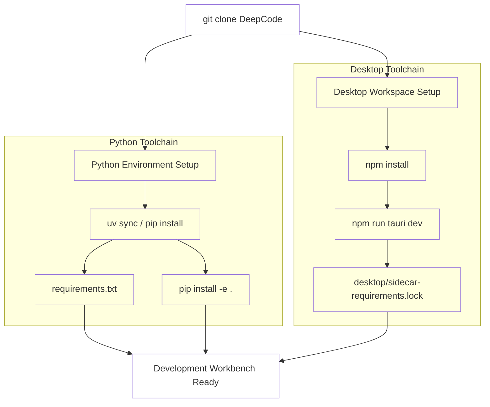
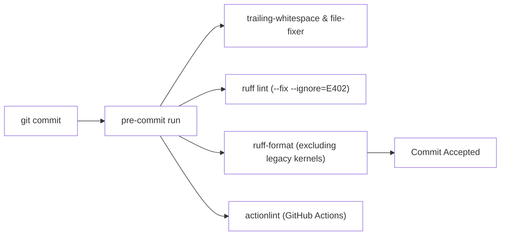

<!-- source: DeepWiki mcp.deepwiki.com · repo HKUDS/DeepCode · page 8.1 Development Setup · fetched 2026-11-09 -->

# Development Setup

<details>
<summary>Relevant source files</summary>

The following files were used as context for generating this wiki page:

- [.github/ISSUE_TEMPLATE/bug_report.yml](.github/ISSUE_TEMPLATE/bug_report.yml)
- [.github/ISSUE_TEMPLATE/config.yml](.github/ISSUE_TEMPLATE/config.yml)
- [.github/ISSUE_TEMPLATE/feature_request.yml](.github/ISSUE_TEMPLATE/feature_request.yml)
- [.github/ISSUE_TEMPLATE/question.yml](.github/ISSUE_TEMPLATE/question.yml)
- [.github/dependabot.yml](.github/dependabot.yml)
- [.github/pull_request_template.md](.github/pull_request_template.md)
- [.gitignore](.gitignore)
- [.pre-commit-config.yaml](.pre-commit-config.yaml)
- [LICENSE](LICENSE)
- [THIRD_PARTY_NOTICES.md](THIRD_PARTY_NOTICES.md)
- [desktop/sidecar-requirements.in](desktop/sidecar-requirements.in)
- [desktop/sidecar-requirements.lock](desktop/sidecar-requirements.lock)
- [desktop/src-tauri/Cargo.lock](desktop/src-tauri/Cargo.lock)
- [requirements.txt](requirements.txt)

</details>


This page provides technical guidance for developers contributing to the DeepCode codebase, configuring a local development environment, and mastering the build, linting, testing, and desktop sidecar pipelines.

**Scope**: This page covers environment setup using modern tooling like `uv`, dependency management via `requirements.txt` and `desktop/sidecar-requirements.lock`, linting with `ruff` and `.pre-commit-config.yaml`, the Tauri/React desktop build workflow, and contribution templates.

---

## Development Environment Setup

### Prerequisites

DeepCode is a polyglot system requiring specific core runtimes:

| Requirement | Version | Purpose | Code Reference |
|------------|---------|---------|----------------|
| Python | ≥ 3.12 | Core agent runtime and App Server | `pyproject.toml` |
| Node.js | ≥ 22 | Desktop frontend workbench (React) | [.github/workflows/desktop-ci.yml:121]() |
| Rust | Stable | Tauri IPC bridge and native window management | [.github/workflows/desktop-ci.yml:127]() |
| `uv` | Latest | High-performance Python package synchronization | `desktop/sidecar-requirements.lock:1-2` |

### Repository Setup & Dependency Flow

**Repository Initialization and Dependency Architecture**


**Sources**: [requirements.txt:1-24](), [desktop/sidecar-requirements.in:1-22](), [desktop/sidecar-requirements.lock:1-10]()

---

## Dependency Manifests and Sidecar Locks

DeepCode maintains distinct dependency boundaries between core CLI/server tooling and the localized Desktop packaging runtime.

### Core Python Dependencies
The primary development dependencies for the agent runtime, LLM adapters, and MCP client infrastructure are specified in `requirements.txt`:
- Core asynchronous communication (`aiofiles>=0.8.0`, `aiohttp>=3.14.3`, `asyncio-mqtt`) [requirements.txt:2-5]()
- Model provider integration (`anthropic>=0.40.0`, `openai>=1.55.0`, `google-genai`) [requirements.txt:3-16]()
- Protocol parsing and repair (`json-repair>=0.30.0`, `PyYAML>=6.0`, `pydantic-settings>=2.14.2`) [requirements.txt:9-22]()
- Terminal interface components (`prompt_toolkit>=3.0.0`, `rich>=13.0.0`) [requirements.txt:19-24]()

### Desktop Sidecar Requirements Lock
To ensure reproducible builds for the Tauri desktop application, backend sidecar dependencies are frozen via `uv` in `desktop/sidecar-requirements.lock`. The lock file is compiled from `desktop/sidecar-requirements.in`:
```bash
uv pip compile sidecar-requirements.in --output-file sidecar-requirements.lock --python-version 3.12 --universal
```
This ensures isolated builds using pinned runtimes (`aiofiles==25.1.0`, `aiohttp==3.14.3`, `anthropic==0.116.0`, `openai==2.29.0`, `pyinstaller==6.21.0`) without bleeding local developer extensions into production distributions [desktop/sidecar-requirements.lock:3-132]().

**Sources**: [requirements.txt:1-24](), [desktop/sidecar-requirements.in:1-22](), [desktop/sidecar-requirements.lock:1-206]()

---

## Code Quality and Linting Standards

DeepCode enforces strict code style guidelines and automated quality checks using `pre-commit` and `ruff`.

### Pre-commit Hooks
The repository includes `.pre-commit-config.yaml` to run formatting, trailing whitespace checks, and linting rules prior to commits [.pre-commit-config.yaml:1-30]().

**Linting and Formatting Pipeline**


### Ruff Configuration and Exclusions
`ruff` is configured to automatically correct style errors while respecting byte-stable legacy client/kernel files via explicit exclusions in [.pre-commit-config.yaml:13-19]():
- `cli/mcp_server.py`
- `tools/code_indexer.py`
- `workflows/agents/code_implementation_agent.py`
- `workflows/agents/memory_agent_concise.py`

**Sources**: [.pre-commit-config.yaml:1-30]()

---

## Desktop npm / Cargo / Tauri Development Flow

The Desktop workbench combines a React frontend, a Rust-based Tauri core (`desktop/src-tauri/Cargo.lock`), and a Python App Server sidecar.

### Sidecar Integration and Dev Lifecycle
1. **Frontend Setup**: Navigate to `desktop/` and install node packages:
   ```bash
   cd desktop
   npm install
   ```
2. **Sidecar Preparation**: Prepare the Python sidecar execution environment matching `desktop/sidecar-requirements.lock`.
3. **Tauri Development Server**: Launch the combined environment:
   ```bash
   npm run tauri dev
   ```
   This command starts the Vite/React development server alongside the Tauri binary, establishing JSON-RPC communication over standard I/O with the embedded Python service.

**Sources**: [desktop/sidecar-requirements.lock:1-206](), [desktop/src-tauri/Cargo.lock:1-50]()

---

## Contribution Templates and Governance

Contributors must adhere to the standard issue templates and pull request frameworks provided in the repository:
- **Pull Request Template**: Located at `.github/pull_request_template.md`, requiring a description, related issues, change checklist, and testing verification [.github/pull_request_template.md:1-32]().
- **Bug Reports**: Structured via `.github/ISSUE_TEMPLATE/bug_report.yml`, capturing reproduction steps, config snapshots, and environment details [.github/ISSUE_TEMPLATE/bug_report.yml:1-61]().
- **Third-Party Licenses**: Managed via `THIRD_PARTY_NOTICES.md`, documenting permissive and weak-copyleft licenses (MIT, Apache-2.0, BSD, ISC, MPL-2.0) across Python, Rust, and JavaScript dependencies [THIRD_PARTY_NOTICES.md:1-25]().

**Sources**: [.github/pull_request_template.md:1-32](), [.github/ISSUE_TEMPLATE/bug_report.yml:1-61](), [THIRD_PARTY_NOTICES.md:1-25]()

---

