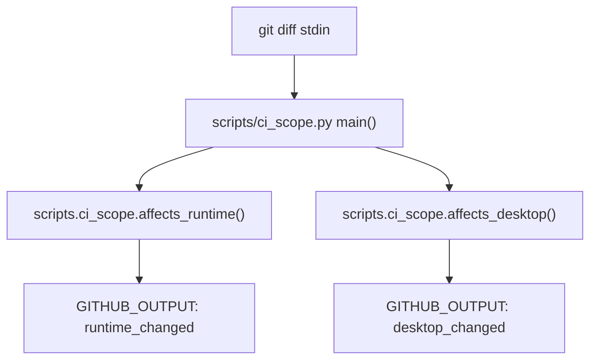
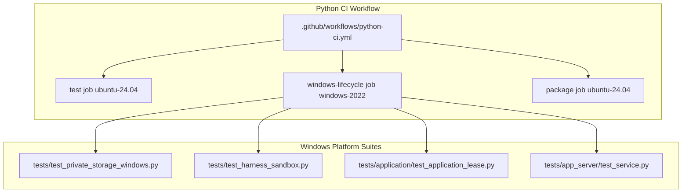
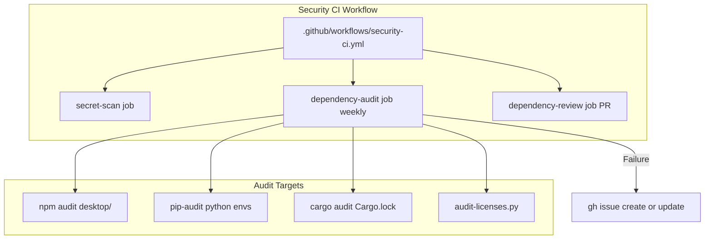

<!-- source: DeepWiki mcp.deepwiki.com · repo HKUDS/DeepCode · page 8.2 CI/CD Pipeline · fetched 2026-11-09 -->

# CI/CD Pipeline

Relevant source files

The following files were used as context for generating this wiki page:

- [.github/actions/ci-scope/action.yml](.github/actions/ci-scope/action.yml)
- [.github/workflows/desktop-ci.yml](.github/workflows/desktop-ci.yml)
- [.github/workflows/linting.yaml](.github/workflows/linting.yaml)
- [.github/workflows/python-ci.yml](.github/workflows/python-ci.yml)
- [.github/workflows/release-desktop.yml](.github/workflows/release-desktop.yml)
- [.github/workflows/security-ci.yml](.github/workflows/security-ci.yml)
- [.github/workflows/web-ci.yml](.github/workflows/web-ci.yml)
- [.gitleaksignore](.gitleaksignore)
- [app_server/service_client.py](app_server/service_client.py)
- [app_server/service_state.py](app_server/service_state.py)
- [cli/service_cli.py](cli/service_cli.py)
- [core/application/diagnostics_service.py](core/application/diagnostics_service.py)
- [desktop/scripts/build-sidecar.py](desktop/scripts/build-sidecar.py)
- [docs/CI.md](docs/CI.md)
- [scripts/ci/requirements.in](scripts/ci/requirements.in)
- [scripts/ci/requirements.lock](scripts/ci/requirements.lock)
- [scripts/ci_scope.py](scripts/ci_scope.py)
- [tests/app_server/test_service.py](tests/app_server/test_service.py)
- [tests/app_server/test_service_discovery.py](tests/app_server/test_service_discovery.py)
- [tests/test_ci_installation.py](tests/test_ci_installation.py)
- [tests/test_ci_scope.py](tests/test_ci_scope.py)
- [tests/test_config_layers.py](tests/test_config_layers.py)
- [tests/test_desktop_release_scripts.py](tests/test_desktop_release_scripts.py)

DeepCode utilizes a comprehensive CI/CD infrastructure powered by GitHub Actions to ensure the stability of the agentic kernel, the Desktop workbench, and cross-platform execution environments. The pipeline enforces rigorous quality gates through scope-aware change classification, multi-version Python testing matrices, Windows lifecycle security validations, containerized and local security auditing, and automated sidecar bundling.

---

## 1. Change Classification and Scope Detection (`ci-scope`)

To optimize CI resource consumption and execution times, workflows do not blindly run every suite on every commit. Instead, an intelligent scope classification action (`.github/actions/ci-scope`) executes `scripts/ci_scope.py` to evaluate the git diff against the merge base [.github/workflows/python-ci.yml:34-37](), [scripts/ci_scope.py:1-6]().

### Classification Logic
The script `scripts/ci_scope.py` inspects changed file paths and categorizes them into two primary signals: `runtime_changed` and `desktop_changed` [scripts/ci_scope.py:83-91]():
*   **Runtime Exemption**: Documentation paths (`docs/`), marketing assets (`assets/`), the documentation website (`website/`), issue templates, and top-level Markdown files (such as `README.md` or `CHANGELOG.md`) are exempt from triggering the heavy Python runtime tests [.github/workflows/python-ci.yml:34-37](), [scripts/ci_scope.py:50-68](). Any other path—including unknown new inputs—triggers full runtime validation [.github/workflows/python-ci.py:34-37](), [scripts/ci_scope.py:70-72]().
*   **Desktop Impact**: The `affects_desktop` function inspects whether changes touch core App Server code, CLI layers, protocol schemas, or Tauri desktop workbench files [.github/workflows/desktop-ci.yml:34-36](), [scripts/ci_scope.py:15-47](). If none of these inputs change, the Desktop quality gates are skipped [.github/workflows/desktop-ci.yml:38-41]().

**Scope Detection Data Flow**

Sources: [.github/workflows/python-ci.yml:34-37](), [scripts/ci_scope.py:1-95]()

---

## 2. Python CI Matrix and Windows Lifecycle Jobs

The primary backend validation workflow is defined in `.github/workflows/python-ci.yml`. It handles regular push events (targeting Python 3.13 on `ubuntu-24.04`) and pull requests (covering the full supported matrix: Python 3.12, 3.13, and 3.14) [.github/workflows/python-ci.yml:18-27]().

### Cross-Platform Windows Lifecycle Validation
Because certain platform security constructs (such as NTFS Access Control Lists, Windows Job Objects for process sandboxing, and file locking mechanisms) cannot be natively verified under Linux runners, a dedicated `windows-lifecycle` job executes on `windows-2022` [.github/workflows/python-ci.yml:66-122]().

*   **Concurrency & Leadership Tests**: Validates application leases, scheduler leadership elections, session deletions, and the execution coordinator under Windows file locking behaviors [.github/workflows/python-ci.yml:97-104]() (`tests/application/test_application_lease.py`, `tests/application/test_automation_scheduler_leadership.py`).
*   **Platform Sandboxing & ACLs**: Verifies private storage directory permissions, Job Object process constraints, and App Server background service discovery mechanisms [.github/workflows/python-ci.yml:109-121]() (`tests/test_private_storage_windows.py`, `tests/test_harness_sandbox.py`, `tests/app_server/test_service.py`).

**Python CI Matrix & Windows Execution**

Sources: [.github/workflows/python-ci.yml:18-130](), [tests/app_server/test_service.py:153-169]()

---

## 3. Desktop CI and Quality Gates

The Desktop CI pipeline (`.github/workflows/desktop-ci.yml`) ensures that the Tauri-based Desktop workbench and its embedded Python App Server sidecar remain in sync [.github/workflows/desktop-ci.yml:1-25]().

### Quality Gate Stages
When `desktop_changed` evaluates to `true`, the `quality` job runs parallel checks [.github/workflows/desktop-ci.yml:21-140]():
1.  **Frontend Verifications**: Installs Node dependencies (`npm ci`), checks protocol schema consistency (`npm run check:protocol`), validates TypeScript types (`npm run typecheck`), executes ESLint (`npm run lint`), and runs component unit tests (`npm test`) [.github/workflows/desktop-ci.yml:112-127]().
2.  **Rust Crate Checks**: Runs `cargo fmt --check`, `cargo clippy --locked --all-targets -- -D warnings`, and `cargo test --locked` inside `desktop/src-tauri` [.github/workflows/desktop-ci.yml:133-140]().
3.  **Scheduled Platform Bundling**: Weekly schedules or manual dispatches (`workflow_dispatch`) invoke the cross-platform bundle build matrix across `macos-15`, `macos-15-intel`, `windows-2022`, and `ubuntu-22.04` [.github/workflows/desktop-ci.yml:8-11](), [.github/workflows/desktop-ci.yml:141-168]().

Sources: [.github/workflows/desktop-ci.yml:1-195](), [tests/test_desktop_release_scripts.py:101-125]()

---

## 4. Security Audits, Gitleaks, and Dependency Review

DeepCode enforces a dedicated security workflow (`.github/workflows/security-ci.yml`) encompassing static secret scanning, vulnerability auditing across all package ecosystems, and PR dependency reviews [.github/workflows/security-ci.yml:1-161]().

### Secret Scanning & Ecosystem Auditing
*   **Gitleaks Scan**: The `secret-scan` job executes a pinned binary of `Gitleaks` (v8.30.1) across the full git history (`fetch-depth: 0`) with redacting enabled [.github/workflows/security-ci.yml:20-40](). Historical or test exclusions are managed via `.gitleaksignore` [.gitleaksignore:1-22]().
*   **Weekly Dependency Audits**: Scheduled weekly runs execute `npm audit`, `pip-audit` against both local and sidecar Python environments, `cargo audit`, and a license compliance check [.github/workflows/security-ci.yml:41-136](). If an advisory is discovered, the workflow automatically creates or updates an open GitHub issue titled `"Dependency audit failed on main"` rather than block arbitrary pushes [.github/workflows/security-ci.yml:137-152]().
*   **PR Dependency Review**: Pull requests automatically evaluate incoming dependency diffs against severity thresholds via `actions/dependency-review-action` [.github/workflows/security-ci.yml:153-161]().

**Security Verification Pipeline**

Sources: [.github/workflows/security-ci.yml:1-161](), [.gitleaksignore:1-22](), [tests/test_desktop_release_scripts.py:138-155]()

---

## 5. Sidecar Packaging and Release Pipelines

Packaging DeepCode for distribution involves compiling the Python App Server as a Tauri resource bundle and publishing Python distributions to PyPI [.github/workflows/release-desktop.yml:1-6](), [.github/workflows/pypi-publish.yml:1-5]().

### Sidecar Packaging (`build-sidecar.py`)
The script `desktop/scripts/build-sidecar.py` packages the Python App Server into an `onedir` distribution using PyInstaller [desktop/scripts/build-sidecar.py:1-7]().
*   **Bundled Assets**: Bundles required runtime resource directories via `--add-data`, including `app_server/web_assets`, `core/application/goal_prompts`, `core/skills/builtin`, and `core/mcp/presets.json` [desktop/scripts/build-sidecar.py:24-38]().
*   **Excluded Modules**: Strips out unnecessary heavy packages such as `PIL`, `numpy`, `pydantic.v1`, and `setuptools` to minimize artifact size [desktop/scripts/build-sidecar.py:53-64]().
*   **Runtime Verification**: After compilation, the binary executes `deepcode-app-server --verify-runtime` to guarantee that all skill creators and bundled MCP presets initialize successfully [desktop/scripts/build-sidecar.py:181-205]().

Sources: [.github/workflows/release-desktop.yml:1-192](), [desktop/scripts/build-sidecar.py:1-210](), [tests/test_desktop_release_scripts.py:157-186]()

---

