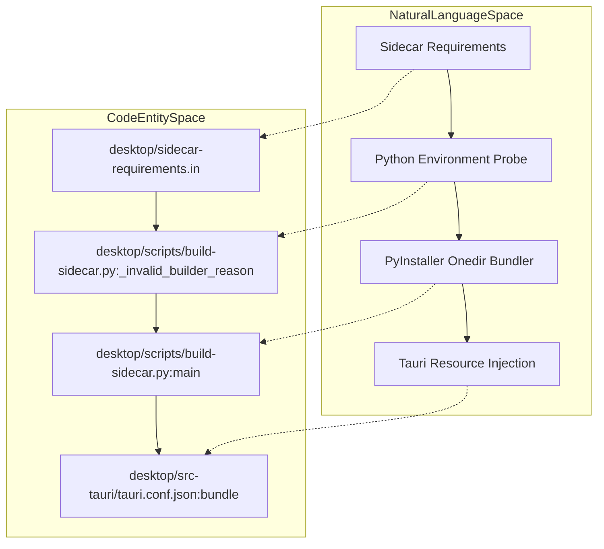
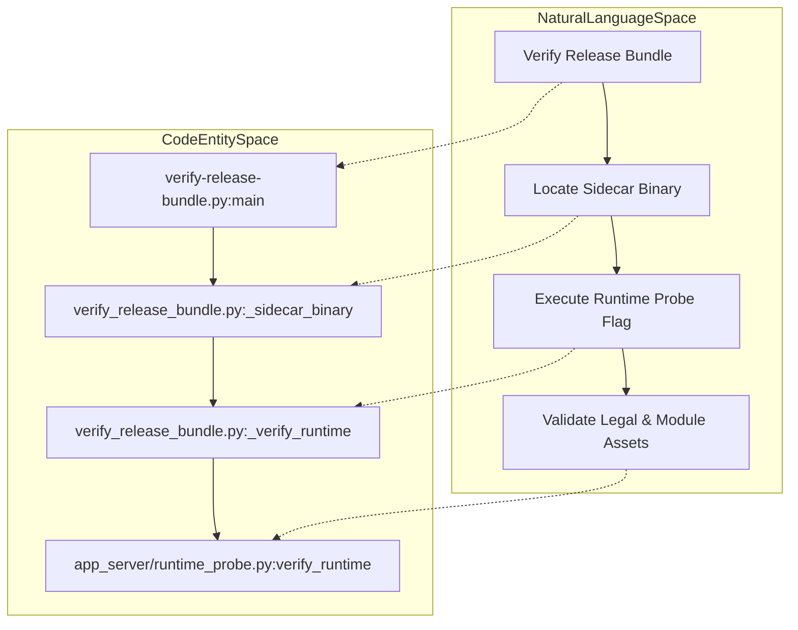

<!-- source: DeepWiki mcp.deepwiki.com · repo HKUDS/DeepCode · page 8.3 Desktop Release Process · fetched 2026-11-09 -->

# Desktop Release Process

Relevant source files

The following files were used as context for generating this wiki page:

- [.gitattributes](.gitattributes)
- [.github/actions/ci-scope/action.yml](.github/actions/ci-scope/action.yml)
- [.github/workflows/linting.yaml](.github/workflows/linting.yaml)
- [.github/workflows/web-ci.yml](.github/workflows/web-ci.yml)
- [.gitignore](.gitignore)
- [app_server/runtime_probe.py](app_server/runtime_probe.py)
- [core/application/views.py](core/application/views.py)
- [desktop/scripts/build-sidecar.py](desktop/scripts/build-sidecar.py)
- [desktop/scripts/verify-release-bundle.py](desktop/scripts/verify-release-bundle.py)
- [desktop/sidecar-requirements.in](desktop/sidecar-requirements.in)
- [desktop/sidecar-requirements.lock](desktop/sidecar-requirements.lock)
- [desktop/src-tauri/tauri.conf.json](desktop/src-tauri/tauri.conf.json)
- [requirements.txt](requirements.txt)
- [scripts/ci/requirements.in](scripts/ci/requirements.in)
- [tests/app_server/test_preset_methods.py](tests/app_server/test_preset_methods.py)
- [tests/app_server/test_runtime_probe.py](tests/app_server/test_runtime_probe.py)
- [tests/test_desktop_release_scripts.py](tests/test_desktop_release_scripts.py)

## Purpose and Scope

This document details the Desktop release pipeline for DeepCode (`ai.deepcode.desktop`), covering version synchronization across configuration manifests, the sidecar build pipeline (`desktop/scripts/build-sidecar.py`), platform-specific code signing and environment validation (`desktop/scripts/validate-release-environment.py`), automated bundle verification (`desktop/scripts/verify-release-bundle.py`), and Tauri auto-updater configuration (`desktop/scripts/create-release-config.py`).

Sources: [desktop/src-tauri/tauri.conf.json:1-45](), [desktop/scripts/build-sidecar.py:1-53]()

---

## Version Alignment and Configuration

Releases are triggered by pushing git tags matching the version patterns configured in the repository. Before platform bundling begins, version strings and endpoints must be validated across the project manifests:
*   `desktop/package.json`
*   `desktop/src-tauri/tauri.conf.json` [desktop/src-tauri/tauri.conf.json:1-45]()
*   `desktop/src-tauri/Cargo.toml`

The `desktop/scripts/create-release-config.py` script manages release configuration generation, ensuring absolute HTTPS endpoints for Tauri updates and validating environment declarations [tests/test_desktop_release_scripts.py:56-78]().

Sources: [desktop/src-tauri/tauri.conf.json:1-45](), [tests/test_desktop_release_scripts.py:56-78]()

---

## Sidecar Build Pipeline

DeepCode Desktop implements a sidecar architecture where the Tauri desktop application invokes a bundled Python App Server via IPC. To avoid cold-start extraction costs and ensure swift macOS library validation, the sidecar is packaged as an `onedir` bundle using PyInstaller [desktop/scripts/build-sidecar.py:1-7]().

### Dependency Compilation and Locking
Python runtime requirements are locked using `uv` against `desktop/sidecar-requirements.in` [desktop/sidecar-requirements.in:1-22]() and materialized in `desktop/sidecar-requirements.lock` [desktop/sidecar-requirements.lock:1-206](). The `desktop/scripts/build-sidecar.py` script verifies that a complete Python 3.12 environment with `REQUIRED_IMPORTS` (including `mcp`, `anthropic`, `openai`, `pydantic`) is available before invocation [desktop/scripts/build-sidecar.py:39-147]().

### PyInstaller Bundling Execution
The build script bundles the application server by executing PyInstaller with explicit exclusions (`EXCLUDED_MODULES` such as `PIL`, `numpy`, `pydantic.v1`, `setuptools`) and injecting `BUNDLED_DATA` resources [desktop/scripts/build-sidecar.py:24-64, 150-188]():

*Figure 1: Sidecar Build and Packaging Pipeline linking requirements to Tauri resource configuration.*

Sources: [desktop/sidecar-requirements.in:1-22](), [desktop/sidecar-requirements.lock:1-206](), [desktop/scripts/build-sidecar.py:24-188](), [desktop/src-tauri/tauri.conf.json:31-38]()

---

## Platform Code Signing and Environment Validation

To prevent operating system security warnings, desktop distributions require signing:
*   **macOS**: Apple Notarization requiring `APPLE_CERTIFICATE`, `APPLE_ID`, and `APPLE_TEAM_ID`.
*   **Windows**: Authenticode signatures using `WINDOWS_CERTIFICATE` and `WINDOWS_CERTIFICATE_PASSWORD`.
*   **Linux**: GPG signing for `.deb` packages and AppImage helpers.

The `desktop/scripts/validate-release-environment.py` script enforces fail-closed validation of these environment variables before any compilation or packaging step executes [tests/test_desktop_release_scripts.py:81-99]().

Sources: [tests/test_desktop_release_scripts.py:81-99]()

---

## Release Bundle Verification

Post-build verification is handled by `desktop/scripts/verify-release-bundle.py`, which inspects the generated Tauri release archives and runs runtime probes against the packaged sidecar binary [tests/test_desktop_release_scripts.py:101-137]().

### Verification Flow

*Figure 2: Release Bundle Verification Flow connecting verification scripts to runtime probes.*

The runtime probe executes `app_server/runtime_probe.py` via the binary flag `--verify-runtime`, asserting that `ok` is `true`, `skillCreator` is available, and all bundled MCP presets are intact [tests/app_server/test_runtime_probe.py:21-40]().

Sources: [tests/test_desktop_release_scripts.py:101-137](), [tests/app_server/test_runtime_probe.py:21-40]()

---

## Tauri Auto-Updater Configuration

DeepCode Desktop integrates the Tauri updater plugin for seamless delivery of updates.

### Configuration & Endpoint Security
*   **Endpoint Generation**: `desktop/scripts/create-release-config.py` builds the updater metadata. Endpoints must be absolute HTTPS URLs; relative paths or insecure schemes are strictly rejected [tests/test_desktop_release_scripts.py:56-78]().
*   **Public Key Verification**: The public signing key is embedded in `desktop/src-tauri/tauri.conf.json` under `plugins.updater.pubkey` [desktop/src-tauri/tauri.conf.json:39-44]().

Sources: [desktop/src-tauri/tauri.conf.json:39-44](), [tests/test_desktop_release_scripts.py:56-78]()

---

