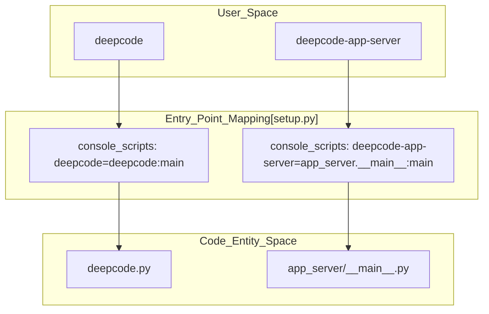

<!-- source: DeepWiki mcp.deepwiki.com · repo HKUDS/DeepCode · page 8.4 Python Package and PyPI Publishing · fetched 2026-11-09 -->

# Python Package and PyPI Publishing

<details>
<summary>Relevant source files</summary>

The following files were used as context for generating this wiki page:

- [.github/workflows/pypi-publish.yml](.github/workflows/pypi-publish.yml)
- [CONTRIBUTORS.md](CONTRIBUTORS.md)
- [MANIFEST.in](MANIFEST.in)
- [README.md](README.md)
- [README_ZH.md](README_ZH.md)
- [core/agent_presets/__init__.py](core/agent_presets/__init__.py)
- [core/agent_presets/builtin/code-reader.md](core/agent_presets/builtin/code-reader.md)
- [core/agent_presets/builtin/minimal.md](core/agent_presets/builtin/minimal.md)
- [core/version.py](core/version.py)
- [docs/HEADLESS_AND_AUTOMATION.md](docs/HEADLESS_AND_AUTOMATION.md)
- [scripts/verify_python_distribution.py](scripts/verify_python_distribution.py)
- [setup.py](setup.py)
- [tests/test_python_distribution_release.py](tests/test_python_distribution_release.py)

</details>


This page documents the packaging, verification, and distribution system for DeepCode, centered around the `deepcode-hku` package [setup.py:45](). It covers the Python package structure, `setup.py` configuration for bundled non-code data (skills, presets, and prompts), console script entry points, the fail-closed release verification pipeline (`verify_python_distribution.py`), and OIDC-based automated PyPI publishing.

## 1. Package Configuration and Structure

The DeepCode package is distributed as `deepcode-hku` on PyPI [setup.py:45](). It is engineered to support Python versions 3.12 through 3.14 [setup.py:59-61](), [tests/test_python_distribution_release.py:73-86]().

### Core Metadata and Dependencies
The `setup.py` script dynamically retrieves metadata from the codebase to maintain a single source of truth:
*   **Version**: Loaded directly from `core/version.py` using regex extraction to avoid importing runtime dependencies during package installation [setup.py:18-24](), [core/version.py:1-4]().
*   **Description**: Read from the repository root `README.md` [setup.py:10-15]().
*   **Dependencies**: Parsed from `requirements.txt` [setup.py:27-38]().
*   **Optional Extras**: The `advanced-documents` extra provisions `docling>=2.113.0` for PDF processing, while `test` provisions `pytest>=8,<10` and `pytest-asyncio>=1,<2` [setup.py:71-77]().

### Bundled Data (Package Data)
Because DeepCode operates as an agentic runner requiring prompt templates, skills, and preset catalogs, non-code files are explicitly packaged via `package_data` [setup.py:79-95]() and filtered through `MANIFEST.in` [MANIFEST.in:1-31]().

| Data Category | Package Path / Module | Purpose |
| :--- | :--- | :--- |
| **Goal Prompts** | `core.application.goal_prompts` | Markdown templates driving the durable `Goal` lifecycle [setup.py:82](). |
| **Built-in Skills** | `core.skills/builtin/` | YAML frontmatter definitions and instructions for the Skills system [setup.py:83-93](). |
| **Agent Presets** | `core.agent_presets/builtin/` | Named agent personas such as `minimal` and `code-reader` [setup.py:94](), [core/agent_presets/builtin/minimal.md:1-9](), [core/agent_presets/builtin/code-reader.md:1-11](). |
| **MCP Presets** | `core.mcp/presets.json` | Pre-configured Model Context Protocol server templates [setup.py:95](). |
| **Tool Specs** | `tools/*.yaml` | External tool configurations for the harness [setup.py:96](). |

Sources: [setup.py:44-109](), [MANIFEST.in:1-31](), [core/version.py:1-4]()

---

## 2. Console Scripts and Entry Points

The package exposes two primary command-line entry points via `console_scripts` in `setup.py` [setup.py:98-103]():
1.  `deepcode`: Invokes the primary CLI, interactive TUI, headless execution (`deepcode exec`), and goal runner loops (`deepcode loop`), routing to `deepcode:main` [setup.py:100]().
2.  `deepcode-app-server`: Starts the JSON-RPC 2.0 backend server consumed by the Desktop application sidecar, routing to `app_server.__main__:main` [setup.py:101]().

### CLI to Code Entity Mapping

The following diagram bridges the high-level user shell commands to their precise Python entry point functions and underlying module files.



Sources: [setup.py:98-103](), [deepcode.py](), [app_server/__main__.py]()

---

## 3. Release Verification System

Before publication to PyPI, DeepCode executes a strict, fail-closed validation script located at `scripts/verify_python_distribution.py` [.github/workflows/pypi-publish.yml:53-58](). This script inspects the generated wheel (`.whl`) and source distribution (`.tar.gz`) artifacts [.github/workflows/pypi-publish.yml:47-52]().

### Verification Checks and Constraints
*   **Version Synchronization**: Validates that the package version inside the distribution artifact strictly matches the tag and `core/version.py` [tests/test_python_distribution_release.py:88-100]().
*   **Python Support Window**: Asserts that `Requires-Python` matches the supported window (`>=3.12`), rejecting out-of-range configurations like Python 3.11 or 3.13 strict bounds [tests/test_python_distribution_release.py:73-86]().
*   **MCP Dependency Pinning**: Ensures the `mcp` dependency conforms to safe version ranges (e.g., `mcp>=1.29,<2`) without conditional platform hacks [tests/test_python_distribution_release.py:54-70]().
*   **Web Asset Bundling**: Verifies the presence of compiled frontend assets (`web/web-build.json`, `web/index.html`, `web/assets/app.js`) within the distribution package [tests/test_python_distribution_release.py:102-113]().

### Distribution Verification Flow

The diagram below maps the build and validation pipeline from source files to verified artifacts ready for distribution.

```mermaid
graph LR
    subgraph "Source_Root"
        SF[""core/version.py""]
        REQ[""requirements.txt""]
        STP[""setup.py""]
    end

    subgraph "Build_Engine"
        BLD[""python -m build""]
    end

    subgraph "Artifact_Store"
        WHL[""*.whl (Wheel)""]
        SDIST[""*.tar.gz (Sdist)""]
    end

    subgraph "Verification_Engine"
        VFY[""scripts/verify_python_distribution.py""]
        TST[""tests/test_python_distribution_release.py""]
    end

    SF --> STP
    REQ --> STP
    STP --> BLD
    BLD --> WHL
    BLD --> SDIST
    WHL --> VFY
    SDIST --> VFY
    VFY --> TST
```

Sources: [.github/workflows/pypi-publish.yml:47-58](), [scripts/verify_python_distribution.py](), [tests/test_python_distribution_release.py:1-113]()

---

## 4. OIDC PyPI Publishing Workflow

Publishing to PyPI is fully automated via GitHub Actions (`.github/workflows/pypi-publish.yml`), utilizing OpenID Connect (OIDC) trusted publishing to eliminate static API tokens [.github/workflows/pypi-publish.yml:1-88]().

1.  **Release Event Trigger**: The workflow triggers upon a published GitHub release (`types: [published]`) [.github/workflows/pypi-publish.yml:4-5]().
2.  **Environment Setup**: Checks out the release tag, sets up Python 3.12, and configures Node.js 22 to compile the bundled desktop web surface assets (`npm run build:web`) [.github/workflows/pypi-publish.yml:23-46]().
3.  **Build and Validate**: Runs `python -m build`, checks metadata with `twine check`, and executes `scripts/verify_python_distribution.py` [.github/workflows/pypi-publish.yml:47-58]().
4.  **Artifact Upload**: Stores release distributions as workflow artifacts retained for 7 days [.github/workflows/pypi-publish.yml:59-65]().
5.  **Trusted Publishing**: The `pypi-publish` job requests an OIDC token (`id-token: write`) and delegates upload to `pypa/gh-action-pypi-publish` [.github/workflows/pypi-publish.yml:67-88]().

Sources: [.github/workflows/pypi-publish.yml:1-88]()

---

