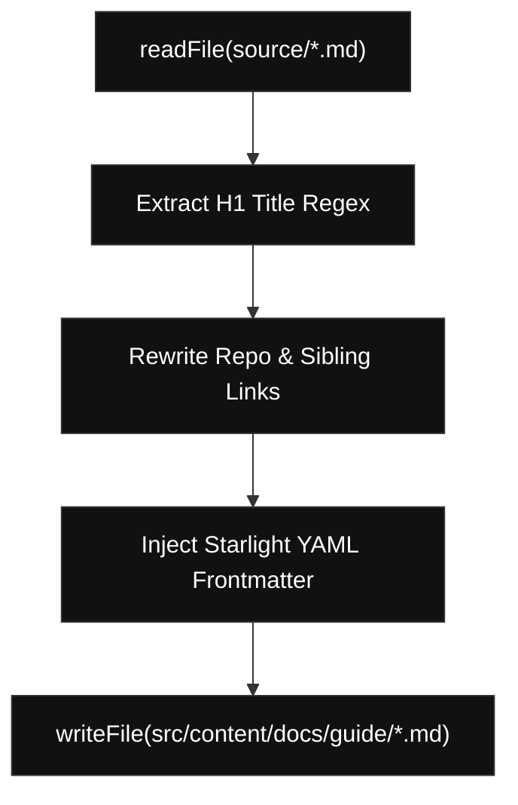
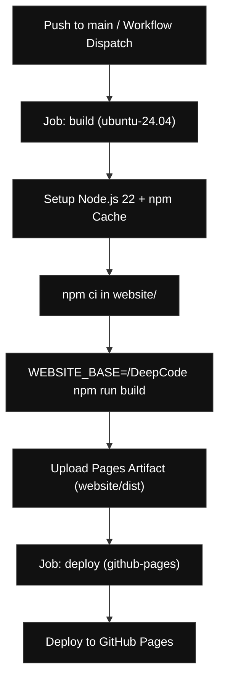

<!-- source: DeepWiki mcp.deepwiki.com · repo HKUDS/DeepCode · page 8.6 Documentation Website · fetched 2026-11-09 -->

# Documentation Website

<details>
<summary>Relevant source files</summary>

The following files were used as context for generating this wiki page:

- [.github/workflows/deploy-website.yml](.github/workflows/deploy-website.yml)
- [assets/framework2.pdf](assets/framework2.pdf)
- [assets/readme/README.md](assets/readme/README.md)
- [assets/readme/deepcode-overview.png](assets/readme/deepcode-overview.png)
- [assets/readme/framework2.png](assets/readme/framework2.png)
- [assets/readme/verification-loop.png](assets/readme/verification-loop.png)
- [assets/setting_model.png](assets/setting_model.png)
- [docs/archive/README_LEGACY_2026-07-20.md](docs/archive/README_LEGACY_2026-07-20.md)
- [docs/archive/README_ZH_LEGACY_2026-07-20.md](docs/archive/README_ZH_LEGACY_2026-07-20.md)
- [docs/guide/README.md](docs/guide/README.md)
- [website/.gitignore](website/.gitignore)
- [website/README.md](website/README.md)
- [website/astro.config.mjs](website/astro.config.mjs)
- [website/package-lock.json](website/package-lock.json)
- [website/package.json](website/package.json)
- [website/scripts/sync-guides.mjs](website/scripts/sync-guides.mjs)
- [website/src/content.config.ts](website/src/content.config.ts)
- [website/src/pages/index.astro](website/src/pages/index.astro)
- [website/src/styles/starlight-theme.css](website/src/styles/starlight-theme.css)

</details>


The documentation website subsystem powers DeepCode's public landing page and interactive user guides. Built using Astro and Starlight, the system treats `docs/guide/` as the single source of truth, synchronizing markdown files into content collections at build time, and deploying automatically to GitHub Pages.

---

## 1. Documentation Source Layout and Architecture

The documentation architecture separates raw editorial content from the static site generator. Markdown files representing user guides are maintained inside the repository's root `docs/guide/` directory (e.g., `docs/guide/README.md`) [docs/guide/README.md:1-34]. The website wrapper in `website/` consumes these files, wrapping them with Starlight layouts, custom styling, and Astro pages (`website/README.md:1-21`).

The following diagram bridges the natural language documentation source space to the website build and deployment entities in code:

```mermaid
graph TD
    subgraph "Natural Language Space"
        DocRoot["docs/guide/README.md"]
        GuideFiles["docs/guide/*.md"]
    end

    subgraph "Code Entity Space"
        SyncScript["website/scripts/sync-guides.mjs"]
        ContentColl["website/src/content.config.ts"]
        AstroConfig["website/astro.config.mjs"]
        LandingPage["website/src/pages/index.astro"]
        DeployWorkflow[".github/workflows/deploy-website.yml"]
    end

    DocRoot -->| "source data" | SyncScript
    GuideFiles -->| "source files" | SyncScript
    SyncScript -->| "generates" | ContentColl
    AstroConfig -->| "configures Starlight" | ContentColl
    LandingPage -->| "renders landing at /" | AstroConfig
    DeployWorkflow -->| "triggers build & deploy" | AstroConfig

    classDef default fill:#111,stroke:#333,stroke-width:1px,color:#fff;
```

Sources: `docs/guide/README.md:1-34`, `website/scripts/sync-guides.mjs:1-65`, `website/astro.config.mjs:1-39`, `website/src/content.config.ts:1-7`, `website/src/pages/index.astro:1-10`, `.github/workflows/deploy-website.yml:1-58`

---

## 2. Guide Synchronization Script

Because Starlight expects content collections inside its own content directory (`website/src/content/docs/guide/`), DeepCode uses a Node.js synchronization script (`website/scripts/sync-guides.mjs`) to copy and transform markdown files from `docs/guide/` prior to every build or development server start (`website/package.json:5-10`).

The script (`website/scripts/sync-guides.mjs:1-65`) performs the following transformations:
1. Clears and recreates the target directory `website/src/content/docs/guide/` (`website/scripts/sync-guides.mjs:55-56`).
2. Reads all `.md` files from the source directory [website/scripts/sync-guides.mjs:57]().
3. Extracts the first Markdown H1 heading (`# Title`) to use as the Starlight page title frontmatter [website/scripts/sync-guides.mjs:13-18]().
4. Rewrites repository-relative links (such as `../` and `../LOCAL_PLUGINS.md`) to point correctly to GitHub blob URLs [website/scripts/sync-guides.mjs:20-32]().
5. Rewrites sibling guide links (e.g., `sessions.md`) into relative Starlight site routes [website/scripts/sync-guides.mjs:33-45]().
6. Inserts generated YAML frontmatter containing the extracted title and slug [website/scripts/sync-guides.mjs:47-53]().



Sources: `website/scripts/sync-guides.mjs:1-65`, `website/package.json:5-10`

---

## 3. Astro Configuration and Starlight Integration

The site is configured in `website/astro.config.mjs` [website/astro.config.mjs:1-39] using Astro and the `@astrojs/starlight` integration. 

Key configuration settings include:
- **Base Path Resolution**: Respects the `WEBSITE_BASE` environment variable (defaulting to `/`) to support GitHub Pages subpath hosting [website/astro.config.mjs:7-13] (`/DeepCode`).
- **Custom CSS**: Injects `./src/styles/starlight-theme.css` for consistent branding [website/astro.config.mjs:18]().
- **Sidebar Navigation**: Explicitly structures documentation categories including "Start here", "Daily driving", and "Compounding" [website/astro.config.mjs:26-36]().
- **Content Collection Schema**: Defined in `website/src/content.config.ts` using `docsLoader()` and `docsSchema()` from Starlight [website/src/content.config.ts:1-7]().

Sources: `website/astro.config.mjs:1-39`, `website/src/content.config.ts:1-7`

---

## 4. Landing Page Surface

The root landing page (`website/src/pages/index.astro`) is a hand-crafted single-file Astro component [website/src/pages/index.astro:1-10] featuring an editorial terminal aesthetic. 

The landing page implements:
- A custom dark color palette (`--ground`, `--panel`, `--ink`, `--sky`, `--cyan`, `--teal`) declared directly in CSS root variables [website/src/pages/index.astro:25-43]().
- An ambient background circuit glow (`.atmo` and `.grain`) [website/src/pages/index.astro:61-70]().
- A fully styled interactive terminal hero element (`.term`) displaying live-action typing simulations and code inspection UI [website/src/pages/index.astro:127-158]().

Sources: `website/src/pages/index.astro:1-158`

---

## 5. Theming and Design System

The visual appearance bridges DeepCode's terminal persona with Starlight's technical documentation layout via `website/src/styles/starlight-theme.css` [website/src/styles/starlight-theme.css:1-57].

Design tokens overridden in Starlight include:
- Font families referencing IBM Plex Sans and IBM Plex Mono [website/src/styles/starlight-theme.css:7-8]().
- Accent color tokens (`--sl-color-accent`, `--sl-color-accent-low`, `--sl-color-accent-high`) mapped to DeepCode's cyan/teal scale for both dark and light modes [website/src/styles/starlight-theme.css:10-36]().
- Markdown content styling that prefixes section headers with terminal symbols (`●`) and places code blocks on deep ground panels [website/src/styles/starlight-theme.css:38-56]().

Sources: `website/src/styles/starlight-theme.css:1-57`

---

## 6. Continuous Integration and Deployment Workflow

The documentation website is built and deployed automatically via GitHub Actions in `.github/workflows/deploy-website.yml` [.github/workflows/deploy-website.yml:1-58].

The workflow executes across two sequential jobs:
1. **`build` job**: Checks out the repository, sets up Node.js 22 with npm caching, installs dependencies within `website/`, and runs `npm run build` with `WEBSITE_BASE: /DeepCode` [pkg-json/workflow:22-46] [.github/workflows/deploy-website.yml:22-46]. The build artifact (`website/dist`) is then uploaded to GitHub Pages [.github/workflows/deploy-website.yml:42-45].
2. **`deploy` job**: Consumes the uploaded artifact and deploys it to the `github-pages` environment [.github/workflows/deploy-website.yml:47-58].



Sources: `.github/workflows/deploy-website.yml:1-58`, `website/package.json:1-16`

---

