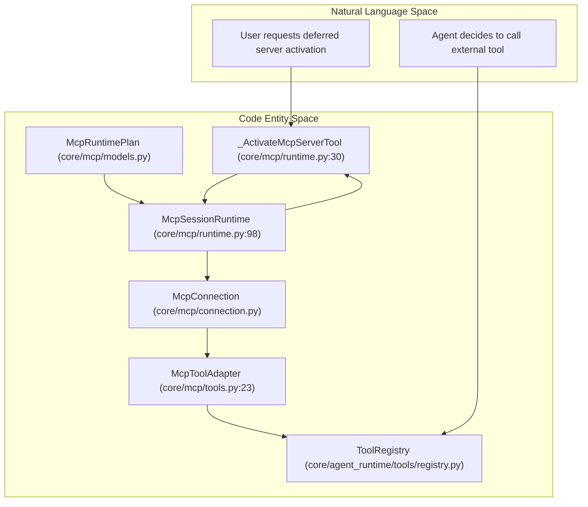
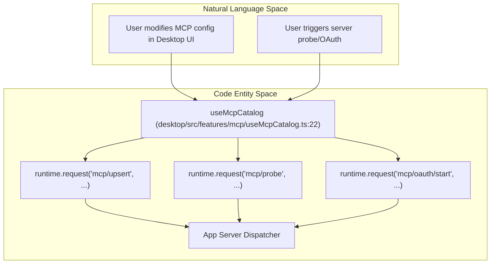

<!-- source: DeepWiki mcp.deepwiki.com · repo HKUDS/DeepCode · page 9.1 MCP Server Integration · fetched 2026-11-09 -->

# MCP Server Integration

Relevant source files

The following files were used as context for generating this wiki page:

- [core/agent_runtime/tools/base.py](core/agent_runtime/tools/base.py)
- [core/domain/execution_security.py](core/domain/execution_security.py)
- [core/harness/memory.py](core/harness/memory.py)
- [core/loop/autodream.py](core/loop/autodream.py)
- [core/mcp/models.py](core/mcp/models.py)
- [core/mcp/runtime.py](core/mcp/runtime.py)
- [core/mcp/tools.py](core/mcp/tools.py)
- [desktop/src/features/mcp/useMcpCatalog.test.tsx](desktop/src/features/mcp/useMcpCatalog.test.tsx)
- [desktop/src/features/mcp/useMcpCatalog.ts](desktop/src/features/mcp/useMcpCatalog.ts)
- [tests/test_autodream.py](tests/test_autodream.py)
- [tests/test_compaction_memory.py](tests/test_compaction_memory.py)
- [tests/test_mcp_runtime_lazy.py](tests/test_mcp_runtime_lazy.py)
- [tests/test_memory.py](tests/test_memory.py)
- [tests/test_memory_layers.py](tests/test_memory_layers.py)
- [tests/test_tool_description_quality.py](tests/test_tool_description_quality.py)

## Purpose and Scope

This page documents the Model Context Protocol (MCP) server integration subsystem within DeepCode (`core/mcp/`). This system provides a session-scoped runtime that manages the lifecycle of external tool servers (supporting `stdio`, `SSE`, and `Streamable HTTP` transports), resolves secure credentials via environment variables or OAuth providers, adapts remote tools into native DeepCode `Tool` abstractions, and exposes management interfaces through the CLI, TUI, and Desktop application workbench.

Sources: [core/mcp/runtime.py:98-130](), [core/mcp/models.py:102-196]()

---

## Architecture and Data Flow

The MCP subsystem bridges external tool providers into DeepCode's agent execution loop. The core coordinator is `McpSessionRuntime`, which takes an immutable `McpRuntimePlan` and instantiates connections, tool adapters, and registration hooks [core/mcp/runtime.py:98-130]().

Sources: [core/mcp/runtime.py:98-130](), [core/mcp/runtime.py:30-42](), [core/mcp/tools.py:23-57]()

---

## Server Lifecycle, Add/Test/Enable, and Lazy Loading

DeepCode supports deferred activation of MCP servers to reduce initialization overhead and conserve connection pools. When `defer_loading` is set to `True` in `McpServerDefinition`, the server is skipped during initial startup and registered with a placeholder activation tool [core/mcp/models.py:157-160](), [tests/test_mcp_runtime_lazy.py:81-100]().

### Lifecycle States and Status Tracking
Servers transition through distinct runtime states represented by `McpServerRuntimeStatus`:
1. `configured`: Discovered in configuration but not initialized [core/mcp/runtime.py:119-128]().
2. `deferred`: Marked for lazy loading, awaiting explicit activation [tests/test_mcp_runtime_lazy.py:81-92]().
3. `starting`: Transport channels are actively being established.
4. `ready`: Connection verified, and tools registered into the active `ToolRegistry`.
5. `error`: Initialization or handshake failure encountered.

When an agent needs a deferred server's capabilities, it invokes `_ActivateMcpServerTool`, which executes `McpSessionRuntime.activate_server(server_id)` to dynamically mount the remote tools [core/mcp/runtime.py:30-95]().

Sources: [core/mcp/runtime.py:21-28](), [core/mcp/runtime.py:30-95](), [core/mcp/models.py:157-160](), [tests/test_mcp_runtime_lazy.py:81-100]()

---

## Credentials, Environment Variables, and OAuth

DeepCode enforces strict separation between server transport definitions and sensitive credentials.

### Credential Resolution Mechanics
- **Environment Inheritance**: `env_vars` specifies explicit environment variables passed directly to subprocesses [core/mcp/models.py:116-119]().
- **Credential References**: `McpCredentialRef` models pointers to managed user connection IDs (e.g., `provider:github`), which are resolved immediately prior to process startup [core/mcp/models.py:65-90]().
- **Header Injection**: `env_http_headers` and `bearer_token_credential` securely inject authorization headers for HTTP and SSE transports [core/mcp/models.py:130-153]().
- **OAuth Integration**: Servers configured with `auth: "oauth"` rely on `OAuthProviderFactory` to manage authorization code exchanges and token persistence [core/mcp/runtime.py:107-114]().

Sources: [core/mcp/models.py:65-90](), [core/mcp/models.py:116-153](), [core/mcp/runtime.py:107-114]()

---

## User Interfaces: CLI and TUI

DeepCode provides native command-line and terminal interface capabilities for managing MCP servers:
- **Headless CLI (`deepcode mcp`)**: 
  - `deepcode mcp list`: Enumerates configured servers, their sources, and connection health.
  - `deepcode mcp add`: Interactively registers new stdio or HTTP servers.
  - `deepcode mcp test`: Probes a target server ID to check availability and list advertised tools.
- **Interactive TUI (`/mcp`)**: A slash command inside the terminal REPL allowing users to inspect active tool inventories, view error traces, and toggle server states on the fly.

Sources: [core/mcp/runtime.py:21-28](), [core/mcp/models.py:102-196]()

---

## Desktop Catalog Hook and RPC Bridge

The Desktop application manages MCP configurations through a dedicated React hook, `useMcpCatalog`, which communicates with the App Server via JSON-RPC.

### Key RPC Endpoints
| RPC Method | Hook Wrapper | Description |
| :--- | :--- | :--- |
| `mcp/list` | `useMcpCatalog` | Fetches complete server inventory and status [desktop/src/features/mcp/useMcpCatalog.ts:50]() |
| `mcp/presets` | `useMcpCatalog` | Retrieves bundled preset catalog options [desktop/src/features/mcp/useMcpCatalog.ts:51]() |
| `mcp/upsert` | `upsert` | Adds or updates custom server definitions [desktop/src/features/mcp/useMcpCatalog.ts:109]() |
| `mcp/remove` | `remove` | Deletes a server definition from config [desktop/src/features/mcp/useMcpCatalog.ts:122]() |
| `mcp/preset/add`| `addPreset` | Instantiates a server from the preset template catalog [desktop/src/features/mcp/useMcpCatalog.ts:134]() |
| `mcp/set-enabled`| `setEnabled`| Toggles server enabled flag without removing configuration [desktop/src/features/mcp/useMcpCatalog.ts:146]() |
| `mcp/probe` | `probe` | Triggers a live connection health check [desktop/src/features/mcp/useMcpCatalog.ts:158]() |
| `mcp/oauth/start`| `startOAuth` | Initiates browser-based OAuth authentication flow [desktop/src/features/mcp/useMcpCatalog.ts:171]() |

Sources: [desktop/src/features/mcp/useMcpCatalog.ts:22-192]()

---

## Bundled MCP Preset Catalog

DeepCode bundles pre-configured templates for common developer services, enabling rapid integration into projects or user workspaces:

| Server ID | Transport | Primary Tool Capabilities |
| :--- | :--- | :--- |
| `browserbase` | SSE | `list_sessions`, `create_session`, `live_view` |
| `playwright` | stdio | `navigate`, `click`, `screenshot`, `evaluate` |
| `github` | stdio | `create_issue`, `search_code`, `get_pull_request` |
| `notion` | stdio | `append_block`, `search`, `get_page` |
| `linear` | stdio | `create_issue`, `search_issues`, `get_workflow_states` |
| `firecrawl` | stdio | `scrape_url`, `crawl_website` |
| `context7` | stdio | `search_documentation`, `index_repo` |

Sources: [core/mcp/runtime.py:21-28](), [desktop/src/features/mcp/useMcpCatalog.ts:8-11]()

---

