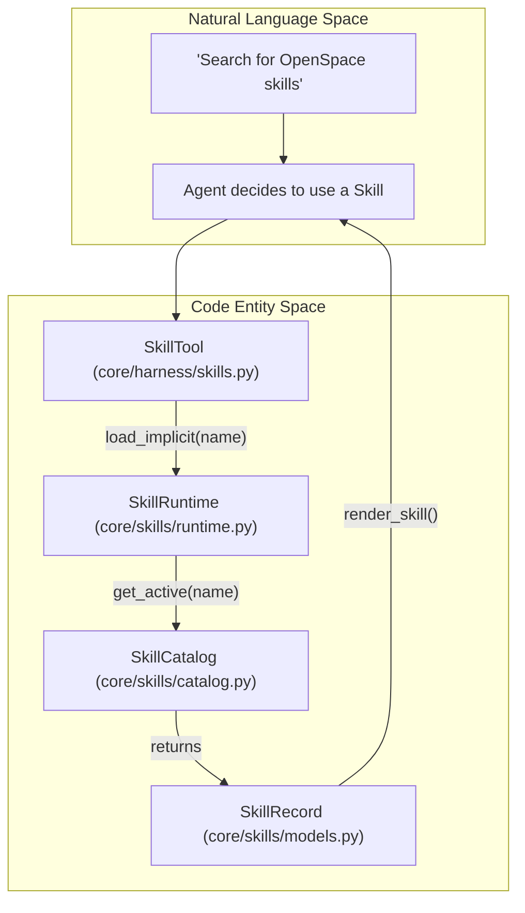
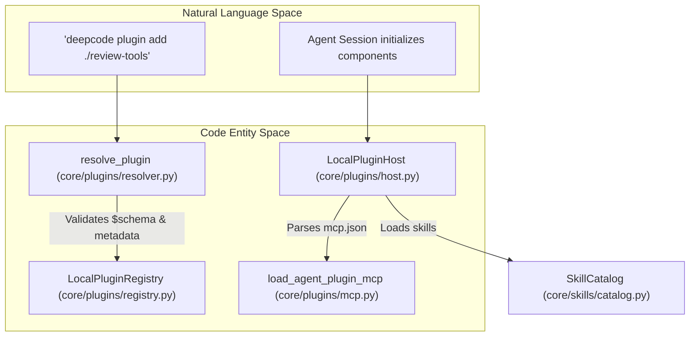

<!-- source: DeepWiki mcp.deepwiki.com · repo HKUDS/DeepCode · page 9.2 OpenSpace and Local Plugins · fetched 2026-11-09 -->

# OpenSpace and Local Plugins

<details>
<summary>Relevant source files</summary>

The following files were used as context for generating this wiki page:

- [core/application/skill_service.py](core/application/skill_service.py)
- [core/harness/skills.py](core/harness/skills.py)
- [core/plugins/mcp.py](core/plugins/mcp.py)
- [core/skills/__init__.py](core/skills/__init__.py)
- [core/skills/builtin/skill-creator/scripts/quick_validate.py](core/skills/builtin/skill-creator/scripts/quick_validate.py)
- [core/skills/catalog.py](core/skills/catalog.py)
- [core/skills/management.py](core/skills/management.py)
- [core/skills/metadata.py](core/skills/metadata.py)
- [core/skills/models.py](core/skills/models.py)
- [core/skills/prompting.py](core/skills/prompting.py)
- [core/skills/runtime.py](core/skills/runtime.py)
- [docs/LOCAL_PLUGINS.md](docs/LOCAL_PLUGINS.md)
- [docs/SKILLS_PRODUCT_ARCHITECTURE.md](docs/SKILLS_PRODUCT_ARCHITECTURE.md)
- [tests/test_plugins.py](tests/test_plugins.py)

</details>


DeepCode integrates with external environments through OpenSpace (utilizing `openspace-mcp` and dedicated delegation skills) and provides extensible local capabilities via the Agent Plugins 1.0 packaging format. This page details the implementation, data flows, security boundaries, and runtime behaviors for both OpenSpace integration and local plugins.

## 1. OpenSpace Integration

DeepCode integrates with OpenSpace to provide enhanced task delegation and skill discovery capabilities. This integration is implemented using the Model Context Protocol (MCP) and specialized Skills that bridge user intent with the underlying execution environment.

### 1.1 MCP Server Configuration and `${workspace}`
The core of the OpenSpace integration is the `openspace-mcp` server, installed as a standard MCP server within the DeepCode environment [docs/SKILLS_PRODUCT_ARCHITECTURE.md:1-136](). The `McpServerDefinition` supports dynamic path resolution [core/mcp/models.py:102-160](). When defining an MCP server like `openspace-mcp`, the `${workspace}` placeholder is dynamically resolved to the active project's root directory during the materialization of the `McpRuntimePlan` [core/mcp/runtime.py:98-115](). This ensures stdio-based servers and working directories are correctly fenced to the active project [core/mcp/models.py:114-114]().

Sources: [core/mcp/models.py:102-160](), [core/mcp/runtime.py:98-115](), [docs/SKILLS_PRODUCT_ARCHITECTURE.md:1-136]()

### 1.2 Version Pinning and Lazy Loading
To maintain session stability, MCP protocol versions (e.g., `2025-03-26`) are negotiated during the `McpConnection` handshake [tests/test_mcp_runtime_lazy.py:38-38](). The integration leverages `deferLoading` [core/mcp/models.py:157-160](), allowing the `openspace-mcp` server to initialize lazily. When an agent invokes a deferred tool, `_ActivateMcpServerTool` triggers `McpSessionRuntime.activate_server` to start the connection and register tools dynamically [core/mcp/runtime.py:30-95]().

Sources: [core/mcp/models.py:157-160](), [core/mcp/runtime.py:30-95](), [tests/test_mcp_runtime_lazy.py:38-38]()

### 1.3 Integrated Skills (`skill-discovery` and `delegate-task`)
The OpenSpace integration exposes two primary skills managed by the `SkillCatalog` [core/harness/skills.py:13-17]():
- `skill-discovery`: Allows the agent to search for and identify capabilities within the OpenSpace repository using progressive disclosure [core/harness/skills.py:122-137]().
- `delegate-task`: Facilitates offloading specific sub-tasks to the OpenSpace execution environment using activated MCP tools.

**Natural Language to Code Entity Space: Skill Resolution**

Sources: [core/harness/skills.py:13-26](), [core/harness/skills.py:122-186](), [core/skills/runtime.py:24-24]()

---

## 2. Agent Plugins 1.0 Local Plugin Packaging Format

A Skill remains a first-class DeepCode resource, but a Plugin is an optional package that contributes additional Skills and MCP servers to the catalog without altering standalone skill semantics [docs/LOCAL_PLUGINS.md:1-16]().

### 2.1 Package Layout and `plugin.json` Schema
DeepCode enforces the Agent Plugins 1.0.0 specification [docs/LOCAL_PLUGINS.md:18-38](). A valid plugin package contains a `plugin.json` manifest and a fixed `skills/` directory:

```text
review-tools/
├── plugin.json
├── skills/
│   ├── review/SKILL.md
│   └── verify/SKILL.md
└── mcp.json
```

The manifest must declare the Agent Plugins 1.0.0 schema URI in `$schema` [docs/LOCAL_PLUGINS.md:31-45](). No experimental legacy fallback exists [docs/LOCAL_PLUGINS.md:40-41](). `resolve_plugin()` validates metadata and fixed components [tests/test_plugins.py:97-109]().

Sources: [docs/LOCAL_PLUGINS.md:18-52](), [tests/test_plugins.py:97-109]()

### 2.2 Fixed Skills and MCP Components
Plugin skills are discovered exclusively as immediate child directories of `skills/` [docs/LOCAL_PLUGINS.md:42-43](). Each skill must include a `SKILL.md` with frontmatter matching its parent directory name [docs/LOCAL_PLUGINS.md:47-48](). 

An optional `mcp.json` file configures local or remote MCP servers (stdio, SSE, or Streamable HTTP) [docs/LOCAL_PLUGINS.md:54-56](). `load_agent_plugin_mcp()` validates `mcp.json` independently without executing or importing plugin code [core/plugins/mcp.py:79-149]().

Sources: [docs/LOCAL_PLUGINS.md:42-59](), [core/plugins/mcp.py:79-149]()

### 2.3 Security, Credentials, and Runtime Isolation
Plugin MCP server definitions are treated as distributable package data. Literal plaintext secrets in `mcp.json` are detected by `_credential_diagnostics()` and flagged with a warning [core/plugins/mcp.py:152-186](). Secrets must be bound at runtime via user configuration rather than stored statically in the package [docs/LOCAL_PLUGINS.md:60-91]().

Discovery is inert: registering a plugin never executes arbitrary code or spawns subprocesses until an active agent session demands the capability [docs/LOCAL_PLUGINS.md:66-71]().

Sources: [docs/LOCAL_PLUGINS.md:60-91](), [core/plugins/mcp.py:152-186]()

### 2.4 Local Lifecycle and Registry Management
Plugins are managed via the `deepcode plugin` CLI suite [docs/LOCAL_PLUGINS.md:93-108]():
- `deepcode plugin add <path>`: Assigns an opaque installation ID (`plg_...`) and links the source directory in `$DEEPCODE_HOME/plugins/registry.json`.
- `deepcode plugin list`: Displays registered plugins and their component status.
- `deepcode plugin enable` / `disable`: Toggles plugin activation state.
- `deepcode plugin remove`: Unregisters the installation without deleting source files [docs/LOCAL_PLUGINS.md:103-108]().

**Natural Language to Code Entity Space: Local Plugin and MCP Loading**

Sources: [docs/LOCAL_PLUGINS.md:93-113](), [core/plugins/mcp.py:79-149](), [tests/test_plugins.py:97-110]()

---

