# Page: Overview

# Overview

<details>
<summary>Relevant source files</summary>

The following files were used as context for generating this wiki page:

- [CONTRIBUTORS.md](CONTRIBUTORS.md)
- [README.md](README.md)
- [README_ZH.md](README_ZH.md)
- [assets/framework2.pdf](assets/framework2.pdf)
- [assets/readme/README.md](assets/readme/README.md)
- [assets/readme/deepcode-overview.png](assets/readme/deepcode-overview.png)
- [assets/readme/framework2.png](assets/readme/framework2.png)
- [assets/readme/verification-loop.png](assets/readme/verification-loop.png)
- [assets/setting_model.png](assets/setting_model.png)
- [core/version.py](core/version.py)
- [docs/archive/README_LEGACY_2026-07-20.md](docs/archive/README_LEGACY_2026-07-20.md)
- [docs/archive/README_ZH_LEGACY_2026-07-20.md](docs/archive/README_ZH_LEGACY_2026-07-20.md)
- [docs/guide/README.md](docs/guide/README.md)

</details>


## Purpose and Scope

DeepCode is an open agentic coding system designed to bridge the gap between high-level requirements and functional, verified implementations. It utilizes a multi-agent architecture to automate complex software development tasks, specializing in a "Loop Engineering" philosophy where agents iterate through planning, implementation, and verification until a goal is provably satisfied.

This page serves as the parent entry point for understanding the system's core capabilities, including its interactive interfaces, shared background service, research-to-code pipeline, and underlying agent kernel.

For detailed setup, installation, and configuration, see the child pages:
- [Getting Started](#1.1) — Installing DeepCode via pip/uv/pipx, running `deepcode init`, connecting model providers, trusting workspaces, and launching interactive TUI, Desktop, or Web entry points.
- [Configuration Reference](#1.2) — Detailed reference for `~/.deepcode/deepcode_config.json`, layered user/project configurations, provider profiles, model declarations, MCP entries, permission presets, dictation blocks, and config error reporting.

Sources: [README.md:81-84](), [docs/guide/README.md:1-17]()

---

## Core Capabilities

DeepCode provides a unified agent runtime accessible through multiple interface modalities, ensuring complete parity across terminal and visual workflows over a shared local background service.

*   **Multi-Interface Workbenches**: Interactive CLI/TUI (`deepcode`), Tauri-based Desktop workbench (`deepcode desktop`), and Web workbench (`deepcode web`). All interfaces share the same local Projects, Session history, models, Skills, permissions, Goals, and Automations [README.md:81-85]().
*   **Loop Engineering**: A goal-driven execution model where agents work toward defined objectives (`Goal`), utilizing tools, running test suites, and receiving feedback in an automated loop until verification passes [README_ZH.md:125-126]().
*   **Paper2Code Research Pipeline**: A specialized 7-phase multi-agent orchestration workflow that transforms academic papers (PDF/arXiv) into verified, production-ready algorithm implementations [README.md:102-103]().
*   **Durable Sessions and Memory**: Persistent session management using a JSONL `SessionStore` and SQLite projection, alongside a two-layer memory architecture (`MEMORY.md` pointer index and topic files) enabling long-running continuity [CONTRIBUTORS.md:26]().

Sources: [README.md:70-85](), [README_ZH.md:121-133](), [CONTRIBUTORS.md:26]()

---

## System Architecture

DeepCode is structured around a layered architecture that cleanly separates user-facing clients from the local background service, App Server, application services, and the core agent execution kernel.

### Component Architecture

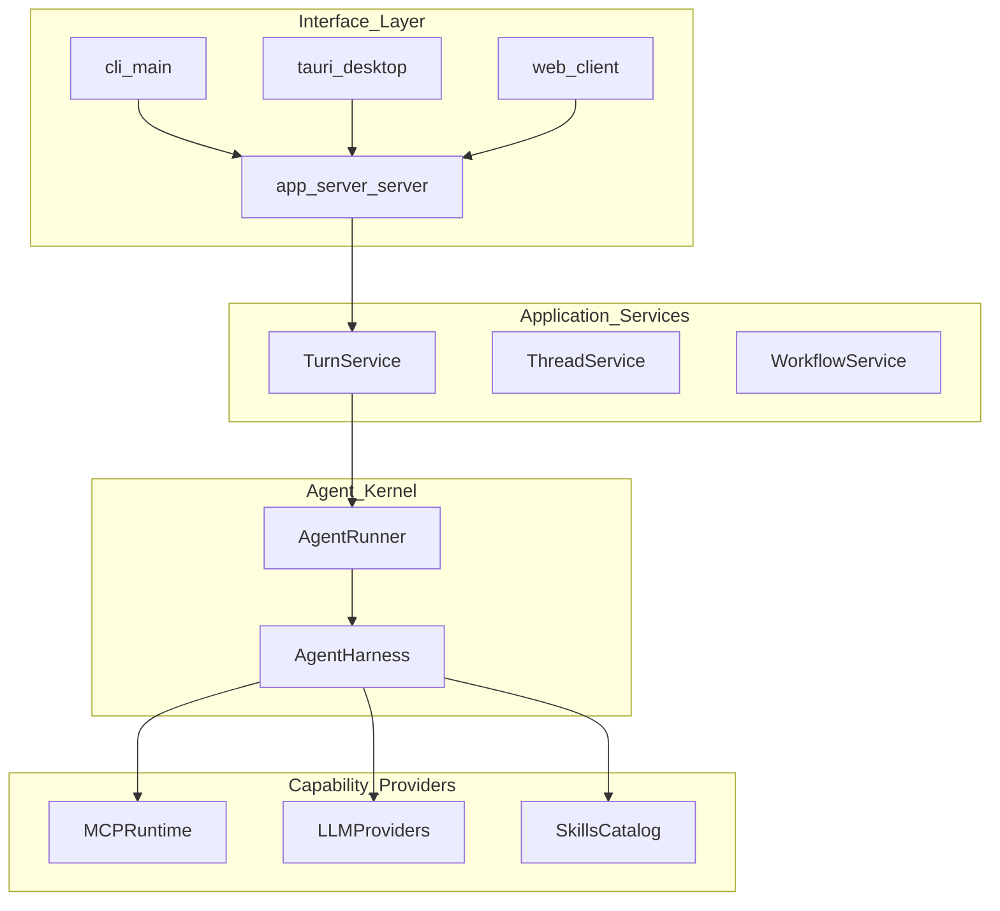
Sources: [README.md:81-85](), [setup.py:96-101]()

### Bridging Natural Language to Code Entities

DeepCode translates abstract user prompts and research inputs into concrete code modifications by mapping them through typed domain objects and tool invocations.

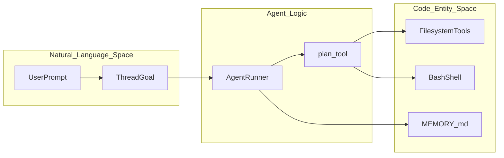
Sources: [README.md:102-103](), [README_ZH.md:125-127]()

---

## Major Subsystems

DeepCode is organized into several interdependent subsystems spanning client surfaces, background services, application logic, and specialized pipelines:

*   **Agent Runtime and Harness**: The core execution engine centered around `AgentRunner`, managing tool-using loops, `AgentRunSpec`, compaction, token metering, and repeat-call guards.
*   **Application Services Layer**: Durable management of `TurnService`, `ThreadService`, `SessionRuntimeRegistry`, and `WorkflowService`.
*   **Domain Model and Persistence**: Core domain objects (`Thread`, `Turn`, `Item`, `Project`, `Goal`, `Automation`) backed by SQLite projections and JSONL `SessionStore` transcripts.
*   **Security and Permissions Model**: Three-valued permission engine, execution modes, platform sandboxes (`seatbelt`/`bwrap`/Windows Job Object), and command guards.
*   **MCP Integration Layer**: Model Context Protocol client system supporting stdio/SSE/Streamable HTTP servers and lazy connections.
*   **LLM Provider System**: Provider registry, OpenAI-compatible and Anthropic adapters, model catalog service, and egress policy controls.
*   **Background Service and Discovery**: Shared local background service managed via `ServiceFiles` state records, HMAC identity proof, and control RPCs.
*   **Paper2Code Research Pipeline**: 7-phase automated pipeline for acquiring papers, generating YAML implementation plans, indexing code structures, and executing verification loops.

Sources: [README.md:81-85](), [CONTRIBUTORS.md:26]()

---

## Technical Specifications

| Component | Detail | Reference |
|-----------|--------|-----------|
| **Language** | Python 3.12+ | [setup.py:69]() |
| **Interfaces** | Interactive TUI, Tauri Desktop, Web Workbench | [README.md:81-85]() |
| **LLM Support** | OpenAI, Anthropic, Custom Providers | [requirements.txt:4-16]() |
| **Storage** | SQLite (Projections) + JSONL (`SessionStore`) | [CONTRIBUTORS.md:26]() |
| **License** | MIT | [setup.py:49]() |

Sources: [setup.py:44-70](), [requirements.txt:1-24](), [CONTRIBUTORS.md:26]()

---

# Page: Getting Started

# Getting Started

<details>
<summary>Relevant source files</summary>

The following files were used as context for generating this wiki page:

- [CONTRIBUTORS.md](CONTRIBUTORS.md)
- [README.md](README.md)
- [README_ZH.md](README_ZH.md)
- [cli/init_config.py](cli/init_config.py)
- [core/schedule/monitor.py](core/schedule/monitor.py)
- [core/version.py](core/version.py)
- [docs/guide/getting-started.md](docs/guide/getting-started.md)
- [docs/guide/goals-and-headless.md](docs/guide/goals-and-headless.md)
- [docs/guide/sessions.md](docs/guide/sessions.md)
- [docs/guide/the-tui.md](docs/guide/the-tui.md)
- [tests/test_init_config.py](tests/test_init_config.py)
- [tests/test_schedule_monitor.py](tests/test_schedule_monitor.py)

</details>


This page details the initial setup, configuration, provider connection, workspace trust verification, and first interactive session execution across DeepCode's CLI, Desktop, and Web entry points.

**Sources:** [docs/guide/getting-started.md:1-10](), [cli/init_config.py:1-12]()

---

## 1. Installation and Entry Points

DeepCode requires **Python 3.12+**. Tool management via `uv` is recommended, though `pip` and `pipx` are fully supported package managers [`README.md:44](), [docs/guide/getting-started.md:11-17]().

### CLI and Package Installation
```bash
# Recommended installation via uv
uv tool install --python 3.12 deepcode-hku

# Alternative installation via pip
pip install deepcode-hku
```
The installation provisions console scripts mapped in the package metadata: `deepcode` (the primary CLI / TUI interface) and `deepcode-app-server` (the JSON-RPC backend server consumed by the Desktop and Web workbenches) [docs/guide/getting-started.md:11-32]().

### Client Interfaces
DeepCode exposes three client interfaces over a shared local background service, unifying Projects, Session history, model registries, Skills, and permissions [`README.md:80-84]()`:
*   **Terminal UI (TUI):** Launched directly via `deepcode`.
*   **Desktop Application:** Launched via `deepcode desktop` (Tauri-based multi-process workbench).
*   **Web Workbench:** Launched via `deepcode web` (browser-facing surface served by `app_server/web_surface.py` and `cli/web_cli.py`) [docs/guide/getting-started.md:25-32]().

**Sources:** [README.md:80-84](), [docs/guide/getting-started.md:11-32]()

---

## 2. Initialization (`deepcode init`)

DeepCode initializes a private user configuration directory located at `$DEEPCODE_HOME` or `~/.deepcode/`. Running `deepcode init` executes the initialization logic defined in `cli/init_config.py` [cli/init_config.py:1-8]().

The initialization sequence sets up safe defaults (`"security": {"accessPreset": "ask"}`), enforces strict file permissions via `core/private_storage.py`, and supports explicit imports (`--from PATH`) with automatic backup creation (`.bak`) when forced [cli/init_config.py:27-40](), [tests/test_init_config.py:39-88]().

### System Data Flow: Configuration and Initialization

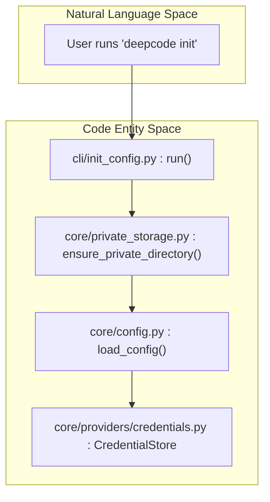

**Sources:** [cli/init_config.py:119-172](), [tests/test_init_config.py:39-58]()

---

## 3. Connecting a Model Provider

DeepCode is model-agnostic and interacts with OpenAI, Anthropic, DeepSeek, Gemini, and local endpoints via OpenRouter or vLLM adapters. Credentials are maintained inside `CredentialStore` and managed through connection profiles [docs/guide/getting-started.md:36-62]().

### Configuration Commands
1.  **Define a Connection Profile:**
    ```bash
    deepcode provider set my-openrouter --template openrouter --api-key
    ```
2.  **Synchronize Model Catalogs:**
    ```bash
    deepcode provider models my-openrouter --refresh
    ```
3.  **Run Connectivity Handshake:**
    ```bash
    deepcode provider test my-openrouter --model MODEL_ID
    ```

**Sources:** [docs/guide/getting-started.md:36-55](), [core/providers/credentials.py:1-25]()

---

## 4. Workspace Trust and First Interactive Session

DeepCode enforces a strict **Workspace Trust** model. The first time the agent is executed inside a repository directory, trust must be established via `--trust` or explicitly confirmed [docs/guide/getting-started.md:64-77]().

### Launching the First Session
Navigate to the target workspace and start an interactive session:
```bash
mkdir deepcode-demo
cd deepcode-demo
deepcode --trust --connection my-openrouter --model MODEL_ID
```

Upon invocation, the TUI initializes the conversation loop, managing turns via `AgentRunner` (`core/agent_runtime/runner.py`), evaluating permissions through `PermissionEngine` (`core/security/permissions.py`), and recording session logs to disk via `SessionStore` [docs/guide/getting-started.md:64-85]().

### Interaction Logic to Code Entity Mapping

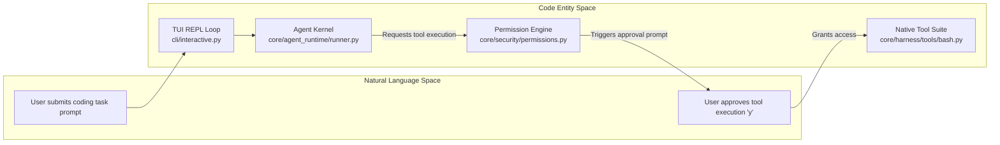

**Sources:** [docs/guide/getting-started.md:64-115](), [docs/guide/sessions.md:73-78]()

---

## 5. Next Steps

After completing your first successful agentic turn, proceed to explore:
*   **Session Management:** Resume sessions using `deepcode --resume SESSION_ID` or compact context using `/compact` [docs/guide/sessions.md:8-57]().
*   **Goals:** Establish persistent multi-turn objectives using `/goal` [docs/guide/goals-and-headless.md:14-31]().
*   **Skills:** Define project-specific guidelines via `SKILL.md` configurations [docs/guide/getting-started.md:166-171]().

**Sources:** [docs/guide/getting-started.md:166-171](), [docs/guide/sessions.md:8-57]()

---

# Page: Configuration Reference

# Configuration Reference

<details>
<summary>Relevant source files</summary>

The following files were used as context for generating this wiki page:

- [.gitleaksignore](.gitleaksignore)
- [cli/config_errors.py](cli/config_errors.py)
- [core/application/diagnostics_service.py](core/application/diagnostics_service.py)
- [core/application/dictation_service.py](core/application/dictation_service.py)
- [core/config.py](core/config.py)
- [core/dictation/__init__.py](core/dictation/__init__.py)
- [core/dictation/client.py](core/dictation/client.py)
- [core/dictation/local_runner.py](core/dictation/local_runner.py)
- [desktop/src/features/execution/useDictation.test.ts](desktop/src/features/execution/useDictation.test.ts)
- [desktop/src/features/execution/useDictation.ts](desktop/src/features/execution/useDictation.ts)
- [docs/guide/dictation.md](docs/guide/dictation.md)
- [schema/mcp-agent.config.schema.json](schema/mcp-agent.config.schema.json)
- [tests/test_config_errors.py](tests/test_config_errors.py)
- [tests/test_config_layers.py](tests/test_config_layers.py)
- [tests/test_dictation_local_runner.py](tests/test_dictation_local_runner.py)
- [tests/test_dictation_service.py](tests/test_dictation_service.py)

</details>


This page provides a comprehensive technical reference for DeepCode's configuration system. DeepCode utilizes a layered JSON architecture centered around `deepcode_config.json`, supporting global user settings, project-level overrides, provider profiles, model declarations, Model Context Protocol (MCP) servers, permission presets, and voice dictation settings.

---

## Configuration Architecture and Layering

DeepCode's runtime configuration is managed by `core/config.py` [core/config.py:1-11](). It follows a "home base + project override" pattern designed to allow `deepcode` to run seamlessly in any directory:

1. **User-Level Base**: Located at `deepcode_home()`, defaulting to `~/.deepcode/deepcode_config.json` [core/config.py:7-9](). The location can be relocated using the `DEEPCODE_HOME` environment variable [core/config.py:8](). Provider keys and global defaults reside here.
2. **Project-Level Override**: The loader walks up parent directories from the current working directory (CWD) to locate a project-level `deepcode_config.json` [core/config.py:9-11]().
3. **Deep Merge & Resolution**: Project keys override user keys key-by-key [core/config.py:9-11](). Strings matching `${ENV_VAR}` are evaluated against the environment at load time [core/config.py:24]().

### Configuration Data Flow
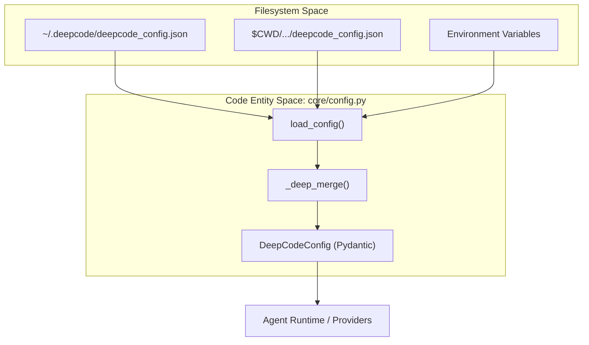

Sources: [core/config.py:1-27](), [tests/test_config_layers.py:40-65]()

---

## Provider and Connection Profiles

DeepCode abstracts LLM communication through provider profiles and connection blocks (`ProviderConfig`) [core/config.py:151-164](). 

### Connection Configuration Fields
- `apiKey`: Literal key or a `${ENV_VAR}` reference resolved at load time [core/config.py:154-158]().
- `apiBase`: Custom endpoint URL for OpenAI-compatible or alternative backends [core/config.py:159]().
- `extraHeaders`: Optional dictionary of HTTP headers injected into provider requests [core/config.py:160]().
- `protocol`: Protocol adapter specification (`auto`, `openai_compat`, `anthropic_messages`) [core/config.py:161]().
- `compat`: Compatibility rule flags (`ProviderCompat`) [core/config.py:162]().
- `auth`: Authentication mode (`api_key` or `none`) [core/config.py:163]().

### Manual Model Declarations (`ManualModelConfig`)
For models lacking native auto-discovery or for overriding built-in catalog parameters, models are declared via `ManualModelConfig` [core/config.py:175-188](). Declarations narrow or correct catalog defaults without requiring full restatements [core/config.py:175-182]().

Sources: [core/config.py:151-190]()

---

## Agent and Phase Configuration

Agent generation defaults are structured via `AgentsConfig`, which separates global `defaults` from phase-specific overrides (`planning` and `implementation`) [core/config.py:114-129]().

### Natural Language Space to Code Entity Space: Agent Phases
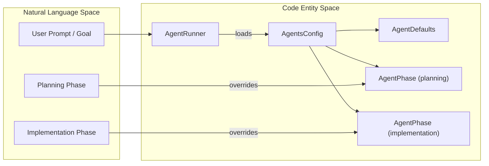

Sources: [core/config.py:91-132]()

---

## Voice Dictation Block (`dictation`)

The `dictation` configuration block enables push-to-talk speech-to-text transcription directly within the composer interface [docs/guide/dictation.md:1-11](). 

### Operational Modes
1. **Local CLI Runner (`endpoint: "local"`)**: Invokes the `parakeet-mlx` command line utility directly on the host machine (`pip install parakeet-mlx`) without requiring a background HTTP server [docs/guide/dictation.md:9](). Handled by `LocalParakeetClient` in `core/dictation/local_runner.py` [core/application/dictation_service.py:51](), [core/dictation/local_runner.py:54-56]().
2. **OpenAI-Compatible Server (`endpoint: "http://..."`)**: Connects to a remote or local HTTP transcription server (e.g., `mlx_audio.server`) adhering to the OpenAI audio transcription contract (`POST /audio/transcriptions`) [docs/guide/dictation.md:8-10](), [core/dictation/client.py:1-7]().

### Natural Language Space to Code Entity Space: Dictation Flow
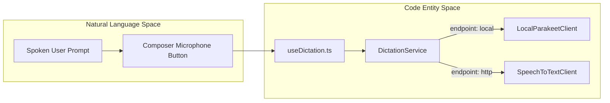

### Dictation Configuration Schema
| Field | Type | Default | Description |
|---|---|---|---|
| `endpoint` | string | *required* | Base URL of the OpenAI-compatible server or `"local"` [docs/guide/dictation.md:73](). |
| `model` | string | *required* | Speech-to-text model identifier (e.g. `mlx-community/parakeet-tdt-0.6b-v3`) [docs/guide/dictation.md:74](). |
| `language` | string \| null | `null` | ISO 639-1 language hint [docs/guide/dictation.md:75](). |
| `apiKeyEnv` | string \| null | `null` | Environment variable containing bearer token for authenticated endpoints [docs/guide/dictation.md:76](). |
| `maxAudioSeconds` | integer | `120` | Maximum recording duration in seconds [docs/guide/dictation.md:77](). |
| `timeoutSeconds` | float | `60.0` | Whole-request transcription timeout budget [docs/guide/dictation.md:78](). |

Sources: [docs/guide/dictation.md:1-87](), [core/application/dictation_service.py:1-116](), [core/dictation/local_runner.py:54-80](), [desktop/src/features/execution/useDictation.ts:1-45]()

---

## Security, Redaction, and Effective Config Layers

DeepCode ensures secure provenance tracking via `effective_config_layers` [tests/test_config_layers.py:1-8]().

- **Redaction Rules**: Any leaf value under subtrees named `env`, `headers`, `apiKey`, or `proxy` is automatically replaced with `••• (set)` in diagnostic outputs to prevent credential leaks [tests/test_config_layers.py:76-95]().
- **Project Boundary Enforcement**: Repository-level project configs cannot override sensitive blocks such as `dictation` endpoints or global provider authentication tokens, mitigating risk from malicious workspaces [docs/guide/dictation.md:84](), [core/application/dictation_service.py:169-184]().

Sources: [tests/test_config_layers.py:1-109](), [core/application/dictation_service.py:169-184]()

---

## Configuration Error Reporting

When configuration is missing or malformed, DeepCode provides actionable feedback via `cli/config_errors.py`:
- `is_unconfigured()`: Detects the total absence of user or project-level configuration files.
- `format_config_error()`: Prompts users to run `deepcode init` to establish a base configuration [cli/config_errors.py:13-30]().
- Parsing exceptions raise structured diagnostics, preventing silent failures during agent initialization.

Sources: [cli/config_errors.py:1-30](), [tests/test_config_errors.py:1-59]()

---

# Page: Architecture

# Architecture

<details>
<summary>Relevant source files</summary>

The following files were used as context for generating this wiki page:

- [CONTRIBUTORS.md](CONTRIBUTORS.md)
- [README.md](README.md)
- [README_ZH.md](README_ZH.md)
- [core/agent_runtime/runner.py](core/agent_runtime/runner.py)
- [core/application/agent_adapter.py](core/application/agent_adapter.py)
- [core/application/session_runtime.py](core/application/session_runtime.py)
- [core/application/turn_service.py](core/application/turn_service.py)
- [core/events/session.py](core/events/session.py)
- [core/harness/hooks/__init__.py](core/harness/hooks/__init__.py)
- [core/harness/hooks/discovery.py](core/harness/hooks/discovery.py)
- [core/harness/hooks/engine.py](core/harness/hooks/engine.py)
- [core/harness/hooks/events.py](core/harness/hooks/events.py)
- [core/version.py](core/version.py)
- [tests/test_hooks.py](tests/test_hooks.py)
- [tests/test_session_end_lifecycle.py](tests/test_session_end_lifecycle.py)

</details>


## Purpose and Scope

DeepCode is built on a layered, multi-process architecture designed to provide a unified agentic coding experience across CLI, Desktop, and Web interfaces. The system decouples the **Agent Kernel** (the tool-using execution loop) from the **Application Services** (which manage durable state like Threads, Turns, and Goals) and the **Interface Layer** (TUI, Desktop, Web, and JSON-RPC App Server).

This page provides a high-level overview of how these layers interact, the process boundaries between them, and the core data models that ensure session durability.

**Related Child Pages:**
- [Agent Runtime and Execution Loop](#2.1) — The `AgentRunner` kernel in `core/agent_runtime/runner.py`: tool-using loop, `AgentRunSpec`, `AgentHook`, compaction, token metering, repeat-call guard, context pruning, semantic hints, termination.
- [Application Services Layer](#2.2) — `core/application/`: TurnService, ThreadService, SessionRuntimeRegistry, ExecutionCoordinator, EventService, SettingsService, WorkflowService, AutomationService and durable Turn/Thread/Goal lifecycles.
- [Domain Model and Persistence](#2.3) — Core domain objects in `core/domain/` (Thread, Turn, Item, Project, Goal, Automation, Approval, Artifact, ExecutionProfile) plus the SQLite database, migrations, locking, JSONL SessionStore, session index and transcripts.
- [Security and Permissions Model](#2.4) — Three-valued permission engine, execution modes, platform sandboxes (seatbelt/bwrap/Windows Job Object), command guard, env sanitizing, approvals, private storage with NTFS ACL hardening.
- [MCP Integration Layer](#2.5) — MCP client system in `core/mcp/`: server lifecycle (stdio/SSE/Streamable HTTP), preset catalog, OAuth, lazy connections, tool adaptation, and the `cli/mcp_server.py` server mode.
- [LLM Provider System](#2.6) — `core/providers/`: registry, OpenAI-compatible and Anthropic adapters, model catalog service, reasoning effort, model compatibility, egress policy, credential management.
- [Background Service and Discovery](#2.7) — The shared local background service: `ServiceFiles` state, lifetime lease and discovery record, HMAC identity proof, `ServiceClient` control RPC, `deepcode service` CLI, platform supervisors (LaunchAgent/systemd/Windows task), drain vs cancel shutdown.
- [Observability and Transparency Log](#2.8) — `core/observability/`: the event bus, records, transparency log verification script, and LLMOps metering/tracing of model calls.

Sources: [core/events/session.py:1-17](), [core/application/turn_service.py:188-203](), [core/agent_runtime/runner.py:1-9]()

---

## High-Level System Architecture

DeepCode operates across distinct process boundaries when running in Desktop/Web mode, while the CLI collapses these into a single process that directly invokes the application services and agent runtimes.

### Process Boundary Diagram

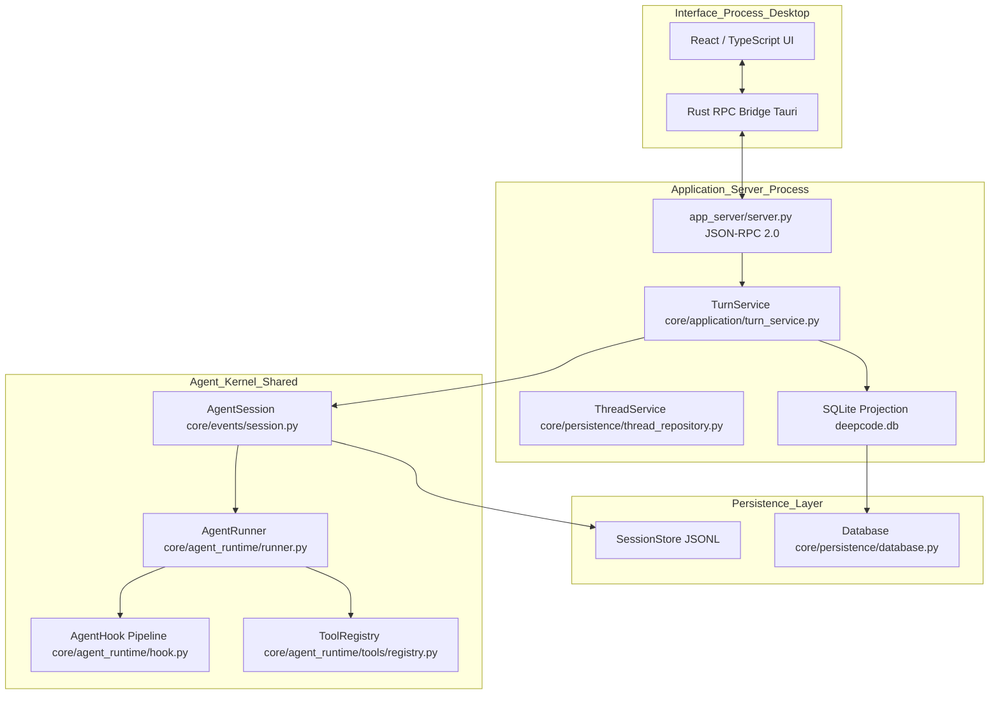

Sources: [core/events/session.py:1-17](), [core/application/turn_service.py:188-203](), [core/agent_runtime/runner.py:1-9](), [app_server/server.py:1-20]()

---

## Core Architectural Components

### 1. The Agent Kernel (`AgentRunner`)
The heart of DeepCode is the `AgentRunner` located in `core/agent_runtime/runner.py`. It implements a tool-using execution loop that manages the interaction between the LLM and the local environment. It handles token metering, repeat-call guards, context pruning, and compaction. The `AgentRunner` is stateless regarding long-term history; it operates on an `AgentRunSpec` for a single turn.

For details, see [Agent Runtime and Execution Loop](#2.1).

Sources: [core/agent_runtime/runner.py:135-172]()

### 2. Event-Sourced Communication (`AgentSession`)
The `AgentSession` in `core/events/session.py` acts as the bridge between the kernel and the outside world. It consumes `Op` submissions (such as `UserInput` or `Shutdown`) and emits `Event` messages (`ToolStarted`, `AgentMessageDelta`, `TurnStarted`). This ensures that TUIs, Desktop apps, and headless runners all receive identical real-time telemetry.

Sources: [core/events/session.py:37-64](), [core/events/session.py:103-136]()

### 3. Application Services and Durability
Above the kernel, the application services layer manages the lifecycle of durable entities:
- **`TurnService`**: Orchestrates the execution of a single turn, ensuring durable writes and coordination [core/application/turn_service.py:188-203]().
- **`SessionRuntimeRegistry`**: Manages live `AgentSession` instances, ensuring exclusive process leases to prevent history corruption [core/application/session_runtime.py:91-118]().

For details, see [Application Services Layer](#2.2).

### 4. Dual-Persistence Strategy
DeepCode uses two distinct storage mechanisms:
1. **SessionStore (JSONL)**: The source of truth for conversation history and transcript logs [core/sessions/__init__.py]() (see [Domain Model and Persistence](#2.3)).
2. **SQLite Projection**: A relational database (`deepcode.db`) used for fast querying of Threads, Turns, Items, Goals, Automations, and Approvals.

For details, see [Domain Model and Persistence](#2.3).

Sources: [core/application/session_runtime.py:173-181](), [core/application/turn_service.py:92-101]()

---

## Request Flow: Natural Language to Code Entity

This diagram bridges natural language inputs to code entity operations across the system layers.

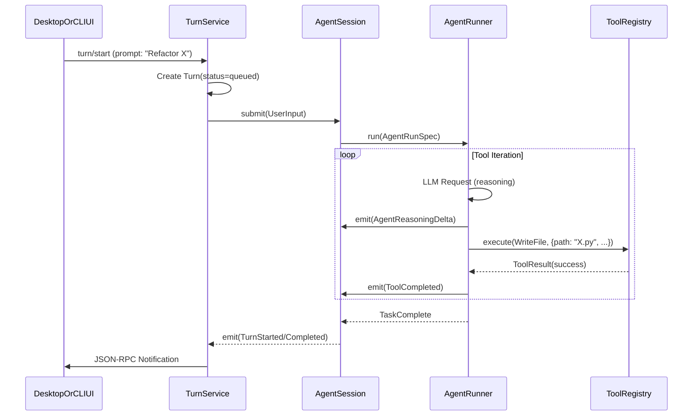

Sources: [core/events/session.py:1-17](), [core/application/turn_service.py:188-203](), [core/agent_runtime/runner.py:1-9]()

---

## Extension and Hook System

DeepCode is designed for extensibility through a robust **Hook System** defined in `core/harness/hooks/`. Hooks allow external command handlers to intercept agent behavior at critical lifecycle points without modifying the core kernel.

| Hook Point | Description | Code Entity |
|------------|-------------|-------------|
| **`SessionStart`** | Fires once when a session begins. | `core/harness/hooks/events.py:33` |
| **`PreToolUse`** | Allows blocking or rewriting a tool call before it executes. | `core/harness/hooks/events.py:28` |
| **`PostToolUse`** | Injects feedback into the agent context after a tool runs. | `core/harness/hooks/events.py:30` |
| **`PreCompact`** | Captures state before conversation history is summarized. | `core/harness/hooks/events.py:31` |
| **`SessionEnd`** | Fires exactly once at session termination. | `core/harness/hooks/events.py:34` |

For details, see [Agent Runtime and Execution Loop](#2.1) and [core/harness/hooks/discovery.py]() [core/harness/hooks/engine.py]().

Sources: [core/harness/hooks/events.py:27-39](), [core/harness/hooks/discovery.py:46-59](), [core/harness/hooks/engine.py:1-100]()

---

# Page: Agent Runtime and Execution Loop

# Agent Runtime and Execution Loop

<details>
<summary>Relevant source files</summary>

The following files were used as context for generating this wiki page:

- [core/agent_runtime/compaction.py](core/agent_runtime/compaction.py)
- [core/agent_runtime/context.py](core/agent_runtime/context.py)
- [core/agent_runtime/helpers.py](core/agent_runtime/helpers.py)
- [core/agent_runtime/pruner.py](core/agent_runtime/pruner.py)
- [core/agent_runtime/repeat_guard.py](core/agent_runtime/repeat_guard.py)
- [core/agent_runtime/runner.py](core/agent_runtime/runner.py)
- [core/agent_runtime/token_meter.py](core/agent_runtime/token_meter.py)
- [core/agent_runtime/tools/registry.py](core/agent_runtime/tools/registry.py)
- [core/agent_runtime/tools/semantic_hint.py](core/agent_runtime/tools/semantic_hint.py)
- [core/events/session.py](core/events/session.py)
- [core/harness/hooks/__init__.py](core/harness/hooks/__init__.py)
- [core/harness/hooks/discovery.py](core/harness/hooks/discovery.py)
- [core/harness/hooks/engine.py](core/harness/hooks/engine.py)
- [core/harness/hooks/events.py](core/harness/hooks/events.py)
- [tests/test_agent_runner_kernel.py](tests/test_agent_runner_kernel.py)
- [tests/test_compaction_retry_memo.py](tests/test_compaction_retry_memo.py)
- [tests/test_context_note_sink.py](tests/test_context_note_sink.py)
- [tests/test_hooks.py](tests/test_hooks.py)
- [tests/test_loop_detector.py](tests/test_loop_detector.py)
- [tests/test_manual_compact.py](tests/test_manual_compact.py)
- [tests/test_repeat_call_reminder.py](tests/test_repeat_call_reminder.py)
- [tests/test_semantic_hint.py](tests/test_semantic_hint.py)
- [tests/test_session_end_lifecycle.py](tests/test_session_end_lifecycle.py)
- [tests/test_skills_product.py](tests/test_skills_product.py)
- [tests/test_tool_call_timeout.py](tests/test_tool_call_timeout.py)
- [tests/test_tool_result_pruner.py](tests/test_tool_result_pruner.py)
- [utils/loop_detector.py](utils/loop_detector.py)

</details>


The `AgentRunner` kernel, located in `core/agent_runtime/runner.py`, serves as the shared execution engine for all DeepCode agent interactions. It provides a standardized, tool-using loop managing model requests, tool execution, context compaction, token metering, and safety guards. Frontends (CLI, Desktop, TUI) attach to this kernel via the `AgentSession` protocol layer in `core/events/session.py`.

Sources: [core/agent_runtime/runner.py:1-9](), [core/events/session.py:1-17]()

---

## 1. Core Execution Loop and `AgentRunSpec`

The `AgentRunner` executes a synchronous or streaming sampling loop that iterates until the model emits a text finish reason, an external stop trigger occurs, or `max_iterations` is exhausted.

### AgentRunSpec Configuration
The `AgentRunSpec` data class defines parameters for a single execution pass:
* `initial_messages`: The baseline conversation history (`list[dict[str, Any]]`) [core/agent_runtime/runner.py:139]().
* `tools`: The active `ToolRegistry` containing available built-in and MCP tool definitions [core/agent_runtime/runner.py:140]().
* `transient_context_messages`: Ephemeral user-priority context injected into requests without persisting in history [core/agent_runtime/runner.py:144-146]().
* `repeat_call_thresholds`: Escalating reminder thresholds for consecutive identical tool calls [core/agent_runtime/runner.py:155-158]().

Sources: [core/agent_runtime/runner.py:136-172]()

---

## 2. Hook System and Event Bridging

The harness hook system combines programmatic hooks (`AgentHook`) with discovered external command hooks (`HooksEngine`, `discover_hooks`).

### Event Emission and Bridging
`_EventEmittingHook` in `core/events/session.py` bridges low-level kernel callbacks onto the event stream [core/events/session.py:103-105]().

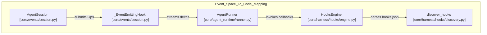
Sources: [core/events/session.py:103-137](), [core/harness/hooks/engine.py:85-125](), [core/harness/hooks/discovery.py:77-98]()

Sources: [core/events/session.py:103-200](), [core/harness/hooks/engine.py:85-125]()

---

## 3. Context Management, Compaction, and Token Metering

When conversation history nears the model context window limits, the runner performs compaction.

### Compaction Strategy and PreCompact Checkpoints
Summarization-based compaction (`_COMPACT_TRIGGER_FRACTION`) invokes a background model call to condense old turns into a handoff summary [core/agent_runtime/runner.py:84-88](). Before summarization runs, registered `PreCompact` hooks can inject additional working context via `_build_precompact_checkpoint`, generating a bounded user message (`[PreCompact checkpoint]`) that survives compaction [core/agent_runtime/runner.py:91-132]().

### Token Metering
`ProviderAnchoredTokenMeter` tracks input, output, and reasoning tokens across requests, emitting `ModelUsageRecorded` events [core/agent_runtime/token_meter.py](), [core/events/session.py:48]().

Sources: [core/agent_runtime/runner.py:84-132](), [core/agent_runtime/token_meter.py](), [core/events/session.py:48]()

---

## 4. Execution Guards and Safeguards

To prevent infinite loops, hangs, and runaway resource consumption, the runtime implements multiple guard layers.

### Repeat-Call Tracking and Loop Detection
* `RepeatCallTracker`: Monitors consecutive identical tool calls and injects advisory warnings when usage exceeds `repeat_call_thresholds` [core/agent_runtime/runner.py:155-158](), [core/agent_runtime/repeat_guard.py]().
* `LoopDetector`: Tracks progress stalls, iteration timeouts, and consecutive tool errors [utils/loop_detector.py:12-46](). It offsets LLM waiting time via `note_llm_wait` to avoid false stall triggers during slow model responses [utils/loop_detector.py:133-145]().

Sources: [core/agent_runtime/runner.py:155-158](), [utils/loop_detector.py:12-178]()

---

## 5. Tool Execution and Semantic Hints

Tool dispatch is mediated by `ToolRegistry` [core/agent_runtime/tools/registry.py:12-18](). When the model requests a tool name that is missing or misspelled, `suggest_tools` and `build_miss_message` compute closest-name candidates via token-overlap similarity without invoking an LLM [core/agent_runtime/tools/semantic_hint.py:28-79]().

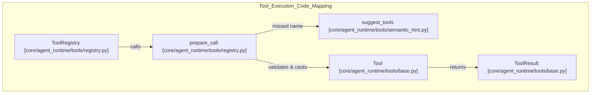
Sources: [core/agent_runtime/tools/registry.py:69-107](), [core/agent_runtime/tools/semantic_hint.py:39-79](), [core/agent_runtime/tools/base.py:20-41]()

Sources: [core/agent_runtime/tools/registry.py:69-123](), [core/agent_runtime/tools/semantic_hint.py:39-79]()

---

# Page: Application Services Layer

# Application Services Layer

<details>
<summary>Relevant source files</summary>

The following files were used as context for generating this wiki page:

- [app_server/server.py](app_server/server.py)
- [cli/goal_runner.py](cli/goal_runner.py)
- [cli/headless_turn.py](cli/headless_turn.py)
- [core/application/agent_adapter.py](core/application/agent_adapter.py)
- [core/application/event_service.py](core/application/event_service.py)
- [core/application/execution_coordinator.py](core/application/execution_coordinator.py)
- [core/application/session_runtime.py](core/application/session_runtime.py)
- [core/application/settings_service.py](core/application/settings_service.py)
- [core/application/thread_service.py](core/application/thread_service.py)
- [core/application/turn_projection.py](core/application/turn_projection.py)
- [core/application/turn_service.py](core/application/turn_service.py)
- [desktop/src/app/composerBehavior.ts](desktop/src/app/composerBehavior.ts)
- [desktop/src/app/replayThreadHistory.test.ts](desktop/src/app/replayThreadHistory.test.ts)
- [desktop/src/app/replayThreadHistory.ts](desktop/src/app/replayThreadHistory.ts)
- [desktop/src/app/useWorkspaceController.ts](desktop/src/app/useWorkspaceController.ts)
- [desktop/src/app/workspaceState.test.ts](desktop/src/app/workspaceState.test.ts)
- [desktop/src/app/workspaceState.ts](desktop/src/app/workspaceState.ts)
- [desktop/src/features/settings/sections/ComposerBehaviorCard.tsx](desktop/src/features/settings/sections/ComposerBehaviorCard.tsx)
- [desktop/src/features/settings/sections/DefaultPresetCard.tsx](desktop/src/features/settings/sections/DefaultPresetCard.tsx)
- [desktop/src/features/settings/sections/GeneralSection.tsx](desktop/src/features/settings/sections/GeneralSection.tsx)
- [docs/guide/skills-and-memory.md](docs/guide/skills-and-memory.md)
- [tests/application/test_default_agent_preset.py](tests/application/test_default_agent_preset.py)
- [tests/application/test_durable_event_relay.py](tests/application/test_durable_event_relay.py)
- [tests/application/test_one_way_data_flow.py](tests/application/test_one_way_data_flow.py)
- [tests/application/test_turn_service.py](tests/application/test_turn_service.py)
- [tests/test_cross_process_run_lease.py](tests/test_cross_process_run_lease.py)
- [tests/test_stdlib_logging_bridge.py](tests/test_stdlib_logging_bridge.py)

</details>


The Application Services Layer (`core/application/`) defines the service boundary of the DeepCode system. It orchestrates the lifecycle of durable entities—**Turns**, **Threads**, **Goals**, and **Automations**—above the low-level agent kernel. This layer ensures that agent sessions are persistent, concurrent access is safely managed via file leases, and domain events are broadcasted to the UI.

## Service Architecture and Orchestration

The Application layer acts as the coordinator between the **Domain Model** (SQLite/JSONL), the **Agent Runtime** (LLM execution), and the **Interfaces** (CLI/Desktop).

### Bridge: Natural Language Space to Code Entity Space

The following diagram maps high-level application concepts to the specific Python classes and database entities that implement them.

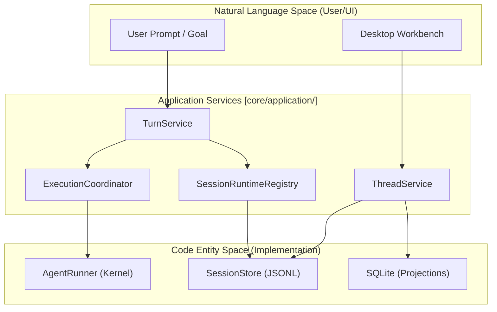

Sources: [core/application/turn_service.py:188-203](), [core/application/thread_service.py:97-113](), [core/application/session_runtime.py:91-115]()

---

## Core Services

### ThreadService
The `ThreadService` manages the high-level lifecycle of a conversation. It bridges the **canonical JSONL SessionStore** (the source of truth for LLM history) with the **SQLite projection** used by the Desktop UI.

- **Reconciliation**: The `reconcile()` method [core/application/thread_service.py:149-161]() repairs the SQLite state by scanning JSONL sessions and rebuilding `Turn` and `Item` records.
- **Creation**: `start()` [core/application/thread_service.py:163-176]() initializes new threads, handling project trust, workspace scoping, and agent preset snapshots.
- **Projections**: It converts `SessionMessage` records into `ItemKind` (e.g., `USER_MESSAGE`, `TOOL_CALL`, `FILE_CHANGE`) for UI rendering [core/application/thread_service.py:73-92]().

### TurnService
The `TurnService` is the primary entry point for executing agent logic. It manages the "Turn" lifecycle: from submission and admission to execution and settlement.

- **Turn Admission**: Before a turn runs, it passes through `TurnAdmissionGuard` [core/application/turn_service.py:131]() to check for conflicts or project trust.
- **Execution Coordination**: It uses the `ExecutionCoordinator` to ensure only one process executes a turn for a specific thread at a time [core/application/turn_service.py:41-46]().
- **Event Streaming**: Provides support for event subscriptions and delivery tracking during live execution [core/application/turn_service.py:136-146]().

Sources: [core/application/thread_service.py:1-176](), [core/application/turn_service.py:1-203]()

---

## Runtime Management

### SessionRuntimeRegistry
To maintain high performance, the system keeps a pool of `LiveSessionRuntime` objects. This registry manages the lifecycle of `AgentSessionPort` instances, which are the active wrappers around the agent kernel.

- **Residency**: It maintains an `OrderedDict` of runtimes with a configurable `max_live_sessions` (default 16) [core/application/session_runtime.py:91-113]().
- **Acquisition**: The `acquire()` method [core/application/session_runtime.py:127-140]() retrieves an existing runtime or creates a new one, ensuring the `AgentPresetSnapshot` matches the thread's configuration.
- **Cross-Process Safety**: It enforces the "one live writer" rule using `FileLease` [core/application/session_runtime.py:86-88](). If another process (e.g., a CLI `deepcode exec` vs the Desktop app) tries to access the same session, a `ConflictError` is raised [core/application/session_runtime.py:156-158]().

### ExecutionCoordinator
The `ExecutionCoordinator` manages the scheduling of turns across potentially multiple worker processes.

- **Liveness**: Each worker maintains concurrency control via robust synchronization mechanisms and process identity tracking.
- **Admission Policy**: It coordinates resource claims to prevent a single workspace from saturating system resources.
- **Orphan Recovery**: Handles recovery procedures when processes terminate unexpectedly.

Sources: [core/application/session_runtime.py:70-181](), [core/application/execution_coordinator.py:1-177]()

---

## Event and Observability Infrastructure

DeepCode uses a durable event bus to decouple agent execution from the user interface.

### EventBroker and EventService
- **EventBroker**: Provides a `Condition`-based fan-out mechanism for live event delivery [core/application/event_service.py:74-92]().
- **Durable Replay**: The `EventService` allows clients to `replay()` history from the SQLite `event_log` table [core/application/event_service.py:171-175](), ensuring that a UI can fully reconstruct the state of a thread after a restart.
- **Sequence Watermarks**: The `_SequenceWatermark` class [core/application/event_service.py:47-72]() ensures events are processed in order and handles potential duplicates.

Sources: [core/application/event_service.py:1-194]()

---

## Headless and Goal Execution

For automation, background scheduling, and CI/CD, the application layer provides specialized adapters.

| Component | Role | Source |
| :--- | :--- | :--- |
| `run_headless_turn` | Executes a single prompt and exits, used by `deepcode exec`. | [cli/headless_turn.py:29-63]() |
| `run_goal` | Orchestrates a multi-turn verify loop for a specific objective. | [cli/goal_runner.py:60-72]() |
| `GoalRuntimeRouter` | Routes goal-related tool calls (e.g., `submit`) to the correct persistence handler. | [core/application/session_runtime.py:20-29]() |

Sources: [cli/headless_turn.py:1-171](), [cli/goal_runner.py:1-185](), [core/application/session_runtime.py:1-181]()

---

# Page: Domain Model and Persistence

# Domain Model and Persistence

<details>
<summary>Relevant source files</summary>

The following files were used as context for generating this wiki page:

- [app_server/service.py](app_server/service.py)
- [cli/automation_cli.py](cli/automation_cli.py)
- [core/application/application.py](core/application/application.py)
- [core/llm_runtime.py](core/llm_runtime.py)
- [core/persistence/database.py](core/persistence/database.py)
- [core/persistence/migrations.py](core/persistence/migrations.py)
- [core/providers/base.py](core/providers/base.py)
- [core/sessions/__init__.py](core/sessions/__init__.py)
- [core/sessions/index.py](core/sessions/index.py)
- [core/sessions/store.py](core/sessions/store.py)
- [core/sessions/transcript.py](core/sessions/transcript.py)
- [desktop/package-lock.json](desktop/package-lock.json)
- [desktop/package.json](desktop/package.json)
- [tests/app_server/test_server.py](tests/app_server/test_server.py)
- [tests/app_server/test_state_backup.py](tests/app_server/test_state_backup.py)
- [tests/application/test_session_alignment.py](tests/application/test_session_alignment.py)
- [tests/persistence/test_database_locks.py](tests/persistence/test_database_locks.py)
- [tests/test_model_visible_is_logged.py](tests/test_model_visible_is_logged.py)
- [tests/test_provider_oauth.py](tests/test_provider_oauth.py)
- [tests/test_session_index.py](tests/test_session_index.py)
- [tests/test_session_transcript.py](tests/test_session_transcript.py)

</details>


## Purpose and Scope

The Domain Model and Persistence subsystem represents the core data structures and durable storage layer of DeepCode. It defines the lifecycle of conversations (`Thread`), interaction cycles (`Turn`), granular operations (`Item`), durable user objectives (`Goal`), background jobs (`Automation`), safety validations (`Approval`, `ExecutionProfile`), and project configurations (`Project`, `Artifact`). 

DeepCode uses a hybrid storage architecture:
1. **Canonical JSONL SessionStore**: A file-backed, human-readable, append-only source of truth (`core/sessions/store.py`) that stores session metadata, message streams, and tasks [core/sessions/store.py:1-12]().
2. **Derived SQLite Projection & Application Database**: A robust relational database (`core/persistence/database.py`) using Write-Ahead Logging (WAL) and strict file locking to support high-performance queries, indexing (`core/sessions/index.py`), UI projections, and system state [core/persistence/database.py:1-61]().

---

## Core Domain Entities

DeepCode models agentic workflows using strongly typed classes defined across `core/domain/` and `core/sessions/models.py`. 

* **`Thread`**: The primary container for a conversation or coding session. It references a workspace path, active LLM configuration, and execution mode (`ThreadMode`) [core/domain/thread.py]().
* **`Turn`**: A discrete execution iteration within a thread representing the sequence: User Prompt $\rightarrow$ Agent Planning $\rightarrow$ Tool Execution $\rightarrow$ Assistant Response [core/domain/turn.py]().
* **`Item`**: The granular event unit within a turn, capturing user inputs, assistant text blocks, tool call requests, execution outputs, and reasoning steps [core/domain/item.py]().
* **`Project`**: Represents an isolated workspace root associated with trust states (`TrustState`) and project-specific settings [core/application/application.py]().
* **`Goal`**: A durable user objective tracked across turns via the `ThreadGoalStore`, enabling multi-turn persistence of verification objectives [core/sessions/__init__.py]().
* **`Automation`**: A background task definition governed by a schedule policy (`AutomationScheduleKind`) that executes recurring prompt templates within trusted projects [cli/automation_cli.py]().
* **`Approval`**: An audit record tracking user authorization for sensitive tool executions within a `Turn` and `Item`.
* **`Artifact`**: Generated files, diffs, or structured snapshots produced during agent execution pipelines.
* **`ExecutionProfile`**: Encapsulates model selection, temperature, reasoning effort, and provider connection credentials [core/providers/base.py]().

### Natural Language Space to Code Entity Mapping

The following diagram bridges high-level user intents and system concepts to the underlying Python classes and persistence entities.

```mermaid
graph TD
    subgraph "NaturalLanguageSpace"
        UserPrompt[""UserPrompt:'Implementauth'"""]
        AgentReasoning[""AgentReasoning:'Readingprojectfiles'"""]
        ToolCall[""ToolCall:'Runningpytest'"""]
    end

    subgraph "CodeEntitySpace"
        TurnClass[""Turn(core.domain.turn)""]
        ItemClass[""Item(core.domain.item)""]
        AgentRunner[""AgentRunner(core.agent_runtime.runner)""]
        SessionStoreClass[""SessionStore(core.sessions.store)""]
    end

    subgraph "PersistenceSpace"
        ThreadTable[("threads_sqlite_table")]
        ItemTable[("items_sqlite_table")]
        SessionJSONL[""session.jsonl_source_of_truth""]
    end

    UserPrompt -->|submits| TurnClass
    TurnClass -->|executes| AgentRunner
    AgentRunner -->|emits| ItemClass
    ItemClass -->|appends| SessionJSONL
    ItemClass -->|projects_to| ItemTable
    TurnClass -->|projects_to| ThreadTable
```

Sources: [core/agent_runtime/runner.py](), [core/domain/item.py](), [core/domain/turn.py](), [core/sessions/store.py]()

---

## SessionStore and Transcripts (JSONL Source of Truth)

The `SessionStore` located in `core/sessions/store.py` manages multi-turn conversation directories under `~/.deepcode/sessions/` [core/sessions/store.py:60-69]().

### Directory Structure

```text
~/.deepcode/sessions/
  index.db              # Derived SQLite index for fast listing
  <session_id>/
    session.jsonl       # Metadata header + message stream (Source of Truth)
    tasks.jsonl         # Attached workflow tasks (e.g., Paper2Code runs)
    settings.json       # Per-session overrides
```
Sources: [core/sessions/store.py:3-12]()

### Concurrency and Locking
* **Atomic Appends**: Message and task mutations are written using pure-append operations to `session.jsonl` and `tasks.jsonl`, which are atomic at the OS level for small writes [core/sessions/store.py:18-23]().
* **Thread & Process Serialization**: In-process coordination is handled via `threading.RLock`, while cross-process safety uses exclusive file locks under `.locks/` and execution lease locks under `.running/` via `acquire_run_lease` [core/sessions/store.py:71-175]().
* **Derived Index (`SessionIndex`)**: `index.db` acts as a disposable SQLite index cache accelerating `list_sessions()` and task lookups. If deleted or corrupted, it automatically self-heals by scanning the JSONL files [core/sessions/index.py](), [tests/test_session_index.py:112-125]().

---

## SQLite Database, Migrations, and WAL Locking

The relational database layer managed by `Database` in `core/persistence/database.py` provides transactional guarantees for application services, threading state, workflow tracking, and diagnostics [core/persistence/database.py:41-61]().

### Core Relational Tables

| Table Name | Primary Role |
| :--- | :--- |
| `threads` | Session metadata, workspace paths, and thread operational states. |
| `turns` | Links to `threads`; tracks execution status and token metrics. |
| `items` | Granular event log for messages, tool outputs, and reasoning deltas. |
| `approvals` | Persistent audit logs for permission grants and security prompts. |
| `event_log` | Low-level event broker log for durable event relaying. |

Sources: [core/persistence/database.py:32-40](), [tests/application/test_session_alignment.py:71-80]()

### WAL Mode and POSIX Anchor Hygiene
* **Write-Ahead Logging (WAL)**: The database operates in WAL mode for concurrent reader/writer isolation [core/persistence/database.py:137-172]().
* **Anchor Connection**: On POSIX systems, `Database` maintains a single idle *anchor* connection to keep the WAL file and shared memory mapping open, preventing race conditions where short-lived connection closures cause unlinking of `-wal` and `-shm` files under active readers [core/persistence/database.py:41-112](), [tests/persistence/test_database_locks.py:106-111]().

### SQLite Database Architecture & Locking Flow

```mermaid
graph TD
    subgraph "ApplicationLayer"
        AppService[""DeepCodeApplication(core.application.application)""]
        ThreadSvc[""ThreadService(core.application.thread_service)""]
    end

    subgraph "PersistenceLayer"
        DbConn[""Database(core.persistence.database)""]
        AnchorConn[""AnchorConnection(POSIX WAL Anchor)""]
        MigrationEng[""MigrationEngine(core.persistence.migrations)""]
    end

    subgraph "StorageFiles"
        SqliteFile[("deepcode.sqlite3")]
        WalFile[("deepcode.sqlite3-wal")]
        ShmFile[("deepcode.sqlite3-shm")]
    end

    AppService -->|queries| ThreadSvc
    ThreadSvc -->|opens transaction| DbConn
    DbConn -->|maintains| AnchorConn
    AnchorConn -->|holds shared lock| WalFile
    DbConn -->|migrates schema| MigrationEng
    MigrationEng -->|updates| SqliteFile
    SqliteFile -->|writes via WAL| WalFile
    SqliteFile -->|maps memory| ShmFile
```

Sources: [core/application/application.py](), [core/persistence/database.py](), [core/persistence/migrations.py]()

---

## State Backup, Recovery, and Restoration

DeepCode includes robust state snapshot and restoration facilities (`app_server/state_backup.py`) for data migration and failure recovery [tests/app_server/test_state_backup.py:8-15]().

* **Offline Snapshots**: `create_snapshot()` bundles the SQLite database, JSONL session stores, credentials, and configuration files into an immutable backup archive after verifying that no application leases or session activity locks are held [tests/app_server/test_state_backup.py:40-84]().
* **Restore Interruption Protection**: If a restoration procedure fails midway, a `.restore.json` marker is written. Subsequent startups refuse to boot until the restore completes successfully or recovers, maintaining strict transactional integrity across system upgrades [core/persistence/database.py:115-128](), [tests/app_server/test_state_backup.py:100-129]().

Sources: [app_server/state_backup.py](), [core/persistence/database.py](), [tests/app_server/test_state_backup.py]()

---

# Page: Security and Permissions Model

# Security and Permissions Model

<details>
<summary>Relevant source files</summary>

The following files were used as context for generating this wiki page:

- [cli/tui/animation.py](cli/tui/animation.py)
- [cli/tui/text.py](cli/tui/text.py)
- [core/harness/__init__.py](core/harness/__init__.py)
- [core/harness/approval.py](core/harness/approval.py)
- [core/harness/collaboration.py](core/harness/collaboration.py)
- [core/harness/command_guard.py](core/harness/command_guard.py)
- [core/harness/permissions.py](core/harness/permissions.py)
- [core/harness/policy.py](core/harness/policy.py)
- [core/harness/sandbox.py](core/harness/sandbox.py)
- [core/harness/tools/__init__.py](core/harness/tools/__init__.py)
- [core/harness/tools/plan.py](core/harness/tools/plan.py)
- [core/harness/tools/user_input.py](core/harness/tools/user_input.py)
- [core/harness/windows_sandbox.py](core/harness/windows_sandbox.py)
- [core/private_storage.py](core/private_storage.py)
- [core/providers/model_compat.py](core/providers/model_compat.py)
- [docs/P1_SECURITY_BASE.md](docs/P1_SECURITY_BASE.md)
- [pyproject.toml](pyproject.toml)
- [tests/application/test_automation_goal_runs.py](tests/application/test_automation_goal_runs.py)
- [tests/persistence/test_database.py](tests/persistence/test_database.py)
- [tests/test_collaboration.py](tests/test_collaboration.py)
- [tests/test_command_executor_native_fence.py](tests/test_command_executor_native_fence.py)
- [tests/test_command_guard.py](tests/test_command_guard.py)
- [tests/test_exec_sandbox_wiring.py](tests/test_exec_sandbox_wiring.py)
- [tests/test_harness_approval.py](tests/test_harness_approval.py)
- [tests/test_harness_permissions.py](tests/test_harness_permissions.py)
- [tests/test_harness_policy.py](tests/test_harness_policy.py)
- [tests/test_harness_sandbox.py](tests/test_harness_sandbox.py)
- [tests/test_native_file_tools.py](tests/test_native_file_tools.py)
- [tests/test_private_storage.py](tests/test_private_storage.py)
- [tests/test_private_storage_acl_once.py](tests/test_private_storage_acl_once.py)
- [tests/test_private_storage_windows.py](tests/test_private_storage_windows.py)
- [tests/test_skills.py](tests/test_skills.py)
- [tests/test_thinking_requires_capable_model.py](tests/test_thinking_requires_capable_model.py)
- [tools/code_implementation_server.py](tools/code_implementation_server.py)
- [tools/command_executor.py](tools/command_executor.py)

</details>


DeepCode implements a multi-layered security architecture designed to protect the host system from potentially harmful agent actions while maintaining a productive developer experience. This model spans from fine-grained tool permissions and destructive-command screening to platform-native process isolation, private storage, and NTFS ACL hardening.

## 1. Three-Valued Permission Engine and Execution Modes

The core of DeepCode's security is a three-valued logic engine (`allow`, `ask`, `deny`) that governs tool execution. This engine evaluates every tool call before it reaches the execution environment.

### Permission Modes
The system operates in three primary execution modes defined in `core/domain/execution_security.py`:

| Mode | Key Characteristic | Security Level |
| :--- | :--- | :--- |
| `default` | Interactive approval for sensitive tools. | Balanced |
| `plan` | Read-only access; no modifications allowed. | High |
| `full_auto` | Autonomous execution without approval. | Low (Restricted to trusted environments) |

### Permission Logic and Rule Snapshots
Permission rules are captured in `ExecutionPermissionRuleSnapshot` objects [core/domain/execution_security.py:68-74](). These rules allow for granular control based on tool names and argument patterns. The `normalize_permission_rules` function ensures that specific patterns take precedence over broad wildcards by calculating pattern specificity [core/domain/execution_security.py:104-156]().

Sources: [core/domain/execution_security.py:13-42](), [core/domain/execution_security.py:68-103](), [core/domain/execution_security.py:153-157]()

---

## 2. Platform Sandbox Backends and Execution Gating

DeepCode utilizes native OS primitives to enforce a strict write-fence around the agent's workspace. The `core/harness/sandbox.py` module detects the host platform and selects the appropriate backend [core/harness/sandbox.py:75-87]().

### Sandbox Implementation Matrix

| Platform | Backend | Mechanism |
| :--- | :--- | :--- |
| **macOS** | `seatbelt` | Uses `/usr/bin/sandbox-exec` with a closed-by-default `.sbpl` policy (`(deny default)`) [core/harness/sandbox.py:49-50](), [core/harness/sandbox.py:97-102](). |
| **Linux** | `bwrap` | Uses `bubblewrap` for mount-namespace isolation and `--unshare-net` [core/harness/sandbox.py:13-15](). |
| **Windows** | `job` | Uses Windows Job Objects via `ctypes` with `JOB_OBJECT_LIMIT_KILL_ON_JOB_CLOSE` for process-tree isolation [core/harness/sandbox.py:16-20](). |

The `build_exec_command` function wraps shell commands or raw argv arrays in the active platform sandbox [core/harness/sandbox.py:65-72](), [tests/test_exec_sandbox_wiring.py:36-44]().

Sources: [core/harness/sandbox.py:1-38](), [core/harness/sandbox.py:75-87](), [tests/test_exec_sandbox_wiring.py:36-44]()

---

## 3. Command Guard and Destructive-Command Screening

The `core/harness/command_guard.py` module acts as a fast, best-effort defense-in-depth layer sitting in front of the sandbox [core/harness/command_guard.py:1-7](). 

### Tokenization vs. Substring Matching
Legacy security implementations used raw substring checks (e.g., searching for `"rm -rf"`), which are easily bypassed by extra whitespace (`rm  -rf`), split flags (`rm -r -f`), uppercase commands, or alternate spellings [core/harness/command_guard.py:9-27](). `Command Guard` solves this by:
1. Splitting the raw shell string on control operators (`||`, `&&`, `;`, `|`, `&`, and newlines) [core/harness/command_guard.py:54-58]().
2. Tokenizing each segment using `shlex.split` [core/harness/command_guard.py:135-142]().
3. Inspecting the resulting `argv` to classify destructive patterns such as recursive-force `rm`, world-writable `chmod 777`, raw block-device writes (`dd of=`, `mkfs`), privilege escalation (`sudo`), and host power control [core/harness/command_guard.py:118-130]().

Unparseable commands (e.g., unbalanced quotes) are gracefully passed through to the sandbox boundary rather than failing closed [core/harness/command_guard.py:131-143]().

Sources: [core/harness/command_guard.py:1-34](), [core/harness/command_guard.py:54-58](), [core/harness/command_guard.py:118-143]()

---

## 4. Private Storage and NTFS ACL Hardening

DeepCode protects sensitive user data (credentials, history, session logs) using the `core/private_storage.py` utility. This ensures that application state remains inaccessible to unprivileged users on multi-user systems.

### Implementation Details
*   **POSIX**: Directories are restricted to `0700` and regular files to `0600` [core/private_storage.py:23-24]().
*   **Windows (NTFS ACLs)**: The system utilizes `icacls.exe` to enforce user isolation [core/private_storage.py:70-92]().
*   **Fail-Safe Ordering**: Permissions are applied in a strict order:
    1. Grant the current user Full Control (`/grant:r`) [core/private_storage.py:150-155]().
    2. Strip inherited access entries (`/inheritance:r`) [core/private_storage.py:158-160]().
    3. Remove broad built-in SIDs (`Everyone`, `Authenticated Users`, `BUILTIN\Users`) [core/private_storage.py:31-35](), [core/private_storage.py:164]().
    
    If the initial grant fails (e.g., under restrictive service accounts), the process fails safe by leaving inherited ACLs intact rather than leaving the file unopenable [core/private_storage.py:140-157](). Furthermore, ACL re-evaluation is restricted to file creation time (`open_private_file`), preventing expensive and redundant `icacls` spawns during routine reads [tests/test_private_storage_acl_once.py:1-8]().

Sources: [core/private_storage.py:1-35](), [core/private_storage.py:140-165](), [tests/test_private_storage_acl_once.py:1-8]()

---

## 5. Sensitive Path Protection and Workspace Fencing

Tools like `MemoryTool` and code reproduction servers enforce strict path boundaries to prevent path traversal or unauthorized outside writes. The `validate_path` function guarantees that target file operations resolve strictly within the designated `WORKSPACE_DIR` [tools/code_implementation_server.py:89-97](). Similarly, native tool bindings in `core/harness/tools/__init__.py` honor the execution security profile to scope file modifications [core/harness/tools/__init__.py:48-102]().

Sources: [tools/code_implementation_server.py:89-97](), [core/harness/tools/__init__.py:48-102]()

---

## Technical Diagrams

### Security Decision Flow: Natural Language to Code Entity

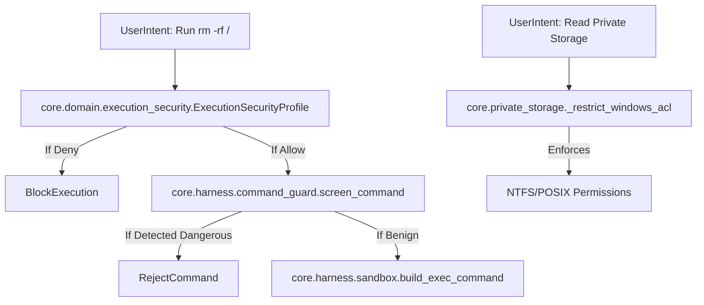
Sources: [core/domain/execution_security.py:185-201](), [core/harness/command_guard.py:132-143](), [core/harness/sandbox.py:32-33](), [core/private_storage.py:140-165]()

### Storage Hardening Flow: Natural Language to Code Entity

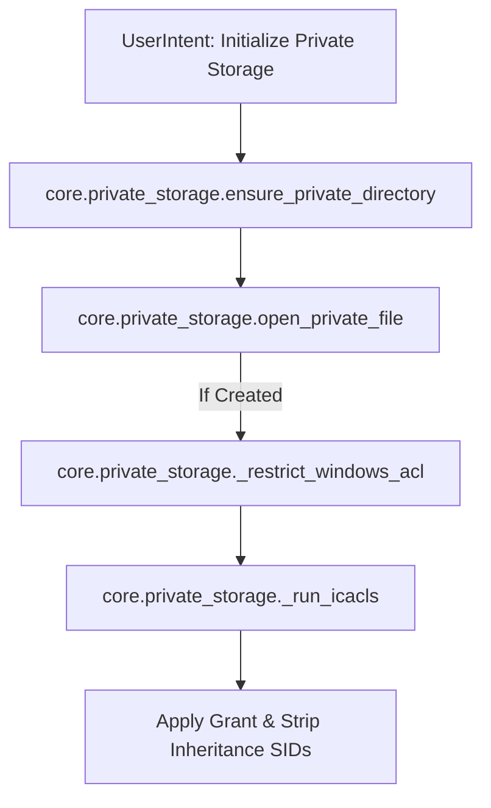
Sources: [core/private_storage.py:100-165](), [core/private_storage.py:167-175]()

### Sandbox Execution Workflow

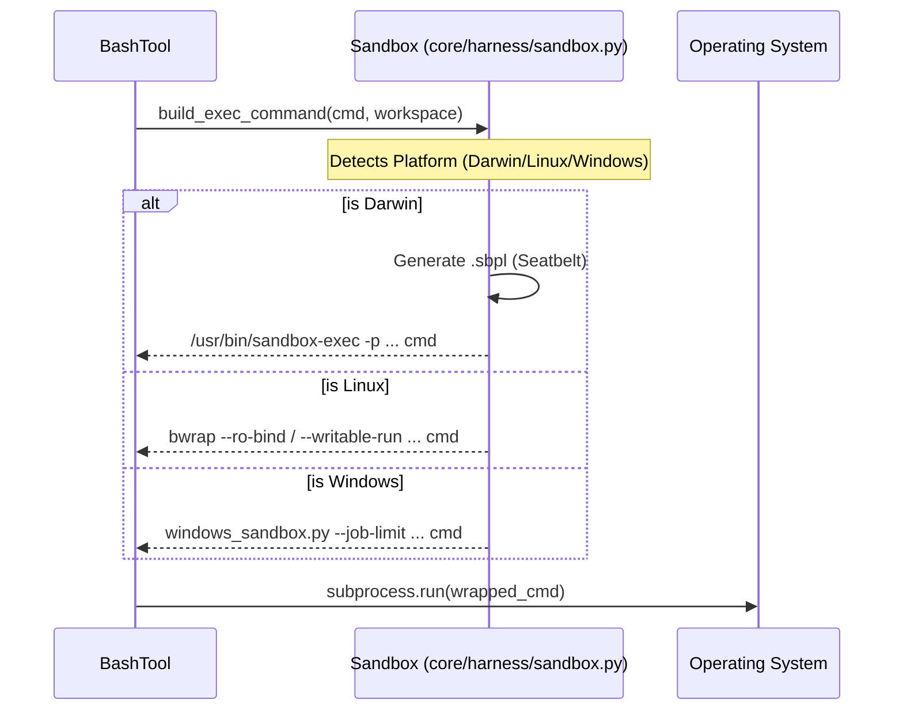
Sources: [core/harness/sandbox.py:75-87](), [core/harness/tools/shell.py:99-103](), [core/harness/sandbox.py:49-50]()

### Security Configuration Reference

| Entity | File Path | Role |
| :--- | :--- | :--- |
| `ExecutionPermissionRuleSnapshot` | [core/domain/execution_security.py:68-74]() | Encapsulates pattern-based tool permission rules. |
| `_SEATBELT_BASE_POLICY` | [core/harness/sandbox.py:97-168]() | Chrome-inspired closed-by-default macOS sandbox policy. |
| `_WINDOWS_BROAD_ACCESS_SIDS` | [core/private_storage.py:31-35]() | List of dangerous SIDs removed during NTFS hardening. |
| `screen_command` | [core/harness/command_guard.py:132-143]() | Token-based destructive shell command screen. |

Sources: [core/domain/execution_security.py:68-74](), [core/harness/sandbox.py:97-168](), [core/private_storage.py:31-35](), [core/harness/command_guard.py:132-143]()

---

# Page: MCP Integration Layer

# MCP Integration Layer

<details>
<summary>Relevant source files</summary>

The following files were used as context for generating this wiki page:

- [cli/mcp_server.py](cli/mcp_server.py)
- [core/agent_runtime/tools/base.py](core/agent_runtime/tools/base.py)
- [core/domain/execution_security.py](core/domain/execution_security.py)
- [core/harness/code_mode/__init__.py](core/harness/code_mode/__init__.py)
- [core/harness/code_mode/_runner.py](core/harness/code_mode/_runner.py)
- [core/harness/memory.py](core/harness/memory.py)
- [core/loop/autodream.py](core/loop/autodream.py)
- [core/mcp/models.py](core/mcp/models.py)
- [core/mcp/runtime.py](core/mcp/runtime.py)
- [core/mcp/tools.py](core/mcp/tools.py)
- [tests/test_autodream.py](tests/test_autodream.py)
- [tests/test_code_mode.py](tests/test_code_mode.py)
- [tests/test_compaction_memory.py](tests/test_compaction_memory.py)
- [tests/test_mcp_runtime_lazy.py](tests/test_mcp_runtime_lazy.py)
- [tests/test_mcp_server.py](tests/test_mcp_server.py)
- [tests/test_memory.py](tests/test_memory.py)
- [tests/test_memory_layers.py](tests/test_memory_layers.py)
- [tests/test_tool_description_quality.py](tests/test_tool_description_quality.py)

</details>


## Purpose and Scope

The MCP (Model Context Protocol) Integration Layer in DeepCode provides a standardized client system for connecting AI agents to external tools and services. Unlike static tool definitions, the MCP layer allows for dynamic tool discovery, multi-transport server lifecycles (stdio, SSE, and Streamable HTTP), preset catalogs, OAuth flows, and lazy connection management. This architecture ensures that agents can extend their capabilities through the vast ecosystem of Model Context Protocol servers while maintaining strict security boundaries, tool description quality bounds, and credential isolation.

Sources: [core/mcp/runtime.py:1-18](), [core/mcp/models.py:1-11]()

---

## MCP Runtime Architecture and Plan Materialization

The core of the MCP client system is the `McpSessionRuntime` class, which materializes an immutable `McpRuntimePlan` into the agent's `ToolRegistry` [core/mcp/runtime.py:98-104](). The runtime manages the lifecycle of multiple `McpConnection` instances, handling connection initialization, tool discovery, capability mapping, and graceful teardown.

### Diagram: MCP Session Materialization (Natural Language to Code Entity Space)

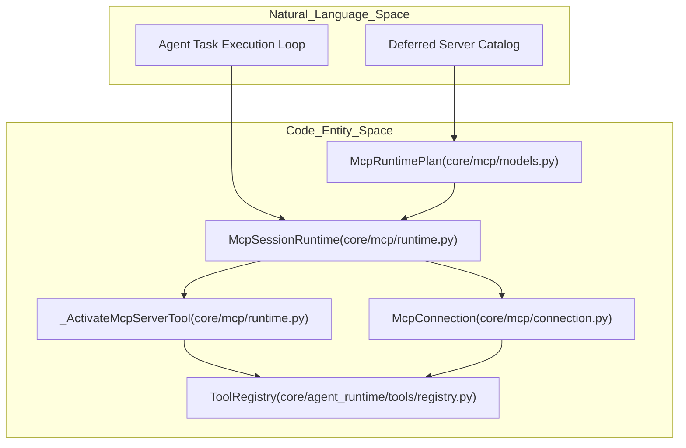

Sources: [core/mcp/runtime.py:98-116](), [core/mcp/runtime.py:30-42]()

---

## Server Lifecycle and Connection Management

DeepCode supports three primary transport types for MCP servers, configured via `McpServerDefinition` [core/mcp/models.py:102-111]():
1.  **stdio**: The server executes as a local subprocess, communicating via structured JSON-RPC over standard input/output streams [core/mcp/models.py:111-114]().
2.  **sse**: The server is accessed via an HTTP endpoint utilizing Server-Sent Events for asynchronous message dispatch [core/mcp/models.py:111]().
3.  **streamableHttp**: A specialized transport for chunked JSON-RPC communication over HTTP [core/mcp/models.py:111]().

### Lazy Connection and Deferred Loading
To optimize session startup overhead, DeepCode implements **Lazy Connection Management**. When a server is marked with `defer_loading: true` in its configuration [core/mcp/models.py:157-160](), initialization is bypassed during the initial `ensure_started()` lifecycle phase [core/mcp/runtime.py:175-197]().

Instead, the runtime registers a model-visible bridge tool named `_ActivateMcpServerTool` [core/mcp/runtime.py:30-42](). When the LLM decides it requires tools from a deferred server, it invokes this bridge tool, triggering connection establishment and dynamic tool registration in the active `ToolRegistry` [core/mcp/runtime.py:75-95]().

### Diagram: Lazy Activation Sequence

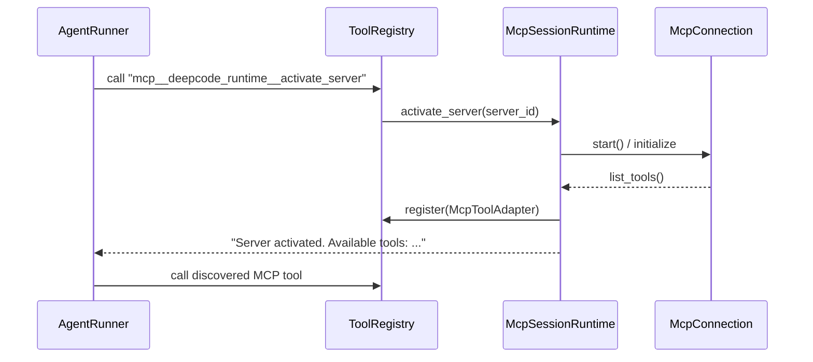

Sources: [core/mcp/runtime.py:30-95](), [tests/test_mcp_runtime_lazy.py:81-122]()

---

## Tool Adaptation, Sanitization, and Execution

Discovered remote tools are wrapped by `McpToolAdapter`, which subclasses the native `Tool` interface [core/mcp/tools.py:23-32](). This adapter handles schema normalization for provider compatibility [core/mcp/tools.py:52](), description bounding against prompt token budgets [core/mcp/tools.py:46-50](), execution tracking, result formatting, and observability logging.

### Diagram: Tool Execution and Telemetry Pipeline

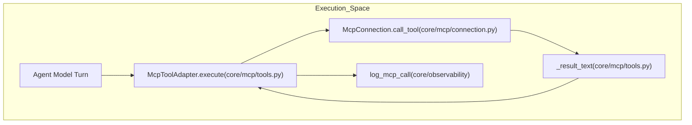

Sources: [core/mcp/tools.py:86-123](), [core/mcp/tools.py:126-164]()

---

## Configuration, Credential Isolation, and OAuth

MCP server configurations are validated using Pydantic models in `core/mcp/models.py`. Security and credential management adhere to strict isolation principles:

- **Credential References (`McpCredentialRef`)**: Secrets and API keys are referenced via `provider:<connection-id>` syntax [core/mcp/models.py:65-75](). These values are resolved immediately before a connection initializes and are excluded from serialized plans and diagnostic logs [core/mcp/models.py:68-70]().
- **OAuth Authentication**: HTTP-based transports support OAuth flows (`auth: "oauth"`) alongside explicit bearer token injection via environment variables or secure credential stores [core/mcp/models.py:130-153]().

Sources: [core/mcp/models.py:65-90](), [core/mcp/models.py:124-153]()

---

## DeepCode as an MCP Server (`cli/mcp_server.py`)

In addition to acting as an MCP client, DeepCode provides a server mode (`cli/mcp_server.py`) allowing external agents, IDEs, or client runtimes to drive DeepCode as a sub-agent. 

The server exposes core orchestration endpoints via standard MCP protocols, leveraging `build_agent_session` to ensure sub-agents inherit DeepCode's native tool suite, filesystem sandboxing, security rules, and persistent memory.

Sources: [cli/mcp_server.py:1-43](), [cli/mcp_server.py:111-118]()

---

# Page: LLM Provider System

# LLM Provider System

<details>
<summary>Relevant source files</summary>

The following files were used as context for generating this wiki page:

- [core/application/llm_configuration_service.py](core/application/llm_configuration_service.py)
- [core/harness/policy.py](core/harness/policy.py)
- [core/providers/catalog.py](core/providers/catalog.py)
- [core/providers/catalog_service.py](core/providers/catalog_service.py)
- [core/providers/egress.py](core/providers/egress.py)
- [core/providers/model_compat.py](core/providers/model_compat.py)
- [core/providers/openai_compat.py](core/providers/openai_compat.py)
- [core/providers/profiles.py](core/providers/profiles.py)
- [core/providers/reasoning.py](core/providers/reasoning.py)
- [core/providers/registry.py](core/providers/registry.py)
- [desktop/src/features/settings/useConnectionCatalog.ts](desktop/src/features/settings/useConnectionCatalog.ts)
- [docs/guide/models.md](docs/guide/models.md)
- [tests/application/test_llm_configuration_service.py](tests/application/test_llm_configuration_service.py)
- [tests/application/test_manual_model_entries.py](tests/application/test_manual_model_entries.py)
- [tests/conftest.py](tests/conftest.py)
- [tests/minimax_provider_test.py](tests/minimax_provider_test.py)
- [tests/test_bedrock_provider.py](tests/test_bedrock_provider.py)
- [tests/test_catalog.py](tests/test_catalog.py)
- [tests/test_forge_provider.py](tests/test_forge_provider.py)
- [tests/test_harness_policy.py](tests/test_harness_policy.py)
- [tests/test_model_catalog_service.py](tests/test_model_catalog_service.py)
- [tests/test_provider_egress.py](tests/test_provider_egress.py)
- [tests/test_reasoning_catalog_alignment.py](tests/test_reasoning_catalog_alignment.py)
- [tests/test_requesty_provider.py](tests/test_requesty_provider.py)
- [tests/test_session_compaction.py](tests/test_session_compaction.py)
- [tests/test_thinking_requires_capable_model.py](tests/test_thinking_requires_capable_model.py)
- [tests/test_zhipu_thinking_wire.py](tests/test_zhipu_thinking_wire.py)

</details>


## Purpose and Scope
The LLM Provider System (`core/providers/`) provides the abstraction layer for multi-provider interactions in DeepCode. It encompasses provider registration and endpoint classification, OpenAI-compatible and Anthropic client adapters, an offline-first model catalog service with context window governance, semantic reasoning effort mapping, a model egress security policy, and isolated credential management.

---

## 1. Provider Registry and Endpoint Classification

The system is anchored by a central registry defined in `core/providers/registry.py`. Every provider is declared using a `ProviderSpec` dataclass that specifies its backend type, environment variable key, and endpoint properties [core/providers/registry.py:102-135]().

### Endpoint Classification (P0-1 Trust Boundary)
Because the endpoint terminates TLS and reads every prompt, tool call, and tool result in plaintext, DeepCode classifies every endpoint using `ENDPOINT_CLASSES` [core/providers/registry.py:30-48](). The classification is determined via `ProviderSpec.resolve_endpoint_class()` [core/providers/registry.py:140-166]() or `host_looks_local()` [core/providers/registry.py:78-95]() when an explicit `apiBase` override is supplied:
* `first_party`: Direct model vendor API surface (`api.deepseek.com`, `api.anthropic.com`) [core/providers/registry.py:30-35]().
* `gateway`: Routers that fan out to multiple vendors (`openrouter`, `requesty`) [core/providers/registry.py:36-40]().
* `aggregator`: Resellers or mirrors (`zhipu`, `dashscope`) [core/providers/registry.py:41-43]().
* `local`: Loopback or LAN endpoints (`localhost`, `127.0.0.1`, Ollama, vLLM) [core/providers/registry.py:44-45, 52-57]().
* `unknown`: Unclassified custom endpoints [core/providers/registry.py:46-47]().

### OpenAI-Compatible and Anthropic Adapters
The `OpenAICompatProvider` (`core/providers/openai_compat.py`) handles all non-Anthropic models. It provides:
* Automatic attribution headers for OpenRouter (`HTTP-Referer`, `X-OpenRouter-Title`) [core/providers/openai_compat.py:80-84]() and Requesty [core/providers/openai_compat.py:85-88]().
* 9-character alphanumeric tool ID generation (`_short_tool_id`) to ensure compatibility with strict schema validators like Mistral [core/providers/openai_compat.py:94-96]().
* Circuit breaking via failure thresholds (`_RESPONSES_FAILURE_THRESHOLD = 3`) [core/providers/openai_compat.py:181-182]().

**Diagram 1: Provider Registry to Adapter Entity Flow**
```mermaid
graph TD
    subgraph "NaturalLanguageSpace"
        UserReq["User Selects Provider or Model"]
    end

    subgraph "CodeEntitySpace"
        Reg["core/providers/registry.py:PROVIDERS"] --> Spec["ProviderSpec"]
        Spec --> Resolver["ConnectionResolver"]
        Resolver --> Matcher["find_by_name() / find_by_model()"]
        Matcher --> Factory["make_llm_provider()"]
        Factory -->|openai_compat| OpenAI["core/providers/openai_compat.py:OpenAICompatProvider"]
        Factory -->|anthropic| Anthropic["core/providers/anthropic.py:AnthropicProvider"]
    end

    UserReq --> Reg
```
Sources: [core/providers/registry.py:30-166](), [core/providers/openai_compat.py:1-42]()

---

## Model Catalog and Context Governance

DeepCode implements an offline-first model catalog in `core/providers/catalog.py` to prevent context overflows. Instead of relying on hardcoded global defaults, `AgentRunner` queries the model's exact context window.

### Resolution Cascade
`resolve_model_info` evaluates model metadata through a cascading lookup:
1. **Exact Match**: Checks the built-in `_SEED` dictionary for curated vendor limits [core/providers/catalog.py:146-154]().
2. **Snapshot**: Merges external `models.dev` exports via `load_catalog_snapshot()` [core/providers/catalog.py:16-17]().
3. **Family Fallback**: Pattern-matches model prefixes (e.g., `gpt-5`, `deepseek-r1`) to assign correct family limits to unlisted version strings [core/providers/catalog.py:24-28]().
4. **Conservative Default**: Falls back to a safe 128K context window for entirely unknown identifiers [core/providers/catalog.py:45-48]().

### Model Catalog Service and Declarations
The `ModelCatalogService` (`core/providers/catalog_service.py`) manages dynamic model discovery with a durable last-known-good cache.
* **Cache Invalidation**: `catalog_revision(connection)` fingerprints executable settings, catalog mode, and manual model definitions [core/providers/catalog_service.py:136-160]().
* **Manual Model Declarations**: Users can define custom models in configuration (`manualModels`), supplying explicit labels, context windows, max output tokens, and reasoning capabilities which outrank remote discoveries [tests/application/test_manual_model_entries.py:55-147]().

Sources: [core/providers/catalog.py:1-155](), [core/providers/catalog_service.py:116-160](), [tests/application/test_manual_model_entries.py:55-147]()

---

## Egress Policy and Endpoint Security

To prevent data exfiltration via untrusted LLM endpoints, `core/providers/egress.py` enforces a strict model-egress security policy (P0-1) [core/providers/egress.py:1-44]().

### Evaluation and Modes
* **Pure Evaluation Kernel**: `evaluate_provider_egress(api_base, allowed_domains, blocked_domains)` parses the endpoint host and validates it against configured allow-lists and block-lists without performing network I/O [core/providers/egress.py:70-84]().
* **Fail-Closed Semantics**: An empty allow-list permits all domains *unless* explicitly blocked, preserving historical behavior. However, malformed domain entries cause `is_domain_allowed` to reject the policy outright [tests/test_provider_egress.py:181-189]().
* **Rollout Modes (`DEEPCODE_EGRESS_MODE`)**:
  * `enforce`: Blocks disallowed endpoints by raising a `ConfigError` during provider construction [core/providers/egress.py:57]().
  * `warn`: Logs violations without blocking traffic, aiding operators in discovering all third-party relays in use before strict enforcement [core/providers/egress.py:38-43, 58]().

Sources: [core/providers/egress.py:1-185](), [tests/test_provider_egress.py:1-189]()

---

## 4. Reasoning and Thinking Controls

DeepCode abstracts vendor-specific reasoning mechanisms (OpenAI `reasoning_effort`, Anthropic `extended_thinking`, DeepSeek thinking blocks) into a unified semantic model (`core/providers/reasoning.py`).

### ModelReasoningCapabilities
The `ModelReasoningCapabilities` data class defines supported thinking controls:
* **Effort Ladder**: Exposes `minimal`, `low`, `medium`, `high`, `max` [core/providers/reasoning.py:79-91]().
* **Mandatory Flag**: `mandatory=True` for models like DeepSeek-R1 or Grok-4 where thinking cannot be toggled off [core/providers/reasoning.py:120-124]().
* **Summary Channel**: Indicates whether the model supports a summarized thinking stream vs. raw trace blocks [core/providers/reasoning.py:83-101]().

**Diagram 2: Reasoning Effort and Compatibility Resolution**
```mermaid
graph TD
    subgraph "NaturalLanguageSpace"
        UserSelectsEffort["User Selects 'High' Reasoning Effort"]
    end

    subgraph "CodeEntitySpace"
        ReasoningModule["core/providers/reasoning.py:infer_reasoning_capabilities()"] --> Caps["ModelReasoningCapabilities"]
        Caps --> CompatModule["core/providers/model_compat.py:resolve_model_compat()"]
        CompatModule --> WireFormat["extra_body / request payload (e.g. thinking: enabled)"]
    end

    UserSelectsEffort --> ReasoningModule
```
Sources: [core/providers/reasoning.py:38-124](), [tests/test_reasoning_catalog_alignment.py:45-123]()

---

## Session Compaction

Context governance is tied directly to the `AgentSession` and `AgentRunner` lifecycle (`core/agent_runtime/runner.py`) [tests/test_session_compaction.py:1-11]() via the model's resolved context window [core/providers/catalog.py:60](). When a session's history approaches the token limit, two mechanisms activate:
1. **Snipping (`_snip_history`)**: Trims older turns from the message history while preserving system instructions and the most recent turn [tests/test_session_compaction.py:58-91]().
2. **Summarization Compaction**: Invokes an LLM pass to replace older conversation history with a structured checkpoint summary while retaining a tool-bearing tail for active tasks [tests/test_session_compaction.py:114-146]().

Sources: [tests/test_session_compaction.py:1-146]()

---

## Credential Management

DeepCode enforces a strict "no ambient credential" policy to prevent keys stored in process environment variables from leaking during multi-tenant operations or App Server execution [tests/test_forge_provider.py:55-64]().

* **Credential Store**: `CredentialStore` manages write-only secret storage in encrypted or private local paths (`~/.deepcode/credentials.json`) [core/providers/catalog_service.py:18-24]().
* **Connection Resolution**: `ConnectionResolver` combines static `deepcode_config.json` definitions with dynamic secrets from `CredentialStore` to yield isolated `ResolvedConnection` objects at execution time, ensuring API keys never touch global state [core/application/llm_configuration_service.py:77-124]().

Sources: [core/application/llm_configuration_service.py:60-124](), [core/providers/catalog_service.py:16-25]()

---

# Page: Background Service and Discovery

# Background Service and Discovery

<details>
<summary>Relevant source files</summary>

The following files were used as context for generating this wiki page:

- [.github/workflows/python-ci.yml](.github/workflows/python-ci.yml)
- [app_server/runtime_probe.py](app_server/runtime_probe.py)
- [app_server/service_client.py](app_server/service_client.py)
- [app_server/service_state.py](app_server/service_state.py)
- [cli/service_cli.py](cli/service_cli.py)
- [core/application/application.py](core/application/application.py)
- [core/application/views.py](core/application/views.py)
- [core/persistence/database.py](core/persistence/database.py)
- [desktop/scripts/verify-release-bundle.py](desktop/scripts/verify-release-bundle.py)
- [tests/app_server/test_preset_methods.py](tests/app_server/test_preset_methods.py)
- [tests/app_server/test_runtime_probe.py](tests/app_server/test_runtime_probe.py)
- [tests/app_server/test_service.py](tests/app_server/test_service.py)
- [tests/app_server/test_service_discovery.py](tests/app_server/test_service_discovery.py)
- [tests/persistence/test_database_locks.py](tests/persistence/test_database_locks.py)
- [tests/test_ci_installation.py](tests/test_ci_installation.py)

</details>


## Purpose and Scope
This page documents DeepCode's shared local background service architecture. The background service acts as a single-instance, local control daemon coordinating application services, background event relays, and automation schedulers across multiple concurrent user interfaces (TUI, Desktop, Web, and CLI commands). We detail the disk-backed state management via `ServiceFiles`, lifetime leases, inter-process discovery records, HMAC-SHA256 identity proof validation, `ServiceClient` RPC control flows, the `deepcode service` CLI interface, platform supervisors (`LaunchAgent`, `systemd`, `WindowsUserTask`), and graceful drain versus immediate cancel shutdown semantics.

---

## 1. State Management and Lifetime Leases (`ServiceFiles`)

The background service manages its state inside the DeepCode home directory next to the primary SQLite database. For a given database path, `ServiceFiles` [app_server/service_state.py:60-68]() initializes a dedicated `.service` sidecar directory containing state files, locks, authentication tokens, and logs.

```mermaid
graph TD
    subcode["ServiceFiles Code Entities"]
    SF["ServiceFiles(database: Path)<br/>app_server/service_state.py:60"]
    DIR["directory: Path<br/>state.sqlite3.service/"]
    LOCK["lock: Path<br/>instance.lock"]
    DLOCK["_discovery_lock: Path<br/>discovery.lock"]
    REC["record: Path<br/>instance.json"]
    TOK["token: Path<br/>token"]
    LOG["log: Path<br/>service.log"]

    SF --> DIR
    DIR --> LOCK
    DIR --> DLOCK
    DIR --> REC
    DIR --> TOK
    DIR --> LOG

    style SF fill:#none,stroke:#333,stroke-width:2px
    style LOCK fill:#none,stroke:#333,stroke-width:1px
    style DLOCK fill:#none,stroke:#333,stroke-width:1px
    style REC fill:#none,stroke:#333,stroke-width:1px
    style TOK fill:#none,stroke:#333,stroke-width:1px
    style LOG fill:#none,stroke:#333,stroke-width:1px
```

*Figure 1: `ServiceFiles` directory layout and state file mappings.*

### Core State Files
* **`instance.lock`**: Acquired via `FileLease.acquire(self.lock, shared=False, blocking=False)` [app_server/service_state.py:70-71](). This OS-backed exclusive file lock serves as the service's lifetime lease. Holding this lock guarantees single-instance execution per database.
* **`discovery.lock`**: An exclusive file lock managed by `exclusive_file_lock(self._discovery_lock)` [app_server/service_state.py:84]() ensuring atomic reads and writes to discovery metadata across processes [tests/app_server/test_service_discovery.py:50-57]().
* **`instance.json`**: Contains the JSON serialization of the active `ServiceRecord` [app_server/service_state.py:47-58](), tracking `instance_id`, database path, OS `pid`, assigned loopback `port`, package `version`, and `protocol_version`.
* **`token`**: A 64-character hex-encoded authentication secret used for HMAC identity proofs and Bearer authorization [app_server/service_state.py:108-109]().
* **`service.log`**: Standard output and error stream capture for the background daemon.

Sources: [app_server/service_state.py:46-125](), [tests/app_server/test_service_discovery.py:50-116]()

---

## 2. Discovery Protocol and HMAC Identity Proof

Clients locate and connect to the background service without hardcoded port assumptions by reading the discovery record. Because local filesystem access alone does not prove the reading process is talking to the legitimate HTTP listener bound to that port (mitigating port-hijacking or stale-port races), DeepCode enforces an HMAC identity challenge on control endpoints [app_server/service_client.py:42-61]().

```mermaid
sequenceDiagram
    participant CLI as "ServiceClient"
    participant FS as "ServiceFiles"
    participant Srv as "Background Service"

    CLI->>FS: read() via exclusive_file_lock(discovery.lock)
    FS-->>CLI: ServiceRecord(port, instance_id), token
    CLI->>Srv: GET /control/identity?challenge=HEX
    Srv-->>CLI: {"proof": HMAC(token, instance_id:challenge)}
    Note over CLI,Srv: Client verifies proof matches local token & instance_id
    CLI->>Srv: POST /control/rpc (Authorization: Bearer token, X-DeepCode-Instance: instance_id)
    Srv-->>CLI: JSON-RPC Result
```

*Figure 2: Discovery read and HMAC challenge-response verification sequence.*

### Identity Proof Verification
The `identity_proof` function computes an HMAC-SHA256 digest over the concatenation of the instance ID and a random hex challenge using the service token as the key [app_server/service_state.py:40-43]():
```python
def identity_proof(token: str, instance_id: str, challenge: str) -> str:
    return hmac.new(
        token.encode(), f"{instance_id}:{challenge}".encode(), hashlib.sha256
    ).hexdigest()
```
When `ServiceClient.call()` executes, it requests `/control/identity` with a random challenge [app_server/service_client.py:49-51](). It compares the returned proof against the locally computed digest using constant-time comparison (`hmac.compare_digest`) before transmitting any management payloads [app_server/service_client.py:55-61]().

Sources: [app_server/service_state.py:40-44](), [app_server/service_client.py:22-100]()

---

## 3. Control RPC and Client Communication (`ServiceClient`)

The `ServiceClient` class acts as the lightweight management client. It never hosts an application runtime or database anchor directly [app_server/service_client.py:1]() but communicates exclusively via HTTP with loopback origin checks.

### Key Validation Checks in `ServiceClient`
1. **Running Check**: Asserts `self.files.running()` is true [app_server/service_client.py:34]().
2. **Instance Consistency**: Rejects requests if `instance_id` changes mid-operation [app_server/service_client.py:40-41]().
3. **Loopback & Origin Enforcement**: The server rejects non-loopback requests, incorrect `X-DeepCode-Instance` headers, or unexpected `Origin`/`Host` headers with `401 Unauthorized` or `403 Forbidden` [tests/app_server/test_service.py:23-56]().
4. **JSON-RPC Envelope**: Control requests follow JSON-RPC 2.0 specifications (`method`, `params`, `id`) over `/control/rpc` [app_server/service_client.py:62-74]().

Sources: [app_server/service_client.py:22-100](), [tests/app_server/test_service.py:23-70]()

---

## 4. Service Lifecycle and Management CLI (`deepcode service`)

The `deepcode service` command suite (`cli/service_cli.py`) orchestrates starting, stopping, inspecting, and resuming the background daemon.

```mermaid
graph TD
    subcode["Service Lifecycle Code Entities"]
    CLI_SVC["cli/service_cli.py"]
    START["start_service()"]
    STOP["stop_service()"]
    DETACH["_start_detached()"]
    MGR["_service_manager()"]
    CLIENT["ServiceClient"]

    CLI_SVC --> START
    CLI_SVC --> STOP
    START --> MGR
    START --> DETACH
    START --> CLIENT
    STOP --> MGR
    STOP --> CLIENT

    style CLI_SVC fill:#none,stroke:#333,stroke-width:2px
    style START fill:#none,stroke:#333,stroke-width:1px
    style STOP fill:#none,stroke:#333,stroke-width:1px
    style DETACH fill:#none,stroke:#333,stroke-width:1px
    style MGR fill:#none,stroke:#333,stroke-width:1px
    style CLIENT fill:#none,stroke:#333,stroke-width:1px
```

*Figure 3: Service management CLI code entity relationships.*

### Startup & Idempotency
`start_service` uses an exclusive management lock (`files.directory / "management.lock"`) to prevent concurrent race conditions [cli/service_cli.py:44-48](). If a service is already running, it waits for readiness or resumes a drained instance [cli/service_cli.py:52-57](). If not managed by an OS supervisor, it launches a detached background process [cli/service_cli.py:66]() via `_start_detached` with `start_new_session=True` (POSIX) or `DETACHED_PROCESS` (Windows) [cli/service_cli.py:120-136]().

### Drain vs. Cancel Shutdown Semantics
When stopping a service via `stop_service` (`cli/service_cli.py`), operators choose between graceful draining and immediate cancellation:
* **Drain Mode (`cancel_running=False`)**: The client invokes the `drain` RPC method with a timeout [cli/service_cli.py:88-94](). The server stops accepting new turns, finishes executing active agent turns, and enters a `drained` phase. If shutdown is aborted, a `resume` RPC restores the `ready` phase [tests/app_server/test_service.py:72-90]().
* **Cancel Mode (`cancel_running=True`)**: Active agent turns and background tasks are immediately cancelled, followed by server termination and release of the lifetime lease lock.

Sources: [cli/service_cli.py:44-118](), [tests/app_server/test_service.py:72-114]()

---

## 5. Platform Supervisors

To ensure high availability and automatic background recovery, DeepCode integrates with native OS user supervisors depending on the host platform:

| Platform | Supervisor Class | Mechanism | Management Scope |
| :--- | :--- | :--- | :--- |
| **macOS** | `LaunchAgent` [cli/service_cli.py:28-32]() | `launchd` plist configuration | User agent daemon lifecycle |
| **Linux** | `SystemdUserService` [cli/service_cli.py:33-36]() | `systemd --user` units | Persistent background unit |
| **Windows** | `WindowsUserTask` [cli/service_cli.py:37-40]() | Windows Task Scheduler / Job Object | User session task execution |

These adapters inspect supervisor state (`job["loaded"]`, `job["pid"]`), load/unload plist/unit/task definitions, and ensure that if the machine restarts or the service crashes, the background daemon recovers automatically under the user session.

Sources: [cli/service_cli.py:28-41](), [.github/workflows/python-ci.yml:66-122]()

---

# Page: Observability and Transparency Log

# Observability and Transparency Log

<details>
<summary>Relevant source files</summary>

The following files were used as context for generating this wiki page:

- [core/observability/bus.py](core/observability/bus.py)
- [core/observability/llmops.py](core/observability/llmops.py)
- [core/observability/records.py](core/observability/records.py)
- [scripts/verify_transparency_log.py](scripts/verify_transparency_log.py)
- [tests/test_cli_logging_bootstrap.py](tests/test_cli_logging_bootstrap.py)
- [tests/test_llmops.py](tests/test_llmops.py)
- [tests/test_transparency_log.py](tests/test_transparency_log.py)

</details>


## Purpose and Scope

The `core/observability/` package provides DeepCode's centralized logging, sink wiring, structured log record schemas, LLMOps metering/tracing, and the tamper-evident transparency log hash chain [core/observability/bus.py:1-31, core/observability/records.py:1-17]. It bridges standard library logging and Loguru sinks, routes logs globally and per-task, and enables forensic auditing of LLM model interactions.

---

## 1. The Event Bus and Log Sinks (`core/observability/bus.py`)

The event bus architecture revolves around a module-level, idempotent setup function `setup_logging()` that configures Loguru sinks and intercepts Python standard library log records [core/observability/bus.py:1-92, core/observability/bus.py:125-144].

### Loguru Wiring & Standard Library Bridge

Because portions of the application and third-party libraries emit logs via Python's built-in `logging` module, DeepCode uses a custom `_StdlibBridgeHandler` to capture standard library log records and route them through Loguru's active sinks without misattributing call stacks [core/observability/bus.py:58-92].

```mermaid
graph TD
    subgraph "Natural Language Space"
        A["Standard Library Logger"]
        B["Loguru Logger Calls"]
        C["Console Sink"]
        D["Global JSONL Sink"]
        E["Per-Task JSONL Sink"]
    end

    subgraph "Code Entity Space"
        F["logging.Handler" --> G["_StdlibBridgeHandler.emit()"]]
        G --> H["_loguru_logger.opt()"]
        H --> I["core.observability.bus.setup_logging()"]
        I --> J["logs/server-{date}.jsonl"]
        I --> K["deepcode_lab/tasks/<task_id>/logs/system.jsonl"]
    end

    A --> F
    B --> H
    H --> C
    H --> D
    H --> E

    style F fill:none,stroke:#000,stroke-width:1px
    style G fill:none,stroke:#000,stroke-width:1px
    style H fill:none,stroke:#000,stroke-width:1px
    style I fill:none,stroke:#000,stroke-width:1px
    style J fill:none,stroke:#000,stroke-width:1px
    style K fill:none,stroke:#000,stroke-width:1px
```

*Sources:* `core/observability/bus.py:58-92`, `core/observability/bus.py:125-144`

---

## 2. Structured Record Schemas (`core/observability/records.py`)

DeepCode emits structured log streams using plain Python `dataclass` instances rather than Pydantic to maintain zero validation overhead on hot logging paths [core/observability/records.py:1-6].

### Core Record Classes

* **`SystemLogRecord`**: Captures generic Loguru-derived log events with support for `task_id`, `session_id`, log levels, and exception tracebacks [core/observability/records.py:86-110].
* **`LLMLogRecord`**: Captures individual model invocation requests, responses, durations, token counts, and transparency log metadata [core/observability/records.py:113-157].

```mermaid
graph TD
    subgraph "Natural Language Space"
        A["System Log Event"]
        B["LLM Model Call Record"]
        C["Canonical JSON Encoder"]
        D["SHA-256 Hasher"]
    end

    subgraph "Code Entity Space"
        E["core.observability.records.SystemLogRecord"]
        F["core.observability.records.LLMLogRecord"]
        G["core.observability.records.canonical_json()"]
        H["core.observability.records.sha256_hex()"]
        I["core.observability.records.compute_entry_hash()"]
    end

    A --> E
    B --> F
    E --> G
    F --> G
    G --> H
    H --> I

    style E fill:none,stroke:#000,stroke-width:1px
    style F fill:none,stroke:#000,stroke-width:1px
    style G fill:none,stroke:#000,stroke-width:1px
    style H fill:none,stroke:#000,stroke-width:1px
    style I fill:none,stroke:#000,stroke-width:1px
```

*Sources:* `core/observability/records.py:33-110`, `core/observability/records.py:113-157`

---

## 3. Transparency Log and Hash Chain (`DEEPCODE_TRANSPARENCY_LOG=1`)

To protect against a malicious model router or proxy between the agent harness and model providers (which could rewrite tool calls or log credentials), DeepCode features an optional append-only transparency log [core/observability/bus.py:20-31, core/observability/records.py:7-17].

### Write-Time Hashing Mechanics

When `DEEPCODE_TRANSPARENCY_LOG=1` is active, every `LLMLogRecord` appended to `llm.jsonl` is linked into a cryptographic hash chain at write time [core/observability/bus.py:20-24, tests/test_transparency_log.py:69-76]:

$$\text{entry\_hash} = \text{SHA256}(\text{canonical\_json}(\text{payload}) \mathbin{\Vert} \text{prev\_hash})$$

* **`canonical_json()`**: Generates deterministic byte sequences by sorting dictionary keys and stripping whitespace, ensuring cross-platform serialization stability [core/observability/records.py:33-46].
* **`prev_hash`**: Contains the `entry_hash` of the preceding log line (`""` for the genesis record) [core/observability/records.py:70-83].
* **Tail Recovery**: On process restart, the bus reads the tail of the target `llm.jsonl` file to recover the last `entry_hash` without buffering the entire log [core/observability/bus.py:113-117].

*Sources:* `core/observability/bus.py:20-31`, `core/observability/records.py:33-83`, `tests/test_transparency_log.py:69-76`

---

## 4. Transparency Log Verification (`scripts/verify_transparency_log.py`)

The verification script `scripts/verify_transparency_log.py` inspects `llm.jsonl` files to audit integrity and linkage [scripts/verify_transparency_log.py:1-120].

```mermaid
graph TD
    subgraph "Natural Language Space"
        A["Transparency Log File"]
        B["Integrity Validator"]
        C["Linkage Validator"]
        D["Exit Status"]
    end

    subgraph "Code Entity Space"
        E["scripts.verify_transparency_log.verify_file()"]
        F["core.observability.records.compute_entry_hash()"]
        G["scripts.verify_transparency_log.VerifyResult"]
        H["scripts.verify_transparency_log.Problem"]
    end

    A --> E
    E --> F
    E --> G
    G --> H
    G --> D

    style E fill:none,stroke:#000,stroke-width:1px
    style F fill:none,stroke:#000,stroke-width:1px
    style G fill:none,stroke:#000,stroke-width:1px
    style H fill:none,stroke:#000,stroke-width:1px
```

### Validation Checks
1. **Integrity Check**: Recomputes `entry_hash` from the record payload and compares it against the stored `entry_hash` [scripts/verify_transparency_log.py:101-164].
2. **Linkage Check**: Confirms that each entry's `prev_hash` matches the preceding entry's stored `entry_hash`, preventing line deletion, reordering, or substitution [scripts/verify_transparency_log.py:165-177].

*Sources:* `scripts/verify_transparency_log.py:101-177`

---

## 5. LLMOps Metering and Tracing (`core/observability/llmops.py`)

The `llmops` module aggregates `llm.jsonl` records to compute cost, latency distributions, and call statuses [core/observability/llmops.py:1-20].

### Cost and Latency Calculation

* **Cost Aggregation**: Token usage counts are multiplied by list prices fetched from the model catalog (`core.providers.catalog.resolve_model_info`) [core/observability/llmops.py:8-13, core/observability/llmops.py:121-137]. Unpriced models increment `unpriced_calls` so overall usage is never understated [core/observability/llmops.py:10-11, core/observability/llmops.py:130-136].
* **Latency Percentiles**: Computes `p50`, `p95`, and `max` over `duration_ms` samples [core/observability/llmops.py:13-14, core/observability/llmops.py:141-152].

*Sources:* `core/observability/llmops.py:1-175`, `tests/test_llmops.py:30-62`

---

# Page: Interfaces

# Interfaces

<details>
<summary>Relevant source files</summary>

The following files were used as context for generating this wiki page:

- [cli/schedule_cli.py](cli/schedule_cli.py)
- [cli/tui/app.py](cli/tui/app.py)
- [cli/tui/commands.py](cli/tui/commands.py)
- [cli/tui/input.py](cli/tui/input.py)
- [cli/tui/renderer.py](cli/tui/renderer.py)
- [cli/tui/session_bridge.py](cli/tui/session_bridge.py)
- [cli/tui/theme.py](cli/tui/theme.py)
- [cli/tui/thread_client.py](cli/tui/thread_client.py)
- [deepcode.py](deepcode.py)
- [desktop/README.md](desktop/README.md)
- [desktop/src/App.tsx](desktop/src/App.tsx)
- [desktop/src/app/appearance.ts](desktop/src/app/appearance.ts)
- [desktop/src/app/i18n.ts](desktop/src/app/i18n.ts)
- [desktop/src/app/useAppearance.ts](desktop/src/app/useAppearance.ts)
- [desktop/src/features/thread/ConversationSplitter.module.css](desktop/src/features/thread/ConversationSplitter.module.css)
- [desktop/src/features/thread/ConversationSplitter.test.tsx](desktop/src/features/thread/ConversationSplitter.test.tsx)
- [desktop/src/features/thread/ConversationSplitter.tsx](desktop/src/features/thread/ConversationSplitter.tsx)
- [desktop/src/features/thread/conversationWidthResize.test.ts](desktop/src/features/thread/conversationWidthResize.test.ts)
- [desktop/src/features/thread/conversationWidthResize.ts](desktop/src/features/thread/conversationWidthResize.ts)
- [tests/test_git_command_url.py](tests/test_git_command_url.py)
- [tests/test_tui.py](tests/test_tui.py)
- [tools/code_reference_indexer.py](tools/code_reference_indexer.py)
- [tools/git_command.py](tools/git_command.py)
- [tools/pdf_converter.py](tools/pdf_converter.py)

</details>


DeepCode provides multiple interactive surfaces and integration channels for its agentic coding kernel. While the underlying execution engine and session storage remain unified, interfaces range from high-velocity terminal workflows to cross-platform desktop applications, web workbenches, automated headless CLI jobs, and structured JSON-RPC APIs. 

All interfaces communicate with the same underlying infrastructure, sharing session history, provider configurations, and tool permissions through the session store and application services layer [deepcode.py:1-35](), [cli/tui/thread_client.py:39-74]().

## Interface Matrix

| Interface | Primary Use Case | Technology | Key Components |
| :--- | :--- | :--- | :--- |
| **Interactive TUI** | Natural language coding & REPL | Python (`Rich`, `PromptToolkit`) | `TuiApp`, `EventRenderer`, `commands.py` |
| **Headless CLI** | CI/CD, automation, and batch tasks | Python (`Argparse`) | `deepcode exec`, `headless_turn.py`, `goal_runner.py` |
| **Desktop App** | Visual workbench, review & settings | Tauri (React, Rust, Python Sidecar) | `AppServer`, `DesktopSidebar`, `Composer` |
| **Web Workbench** | Browser-based shared shell access | React, WebSockets, Python Surface | `web_cli.py`, `web_surface.py`, `webMain.tsx` |
| **App Server** | Programmatic & remote access protocol | JSON-RPC 2.0 over stdio | `app_server/server.py`, `app_server/dispatcher.py` |
| **Voice Dictation** | Push-to-talk speech-to-text input | MLX / OpenAI-compatible endpoint | `DictationService`, `useDictation` |

---

## 3.1 Interactive TUI

The interactive terminal UI provides a REPL loop for free-form multi-turn coding sessions [cli/tui/app.py:1-17](). It features an event-sourced rendering architecture where agent actions, thinking deltas, and tool executions are dynamically painted onto the terminal using `Rich` [tests/test_tui.py:1-54](). Users can steer conversations using slash commands registered declaratively [cli/tui/commands.py:1-10](), utilize smart input completion for `@path` file references [cli/tui/app.py:50-51](), and inspect execution profiles [cli/tui/thread_client.py:39-105]().

For details, see [Interactive TUI](#3.1).

Sources: [cli/tui/app.py:1-17](), [cli/tui/commands.py:1-10](), [cli/tui/thread_client.py:39-105]()

---

## 3.2 Headless and Automation CLI

For non-interactive environments, CI/CD pipelines, and background workflows, DeepCode provides headless execution commands [deepcode.py:124-177](). Commands like `deepcode exec`, `deepcode loop`, and `deepcode schedule` allow agents to operate as batch workers or autonomous loop runners, streaming structured JSON events for telemetry and test-driven verification [tests/test_tui.py:1-7]().

For details, see [Headless and Automation CLI](#3.2).

Sources: [deepcode.py:124-177](), [tests/test_tui.py:1-7]()

---

## 3.3 Desktop Application

The Tauri-based Desktop workbench offers a visual multi-process environment combining a React frontend, a Rust Tauri shell, and a Python App Server sidecar [desktop/README.md:1-25](). It surfaces the same canonical sessions, skills, automations, and permission models as the CLI [desktop/README.md:1-12](). Key subsystems include the `Composer`, conversation renderers, and dedicated settings management [desktop/src/App.tsx:1-50]().

* **Desktop Settings and Provider Configuration**: Manages credential CRUD, write-only keys, model discovery, validation probes, appearance preferences, and internationalization tokens [desktop/src/app/i18n.ts:1-50](), [desktop/src/app/appearance.ts:1-70]().
* **Desktop Automations, Goals and Presets**: Surfaces background goals, occurrence schedules, approval inspector cards, and runtime notices [desktop/src/App.tsx:70-120]().

For details, see [Desktop Application](#3.3).

Sources: [desktop/README.md:1-25](), [desktop/src/App.tsx:1-50](), [desktop/src/app/appearance.ts:1-70]()

---

## 3.4 App Server JSON-RPC Protocol

The App Server provides a bidirectional JSON-RPC 2.0 communication channel over stdio [desktop/README.md:1-163](). It structures interaction into distinct RPC namespaces (`thread/*`, `turn/*`, `file/*`, `mcp/*`) and handles runtime probing, event notifications, error retry semantics, and state projection from the underlying JSONL `SessionStore` into SQLite.

For details, see [App Server JSON-RPC Protocol](#3.4).

Sources: [desktop/README.md:1-163]()

---

## 3.5 Web Workbench

The `deepcode web` browser client exposes the workbench interface over web surfaces [deepcode.py:173-176](). Utilizing `cli/web_cli.py`, `app_server/web_surface.py`, and WebSocket transport layers, it renders the shared React shell (`desktop/src/webMain.tsx`) inside standard browsers while retaining full background service integration.

For details, see [Web Workbench](#3.5).

Sources: [deepcode.py:173-176]()

---

## 3.6 Voice Dictation

Voice dictation enables push-to-talk speech-to-text transcription within input components. Powered by `DictationService`, it supports local `parakeet-mlx` runners or OpenAI-compatible transcription endpoints, respecting strict egress policies and exposing `dictation/status` and `dictation/transcribe` RPC routes alongside the React `useDictation` hook.

For details, see [Voice Dictation](#3.6).

---

## Interface to Code Mapping

The following diagrams map natural language interaction spaces to their corresponding backend code entities across different interfaces.

### TUI Input to REPL Execution Flow
```mermaid
graph TD
    User["User Input: '/model gpt-4o'"] --> Reader["InputReader (cli/tui/input.py)"]
    Reader --> App["TuiApp (cli/tui/app.py)"]
    App --> CmdRegistry["REGISTRY (cli/tui/commands.py)"]
    CmdRegistry --> Handler["_cmd_model handler"]
    Handler --> Client["TuiThreadClient (cli/tui/thread_client.py)"]
    Client --> AppService["DeepCodeApplication (core/application/application.py)"]
```
Sources: [cli/tui/app.py:70-135](), [cli/tui/commands.py:1-40](), [cli/tui/thread_client.py:39-75]()

### Desktop RPC and Sidecar Dispatch Flow
```mermaid
graph LR
    subgraph "Frontend Space"
        UI["App.tsx"] --> Controller["useWorkspaceController"]
    end

    subgraph "Bridge Space"
        Controller --> RPC["invoke('rpc_call')"]
    end

    subgraph "Service Space"
        RPC --> Server["AppServer (app_server/server.py)"]
        Server --> Dispatcher["Dispatcher (app_server/dispatcher.py)"]
        Dispatcher --> ThreadService["ThreadService (core/application/thread_service.py)"]
    end
```
Sources: [desktop/src/App.tsx:70-120](), [cli/tui/thread_client.py:39-75]()

---
**Child Pages:**
* [Interactive TUI](#3.1)
* [Headless and Automation CLI](#3.2)
* [Desktop Application](#3.3)
* [App Server JSON-RPC Protocol](#3.4)
* [Web Workbench](#3.5)
* [Voice Dictation](#3.6)

---

# Page: Interactive TUI

# Interactive TUI

<details>
<summary>Relevant source files</summary>

The following files were used as context for generating this wiki page:

- [cli/schedule_cli.py](cli/schedule_cli.py)
- [cli/tui/animation.py](cli/tui/animation.py)
- [cli/tui/app.py](cli/tui/app.py)
- [cli/tui/commands.py](cli/tui/commands.py)
- [cli/tui/goal_controller.py](cli/tui/goal_controller.py)
- [cli/tui/input.py](cli/tui/input.py)
- [cli/tui/renderer.py](cli/tui/renderer.py)
- [cli/tui/session_bridge.py](cli/tui/session_bridge.py)
- [cli/tui/text.py](cli/tui/text.py)
- [cli/tui/theme.py](cli/tui/theme.py)
- [cli/tui/thread_client.py](cli/tui/thread_client.py)
- [core/private_storage.py](core/private_storage.py)
- [core/schedule/monitor.py](core/schedule/monitor.py)
- [docs/guide/getting-started.md](docs/guide/getting-started.md)
- [docs/guide/goals-and-headless.md](docs/guide/goals-and-headless.md)
- [docs/guide/sessions.md](docs/guide/sessions.md)
- [docs/guide/the-tui.md](docs/guide/the-tui.md)
- [pyproject.toml](pyproject.toml)
- [tests/application/test_automation_goal_runs.py](tests/application/test_automation_goal_runs.py)
- [tests/persistence/test_database.py](tests/persistence/test_database.py)
- [tests/test_private_storage.py](tests/test_private_storage.py)
- [tests/test_private_storage_acl_once.py](tests/test_private_storage_acl_once.py)
- [tests/test_private_storage_windows.py](tests/test_private_storage_windows.py)
- [tests/test_schedule_monitor.py](tests/test_schedule_monitor.py)
- [tests/test_tui.py](tests/test_tui.py)

</details>


The terminal user interface (TUI) provides a high-fidelity, free-form, multi-turn coding environment designed for interactive terminal workflows. It acts as an event-sourced command-line client over the core application runtime, offering full parity with desktop and web workbenches while retaining low-latency terminal execution.

Sources: [cli/tui/app.py:1-17](), [docs/guide/the-tui.md:1-6]()

---

## Architecture and Event Pipeline

The TUI cleanly separates the **Application Services** (the core execution engine) from the **Terminal Rendering Layer** (the view). Every pixel rendered in the terminal represents a projection of the `DomainEvent` or event stream produced during agent execution.

### Subsystem Component Roles

| Class / Module | File Path | Responsibility |
| :--- | :--- | :--- |
| `TuiApp` | [cli/tui/app.py:69-118]() | Main REPL loop, application state coordinator, session lifecycle, and slash command dispatcher. |
| `TuiThreadClient` | [cli/tui/thread_client.py:39-68]() | CLI adapter over the shared `DeepCodeApplication` instance; handles project trust checks and event subscriptions. |
| `EventRenderer` | [cli/tui/renderer.py:1-25]() | Consumes streaming events and renders them via `rich` console outputs with customized formatting. |
| `InputReader` | [cli/tui/input.py:1-30]() | Manages `prompt_toolkit` input sessions, line editing, prompt history, and tab completion. |
| `SessionBridge` | [cli/tui/session_bridge.py:1-35]() | Manages session storage persistence, disk activity leases, and transaction states for resuming threads. |

### Event-Sourced Rendering Flow

The TUI relies entirely on asynchronous event streams rather than polling state. The following diagram maps user interactions in Natural Language Space to concrete classes and functions in Code Entity Space:

```mermaid
graph TD
    subgraph "Natural Language Space"
        User["UserTerminalInput"]
        TerminalRenderer["EventRenderer (cli/tui/renderer.py)"]
    end

    subgraph "Code Entity Space"
        ReplApp["TuiApp (cli/tui/app.py)"]
        ClientAdapter["TuiThreadClient (cli/tui/thread_client.py)"]
        AgentKernel["InteractiveTurnRouter (core/application/interactive_turn_router.py)"]
        StoreBackend["SessionStore (core/sessions/store.py)"]
    end

    User -->|"Typed Task or /command"| ReplApp
    ReplApp -->|".send_input()"| ClientAdapter
    ClientAdapter -->|".submit()"| AgentKernel
    AgentKernel -->|"(1) Emit DomainEvent"| StoreBackend
    StoreBackend -.->|"(2) Broadcast Stream"| ClientAdapter
    ClientAdapter -->|"(3) on_event callback"| TerminalRenderer
    TerminalRenderer -->|"(4) Rich Console Render"| User

    style User fill:#f9f9f9,stroke:#333
    style AgentKernel fill:#f9f9f9,stroke:#333
```
Sources: [cli/tui/app.py:89-95](), [cli/tui/thread_client.py:172-188](), [cli/tui/renderer.py:1-25](), [core/events/protocol.py:1-16]()

---

## REPL Loop, Controls, and Slash Commands

The main entry loop is driven by `TuiApp`, which reads input via `InputReader`, parses control flows, and delegates slash commands to the registry defined in `cli/tui/commands.py`.

### Keyboard Controls and Interactivity
Three primary keyboard combinations govern real-time session manipulation:
1.  **`Esc`**: Interrupts the running turn immediately via an interrupt signal without terminating the application process [docs/guide/the-tui.md:12]().
2.  **`Ctrl+O`**: Cycles through transcript detail levels (`normal` → `verbose` → `summary`) [docs/guide/the-tui.md:13]().
3.  **`Ctrl+D`**: Gracefully terminates the REPL session (`/exit`), leaving background tasks running if detached [docs/guide/the-tui.md:14]().

### Slash Command Registry
Slash commands are registered declaratively as `Command` items in `cli/tui/commands.py`. Each entry defines a usage pattern, help description, and an asynchronous handler function [cli/tui/commands.py:30-39]().

| Slash Command | Handler / Action | Description |
| :--- | :--- | :--- |
| `/new [title]` | [cli/tui/commands.py:69-75]() | Starts a fresh conversation thread within the active workspace. |
| `/resume [id]` | [cli/tui/commands.py:161-173]() | Resumes a prior session ID or opens the interactive picker widget. |
| `/model` | [cli/tui/app.py:131-133]() | Displays or switches the active model provider and connection ID. |
| `/permissions` | [cli/tui/thread_client.py:144-152]() | Adjusts execution security presets (`ask`, `read-only`, `full-access`). |
| `/skills` | [cli/tui/commands.py:1-35]() | Enumerates discovered agent skills and capabilities. |
| `/mcp` | [tests/test_tui.py:217-228]() | Manages Model Context Protocol servers and authorization status. |

Sources: [cli/tui/app.py:1-17](), [cli/tui/commands.py:30-66](), [docs/guide/the-tui.md:8-48]()

---

## Specialized Widgets, Text Budgeting, and Animations

To fit rich UI elements inside arbitrary terminal dimensions without breaking layout integrity, the TUI implements dedicated widgets and cell-fitting helpers.

### The Picker Widget
The interactive `Picker` (`cli/tui/picker.py`) powers selection menus for `/resume`, `/model`, and `/skills`. It implements fuzzy filtering, multi-scope grouping (e.g., local directory vs. all recent sessions), and rich metadata display (such as relative message age and counts) [cli/tui/commands.py:175-194]().

### Text Cell Budgeting and Folding
Truncation and path folding are centralized in `cli/tui/text.py`. The renderer enforces cell-width budgets using `rich.cells.cell_len` to correctly handle multi-byte characters and ANSI escape codes. Path folding shortens lengthy workspace paths with tilde expansions (`~`) before rendering table rows or status lines [cli/tui/commands.py:98-103]().

### Code Entity Subsystem Mapping

```mermaid
classDiagram
    class TuiApp {
        +workspace: str
        +console: Console
        +renderer: EventRenderer
        +reader: InputReader
        +thread_client: ThreadClient
        +new_conversation(title)
        +resume_conversation(id)
    }
    class TuiThreadClient {
        +application: DeepCodeApplication
        +router: InteractiveTurnRouter
        +access_summary()
        +start_domain_events(sink)
    }
    class EventRenderer {
        +console: Console
        +transcript_mode: TranscriptMode
        +on_event(event)
        +cycle_transcript_mode()
    }
    class InputReader {
        +workspace: str
        +read_input()
        +set_skill_provider(provider)
    }

    TuiApp *-- TuiThreadClient
    TuiApp *-- EventRenderer
    TuiApp *-- InputReader
    TuiThreadClient --> DeepCodeApplication : wraps
    EventRenderer <.. TuiThreadClient : receives events
```
Sources: [cli/tui/app.py:69-124](), [cli/tui/thread_client.py:39-94](), [cli/tui/renderer.py:1-30](), [cli/tui/input.py:1-40]()

---

## Thread Client, Session Bridge, and `@path` Expansion

### Thread Client Integration
The TUI interfaces with application services through `TuiThreadClient` or `ServiceThreadClient`, which wrap `DeepCodeApplication` and manage asynchronous event subscriptions [cli/tui/app.py:110-128](). These clients handle project trust verification [cli/tui/thread_client.py:75-88](), execution profile resolution [cli/tui/thread_client.py:101](), and live turn routing via `InteractiveTurnRouter` [cli/tui/thread_client.py:89-92]().

### Session Bridge
`SessionBridge` coordinates disk persistence between session logs and the local SQLite projection store [cli/tui/session_bridge.py:1-40](). It acquires file activity leases (`FileLease`) via `SessionStore` to prevent concurrent modification conflicts across multiple client processes [cli/tui/app.py:146-164]().

### `@path` Inline File Expansion
Users can attach file contents directly into messages by typing `@path/to/file` [docs/guide/the-tui.md:51-56](). 
*   **Implementation**: `expand_file_refs` parses user strings for `@path` tokens and dynamically loads file content into the prompt context prior to submission [cli/tui/input.py:49-55]().
*   **Safety Guards**: The completer automatically skips sensitive directories and control paths such as `.git`, `.venv`, and `node_modules` [cli/tui/input.py:38-45]().

Sources: [cli/tui/app.py:138-164](), [cli/tui/thread_client.py:39-105](), [cli/tui/input.py:30-100](), [docs/guide/the-tui.md:49-65]()

---

# Page: Headless and Automation CLI

# Headless and Automation CLI

<details>
<summary>Relevant source files</summary>

The following files were used as context for generating this wiki page:

- [.github/workflows/pypi-publish.yml](.github/workflows/pypi-publish.yml)
- [cli/__init__.py](cli/__init__.py)
- [cli/exec_cli.py](cli/exec_cli.py)
- [cli/goal_runner.py](cli/goal_runner.py)
- [cli/headless_turn.py](cli/headless_turn.py)
- [cli/loop_cli.py](cli/loop_cli.py)
- [core/application/thread_service.py](core/application/thread_service.py)
- [core/events/__init__.py](core/events/__init__.py)
- [core/events/llm_events.py](core/events/llm_events.py)
- [core/events/parts.py](core/events/parts.py)
- [core/events/protocol.py](core/events/protocol.py)
- [core/platform_file_lock.py](core/platform_file_lock.py)
- [docs/HEADLESS_AND_AUTOMATION.md](docs/HEADLESS_AND_AUTOMATION.md)
- [scripts/verify_python_distribution.py](scripts/verify_python_distribution.py)
- [tests/application/test_default_agent_preset.py](tests/application/test_default_agent_preset.py)
- [tests/application/test_one_way_data_flow.py](tests/application/test_one_way_data_flow.py)
- [tests/test_agent_session.py](tests/test_agent_session.py)
- [tests/test_exec_cli.py](tests/test_exec_cli.py)
- [tests/test_llm_events.py](tests/test_llm_events.py)
- [tests/test_loop_cli.py](tests/test_loop_cli.py)
- [tests/test_python_distribution_release.py](tests/test_python_distribution_release.py)
- [tests/test_tui_thread_client.py](tests/test_tui_thread_client.py)

</details>


This page documents the non-interactive entry points for DeepCode, specifically focusing on `deepcode exec` for one-shot headless turns and `deepcode loop` for goal-driven automated verification. These tools are built atop the same `DeepCodeApplication` services used by the TUI and Desktop, ensuring consistent behavior across all interfaces.

## Overview

DeepCode provides a robust headless interface for CI/CD integration, scripting, and long-running autonomous tasks. Unlike the interactive TUI, the headless CLI commands are designed for programmatic consumption (via JSON streaming) and autonomous loop execution (via goal refereeing).

- **`deepcode exec`**: Executes a single Turn within a Session. It can start new sessions or resume existing ones, streaming events to `stdout` as JSONL or human-readable text [cli/exec_cli.py:1-127]().
- **`deepcode loop`**: Executes a "Goal" that persists across multiple turns. It uses a verification command (e.g., a test suite) to determine when the objective is met [cli/loop_cli.py:1-13](), [cli/goal_runner.py:1-12]().
- **`deepcode schedule` / `deepcode automation`**: Manages recurring automations and background tasks through the `AutomationService`.

Sources: [cli/exec_cli.py:1-17](), [cli/loop_cli.py:1-13](), [cli/goal_runner.py:1-26](), [cli/headless_turn.py:1-25]()

---

## Headless Turn Execution (`deepcode exec`)

The `deepcode exec` command is the primary tool for one-shot agent interactions. It wraps `cli/headless_turn.py` to orchestrate a durable Turn on the shared runtime.

### Execution Logic
When a headless turn is triggered, the system:
1. **Initializes the Application**: Opens `DeepCodeApplication` with a `headless` host surface and `inherit_default_preset=False` to prevent interactive presets from stripping necessary tools [cli/headless_turn.py:48-57](), [cli/headless_turn.py:92-95]().
2. **Resolves Workspace and Project**: Locates the project and ensures it is in a `TRUSTED` state [cli/headless_turn.py:76-81]().
3. **Acquires Session Lease**: Obtains an activity lease from the `SessionStore` to prevent concurrent modifications [cli/headless_turn.py:133-135]().
4. **Starts Turn**: Submits the prompt to `TurnService.start()`. The execution blocks until a terminal state (`task_complete` or `error`) is reached [cli/headless_turn.py:136-169]().

### Data Flow: Headless Turn
The following diagram illustrates the flow from a CLI command to the underlying domain entities.

```mermaid
graph TD
    subgraph "CLI Layer"
        CMD["deepcode exec"]
        HT["run_headless_turn (cli/headless_turn.py)"]
    end

    subgraph "Application Layer"
        APP["DeepCodeApplication (core/application/application.py)"]
        TS["TurnService (core/persistence/execution_repository.py)"]
    end

    subgraph "Domain & Persistence"
        SESS["SessionStore (core/sessions/store.py)"]
        TURN["Turn (core/domain/turn.py)"]
        LEASE["FileLease (core/platform_file_lock.py)"]
    end

    CMD --> HT
    HT --> APP
    HT -->|"acquire_activity_lease"| LEASE
    HT -->|"subscribe_thread_events"| TS
    TS -->|"start"| TURN
    TURN -->|"JSONL"| SESS
```
Sources: [cli/headless_turn.py:53-172](), [cli/exec_cli.py:128-144](), [core/application/application.py:1-50]()

---

## Goal-Driven Verify Loop (`deepcode loop`)

The `deepcode loop` command implements a durable objective-seeking behavior. It is managed by `cli/goal_runner.py` and utilizes the `ThreadGoal` domain object.

### The Verify Loop Pattern
The "loop" differs from a standard turn by incorporating a referee (a `completion_evidence_command`). The agent is instructed that its work is only complete when this command exits with code 0.

- **Objective Augmentation**: The user's prompt is wrapped with instructions regarding the verification command [cli/goal_runner.py:86-92]().
- **Goal Lifecycle**: The `GoalService` creates a `ThreadGoal` with `start=True`, which triggers the `AgentRunner` to work until the objective is satisfied or the `token_budget` is exhausted [cli/goal_runner.py:125-160]().
- **Persistence**: Goals are stored in the SQLite database and can be resumed across process restarts using `--resume <session_id>` [cli/goal_runner.py:37-46](), [cli/goal_runner.py:112-148]().

### Goal Execution Architecture

```mermaid
graph LR
    subgraph "Automation Controller"
        GR["GoalRunner (cli/goal_runner.py)"]
        Referee["Verification Cmd (BashTool)"]
    end

    subgraph "Service Layer"
        GS["GoalService (core/persistence/database.py)"]
        AS["AutomationService (core/schedule/scheduler.py)"]
    end

    subgraph "Execution Kernel"
        AR["AgentRunner (core/agent_runtime/runner.py)"]
    end

    GR -->|"create/resume"| GS
    GS -->|"orchestrate"| AR
    AR -->|"execute_bash"| Referee
    Referee -->|"Exit Code"| AR
    AR -->|"Update Status"| GS
```
Sources: [cli/goal_runner.py:70-138](), [core/domain/thread_goal.py:1-24](), [core/agent_runtime/runner.py:1-50]()

---

## CI/CD and JSON Streaming

For automation, `deepcode exec` supports a `--json` flag that switches the output from human-readable terminal formatting to a stream of JSON-serialized events.

### Event Serialization
Every event produced by the agent kernel (e.g., `tool_started`, `agent_message_delta`, `task_complete`) is passed through `serialize_event` and printed to `stdout` [cli/exec_cli.py:122-124](). This allows external tools to monitor progress, extract generated code, or trigger external workflows based on specific tool calls.

### Approval Handling in Headless Mode
When an agent performs a sensitive operation (e.g., deleting a file) that requires approval:
- **Non-interactive (CI)**: If `stdin` is not a TTY, the `_approval_decider` automatically denies the request to prevent hangs, unless the session is running with an `ExecutionAccessPreset` that grants `full-access` [cli/exec_cli.py:81-92]().
- **Interactive Headless**: If a TTY is present, the CLI prompts the user for a one-time or session-wide approval [cli/exec_cli.py:93-106]().

Sources: [cli/exec_cli.py:80-105](), [cli/exec_cli.py:121-125](), [core/events/__init__.py:1-30]()

---

## Scheduling and Background Tasks

The scheduling commands interface with the `AutomationService` to manage tasks that run without direct user supervision.

- **Automation Occurrence**: Represents a single execution instance of a scheduled automation [core/persistence/automation_repository.py:1-37]().
- **Autodream**: A specialized background task that performs memory consolidation and `MEMORY.md` updates by analyzing past turns in a session [core/loop/autodream.py:1-40]().

Sources: [cli/schedule_cli.py:1-50](), [core/schedule/scheduler.py:1-30](), [core/loop/autodream.py:1-40]()

---

# Page: Desktop Application

# Desktop Application

<details>
<summary>Relevant source files</summary>

The following files were used as context for generating this wiki page:

- [.gitattributes](.gitattributes)
- [app_server/protocol/methods.py](app_server/protocol/methods.py)
- [app_server/protocol/retry.py](app_server/protocol/retry.py)
- [core/application/errors.py](core/application/errors.py)
- [core/dictation/audio.py](core/dictation/audio.py)
- [desktop/README.md](desktop/README.md)
- [desktop/src-tauri/tauri.conf.json](desktop/src-tauri/tauri.conf.json)
- [desktop/src/App.module.css](desktop/src/App.module.css)
- [desktop/src/App.tsx](desktop/src/App.tsx)
- [desktop/src/app/appearance.ts](desktop/src/app/appearance.ts)
- [desktop/src/app/i18n.ts](desktop/src/app/i18n.ts)
- [desktop/src/app/useAppearance.ts](desktop/src/app/useAppearance.ts)
- [desktop/src/components/RuntimeNotice.module.css](desktop/src/components/RuntimeNotice.module.css)
- [desktop/src/features/execution/ApprovalCard.module.css](desktop/src/features/execution/ApprovalCard.module.css)
- [desktop/src/features/execution/Composer.module.css](desktop/src/features/execution/Composer.module.css)
- [desktop/src/features/execution/Composer.tsx](desktop/src/features/execution/Composer.tsx)
- [desktop/src/features/execution/itemPresentation.ts](desktop/src/features/execution/itemPresentation.ts)
- [desktop/src/features/goal/GoalRail.module.css](desktop/src/features/goal/GoalRail.module.css)
- [desktop/src/features/inspector/Inspector.module.css](desktop/src/features/inspector/Inspector.module.css)
- [desktop/src/features/management/ManagementWorkspace.module.css](desktop/src/features/management/ManagementWorkspace.module.css)
- [desktop/src/features/navigation/DesktopSidebar.module.css](desktop/src/features/navigation/DesktopSidebar.module.css)
- [desktop/src/features/navigation/DesktopSidebar.tsx](desktop/src/features/navigation/DesktopSidebar.tsx)
- [desktop/src/features/navigation/SessionRow.module.css](desktop/src/features/navigation/SessionRow.module.css)
- [desktop/src/features/navigation/SessionRow.tsx](desktop/src/features/navigation/SessionRow.tsx)
- [desktop/src/features/thread/ConversationSplitter.module.css](desktop/src/features/thread/ConversationSplitter.module.css)
- [desktop/src/features/thread/ConversationSplitter.test.tsx](desktop/src/features/thread/ConversationSplitter.test.tsx)
- [desktop/src/features/thread/ConversationSplitter.tsx](desktop/src/features/thread/ConversationSplitter.tsx)
- [desktop/src/features/thread/MarkdownContent.module.css](desktop/src/features/thread/MarkdownContent.module.css)
- [desktop/src/features/thread/ThreadConversation.module.css](desktop/src/features/thread/ThreadConversation.module.css)
- [desktop/src/features/thread/ThreadConversation.tsx](desktop/src/features/thread/ThreadConversation.tsx)
- [desktop/src/features/thread/ThreadHeader.module.css](desktop/src/features/thread/ThreadHeader.module.css)
- [desktop/src/features/thread/TurnBlock.tsx](desktop/src/features/thread/TurnBlock.tsx)
- [desktop/src/features/thread/conversationWidthResize.test.ts](desktop/src/features/thread/conversationWidthResize.test.ts)
- [desktop/src/features/thread/conversationWidthResize.ts](desktop/src/features/thread/conversationWidthResize.ts)
- [tests/test_config_layering.py](tests/test_config_layering.py)

</details>


The DeepCode Desktop Application is a high-performance workbench built on **Tauri 2**, providing a rich graphical interface for the agentic coding kernel [desktop/README.md:3-6](). It unifies conversation history with structured tool progress, approvals, Git review, files, terminals, tests, Artifacts, and provider settings [desktop/README.md:8-10](). Work started in the CLI can be resumed seamlessly in the Desktop application without converting or copying sessions [desktop/README.md:10-11]().

---

## 1. Architecture: The Three-Process Boundary

The Desktop application operates across three distinct process boundaries to ensure UI responsiveness, native system access, and background agent performance [desktop/README.md:3-11]().

```mermaid
graph TD
    subgraph "Frontend Process"
        UI["App.tsx"] --> Runtime["tauriRuntime.ts"]
        UI --> Appearance["useAppearance.ts"]
    end

    subgraph "Bridge Process"
        Runtime --> TauriCore["Tauri Core"]
        TauriCore --> SidecarManager["Sidecar Process Manager"]
    end

    subgraph "Sidecar Process"
        SidecarManager --> Dispatcher["app_server/dispatcher.py"]
        Dispatcher --> Services["core/application/"]
    end

    Services -.->|"JSON-RPC / Events"| UI
```

*   **React Frontend:** Responsible for information architecture, state management, and workspace rendering via `App` [desktop/src/App.tsx:70-74]() and `DesktopSidebar` [desktop/src/features/navigation/DesktopSidebar.tsx]().
*   **Rust Bridge:** Manages application lifecycle, window management, native filesystem dialogs, and the embedded sidecar binary (`tauri.conf.json`).
*   **Python App Server Sidecar:** Runs the agent execution loop, session persistence, and domain services, communicating with the frontend over JSON-RPC 2.0 via `stdio` [app_server/protocol/methods.py:1-109]().

**Sources:** [desktop/src/App.tsx:70-74](), [desktop/README.md:3-11](), [app_server/protocol/methods.py:1-109]().

---

## 2. Information Architecture and Thread Workspace

The Desktop workbench is organized into key operational domains, managed via `DesktopSidebar` and rendered in the main workspace [desktop/src/App.tsx:124-189]().

### The Composer and Turn Orchestration
The `Composer` handles user prompt entry, file attachments via `onPickContextFiles`, and skill selection [desktop/src/features/execution/Composer.tsx:81-127](). It manages `ExecutionAccessPreset` levels (`full_auto`, `ask`, `plan`) to govern agent autonomy per turn [desktop/src/features/execution/Composer.tsx:190-209]().

### Conversation Rendering and Splitter
Conversations are rendered as sequences of turn blocks alongside a responsive conversation splitter (`ConversationSplitter`) that calculates column width dynamically [desktop/src/features/thread/ConversationSplitter.tsx:48-65]() using `conversationWidthResize.ts` utilities [desktop/src/features/thread/conversationWidthResize.ts:70-74](). Appearance preferences and widths are synchronized across local storage [desktop/src/app/appearance.ts:21-76]().

**Sources:** [desktop/src/App.tsx:124-189](), [desktop/src/features/execution/Composer.tsx:81-127](), [desktop/src/features/thread/ConversationSplitter.tsx:48-65](), [desktop/src/features/thread/conversationWidthResize.ts:70-74]().

---

## 3. Appearance, Customization, and Internationalization

Desktop provides comprehensive local customization for themes, fonts, column widths, and interface languages [desktop/src/app/appearance.ts:54-76](), [desktop/src/app/i18n.ts:1-20]().

*   **Theme & Typography Engine:** Managed by `useAppearance` [desktop/src/app/useAppearance.ts:85-103](), supporting presets (`system`, `light`, `dark`, `paper`, `midnight`, `claude`, `claude-dark`, `contrast`, and imported VS Code themes) [desktop/src/app/appearance.ts:31-40]().
*   **Internationalization (i18n):** Localized via `i18next` (`desktop/src/app/i18n.ts`), supporting English as the source of truth and localized translations such as Simplified Chinese (`zh-CN`) [desktop/src/app/i18n.ts:4-24]().

**Sources:** [desktop/src/app/appearance.ts:31-76](), [desktop/src/app/useAppearance.ts:85-103](), [desktop/src/app/i18n.ts:1-24]().

---

## Child Pages

For granular technical documentation on specific Desktop subsystems, refer to the following child pages:

*   **[Desktop Settings and Provider Configuration](#3.3.1)** — Detailed documentation on provider CRUD operations, write-only credential storage, model discovery, theme tokens, and modal management.
*   **[Desktop Automations, Goals and Presets](#3.3.2)** — Covers the Automations page, `GoalRail`, preset pickers, inspector approval cards, and runtime notices mirroring CLI domain objects.

---

# Page: Desktop Settings and Provider Configuration

# Desktop Settings and Provider Configuration

<details>
<summary>Relevant source files</summary>

The following files were used as context for generating this wiki page:

- [core/application/settings_service.py](core/application/settings_service.py)
- [desktop/src-tauri/src/lib.rs](desktop/src-tauri/src/lib.rs)
- [desktop/src/App.test.tsx](desktop/src/App.test.tsx)
- [desktop/src/app/appearance.test.ts](desktop/src/app/appearance.test.ts)
- [desktop/src/app/composerBehavior.ts](desktop/src/app/composerBehavior.ts)
- [desktop/src/app/escapeLayer.ts](desktop/src/app/escapeLayer.ts)
- [desktop/src/app/fontCandidates.test.ts](desktop/src/app/fontCandidates.test.ts)
- [desktop/src/app/fontCandidates.ts](desktop/src/app/fontCandidates.ts)
- [desktop/src/app/importedTheme.test.ts](desktop/src/app/importedTheme.test.ts)
- [desktop/src/app/importedTheme.ts](desktop/src/app/importedTheme.ts)
- [desktop/src/app/useDesktopUi.ts](desktop/src/app/useDesktopUi.ts)
- [desktop/src/features/management/ManagementWorkspace.tsx](desktop/src/features/management/ManagementWorkspace.tsx)
- [desktop/src/features/settings/AppearanceSettings.module.css](desktop/src/features/settings/AppearanceSettings.module.css)
- [desktop/src/features/settings/AppearanceSettings.tsx](desktop/src/features/settings/AppearanceSettings.tsx)
- [desktop/src/features/settings/ConnectionSettings.module.css](desktop/src/features/settings/ConnectionSettings.module.css)
- [desktop/src/features/settings/ConnectionSettings.tsx](desktop/src/features/settings/ConnectionSettings.tsx)
- [desktop/src/features/settings/ModelListEditor.test.tsx](desktop/src/features/settings/ModelListEditor.test.tsx)
- [desktop/src/features/settings/ModelListEditor.tsx](desktop/src/features/settings/ModelListEditor.tsx)
- [desktop/src/features/settings/SettingsDialog.module.css](desktop/src/features/settings/SettingsDialog.module.css)
- [desktop/src/features/settings/SettingsDialog.tsx](desktop/src/features/settings/SettingsDialog.tsx)
- [desktop/src/features/settings/sections/AgentModelCard.tsx](desktop/src/features/settings/sections/AgentModelCard.tsx)
- [desktop/src/features/settings/sections/ComposerBehaviorCard.tsx](desktop/src/features/settings/sections/ComposerBehaviorCard.tsx)
- [desktop/src/features/settings/sections/DefaultPresetCard.tsx](desktop/src/features/settings/sections/DefaultPresetCard.tsx)
- [desktop/src/features/settings/sections/GeneralSection.tsx](desktop/src/features/settings/sections/GeneralSection.tsx)
- [desktop/src/features/settings/sections/ModelsSection.tsx](desktop/src/features/settings/sections/ModelsSection.tsx)
- [desktop/src/features/settings/sections/PermissionCard.tsx](desktop/src/features/settings/sections/PermissionCard.tsx)
- [desktop/src/features/settings/settingsSections.tsx](desktop/src/features/settings/settingsSections.tsx)
- [desktop/src/styles/tokens.css](desktop/src/styles/tokens.css)
- [desktop/src/styles/tokens.test.ts](desktop/src/styles/tokens.test.ts)

</details>


The DeepCode Desktop settings interface provides a centralized workbench for managing LLM provider connections, model routing, security permissions, and visual preferences. It acts as a graphical frontend to the underlying `deepcode_config.json` system [desktop/src/features/settings/ConnectionSettings.tsx:1](), orchestrating communication between the React-based UI and the Python App Server via a Rust Tauri bridge.

## Connection Settings and Provider CRUD

The `ConnectionSettings` component is the primary surface for managing LLM provider configurations [desktop/src/features/settings/ConnectionSettings.tsx:40-44](). It handles the creation, updating, and deletion (CRUD) of provider profiles, including specialized handling for credentials, model discovery, and manual model overrides.

### Provider Configuration Lifecycle
1.  **Template Selection**: Users choose from predefined templates via `chooseTemplate()` which references available server connection templates [desktop/src/features/settings/ConnectionSettings.tsx:114-141]().
2.  **Credential Management**: API keys are treated as write-only fields (`apiKey`). The UI supports direct input or referencing an environment variable via `apiKeyEnv` [desktop/src/features/settings/ConnectionSettings.tsx:93-111]().
3.  **Environment Shadowing**: If a key is already present in the launch environment (`credentialSource === "environment"`), the UI indicates that environment variables shadow manual input to prevent configuration conflicts [desktop/src/features/settings/ConnectionSettings.tsx:109]().
4.  **Verification**: After saving via `controller.upsert()`, the `ConnectionCatalogController` triggers a test via `controller.test()` to ensure live connectivity [desktop/src/features/settings/ConnectionSettings.tsx:143-157]().

### Model Discovery and Adoption
The system supports two parallel methods for managing model catalogs:
*   **Automatic Discovery**: Probes the live provider API using the current form state (unsaved base URLs or typed keys participate without writing to disk) [desktop/src/features/settings/ConnectionSettings.tsx:186-196]().
*   **Manual Adoption**: Through `ModelListEditor.tsx`, users can explicitly define manual model entries containing IDs, display labels, context windows, and maximum output tokens [desktop/src/features/settings/ConnectionSettings.tsx:106-108]().

**Provider Configuration Data Flow**
```mermaid
graph TD
    subgraph "React UI (Desktop)"
        CS["ConnectionSettings.tsx"]
        MLE["ModelListEditor.tsx"]
        CCC["useConnectionCatalog.ts"]
    end

    subgraph "Rust RPC Bridge"
        RPC["DesktopRuntime"]
    end

    subgraph "Python App Server"
        PS["ProviderService"]
        CONF["ConfigManager"]
    end

    CS -- "upsert(connection)" --> CCC
    MLE -- "manualModels" --> CS
    CCC -- "provider/upsert" --> RPC
    RPC -- "JSON-RPC" --> PS
    PS -- "write to ~/.deepcode/deepcode_config.json" --> CONF
    PS -- "test connectivity" --> EXTERNAL["LLM API"]
```
Sources: [desktop/src/features/settings/ConnectionSettings.tsx:40-196](), [desktop/src/features/settings/ModelListEditor.tsx:1-90]()

## Agent Model Routing

The `AgentModelCard` component manages default model routing and advanced phase-specific overrides [desktop/src/features/settings/sections/AgentModelCard.tsx:77-83](). DeepCode permits splitting agentic execution across specialized models for distinct phases.

| Routing Tier | Description | Configuration Key |
| :--- | :--- | :--- |
| **Default** | The fallback model for general agent turns and initialization. | `agents.defaults` |
| **Planning** | Specialized model for generating structured implementation plans. | `agents.planning` |
| **Implementation** | Model optimized for executing code modifications and tool calls. | `agents.implementation` |

Users can also configure `reasoningEffort` for models supporting advanced reasoning and global `maxTokens` constraints [desktop/src/features/settings/sections/AgentModelCard.tsx:22-31]().

Sources: [desktop/src/features/settings/sections/AgentModelCard.tsx:57-75](), [desktop/src/features/settings/sections/AgentModelCard.tsx:115-141]()

## Security and Permissions

The `PermissionCard` component surfaces the underlying three-valued permission engine (`allow`, `ask`, `deny`).

*   **Access Presets**: Users toggle between `full_access`, `read_only`, and `ask` profiles, modifying execution mode, command sandboxing, filesystem scoping, and approval policies [desktop/src/App.test.tsx:63-88]().
*   **Scope Management**: Settings can be written globally to user configuration or locally to project configuration, where project configuration writes are gated by workspace trust validation [desktop/src/App.test.tsx:221]().

Sources: [desktop/src/features/settings/sections/PermissionCard.tsx:1](), [desktop/src/App.test.tsx:63-88]()

## Appearance and Visual Tokens

Appearance settings are per-machine display properties managed by `AppearanceSettings.tsx` and backed by client-side persistence and CSS custom properties [desktop/src/features/settings/AppearanceSettings.tsx:81-82]().

### Visual Configuration Entities
*   **Theme Engine**: Supports tri-state mode cards (`light`, `dark`, `system`) and a broad palette registry (`paper`, `midnight`, `claude`, `contrast`, and VS Code-imported themes) [desktop/src/features/settings/AppearanceSettings.tsx:26-48]().
*   **Typography**: Probes available system fonts asynchronously via `availableFontCandidates()` using temporary `FontFace` local lookups, appending selections to the font stack without invasive global overrides [desktop/src/app/fontCandidates.ts:28-100]().
*   **Layout**: The `conversationWidth` control adjusts the width of the central interaction column dynamically [desktop/src/app/appearance.test.ts:96-98]().

**Appearance Natural Language to Code Entity Mapping**
```mermaid
graph LR
    subgraph "Natural Language Space"
        NL_THEME["Theme: Claude (ivory & terracotta)"]
        NL_FONT["Font Candidate: Inter"]
        NL_WIDTH["Conversation Width: 70%"]
    end

    subgraph "Code Entity Space"
        CE_STATE["useAppearance() -> AppearanceState"]
        CE_ATTR["root.setAttribute('data-theme', 'claude')"]
        CE_TOKENS["tokens.css (:root[data-theme='claude'])"]
        CE_PROP["root.style.setProperty('--conversation-width', '70%')"]
    end

    NL_THEME --> CE_STATE
    NL_FONT --> CE_STATE
    NL_WIDTH --> CE_STATE
    CE_STATE -- "applyAppearance()" --> CE_ATTR
    CE_ATTR --> CE_TOKENS
    CE_STATE -- "applyAppearance()" --> CE_PROP
```
Sources: [desktop/src/features/settings/AppearanceSettings.tsx:26-111](), [desktop/src/app/fontCandidates.ts:28-100](), [desktop/src/styles/tokens.css:1-134]()

## Modal Management (`escapeLayer`)

To prevent conflicting keyboard event handling across layered UI elements (such as opening a provider editor modal over the main settings dialog), DeepCode utilizes a stack-based `escapeLayer` management system [desktop/src/app/escapeLayer.ts:1-10]().

*   **Stack Priority**: The `useEscapeLayer` hook registers cleanup callbacks onto a global active modal stack [desktop/src/app/escapeLayer.ts:26-33]().
*   **Event Interception**: A window-level `keydown` listener checks for the `Escape` key, invoking exclusively the topmost active layer's callback and calling `event.stopPropagation()` to prevent underlying containers from dismissing prematurely [desktop/src/app/escapeLayer.ts:17-23]().

Sources: [desktop/src/app/escapeLayer.ts:1-52](), [desktop/src/features/settings/ConnectionSettings.tsx:90]()

---

# Page: Desktop Automations, Goals and Presets

# Desktop Automations, Goals and Presets

<details>
<summary>Relevant source files</summary>

The following files were used as context for generating this wiki page:

- [desktop/src/assets/flaticon/README.md](desktop/src/assets/flaticon/README.md)
- [desktop/src/assets/flaticon/robot.png](desktop/src/assets/flaticon/robot.png)
- [desktop/src/components/RuntimeNotice.tsx](desktop/src/components/RuntimeNotice.tsx)
- [desktop/src/features/execution/ApprovalCard.tsx](desktop/src/features/execution/ApprovalCard.tsx)
- [desktop/src/features/goal/GoalRail.tsx](desktop/src/features/goal/GoalRail.tsx)
- [desktop/src/features/inspector/Inspector.tsx](desktop/src/features/inspector/Inspector.tsx)
- [desktop/src/features/mcp/useMcpCatalog.test.tsx](desktop/src/features/mcp/useMcpCatalog.test.tsx)
- [desktop/src/features/mcp/useMcpCatalog.ts](desktop/src/features/mcp/useMcpCatalog.ts)
- [desktop/src/features/presets/PresetPicker.module.css](desktop/src/features/presets/PresetPicker.module.css)
- [desktop/src/features/presets/PresetPicker.test.tsx](desktop/src/features/presets/PresetPicker.test.tsx)
- [desktop/src/features/presets/PresetPicker.tsx](desktop/src/features/presets/PresetPicker.tsx)
- [desktop/src/features/presets/usePresetCatalog.ts](desktop/src/features/presets/usePresetCatalog.ts)
- [desktop/src/features/settings/sections/DiagnosticsCard.tsx](desktop/src/features/settings/sections/DiagnosticsCard.tsx)
- [desktop/src/features/settings/sections/UpdatesCard.tsx](desktop/src/features/settings/sections/UpdatesCard.tsx)
- [desktop/src/features/thread/ThreadHeader.tsx](desktop/src/features/thread/ThreadHeader.tsx)
- [tests/test_agent_presets.py](tests/test_agent_presets.py)

</details>


This page details the implementation, data flow, and user interface components for durable objectives (`Goals`), recurring task execution (`Automations`), and session persona management (`Agent Presets`) within the DeepCode Desktop application. It explains how Desktop surfaces the underlying domain objects shared with the CLI and background App Server.

---

## 1. GoalRail and Durable Objectives

The **GoalRail** component (`desktop/src/features/goal/GoalRail.tsx:42-55]()`) surfaces session-level `ThreadGoal` objects, allowing users to define, pause, resume, edit, or clear durable agent objectives that persist across ordinary turns.

### Goal State Management & Presentation
The component interacts with workspace controllers and App Server RPC endpoints to mutate goal states. It relies on presentation derivation logic to map raw goals and turns into actionable user statuses [desktop/src/features/goal/GoalRail.tsx:67-77]().

```mermaid
graph TD
    subgraph "NaturalLanguageSpace"
        UserAction["UserSetsObjectiveOrBudget"]
    end

    subgraph "CodeEntitySpace"
        GoalRailTSX["desktop/src/features/goal/GoalRail.tsx"]
        DeriveGoalPresentation["deriveGoalPresentation()"]
        GoalServiceRPC["AppServer RPC (goal/*)"]
        GoalStore["thread_goal_store"]
    end

    UserAction --> GoalRailTSX
    GoalRailTSX -->|"onSet(input)"| GoalServiceRPC
    GoalRailTSX --> DeriveGoalPresentation
    GoalServiceRPC --> GoalStore
    GoalStore -.->|"Notification Event"| GoalRailTSX
```
*Sources: [desktop/src/features/goal/GoalRail.tsx:42-105](), [desktop/src/features/goal/goalPresentation.ts]()*.

### Key Implementation Details
* **Objective & Token Budgeting**: Users define an `objective`, optional `tokenBudget`, and `skillIds` via an embedded form modal [desktop/src/features/goal/GoalRail.tsx:87-104](). The component renders progress meters when a token budget is configured [desktop/src/features/goal/GoalRail.tsx:153-161]().
* **Execution Actions**: Depending on the state (`active`, `complete`, `paused`), `GoalRail` exposes controls for pausing execution, resuming, continuing once ready, or reopening completed goals [desktop/src/features/goal/GoalRail.tsx:164-215]().

---

## 2. Automations and Scheduling in Desktop

Automations manage recurring execution of goals. The Desktop Automations page exposes the same underlying automation state machine as the CLI scheduler (`core/schedule/`).

### Automation Hierarchy and Data Flow
An automation acts as a template that spawns discrete execution runs over time, progressing through revisions, occurrences, and thread goals.

```mermaid
graph LR
    subgraph "NaturalLanguageSpace"
        AutomationSchedule["RecurringTaskDefinition"]
    end

    subgraph "CodeEntitySpace"
        AutomationRepo["AutomationRepository"]
        SchedulerService["core/schedule/scheduler.py"]
        ThreadService["core/application/thread_service.py"]
        AgentRunner["core/agent_runtime/runner.py"]
    end

    AutomationSchedule --> AutomationRepo
    AutomationRepo --> SchedulerService
    SchedulerService -->|"Trigger Occurrence"| ThreadService
    ThreadService --> AgentRunner
```
*Sources: [core/persistence/automation_repository.py:37](), [core/application/application.py:92]()*.

---

## 3. Preset Picker and Agent Presets Integration

The `PresetPicker` component (`desktop/src/features/presets/PresetPicker.tsx:30-132]()`) enables users to select agent presets for a session. It supports zero-copy interop with Claude Code agent definition files and enforces locking once a conversation has started.

### Preset Selection & Trust Hierarchy
Agent presets follow a strict discovery and resolution hierarchy across trust roots (`project > user > system`) [tests/test_agent_presets.py:61-83]() where the file stem serves as the identity.

```mermaid
graph TD
    subgraph "NaturalLanguageSpace"
        UserSelectPreset["SelectAgentPersona"]
    end

    subgraph "CodeEntitySpace"
        PresetPickerTSX["desktop/src/features/presets/PresetPicker.tsx"]
        UsePresetCatalog["usePresetCatalog.ts"]
        ResolvePreset["core/agent_presets/__init__.py:resolve_agent_preset()"]
        MetadataSnapshot["AgentPresetSnapshot.to_metadata()"]
    end

    UserSelectPreset --> PresetPickerTSX
    PresetPickerTSX --> UsePresetCatalog
    UsePresetCatalog -->|"RPC mcp/presets or agent/presets"| ResolvePreset
    ResolvePreset --> MetadataSnapshot
```
*Sources: [desktop/src/features/presets/PresetPicker.tsx:30-132](), [tests/test_agent_presets.py:61-177]()*.

### Implementation Aspects
* **Roster Filtering**: Broken presets (e.g., malformed YAML frontmatter) are retained on the roster with an error reason but are filtered out of selectable options to prevent runtime failures [desktop/src/features/presets/PresetPicker.tsx:57-59](), [tests/test_agent_presets.py:119-130]().
* **Session Locking**: Once a thread contains any turn (`locked: true`), the preset control disables interaction to maintain session integrity, reflecting the persisted snapshot [desktop/src/features/presets/PresetPicker.tsx:32-35](), [tests/test_agent_presets.py:167-173]().

---

## 4. Inspector, Approval Cards, and Runtime Notices

Desktop surfaces runtime state, file diffs, and execution approvals through dedicated workspace panels and overlay cards.

### Key Surfacing Components
* **Inspector Component** (`desktop/src/features/inspector/Inspector.tsx:48-201]()`): Manages tabbed views for `changes`, `files`, `artifacts`, `tests`, `terminal`, and `details`, integrating code workbench state and unsaved changes warnings (`beforeunload`) [desktop/src/features/inspector/Inspector.tsx:89-102]().
* **Approval Cards** (`desktop/src/features/execution/ApprovalCard.tsx`): Prompts users for permission when agents attempt high-impact tool calls or shell operations under restricted trust configurations.
* **Runtime Notices** (`desktop/src/components/RuntimeNotice.tsx:16-61]()`): Monitors sidecar and App Server status, surfacing crash notifications, authentication requirements for browser access, and manual restart/reconnect triggers [desktop/src/components/RuntimeNotice.tsx:25-31]().

---

## 5. Domain Synchronization (CLI vs Desktop)

Both the CLI and Desktop operate as thin clients over the same core application services. 

* **State Projection**: CLI executions (logged via JSONL files) and Desktop interactions (persisted in SQLite via `ThreadService`) undergo reconciliation to maintain consistent item mappings (`COMMAND_EXECUTION`, `FILE_CHANGE`) [core/application/thread_service.py:59-78]() and `DiagnosticsCard` metrics [desktop/src/features/settings/sections/DiagnosticsCard.tsx:75-119]().
* **Preset & Goal Parity**: Automated runs initiated via headless CLI utilities or scheduled jobs utilize identical snapshot resolution mechanics as the Desktop UI to ensure consistent tool availability [tests/test_agent_presets.py:108-117]().

---
*Sources: [desktop/src/features/goal/GoalRail.tsx](), [desktop/src/features/presets/PresetPicker.tsx](), [tests/test_agent_presets.py](), [desktop/src/components/RuntimeNotice.tsx](), [desktop/src/features/inspector/Inspector.tsx]()*

---

# Page: App Server JSON-RPC Protocol

# App Server JSON-RPC Protocol

<details>
<summary>Relevant source files</summary>

The following files were used as context for generating this wiki page:

- [app_server/dispatcher.py](app_server/dispatcher.py)
- [app_server/protocol/methods.py](app_server/protocol/methods.py)
- [app_server/protocol/retry.py](app_server/protocol/retry.py)
- [app_server/runtime_probe.py](app_server/runtime_probe.py)
- [app_server/server.py](app_server/server.py)
- [core/application/errors.py](core/application/errors.py)
- [core/application/turn_projection.py](core/application/turn_projection.py)
- [core/application/views.py](core/application/views.py)
- [core/dictation/audio.py](core/dictation/audio.py)
- [desktop/scripts/verify-release-bundle.py](desktop/scripts/verify-release-bundle.py)
- [desktop/src/app/useWorkspaceController.ts](desktop/src/app/useWorkspaceController.ts)
- [desktop/src/app/workspaceState.test.ts](desktop/src/app/workspaceState.test.ts)
- [desktop/src/app/workspaceState.ts](desktop/src/app/workspaceState.ts)
- [desktop/src/features/execution/Composer.tsx](desktop/src/features/execution/Composer.tsx)
- [desktop/src/generated/app-server.ts](desktop/src/generated/app-server.ts)
- [protocol/app-server.schema.json](protocol/app-server.schema.json)
- [tests/app_server/test_preset_methods.py](tests/app_server/test_preset_methods.py)
- [tests/app_server/test_runtime_probe.py](tests/app_server/test_runtime_probe.py)
- [tests/application/test_turn_service.py](tests/application/test_turn_service.py)
- [tests/test_config_layering.py](tests/test_config_layering.py)

</details>


The DeepCode App Server is a long-lived Python process that provides a high-level service boundary for the DeepCode Desktop application, web workbench, and other programmatic clients. It implements a bidirectional **JSON-RPC 2.0** protocol over `stdio`, allowing clients to orchestrate agent sessions, manage workspace security, and interact with the multi-agent kernel without direct coupling to Python internals. Its core logic and transport handling reside in `app_server/server.py` and `app_server/dispatcher.py` [app_server/dispatcher.py:1-14]().

---

## 1. Protocol Schema and Architecture

The wire protocol and data contracts are defined by a canonical JSON schema at `protocol/app-server.schema.json`, which describes method parameters, results, and asynchronous notification types [protocol/app-server.schema.json:1-23](). This schema serves as the source of truth for the generated TypeScript client bindings in `desktop/src/generated/app-server.ts` [desktop/src/generated/app-server.ts:1-2]().

The server lifecycle is managed via `AppServer` in `app_server/server.py`, which reads JSON-RPC frames from `stdin`, passes them to `app_server/dispatcher.py`, and writes responses and notifications to `stdout` [app_server/dispatcher.py:1-14]().

**Diagram: App Server Request Flow & Entity Mapping**
```mermaid
graph TD
    subgraph "Client Space (TypeScript)"
        "Desktop_UI[React]" -- "useWorkspaceController" --> "Client_Proxy[app-server.ts]"
        "Client_Proxy" -- "JSON-RPC Request" --> "Tauri_Bridge[Rust]"
    end

    subgraph "Process Boundary (stdio)"
        "Tauri_Bridge" -- "stdin" --> "Server_Loop[server.py]"
    end

    subgraph "App Server Space (Python)"
        "Server_Loop" -- "Request Object" --> "Dispatcher[dispatcher.py]"
        "Dispatcher" -- "Method Routing" --> "Handlers[rpc_methods]"
        "Handlers" -- "Invoke" --> "App_Layer[DeepCodeApplication]"
    end

    subgraph "Core Entity Space"
        "App_Layer" --> "ThreadService[core/application/]"
        "App_Layer" --> "TurnService[core/application/]"
        "App_Layer" --> "LLMConfigurationService[core/application/]"
    end
```
Sources: [app_server/server.py:1-40](), [app_server/dispatcher.py:1-16](), [desktop/src/app/useWorkspaceController.ts:137-176]()

---

## 2. RPC Namespaces and Methods

Method names are organized into domain-specific namespaces defined in `app_server/protocol/methods.py` [app_server/protocol/methods.py:1-109](). The dispatcher routes these requests to underlying application services [app_server/dispatcher.py:1-16]().

### 2.1 Core Method Namespaces

| Namespace | Key Methods | Description |
|:---|:---|:---|
| **Project** | `project/list`, `project/add`, `project/read`, `project/update`, `project/remove` | Manages workspaces and trust states [app_server/protocol/methods.py:5-9](). |
| **Settings & Provider** | `settings/read`, `settings/update`, `provider/list`, `provider/upsert`, `provider/test` | Configures layered settings and LLM credentials [app_server/protocol/methods.py:10-20](). |
| **Thread & Turn** | `thread/start`, `turn/start`, `turn/steer`, `thread/permission/update` | Orchestrates conversation threads and agent turns [app_server/protocol/methods.py:53-78](). |
| **MCP & Skills** | `mcp/list`, `mcp/upsert`, `skills/list`, `skill/read` | Manages Model Context Protocol servers and agent skills [app_server/protocol/methods.py:25-45](). |
| **Workflow & Automation** | `workflow/start`, `workflow/read`, `automation/create`, `automation/run` | Executes structured multi-agent workflows and scheduled tasks [app_server/protocol/methods.py:47-52, 82-87](). |
| **File, Git & Terminal** | `file/read`, `file/write`, `git/status`, `terminal/create` | Provides filesystem, source control, and shell execution capabilities [app_server/protocol/methods.py:92-105](). |
| **Dictation** | `dictation/status`, `dictation/transcribe` | Handles speech-to-text audio transcription [app_server/protocol/methods.py:108-109](). |

Sources: [app_server/protocol/methods.py:1-109](), [app_server/dispatcher.py:1-58]()

---

## 3. Retry Logic and Error Handling

The protocol incorporates robust error handling and retry metadata. Application errors inherit from `ApplicationError` in `core/application/errors.py`, defining machine-readable error codes (e.g., `TURN_NOT_STEERABLE`, `NO_ACTIVE_TURN`, `CONFLICT`) and a `retryable` boolean flag [core/application/errors.py:9-24, 135-139, 238](). Retry capabilities and backoff strategies are defined in `app_server/protocol/retry.py` [app_server/dispatcher.py:19]().

**Diagram: Error and Retry Lifecycle**
```mermaid
sequenceDiagram
    participant Client as "Client Proxy"
    participant Dispatcher as "App Server Dispatcher"
    participant Service as "Application Service"

    Client->>Dispatcher: "JSON-RPC Request"
    Dispatcher->>Service: "Execute Operation"
    Service-->>Dispatcher: "Raise ApplicationError (retryable=true)"
    Dispatcher-->>Client: "JSON-RPC Error Response (code: NO_ACTIVE_TURN, retryable: true)"
    Note over Client: "Client evaluates retry policy"
    Client->>Dispatcher: "Retried JSON-RPC Request"
    Dispatcher->>Service: "Execute Operation"
    Service-->>Dispatcher: "Success Result"
    Dispatcher-->>Client: "JSON-RPC Result"
```
Sources: [app_server/dispatcher.py:10-15](), [core/application/errors.py:9-24, 135-139]()

---

## 4. Event Notifications and Streaming

Asynchronous events from the agent runner are pushed to clients via event notifications. The server uses explicit view projectors in `core/application/views.py` to serialize domain objects (such as `Item`, `Turn`, `Thread`, and `Approval`) into wire-safe dictionaries before emission [core/application/views.py:1-22]().

Sources: [core/application/views.py:1-22](), [core/application/turn_projection.py:47-83]()

---

## 5. Runtime Probe

The App Server includes a diagnostic module (`app_server/runtime_probe.py`) that verifies runtime dependencies, optional imports, provider availability, bundled MCP presets, and built-in skills upon startup or health checks [tests/app_server/test_runtime_probe.py:4-40]().

Sources: [app_server/runtime_probe.py:1-50](), [tests/app_server/test_runtime_probe.py:4-40]()

---

## 6. Generated TypeScript Client

Clients such as the Desktop workbench (`desktop/`) interact with the App Server through strongly typed proxies generated from `protocol/app-server.schema.json` into `desktop/src/generated/app-server.ts` [protocol/app-server.schema.json:1-5](), [desktop/src/generated/app-server.ts:1-88](). This file exports TypeScript interfaces like `MethodParams`, `MethodResults`, and `Notifications`, ensuring compile-time safety across the IPC boundary [desktop/src/generated/app-server.ts:88-92]().

Sources: [protocol/app-server.schema.json:1-23](), [desktop/src/generated/app-server.ts:1-92]()

---

# Page: Web Workbench

# Web Workbench

<details>
<summary>Relevant source files</summary>

The following files were used as context for generating this wiki page:

- [.github/actions/ci-scope/action.yml](.github/actions/ci-scope/action.yml)
- [.github/workflows/linting.yaml](.github/workflows/linting.yaml)
- [.github/workflows/web-ci.yml](.github/workflows/web-ci.yml)
- [app_server/dispatcher.py](app_server/dispatcher.py)
- [desktop/README.md](desktop/README.md)
- [desktop/scripts/build-sidecar.py](desktop/scripts/build-sidecar.py)
- [desktop/src/App.tsx](desktop/src/App.tsx)
- [desktop/src/app/appearance.ts](desktop/src/app/appearance.ts)
- [desktop/src/app/i18n.ts](desktop/src/app/i18n.ts)
- [desktop/src/app/useAppearance.ts](desktop/src/app/useAppearance.ts)
- [desktop/src/features/thread/ConversationSplitter.module.css](desktop/src/features/thread/ConversationSplitter.module.css)
- [desktop/src/features/thread/ConversationSplitter.test.tsx](desktop/src/features/thread/ConversationSplitter.test.tsx)
- [desktop/src/features/thread/ConversationSplitter.tsx](desktop/src/features/thread/ConversationSplitter.tsx)
- [desktop/src/features/thread/conversationWidthResize.test.ts](desktop/src/features/thread/conversationWidthResize.test.ts)
- [desktop/src/features/thread/conversationWidthResize.ts](desktop/src/features/thread/conversationWidthResize.ts)
- [desktop/src/generated/app-server.ts](desktop/src/generated/app-server.ts)
- [protocol/app-server.schema.json](protocol/app-server.schema.json)
- [scripts/ci/requirements.in](scripts/ci/requirements.in)
- [tests/test_desktop_release_scripts.py](tests/test_desktop_release_scripts.py)

</details>


The Web Workbench provides browser-based access to the DeepCode interface. It bridges standard web browsers to the local App Server using WebSocket and HTTP transport layers, sharing the core React UI components with the Tauri desktop workbench.

---

## 1. Overview and Server Surface

The Web Workbench is initialized via the CLI command handled in `cli/web_cli.py`, which provisions or connects to the local background service and launches the embedded or standalone HTTP/WebSocket server defined in `app_server/web_surface.py`. The server exposes static assets from `app_server/web_assets` [desktop/scripts/build-sidecar.py:25-25]() and upgrades client connections for real-time JSON-RPC messaging.

```mermaid
graph TD
    subgraph "Browser Client"
        A["Browser UI\n(desktop/src/webMain.tsx)"]
    end
    subgraph "App Server Backend"
        B["Web Surface\n(app_server/web_surface.py)"]
        C["Dispatcher\n(app_server/dispatcher.py)"]
    end
    A -- "HTTP / WebSocket Transport" --> B
    B -- "JSON-RPC Protocol" --> C

    classDef default fill:none,stroke:#000,stroke-width:1px;
```

Sources: [desktop/scripts/build-sidecar.py:25-25](), [app_server/dispatcher.py:1-58]()

---

## 2. WebSocket Transport and RPC Protocol

Client-server communication over the web surface relies on a persistent WebSocket connection that multiplexes canonical JSON-RPC messages [protocol/app-server.schema.json:1-23](). The dispatcher in `app_server/dispatcher.py` handles method routing for projects, threads, turns, models, and skills, validating incoming parameters and translating domain errors into standard RPC error codes.

```mermaid
sequenceDiagram
    participant Browser as "Browser Client\n(webMain.tsx)"
    participant Surface as "Web Surface\n(web_surface.py)"
    participant Dispatcher as "Dispatcher\n(app_server/dispatcher.py)"
    
    Browser->>Surface: Establish WebSocket Connection
    Surface-->>Browser: Connection Established
    Browser->>Surface: Send JSON-RPC Request (e.g. thread/list)
    Surface->>Dispatcher: Dispatch Method
    Dispatcher-->>Surface: Return Result View
    Surface-->>Browser: Send JSON-RPC Response / Notification
```

Sources: [app_server/dispatcher.py:1-76](), [protocol/app-server.schema.json:1-23]()

---

## 3. Frontend Shell and React Integration

The web frontend uses a shared React shell located under the desktop/web source tree. Entry point `desktop/src/webMain.tsx` mounts the core `<App />` component [desktop/src/App.tsx:70-75]() alongside i18n configurations [desktop/src/app/i18n.ts:24-30]() and appearance/theme contexts [desktop/src/app/appearance.ts:31-52](). Because the UI is decoupled from Tauri native bindings when running in `web` mode, it communicates strictly through the JSON-RPC WebSocket client contract [desktop/src/generated/app-server.ts:88-92]().

```mermaid
graph TD
    subgraph "Frontend Entry"
        A["Web Entry\n(desktop/src/webMain.tsx)"] --> B["Root Component\n(desktop/src/App.tsx)"]
    end
    subgraph "Shared UI Features"
        B --> C["ConversationSplitter\n(ConversationSplitter.tsx)"]
        B --> D["DesktopSidebar\n(DesktopSidebar.tsx)"]
        B --> E["I18n Provider\n(desktop/src/app/i18n.ts)"]
    end

    classDef default fill:none,stroke:#000,stroke-width:1px;
```

Sources: [desktop/src/App.tsx:70-124](), [desktop/src/app/i18n.ts:12-23](), [desktop/src/app/appearance.ts:31-52](), [desktop/src/generated/app-server.ts:88-92]()

---

## 4. Web CI/CD Workflow

Web workbench assets are validated, built, and packaged via the GitHub Actions workflow defined in `.github/workflows/web-ci.yml`. This workflow ensures that frontend compilation using Node.js, TypeScript type-checking against `app-server.schema.json`, and bundling rules succeed prior to releasing platform sidecars or Python distributions [desktop/README.md:27-40]().

```mermaid
graph LR
    A["Trigger:\nPush / Pull Request"] --> B["Web CI Workflow\n(.github/workflows/web-ci.yml)"]
    B --> C["Dependency Install\n(npm ci)"]
    C --> D["Build Web Assets\n(npm run build:web)"]
    D --> E["Schema Validation & Tests"]

    classDef default fill:none,stroke:#000,stroke-width:1px;
```

Sources: [.github/workflows/web-ci.yml:1-35](), [desktop/README.md:27-40]()

---

# Page: Voice Dictation

# Voice Dictation

<details>
<summary>Relevant source files</summary>

The following files were used as context for generating this wiki page:

- [app_server/protocol/methods.py](app_server/protocol/methods.py)
- [app_server/protocol/retry.py](app_server/protocol/retry.py)
- [core/application/dictation_service.py](core/application/dictation_service.py)
- [core/application/errors.py](core/application/errors.py)
- [core/config.py](core/config.py)
- [core/dictation/__init__.py](core/dictation/__init__.py)
- [core/dictation/audio.py](core/dictation/audio.py)
- [core/dictation/client.py](core/dictation/client.py)
- [core/dictation/local_runner.py](core/dictation/local_runner.py)
- [desktop/src/features/execution/Composer.tsx](desktop/src/features/execution/Composer.tsx)
- [desktop/src/features/execution/useDictation.test.ts](desktop/src/features/execution/useDictation.test.ts)
- [desktop/src/features/execution/useDictation.ts](desktop/src/features/execution/useDictation.ts)
- [docs/guide/dictation.md](docs/guide/dictation.md)
- [tests/test_config_layering.py](tests/test_config_layering.py)
- [tests/test_dictation_local_runner.py](tests/test_dictation_local_runner.py)
- [tests/test_dictation_service.py](tests/test_dictation_service.py)

</details>


DeepCode provides native, privacy-preserving push-to-talk voice dictation integrated directly into the Desktop workbench composer [docs/guide/dictation.md:3](). Spoken audio is captured locally via the web browser environment, converted to base64 chunks, and transmitted to a speech-to-text endpoint or processed locally on-device without ever entering an agent tool call unreviewed [core/application/dictation_service.py:1](). 

---

## 1. Application Service Architecture and Egress Policy

Voice dictation is designed as an input-path application service rather than an agent tool [core/application/dictation_service.py:1](). Because a transcription represents verbatim human speech, it is processed *before* a `Turn` is created, allowing users to inspect, edit, or discard text before submission [core/application/dictation_service.py:1]().

The core orchestration resides in `DictationService`, which manages capability status checks, configuration resolution, egress evaluation, audio decoding, and client dispatch [core/application/dictation_service.py:84]().

```mermaid
graph TD
    UserAudio[""User Audio Recording""] -->|Base64 Payload| UseDictation[""useDictation (useDictation.ts)""]
    UseDictation -->|JSON-RPC dictation/transcribe| AppServer[""App Server Dispatcher""]
    AppServer -->|Invokes| DictationService[""DictationService (dictation_service.py)""]
    DictationService -->|Checks Config| ConfigStore[""ConfigStore (config.py)""]
    DictationService -->|Evaluates Policy| EgressPolicy[""evaluate_provider_egress (egress.py)""]
    DictationService -->|Decodes Bytes| AudioDecoder[""decode_audio (audio.py)""]
```
*Sources: [core/application/dictation_service.py:84](), [desktop/src/features/execution/useDictation.ts:173](), [core/dictation/audio.py:1]()*, [core/config.py:1]()

When `DictationService.status()` is invoked, it evaluates whether a `dictation` block is configured in `deepcode_config.json` [core/application/dictation_service.py:98](). Project-level overrides cannot introduce or alter dictation endpoints; repository-level dictation configurations are automatically stripped to prevent malicious repositories from redirecting microphone streams [docs/guide/dictation.md:82]().

Furthermore, before any audio payload is processed or transmitted, `DictationService.transcribe()` checks the destination endpoint against the system's provider egress policy (`providers.egress`), ensuring that data never leaves unauthorized network domains [core/application/dictation_service.py:137]().

Sources: [core/application/dictation_service.py:84-140](), [docs/guide/dictation.md:82-86]()

---

## 2. Execution Modes: Local Runner vs. Remote Endpoint

DeepCode supports two distinct operational modes for speech-to-text processing, abstracted behind a unified client interface selected via the configuration's `endpoint` property [core/application/dictation_service.py:64]().

```mermaid
graph TD
    TranscribeCall[""DictationService.transcribe()""] --> ClientFactory[""_default_client_factory()""]
    ClientFactory --> EndpointDecision{{"config.endpoint"}}
    EndpointDecision -->|'local'| LocalRunner[""LocalParakeetClient (local_runner.py)""]
    EndpointDecision -->|'http://...'| RemoteClient[""SpeechToTextClient (client.py)""]
    LocalRunner -->|Invokes CLI| ParakeetBinary[""parakeet-mlx Process""]
    RemoteClient -->|HTTP POST /audio/transcriptions| OpenAIEp[""OpenAI-Compatible Server""]
```
*Sources: [core/application/dictation_service.py:64](), [core/dictation/local_runner.py:54](), [core/dictation/client.py:51]()*

### Local CLI Runner (`endpoint: "local"`)
When `endpoint` is set to `"local"`, transcription executes entirely on-machine via the `parakeet-mlx` command-line interface (`pip install parakeet-mlx`) [docs/guide/dictation.md:16](). 
* `LocalParakeetClient` writes the incoming audio clip to a secure temporary directory (`tempfile.TemporaryDirectory`) [core/dictation/local_runner.py:83]().
* It locates the `parakeet-mlx` executable via `shutil.which` or user-local paths (`~/.local/bin/parakeet-mlx`) [core/dictation/local_runner.py:37]().
* To protect user secrets, child process environment variables are strictly sanitized, stripping out ambient provider keys (`DEEPSEEK_API_KEY`, etc.) while retaining essential execution variables (`PATH`, `HOME`, `HF_HOME`) [core/dictation/local_runner.py:24]().

### OpenAI-Compatible HTTP Endpoint (`endpoint: "http://..."`)
When configured with a remote URL or a local daemon (such as `mlx_audio.server`), `SpeechToTextClient` manages the HTTP request [core/dictation/client.py:51]().
* It issues a `POST` request to `<endpoint>/audio/transcriptions` as a multipart form payload containing the model identifier, language hint, and audio file [core/dictation/client.py:92]().
* **Security Guardrails:** The client explicitly disables HTTP redirects (`follow_redirects=False`) and ignores ambient proxies (`trust_env=False`) to prevent bearer tokens or audio clips from being re-routed maliciously [core/dictation/client.py:100](). Response bodies from error pages or stack traces are never echoed back to the user interface or logs; only sanitized HTTP status descriptions are surfaced [core/dictation/client.py:30]().

Sources: [core/dictation/local_runner.py:54-143](), [core/dictation/client.py:51-148](), [docs/guide/dictation.md:16-51]()

---

## 3. App Server JSON-RPC Protocol

The App Server exposes voice dictation capabilities through two standard JSON-RPC methods defined in the protocol layer [app_server/protocol/methods.py:108]().

| RPC Method | Parameters | Return Schema | Description |
|---|---|---|---|
| `dictation/status` | `project_id?: string` | `{ available: boolean, model: string \| null, maxAudioSeconds: number \| null }` | Reports whether dictation is configured and active, exposing model metadata without revealing ambient credentials [core/application/dictation_service.py:98](). |
| `dictation/transcribe` | `{ audio: string, mimeType: string, language?: string, project_id?: string }` | `{ text: string, model: string }` | Decodes base64-encoded audio, validates container mime types, runs egress verification, and returns the transcription [core/application/dictation_service.py:117](). |

Sources: [app_server/protocol/methods.py:108-109](), [core/application/dictation_service.py:98-165]()

---

## 4. Frontend Integration and the `useDictation` Hook

In the Desktop workbench, voice input is managed by the `useDictation` React hook and surfaced in the `Composer` component [desktop/src/features/execution/useDictation.ts:1](), [desktop/src/features/execution/Composer.tsx:161]().

### Workflow and State Machine
1. **Capability Probing:** Upon mounting, the hook issues a `dictation/status` request to the App Server [desktop/src/features/execution/useDictation.ts:126](). If unavailable, the microphone button is hidden [desktop/src/features/execution/useDictation.ts:14]().
2. **Recording:** Triggered via `toggle()`, the hook requests microphone access through `navigator.mediaDevices.getUserMedia` and initializes a `MediaRecorder` instance using supported container mime types (`audio/webm`, `audio/ogg`, `audio/mp4`) [desktop/src/features/execution/useDictation.ts:75]().
3. **Cancellation Safety:** Pressing `Escape` or invoking `cancel()` immediately stops the media stream, discards recorded chunks locally, and aborts any pending transmission so abandoned audio is never transcribed [desktop/src/features/execution/useDictation.ts:43]().
4. **Chunked Base64 Upload:** Completed audio blobs are converted to base64 strings in chunks (32 KiB increments) to prevent call stack overflows on long recordings, then submitted via `dictation/transcribe` [desktop/src/features/execution/useDictation.ts:88]().
5. **Composer Insertion:** The resulting transcript is passed to the `onTranscript` callback, inserting the text directly into the composer draft at the current cursor position for user review [desktop/src/features/execution/useDictation.ts:30](), [docs/guide/dictation.md:3]().

Sources: [desktop/src/features/execution/useDictation.ts:1-192](), [desktop/src/features/execution/Composer.tsx:161-164](), [docs/guide/dictation.md:3-12]()

---

# Page: Skills, Memory, and Agent Presets

# Skills, Memory, and Agent Presets

<details>
<summary>Relevant source files</summary>

The following files were used as context for generating this wiki page:

- [MANIFEST.in](MANIFEST.in)
- [core/agent_presets/__init__.py](core/agent_presets/__init__.py)
- [core/agent_presets/builtin/code-reader.md](core/agent_presets/builtin/code-reader.md)
- [core/agent_presets/builtin/minimal.md](core/agent_presets/builtin/minimal.md)
- [core/agent_runtime/tools/base.py](core/agent_runtime/tools/base.py)
- [core/application/skill_service.py](core/application/skill_service.py)
- [core/domain/execution_security.py](core/domain/execution_security.py)
- [core/harness/memory.py](core/harness/memory.py)
- [core/harness/skills.py](core/harness/skills.py)
- [core/loop/autodream.py](core/loop/autodream.py)
- [core/mcp/tools.py](core/mcp/tools.py)
- [core/skills/__init__.py](core/skills/__init__.py)
- [core/skills/builtin/skill-creator/scripts/quick_validate.py](core/skills/builtin/skill-creator/scripts/quick_validate.py)
- [core/skills/catalog.py](core/skills/catalog.py)
- [core/skills/management.py](core/skills/management.py)
- [core/skills/metadata.py](core/skills/metadata.py)
- [core/skills/models.py](core/skills/models.py)
- [core/skills/prompting.py](core/skills/prompting.py)
- [core/skills/runtime.py](core/skills/runtime.py)
- [docs/SKILLS_PRODUCT_ARCHITECTURE.md](docs/SKILLS_PRODUCT_ARCHITECTURE.md)
- [setup.py](setup.py)
- [tests/test_autodream.py](tests/test_autodream.py)
- [tests/test_compaction_memory.py](tests/test_compaction_memory.py)
- [tests/test_memory.py](tests/test_memory.py)
- [tests/test_memory_layers.py](tests/test_memory_layers.py)
- [tests/test_tool_description_quality.py](tests/test_tool_description_quality.py)

</details>


DeepCode manages durable agent knowledge through three distinct layers: **Skills** (reusable playbooks), **Memory** (project-specific and persistent notes), and **Agent Presets** (named compositions of tools and personas). These systems ensure that agent intelligence is not limited to a single conversation but grows with the workspace and user preferences.

## Knowledge Layer Overview

DeepCode bridges the gap between static code and active reasoning by layering context across multiple subsystems:

```mermaid
graph TD
    subgraph "NaturalLanguageSpace"
        P["AgentPresets (.md)"]
        S["Skills (SKILL.md)"]
        M["Memory (MEMORY.md)"]
    end

    subgraph "CodeEntitySpace"
        H["AgentRunner"]
        T["ToolRegistry"]
        MT["MemoryTool"]
        ST["SkillTool"]
    end

    P -- "configures" --> H
    S -- "rendered by" --> ST
    M -- "managed by" --> MT
    ST -- "injects to" --> H
    MT -- "reads/writes" --> H
    T -- "contains" --> MT
    T -- "contains" --> ST
```
Sources: [core/harness/memory.py:1-22](), [core/harness/skills.py:122-130]()

## Child Pages

### [Skills System](#4.1)
The Skills system provides a catalog of reusable "playbooks" stored under `core/skills/`. Skills are identified by a `SkillKey` and organized in a scope hierarchy (project, user, or system-builtin).
*   **Format**: Defined via `SKILL.md` files containing YAML frontmatter for metadata and Markdown for instructions [core/harness/skills.py:70-81]().
*   **Discovery**: The `SkillCatalog` handles discovery across multiple trust roots [core/harness/skills.py:13-17]().
*   **Execution**: Agents use the `SkillTool` to load instructions or search package resources dynamically [core/harness/skills.py:122-143]().
*   For details, see [Skills System](#4.1).

### [Agent Memory](#4.2)
DeepCode implements a two-layer memory system managed in `core/harness/memory.py` to provide standing guidance and cross-session persistence.
*   **Project Instructions**: Discovers `AGENTS.md`, `DEEPCODE.md`, or `CLAUDE.md` from the repository root down to the workspace [core/harness/memory.py:5-9]().
*   **Persistent Notes**: The `MemoryTool` allows agents to read and write to `<workspace>/.deepcode/memory/` [core/harness/memory.py:11-15]().
*   **Autodream**: A background consolidation pass that maintains the `MEMORY.md` index to survive session restarts [core/loop/autodream.py:1-15]().
*   For details, see [Agent Memory](#4.2).

### [Agent Presets](#4.3)
Agent Presets in `core/agent_presets/` define named compositions of tools, personas, and security policies.
*   **Presets**: Built-in presets like `minimal` and `code-reader` provide optimized starting points for different tasks [setup.py:92-94]().
*   **Discovery**: Presets are discovered across trust roots, including project-specific configurations and user-global settings.
*   **Snapshots**: The `ExecutionSecurityProfile` and related configuration snapshots capture the state of a preset for consistent execution within a `Turn` [core/domain/execution_security.py:185-201]().
*   For details, see [Agent Presets](#4.3).

Sources: [core/harness/memory.py:1-34](), [core/harness/skills.py:13-81](), [setup.py:92-94]()

## Memory and Instruction Flow

The following diagram illustrates how instructions and persistent memory interact with the filesystem and the agent prompt budget.

```mermaid
graph LR
    subgraph "FilesystemSpace"
        RootMD["/repo/AGENTS.md"]
        LocalMD["/repo/sub/AGENTS.md"]
        MemDir[".deepcode/memory/*.md"]
    end

    subgraph "AgentKernelSpace"
        PI["project_instructions()"]
        SP["system_preamble()"]
        MT["MemoryTool.execute()"]
    end

    RootMD --> PI
    LocalMD --> PI
    PI -- "Capped by _MAX_INJECT_CHARS" --> SP
    MemDir <--> MT
    SP -- "Injected" --> Agent["LLMContext"]
    MT -- "ToolCall" --> Agent
```
Sources: [core/harness/memory.py:43-57](), [core/harness/memory.py:112-114](), [core/harness/memory.py:180-182]()

## Summary of Durable Knowledge Layers

| Layer | Storage Location | Primary Purpose | Code Reference |
| :--- | :--- | :--- | :--- |
| **Skills** | `core/skills/builtin/`, `~/.deepcode/skills/` | Reusable capabilities and domain playbooks. | [core/harness/skills.py:29-68]() |
| **Project Memory** | `AGENTS.md` (Repo Root) | Standing rules for a specific codebase. | [core/harness/memory.py:36]() |
| **Persistent Memory** | `.deepcode/memory/MEMORY.md` | Learning user preferences and project facts. | [core/harness/memory.py:34]() |
| **Presets** | `core/agent_presets/builtin/` | Pre-configured toolsets and security modes. | [setup.py:92-94]() |

Sources: [core/harness/memory.py:1-22](), [core/harness/skills.py:29-68](), [setup.py:79-95]()

---

# Page: Skills System

# Skills System

<details>
<summary>Relevant source files</summary>

The following files were used as context for generating this wiki page:

- [core/application/skill_service.py](core/application/skill_service.py)
- [core/harness/skills.py](core/harness/skills.py)
- [core/plugins/mcp.py](core/plugins/mcp.py)
- [core/skills/__init__.py](core/skills/__init__.py)
- [core/skills/aggregation.py](core/skills/aggregation.py)
- [core/skills/builtin/skill-creator/scripts/init_skill.py](core/skills/builtin/skill-creator/scripts/init_skill.py)
- [core/skills/builtin/skill-creator/scripts/quick_validate.py](core/skills/builtin/skill-creator/scripts/quick_validate.py)
- [core/skills/capabilities.py](core/skills/capabilities.py)
- [core/skills/catalog.py](core/skills/catalog.py)
- [core/skills/management.py](core/skills/management.py)
- [core/skills/metadata.py](core/skills/metadata.py)
- [core/skills/models.py](core/skills/models.py)
- [core/skills/prompting.py](core/skills/prompting.py)
- [core/skills/runtime.py](core/skills/runtime.py)
- [docs/LOCAL_PLUGINS.md](docs/LOCAL_PLUGINS.md)
- [docs/SKILLS_PRODUCT_ARCHITECTURE.md](docs/SKILLS_PRODUCT_ARCHITECTURE.md)
- [tests/test_plugins.py](tests/test_plugins.py)

</details>


The Skills catalog (`core/skills/`) provides a mechanism for durable, reusable agent playbooks and specialized toolsets. Skills are collections of instructions and resources that can be injected into an agent's context to guide behavior for specific tasks or domains [docs/SKILLS_PRODUCT_ARCHITECTURE.md:1-6](). Unlike standard system prompts, Skills support a hierarchical scope (Project, User, System) and can narrow the agent's available toolset to ensure safety and focus [docs/SKILLS_PRODUCT_ARCHITECTURE.md:15-17]().

Sources: [docs/SKILLS_PRODUCT_ARCHITECTURE.md:1-17](), [core/skills/models.py:1-10]()

---

## Core Identity and Scope

A Skill is uniquely identified by a `SkillKey`, which encapsulates its scope, source root, absolute file path, and relative path [core/skills/models.py:166-173](). The system generates an opaque `skillId` (e.g., `sk_...`) using a SHA-256 hash over these fields [core/skills/models.py:176-189](). This prevents filesystem paths from leaking across protocol boundaries or to external clients [docs/SKILLS_PRODUCT_ARCHITECTURE.md:28-44]().

### Scope Hierarchy
DeepCode discovers Skills across three levels of trust, with higher-priority levels shadowing lower ones [docs/SKILLS_PRODUCT_ARCHITECTURE.md:47-54]():

1.  **Project**: Located in `.agents/skills/` (or compatibility roots `.deepcode/skills/`, `.claude/skills/`) within the workspace [core/skills/models.py:30-34](), [docs/SKILLS_PRODUCT_ARCHITECTURE.md:47-54]().
2.  **User**: Located in `~/.agents/skills/` (and user-level compatibility roots) for cross-project availability [docs/SKILLS_PRODUCT_ARCHITECTURE.md:52-53]().
3.  **System**: Built-in skills bundled with the DeepCode distribution [docs/SKILLS_PRODUCT_ARCHITECTURE.md:54]().

### Data Flow: Discovery to Runtime
This diagram bridges physical file entities to the core domain models and runtime classes.

**Figure 1: Skill Entity Mapping (Natural Language to Code Space)**
```mermaid
graph TD
    subgraph "Filesystem Space (Code Entities)"
        A["SKILL.md (Markdown + YAML)"]
        B["scripts/ (Executables)"]
        C["references/ (Docs)"]
    end

    subgraph "Domain Model (core/skills/models.py)"
        D["SkillRecord"]
        E["SkillKey"]
        F["SkillMetadata"]
    end

    subgraph "Runtime Space (core/skills/runtime.py)"
        G["SkillCatalog"]
        H["SkillRuntime"]
        I["SkillTurnContext"]
    end

    A -- "validate_skill_directory()" --> D
    D -- "composed of" --> E
    D -- "parsed frontmatter" --> F
    G -- "list()" --> D
    H -- "begin_turn()" --> I
    I -- "loads" --> D
```
Sources: [core/skills/models.py:166-232](), [core/skills/runtime.py:46-62](), [core/skills/catalog.py:16-17]()

Sources: [core/skills/models.py:166-189](), [docs/SKILLS_PRODUCT_ARCHITECTURE.md:28-54]()

---

## The SKILL.md Format

Every Skill resides in a dedicated directory containing a mandatory `SKILL.md` file [core/harness/skills.py:79-81](). This file uses YAML frontmatter for structured metadata and Markdown for execution instructions.

### Frontmatter Fields
*   `name`: A lowercase slug identity that must match its parent directory name [docs/LOCAL_PLUGINS.md:47-49]().
*   `description`: A concise summary used by the Skill picker and agent catalog [core/skills/builtin/skill-creator/scripts/init_skill.py:26-28]().
*   `allowed-tools`: An optional sequence of tool names. When active, it restricts the agent to *only* these tools (plus the core `skill` tool) [core/skills/runtime.py:82-84]().

### Resource Directories
Skills can include optional subdirectories to supply supplementary assets without bloating the primary prompt [core/skills/builtin/skill-creator/scripts/init_skill.py:73-108]():
*   `scripts/`: Executable scripts (Python, Bash) that can be run or inspected [core/skills/builtin/skill-creator/scripts/init_skill.py:77-86]().
*   `references/`: Detailed documentation loaded into context dynamically via the `skill` tool [core/skills/builtin/skill-creator/scripts/init_skill.py:88-96]().
*   `assets/`: Boilerplate code, templates, or binary files intended for production output rather than context injection [core/skills/builtin/skill-creator/scripts/init_skill.py:98-106]().

Sources: [core/harness/skills.py:79-81](), [core/skills/builtin/skill-creator/scripts/init_skill.py:26-108](), [core/skills/runtime.py:82-84]()

---

## Local Plugin Packages (Agent Plugins 1.0)

DeepCode supports the **Agent Plugins 1.0** format, which packages Skills and Model Context Protocol (MCP) servers into distributable local plugin bundles [docs/LOCAL_PLUGINS.md:18-29]().

### Plugin Structure
A plugin directory contains a `plugin.json` manifest and a fixed `skills/` subdirectory [docs/LOCAL_PLUGINS.md:20-29](). It may also contain an optional `mcp.json` file for tool contributions [core/plugins/mcp.py:79-82]().

| Component | File Path | Role |
| :--- | :--- | :--- |
| **Manifest** | `plugin.json` | Metadata declaration (name, version, schema) [docs/LOCAL_PLUGINS.md:33-38](). |
| **Skills** | `skills/` | Fixed parent directory containing individual Skill subdirectories [docs/LOCAL_PLUGINS.md:41-43](). |
| **MCP** | `mcp.json` | Server declarations for stdio/HTTP MCP capabilities [core/plugins/mcp.py:108-112](). |

### Plugin-MCP Security Boundary
The `mcp.json` configuration is parsed and validated independently (`core/plugins/mcp.py`) [docs/LOCAL_PLUGINS.md:54-58](). Because literal `env` and `headers` values in `mcp.json` are distributable package data rather than a secure secret store, DeepCode issues warnings if plaintext credentials are detected, advising users to bind secrets via runtime configuration or `credentialEnv` instead [core/plugins/mcp.py:152-185](), [docs/LOCAL_PLUGINS.md:60-64]().

Sources: [docs/LOCAL_PLUGINS.md:18-71](), [core/plugins/mcp.py:79-185]()

---

## Skill Runtime and Progressive Disclosure

The `SkillRuntime` class governs skill resolution and progressive disclosure across agent turns [core/skills/runtime.py:90-92]().

### Invocation Flow
When an agent session begins a turn, a `SkillTurnContext` is instantiated [core/skills/runtime.py:64-88](). Skills enter the turn via two paths:
1.  **Explicit**: Pre-selected by the user prior to turn execution (e.g., via CLI `--skill` or the Desktop Composer).
2.  **Implicit**: Discovered and loaded by the agent mid-turn using the `SkillTool` [core/harness/skills.py:122-186]().

**Figure 2: Skill Invocation Sequence (User/Agent to Runtime Space)**
```mermaid
sequenceDiagram
    participant A as AgentRunner
    participant R as SkillRuntime
    participant T as SkillTool
    participant C as SkillCatalog

    A->>R: begin_turn(selections)
    R->>C: list()
    C-->>R: SkillRecords
    R->>R: create SkillTurnContext
    Note over R: Inject explicit skills into System Prompt
    A->>T: execute(name="my-skill")
    T->>R: load_implicit("my-skill")
    R->>R: register(record, kind=IMPLICIT)
    R-->>T: render_skill(record)
    T-->>A: Markdown Instructions
```
Sources: [core/skills/runtime.py:64-88](), [core/harness/skills.py:143-186](), [core/skills/prompting.py:25-29]()

Sources: [core/skills/runtime.py:90-150](), [core/harness/skills.py:122-186]()

---

## Management Services and CLI Commands

Cross-process local Skill management is centralized in `LocalSkillManager` and exposed through application services and the command line [core/skills/management.py:1-30](), [core/application/skill_service.py:84-85]().

### Application and Management Services
*   `LocalSkillManager`: Handles local catalog CRUD operations, imports, and directory validation under workspace roots [core/skills/management.py:29-51]().
*   `SkillService`: Acts as the frontend-neutral application adapter, enforcing project trust boundaries before exposing skill instructions [core/application/skill_service.py:84-149]().

### CLI Commands
*   `deepcode skill list`: Displays active, shadowed, and invalid skills in the current workspace [core/harness/skills.py:55-58]().
*   `deepcode plugin add <path>`: Registers a local plugin directory in the registry without copying source files [docs/LOCAL_PLUGINS.md:95-105]().
*   `deepcode skill-creator`: A built-in skill that uses `init_skill.py` to scaffold new skill directory structures and templates [core/skills/builtin/skill-creator/scripts/init_skill.py:5-14]().

Sources: [core/skills/management.py:29-178](), [core/application/skill_service.py:84-205](), [core/skills/builtin/skill-creator/scripts/init_skill.py:5-14](), [docs/LOCAL_PLUGINS.md:95-105]()

---

# Page: Agent Memory

# Agent Memory

<details>
<summary>Relevant source files</summary>

The following files were used as context for generating this wiki page:

- [core/agent_runtime/tools/base.py](core/agent_runtime/tools/base.py)
- [core/domain/execution_security.py](core/domain/execution_security.py)
- [core/harness/memory.py](core/harness/memory.py)
- [core/loop/autodream.py](core/loop/autodream.py)
- [core/mcp/tools.py](core/mcp/tools.py)
- [tests/test_autodream.py](tests/test_autodream.py)
- [tests/test_compaction_memory.py](tests/test_compaction_memory.py)
- [tests/test_manual_compact.py](tests/test_manual_compact.py)
- [tests/test_memory.py](tests/test_memory.py)
- [tests/test_memory_layers.py](tests/test_memory_layers.py)
- [tests/test_tool_description_quality.py](tests/test_tool_description_quality.py)

</details>


## Purpose and Scope

This page documents the agent memory architecture implemented in `core/harness/memory.py` and `core/loop/autodream.py`. DeepCode employs a two-layer memory system providing agents with standing project guidance (project instructions) and dynamic cross-session knowledge (persistent memory). This system guarantees that agents respect repository-specific conventions while retaining durable facts, architectural decisions, and compacted session handoffs across conversations [core/harness/memory.py:1-34]().

---

## 1. Project Instructions (Static Guidance Layer)

The static instruction layer discovers repository rules by traversing upward from the current workspace to the repository root, allowing nested subdirectories to inherit broad project instructions while incorporating local overrides [core/harness/memory.py:5-10]().

*   **Discovery Files**: The system searches for `AGENTS.md`, `DEEPCODE.md`, or `CLAUDE.md` in priority order [core/harness/memory.py:50]().
*   **Repository Root Markers**: Traversal stops at marker boundaries such as `.git` [core/harness/memory.py:53]().
*   **User-Global Rules**: Standing personal instructions located at user-level paths (`~/.deepcode/AGENTS.md` or `~/.claude/CLAUDE.md`) are loaded as a baseline [core/harness/memory.py:56]().
*   **Exclusions**: Instruction files matching glob patterns specified in `DEEPCODE_INSTRUCTION_EXCLUDES` are filtered out via `_instruction_excluded` [core/harness/memory.py:64-126]().

```mermaid
graph TD
    subgraph "Natural Language & Code Space: core/harness/memory.py"
        Global["user_global_instructions()"]
        Root["Repo Root (AGENTS.md)"]
        WS["Workspace Subdir (CLAUDE.md)"]
        
        ProjectProc["project_instructions(workspace)"]
        Alloc["_allocate_instruction_bodies(entries, budget)"]
        Frame["_frame_instructions(body)"]
        
        Global --> ProjectProc
        Root --> ProjectProc
        WS --> ProjectProc
        
        ProjectProc --> Alloc
        Alloc --> Frame
        Frame --> FinalPreamble["System Prompt Preamble"]
    end
```
**Sources:** [core/harness/memory.py:5-10](), [core/harness/memory.py:38-126](), [core/harness/memory.py:159-178]()

---

## 2. Persistent Memory and Pointer Index Architecture

Persistent memory lives inside `<workspace>/.deepcode/memory/` and is structured into three layers [core/harness/memory.py:11-28]():

1.  **The Pointer Index (`MEMORY.md`)**: Injected into the system prompt every turn, capped at `_MAX_INDEX_LINES` (200 lines) and `_MAX_INDEX_BYTES` (25,000 bytes) [tests/test_memory_layers.py:66-70](). It holds pointers formatted as `- [Title](topic.md) — hook` where lines exceeding `_POINTER_MAX_CHARS` (150 chars) are treated as raw prose facts rather than pointers [tests/test_memory_layers.py:76-96]().
2.  **Topic Files**: Detailed Markdown files stored in the same directory, read on-demand via `fetch_memory_topic` [core/harness/memory.py:23-24]().
3.  **Consolidation Pass**: Offline processing (`consolidate_memory_index`) that reorganizes pointers and purges stale facts [core/harness/memory.py:25-27]().

```mermaid
graph TD
    subgraph "Persistent Storage: <workspace>/.deepcode/memory/"
        IndexFile["MEMORY.md (Pointer Index)"]
        TopicFileA["decisions.md (Topic File)"]
        TopicFileB["testing.md (Topic File)"]
    end

    subgraph "Runtime Functions: core/harness/memory.py"
        MemoryIndexFn["memory_index(workspace)"]
        ParseIndex["parse_memory_index(text)"]
        FetchTopic["fetch_memory_topic(workspace, ref)"]
        ResolvePath["resolve_topic_path(workspace, ref)"]
    end

    IndexFile --> MemoryIndexFn
    MemoryIndexFn --> ParseIndex
    FetchTopic --> ResolvePath
    ResolvePath --> TopicFileA
    ResolvePath --> TopicFileB
```
**Sources:** [core/harness/memory.py:11-28](), [tests/test_memory_layers.py:66-96]()

---

## 3. MemoryTool Operations and Security

Agents manipulate persistent memory through the `MemoryTool` class [core/harness/memory.py:32](). 

| Action | Code Function / Handler | Description |
| :--- | :--- | :--- |
| `write` | `MemoryTool.execute(action="write", ...)` | Creates or overwrites a memory topic file or `MEMORY.md`. |
| `read` | `MemoryTool.execute(action="read", ...)` | Fetches the contents of a specific topic file. |
| `append` | `MemoryTool.execute(action="append", ...)` | Appends prose or pointers to an existing file. |
| `list` | `MemoryTool.execute(action="list", ...)` | Lists all files present in `.deepcode/memory/`. |
| `delete` | `MemoryTool.execute(action="delete", ...)` | Removes a topic file from storage. |

Security enforcement is handled by `resolve_topic_path` and path checks, which strictly reject path traversal attempts (e.g., `../escape.md`), absolute paths, and escaping symlinks [tests/test_memory_layers.py:153-188]().

**Sources:** [core/harness/memory.py:32](), [tests/test_memory.py:105-144](), [tests/test_memory_layers.py:153-188]()

---

## 4. Compaction-as-Memory Sink

To prevent valuable context from disappearing during history compaction, DeepCode implements a compaction-as-memory sink [tests/test_compaction_memory.py:1-7](). When `AgentRunner.compact_history` compresses a conversation, the handoff summary is automatically deposited into the memory vault via `write_compaction_summary` [tests/test_compaction_memory.py:30-44]().

*   **Anchor Metadata**: Deposited summaries include session keys, phases (`auto`/`manual`), timestamps, and volume metrics [tests/test_compaction_memory.py:30-44]().
*   **Opt-Out Control**: Controlled by `DEEPCODE_COMPACTION_MEMORY` (default enabled) [tests/test_compaction_memory.py:74-84]().

```mermaid
sequenceDiagram
    participant R as AgentRunner
    participant C as compact_history()
    participant S as write_compaction_summary()
    participant F as .deepcode/memory/_compaction.md

    R->>C: Trigger compaction (manual or auto)
    C->>C: Summarize resident history via LLM
    C->>S: Pass summary and session anchor metadata
    S->>F: Append entry with timestamp and anchors
    F-->>R: Handoff preserved in persistent vault
```
**Sources:** [tests/test_compaction_memory.py:1-85]()

---

## 5. Autodream Memory Consolidation Pass

Over numerous sessions, persistent memory accumulates duplicates and drift. The `autodream` module (`core/loop/autodream.py`) provides an offline consolidation loop [core/loop/autodream.py:1-15]().

*   **Execution Flow**: `consolidate_memory` instantiates a single-turn agent session using `build_agent_session`, supplying the specialized prompt `_CONSOLIDATE_PROMPT` restricted exclusively to the `memory` tool [core/loop/autodream.py:26-90]().
*   **Pass Steps**: Orient (`memory list`) → Gather (`memory read`) → Consolidate (merge/prune) → Rewrite (`MEMORY.md`) [core/loop/autodream.py:26-34]().
*   **Result Metrics**: Returns an `AutodreamResult` containing `notes_before`, `notes_after`, summary, and `index_consolidated` status [core/loop/autodream.py:37-46]().

**Sources:** [core/loop/autodream.py:1-104](), [tests/test_autodream.py:1-66]()

---

# Page: Agent Presets

# Agent Presets

<details>
<summary>Relevant source files</summary>

The following files were used as context for generating this wiki page:

- [MANIFEST.in](MANIFEST.in)
- [core/agent_presets/__init__.py](core/agent_presets/__init__.py)
- [core/agent_presets/builtin/code-reader.md](core/agent_presets/builtin/code-reader.md)
- [core/agent_presets/builtin/minimal.md](core/agent_presets/builtin/minimal.md)
- [desktop/src/assets/flaticon/README.md](desktop/src/assets/flaticon/README.md)
- [desktop/src/assets/flaticon/robot.png](desktop/src/assets/flaticon/robot.png)
- [desktop/src/features/presets/PresetPicker.module.css](desktop/src/features/presets/PresetPicker.module.css)
- [desktop/src/features/presets/PresetPicker.test.tsx](desktop/src/features/presets/PresetPicker.test.tsx)
- [desktop/src/features/presets/PresetPicker.tsx](desktop/src/features/presets/PresetPicker.tsx)
- [desktop/src/features/presets/usePresetCatalog.ts](desktop/src/features/presets/usePresetCatalog.ts)
- [setup.py](setup.py)
- [tests/test_agent_presets.py](tests/test_agent_presets.py)

</details>


The Agent Preset system in `core/agent_presets/` provides a mechanism for defining named configurations that compose a specific **Persona** (system instructions) with a restricted or specialized **Tool Set** [core/agent_presets/__init__.py:1-14](). Presets allow users to switch between different agent "personalities"—such as a read-only investigator or a full-access developer—without manually configuring permissions or prompts for every session [tests/test_agent_presets.py:1-17]().

This leaf page details the preset discovery logic across trust roots, Markdown+YAML frontmatter format, mechanical tool name normalization, durable snapshot lifecycles, built-in presets (`minimal` and `code-reader`), and Python packaging configuration via `MANIFEST.in` and `setup.py` [core/agent_presets/__init__.py:1-34](), [MANIFEST.in:31](), [setup.py:94]().

## Core Architecture and Discovery

The system is designed around **Discovery**, **Normalization**, and **Snapshotting**. Presets are defined as Markdown files with YAML frontmatter, allowing for easy portability and compatibility with foreign dialects like Claude Code [tests/test_agent_presets.py:86-99]().

### Preset Discovery and Trust Roots
DeepCode discovers presets by walking a hierarchy of trust-ranked roots [tests/test_agent_presets.py:5-7](). When duplicate IDs are found, the nearest root to the project wins [tests/test_agent_presets.py:74-84]().

1.  **Project**: `.agents/presets/` (or legacy directories) within the workspace [tests/test_agent_presets.py:76-77, 107-112]().
2.  **User**: `~/.agents/presets/` or paths rooted in `DEEPCODE_HOME` [tests/test_agent_presets.py:43-47, 110-112]().
3.  **System/Built-in**: Bundled presets shipped within the Python package at `core/agent_presets/builtin/` [setup.py:94](), [tests/test_agent_presets.py:61-71]().

### Package Distribution via MANIFEST and setup.py
To ensure built-in presets are correctly bundled into source distributions and binary builds, package manifests explicitly declare asset inclusion rules:
*   `MANIFEST.in` includes `recursive-include core/agent_presets/builtin *` [MANIFEST.in:31]().
*   `setup.py` designates package data under `core.agent_presets`: `["builtin/*.md"]` [setup.py:94]().

**Figure 1: Natural Language Space to Code Entity Space**
```mermaid
graph TD
    subgraph "NaturalLanguageSpace"
        A[".mdFileStem: 'code-reader'"]
        B["YAMLFrontmatter: tools, description"]
        C["MarkdownBody: Persona/Instructions"]
    end

    subgraph "DiscoveryLogic"
        D["list_agent_presets"]
        E["resolve_agent_preset"]
        F["normalize_tool_name"]
    end

    subgraph "CodeEntitySpace"
        G["AgentPresetSnapshot"]
        H["SessionMetadata: 'agent_preset'"]
        I["AgentRunner.system_prompt"]
        J["ToolRegistryFiltering"]
    end

    A --> D
    B --> E
    C --> E
    E -- "Lowercases 'Read' to 'read'" --> F
    F --> G
    G -- "to_metadata" --> H
    H -- "compose_system_prompt" --> I
    G -- "Restrict allowed tools" --> J
```
Sources: [core/agent_presets/__init__.py](), [tests/test_agent_presets.py:31-39, 138-144, 167-176](), [setup.py:94](), [MANIFEST.in:31]()

## File Format and Dialect Normalization

Presets use a Markdown format where the file stem (e.g., `minimal.md`) acts as the unique identifier [tests/test_agent_presets.py:105-117](). Frontmatter cannot override the file stem ID, protecting against trust spoofing [tests/test_agent_presets.py:19-20]().

### YAML Frontmatter
The frontmatter defines the agent's capabilities:
*   **name**: The display name shown in UIs [tests/test_agent_presets.py:116]().
*   **tools**: A list of allowed tool names, `[]` for no tools, or `'*'` for all tools [tests/test_agent_presets.py:146-160]().
*   **description**: A short summary of the preset's purpose [tests/test_agent_presets.py:79]().

### Tool Name Normalization
To maintain interoperability with Claude Code, DeepCode implements `normalize_tool_name`. It mechanically transforms TitleCase tool names into the snake_case used by the DeepCode `ToolRegistry` [tests/test_agent_presets.py:86-99, 138-144]().

| Foreign Dialect (Claude Code) | DeepCode Native |
| :--- | :--- |
| `Read` | `read` |
| `WebFetch` | `web_fetch` |
| `bash` | `bash` |
| `mcp__github__createIssue` | `mcp__github__createIssue` (Verbatim) |

Sources: [tests/test_agent_presets.py:138-144, 86-99]()

## Built-in Presets

DeepCode ships with two canonical presets under `core/agent_presets/builtin/` [tests/test_agent_presets.py:67-71]().

| Preset ID | Purpose | Tools |
| :--- | :--- | :--- |
| `minimal` | A lightweight agent with basic file access (`read`, `write`, `edit`, `bash`, `grep`, `glob`) [core/agent_presets/builtin/minimal.md:1-9](). | `read`, `write`, `edit`, `bash`, `grep`, `glob` |
| `code-reader` | A safe, non-mutating investigator for code exploration [core/agent_presets/builtin/code-reader.md:1-11](). | `read`, `grep`, `glob`, `skill` |

Sources: [core/agent_presets/builtin/minimal.md:1-9](), [core/agent_presets/builtin/code-reader.md:1-11](), [tests/test_agent_presets.py:67-71]()

## Implementation Details

### AgentPresetSnapshot Lifecycle
The `AgentPresetSnapshot` class handles the transition from static configuration to active session state [tests/test_agent_presets.py:167-170]().

*   **Metadata Storage**: Snapshots are serialized using `to_metadata()` and stored under the `METADATA_KEY` (`agent_preset`) on the canonical session [core/agent_presets/__init__.py:60-61, 132-139]().
*   **Prompt Composition**: The `compose_system_prompt(base)` method appends the preset's persona to the system's base instructions or replaces them based on `prompt_mode` [core/agent_presets/__init__.py:169-176]().
*   **Locking**: In the Desktop UI, once a thread has its first `Turn`, the preset is locked and cannot be changed [desktop/src/features/presets/PresetPicker.tsx:10-11, 74]().

### UI Integration: PresetPicker
The Desktop application uses the `PresetPicker` component and `usePresetCatalog` hook to allow users to select an agent persona before starting a conversation [desktop/src/features/presets/PresetPicker.tsx:30-37](), [desktop/src/features/presets/usePresetCatalog.ts:30-34]().

**Figure 2: Preset Selection to Runtime Injection**
```mermaid
sequenceDiagram
    participant U as PresetPicker
    participant S as AppServerDispatcher
    participant R as AgentPresetRegistry
    participant K as AgentRunner

    U->>S: "turn/create (with preset_id)"
    S->>R: "resolve_agent_preset(preset_id)"
    R-->>S: "AgentPresetSnapshot"
    S->>S: "Store snapshot in SessionStore"
    S->>K: "AgentRunSpec(tools=snapshot.tools, prompt=snapshot.prompt)"
    Note over K: "Execution Loop starts with restricted tools"
```
Sources: [desktop/src/features/presets/PresetPicker.tsx:63-66](), [core/agent_presets/__init__.py](), [tests/test_agent_presets.py:12-16](), [desktop/src/features/presets/usePresetCatalog.ts:82-97]()

### Error Handling
The system distinguishes between two error kinds:
1.  **UnknownPresetError**: Raised when a requested ID is not found in any trust root. The error message includes the available roster to aid debugging [tests/test_agent_presets.py:132-136]().
2.  **BrokenPresetError**: Raised when a file exists but is malformed (e.g., invalid YAML). Broken presets are listed in the roster with their error reason but cannot be used to start a session [tests/test_agent_presets.py:119-130](), [desktop/src/features/presets/PresetPicker.tsx:57-59]().

Sources: [core/agent_presets/__init__.py:68-85](), [tests/test_agent_presets.py:34-35, 119-136]()

---

# Page: Agent Harness and Tools

# Agent Harness and Tools

<details>
<summary>Relevant source files</summary>

The following files were used as context for generating this wiki page:

- [core/agent_setup.py](core/agent_setup.py)
- [core/harness/agents/control.py](core/harness/agents/control.py)
- [core/harness/agents/structured_result.py](core/harness/agents/structured_result.py)
- [core/harness/collaboration.py](core/harness/collaboration.py)
- [core/harness/permissions.py](core/harness/permissions.py)
- [core/harness/snapshot.py](core/harness/snapshot.py)
- [core/harness/tools/__init__.py](core/harness/tools/__init__.py)
- [core/harness/tools/plan.py](core/harness/tools/plan.py)
- [core/harness/tools/spawn_agent.py](core/harness/tools/spawn_agent.py)
- [core/harness/tools/user_input.py](core/harness/tools/user_input.py)
- [tests/test_collaboration.py](tests/test_collaboration.py)
- [tests/test_harness_permissions.py](tests/test_harness_permissions.py)
- [tests/test_native_file_tools.py](tests/test_native_file_tools.py)
- [tests/test_skills.py](tests/test_skills.py)
- [tests/test_snapshot.py](tests/test_snapshot.py)
- [tests/test_spawn_agent.py](tests/test_spawn_agent.py)
- [tests/test_subagent_composition.py](tests/test_subagent_composition.py)
- [tests/test_subagent_conversation.py](tests/test_subagent_conversation.py)
- [tests/test_subagent_late_result.py](tests/test_subagent_late_result.py)

</details>


The agent harness layer (`core/harness/`) provides the execution environment where the LLM interacts with the physical world. It translates high-level model intents into concrete actions—such as editing files, running shell commands, or spawning sub-agents—while enforcing a strict security and permission boundary.

## Harness Architecture

The harness bridges the "Natural Language Space" (where the LLM operates) and the "Code Entity Space" (where files and processes exist). It uses a `ToolRegistry` to expose capabilities to the `AgentSession`.

### Mapping Space: Model Intent to Code Entities

```mermaid
graph LR
    subgraph "Natural Language Space (LLM Intent)"
        INTENT_EDIT["Change x to y in a.py"]
        INTENT_SPAWN["Delegate the test fix"]
        INTENT_SHELL["Run the build"]
    end

    subgraph "Harness Layer (core/harness/)"
        TR["ToolRegistry"]
        PE["PermissionEngine"]
        AC["AgentControl"]
    end

    subgraph "Code Entity Space (Files/System)"
        ET["EditTool [core/harness/tools/files.py]"]
        SAT["SpawnAgentTool [core/harness/tools/spawn_agent.py]"]
        BT["BashTool [core/harness/tools/shell.py]"]
    end

    INTENT_EDIT --> TR
    INTENT_SPAWN --> TR
    INTENT_SHELL --> TR

    TR --> PE
    PE --> ET
    PE --> BT
    PE --> SAT
    SAT --> AC
```
Sources: [core/agent_setup.py:34-51](), [core/harness/tools/__init__.py:48-154](), [core/harness/permissions.py:161-196]()

---

## Native Tool Suite

DeepCode provides a suite of native tools optimized for reliability and workspace safety. Unlike generic MCP tools, these are tightly integrated with the harness's fuzzy matching and path fencing logic.

*   **File Operations**: `ReadTool`, `WriteTool`, and `EditTool` provide the primary interface for codebase modification [core/harness/tools/files.py](). The `EditTool` uses a fuzzy replacement engine to handle whitespace and indentation drift [core/harness/tools/replace.py:7-9]().
*   **Shell and Search**: `BashTool` provides terminal access with output capping [core/harness/tools/shell.py](), while `GrepTool` and `GlobTool` enable high-speed codebase navigation [core/harness/tools/search.py]().
*   **Context Management**: `MemoryTool` manages persistent project notes in `MEMORY.md` [core/harness/memory.py](), and `UpdatePlanTool` allows the agent to track multi-step progress [core/harness/tools/plan.py]().

For details, see [Native Tool Suite](#5.1).

Sources: [core/harness/tools/__init__.py:1-45](), [core/agent_setup.py:57-59]()

---

## Sub-Agent Spawning and Collaboration

DeepCode supports model-driven concurrent delegation via the `AgentControl` interface. This allows a parent agent to spawn specialized sub-agents for parallel tasks.

### Collaboration Lifecycle

```mermaid
sequenceDiagram
    participant P as "ParentAgent"
    participant SAT as "SpawnAgentTool"
    participant AC as "AgentControl"
    participant S as "SubAgent"
    participant W as "WorktreeManager"

    P->>SAT: "execute(task='fix tests', name='tester')"
    SAT->>AC: "spawn(name='tester')"
    AC->>W: "create_worktree()"
    AC->>S: "start_background_task()"
    SAT-->>P: "returns 'agent-1'"
    Note over P: "Parent continues working..."
    S->>S: "Performs task in isolation"
    S->>AC: "complete(result)"
    AC->>W: "merge_back()"
    P->>AC: "wait_for_activity()"
    AC-->>P: "Inject RESULT into Turn"
```
Sources: [core/harness/agents/control.py:1-21](), [core/harness/tools/spawn_agent.py:1-12]()

*   **Concurrency**: Up to `MAX_CONCURRENT_SUBAGENTS` (default 5) can run simultaneously [core/harness/agents/control.py:44]().
*   **Isolation**: Sub-agents typically run in isolated git worktrees to prevent conflicting file writes [core/harness/agents/control.py:15-17]().
*   **Structured Results**: Parents can enforce an `output_schema` to ensure sub-agents return machine-readable JSON [core/harness/agents/structured_result.py:30-35]().

For details, see [Sub-Agent Spawning and Collaboration](#5.2).

Sources: [core/harness/agents/control.py:132-167](), [core/harness/tools/spawn_agent.py:100-154]()

---

## Harness Hook System

The `HooksEngine` allows external scripts to intercept and modify the agent's execution loop. This is used for environment discovery, observability, and custom policy enforcement.

*   **Lifecycle Events**: Hooks fire at `PreToolUse`, `PostToolUse`, `SessionStart`, and `Stop` [core/harness/hooks/__init__.py:1-6]().
*   **Intervention**: A hook can `block` an action, `updated_input` to rewrite tool arguments, or inject `additional_contexts` into the agent's history [core/agent_setup.py:83-120]().
*   **Discovery**: The system automatically scans for `hooks.json` in the workspace root [core/harness/hooks/discovery.py]().

For details, see [Harness Hook System](#5.3).

Sources: [core/harness/hooks/__init__.py:1-33](), [core/agent_setup.py:62-81]()

---

## Code Mode

Code Mode is a specialized tool (`CodeModeTool`) that allows the LLM to write and execute a Python script to orchestrate other tools. This enables complex, batched operations (like "refactor all 50 files") in a single turn.

*   **Policy Enforcement**: Every tool call made by the Python script is still routed through the `PermissionEngine` and `HooksEngine` [core/agent_setup.py:70-75]().
*   **Approval**: If the code attempts an action requiring permission (decision `ask`), the execution pauses to invoke the `approval_callback` [core/agent_setup.py:95-112]().

Sources: [core/agent_setup.py:62-134]()

---

# Page: Native Tool Suite

# Native Tool Suite

<details>
<summary>Relevant source files</summary>

The following files were used as context for generating this wiki page:

- [core/agent_runtime/tools/registry.py](core/agent_runtime/tools/registry.py)
- [core/harness/agents/external_backend.py](core/harness/agents/external_backend.py)
- [core/harness/code_mode/tool.py](core/harness/code_mode/tool.py)
- [core/harness/collaboration.py](core/harness/collaboration.py)
- [core/harness/env_sanitize.py](core/harness/env_sanitize.py)
- [core/harness/hooks/execution.py](core/harness/hooks/execution.py)
- [core/harness/permissions.py](core/harness/permissions.py)
- [core/harness/tools/__init__.py](core/harness/tools/__init__.py)
- [core/harness/tools/diagnostics.py](core/harness/tools/diagnostics.py)
- [core/harness/tools/files.py](core/harness/tools/files.py)
- [core/harness/tools/plan.py](core/harness/tools/plan.py)
- [core/harness/tools/replace.py](core/harness/tools/replace.py)
- [core/harness/tools/shell.py](core/harness/tools/shell.py)
- [core/harness/tools/user_input.py](core/harness/tools/user_input.py)
- [tests/test_collaboration.py](tests/test_collaboration.py)
- [tests/test_command_guard_egress.py](tests/test_command_guard_egress.py)
- [tests/test_diagnostics.py](tests/test_diagnostics.py)
- [tests/test_env_sanitize.py](tests/test_env_sanitize.py)
- [tests/test_fuzzy_replace.py](tests/test_fuzzy_replace.py)
- [tests/test_harness_permissions.py](tests/test_harness_permissions.py)
- [tests/test_loop_detector.py](tests/test_loop_detector.py)
- [tests/test_native_file_tools.py](tests/test_native_file_tools.py)
- [tests/test_semantic_hint.py](tests/test_semantic_hint.py)
- [tests/test_shell_search_tools.py](tests/test_shell_search_tools.py)
- [tests/test_skills.py](tests/test_skills.py)
- [utils/loop_detector.py](utils/loop_detector.py)

</details>


The Native Tool Suite comprises a set of high-performance, built-in tools registered in `core/harness/tools/`. Unlike MCP-based tools which operate over a protocol boundary, these tools are implemented directly in Python using the `Tool` base class [core/harness/tools/__init__.py:4-9](). They provide the core primitives for file manipulation, shell execution, searching, and agent state management with built-in security fencing and reliability features like fuzzy string replacement and output capping.

## Core Architecture and Registration

Native tools are assembled into a `ToolRegistry` instance via the `default_coding_tools` factory function [core/harness/tools/__init__.py:48-57](). This registry is consumed by the `AgentSession` or runtime runner to expose capabilities to the LLM.

### Native Tool Map

| Tool Name | Implementation Class | Primary Responsibility |
| :--- | :--- | :--- |
| `read` | `ReadTool` | Line-numbered file reading with offset/limit [core/harness/tools/files.py:1] |
| `write` | `WriteTool` | Atomic file creation/overwrite with diagnostics |
| `edit` | `EditTool` | Fuzzy string replacement using matching strategies [core/harness/tools/__init__.py:7-9]() |
| `apply_patch` | `ApplyPatchTool` | Unified diff patch application |
| `bash` | `BashTool` | Sandboxed shell execution with interactive preflight [core/harness/tools/shell.py:1-22]() |
| `grep` | `GrepTool` | Fast regex-based content search [core/harness/tools/search.py:1] |
| `glob` | `GlobTool` | Recursive file pattern matching [core/harness/tools/search.py:1] |
| `web_fetch` | `WebFetchTool` | Web content retrieval [core/harness/tools/web.py:1] |
| `memory` | `MemoryTool` | Persistent project-level note management [core/harness/memory.py:1] |
| `update_plan`| `UpdatePlanTool` | Management of the agent's internal TODO list [core/harness/tools/plan.py:1] |
| `code` | `CodeModeTool` | Code mode subprocess orchestrator for multi-step batching [core/harness/code_mode/tool.py:98-143]() |

```mermaid
graph TD
    subgraph "Natural Language Space"
        NLReq["User or Agent Request"]
    end

    subgraph "Code Entity Space"
        DefaultTools["default_coding_tools()"] --> Registry["ToolRegistry"]
        Registry --> PrepCall["ToolRegistry.prepare_call()"]
        PrepCall --> Cast["tool.cast_params()"]
        PrepCall --> Validate["tool.validate_params()"]
        Registry --> Exec["ToolRegistry.execute()"]
        Exec --> ToolImpl["Tool.execute()"]
    end

    NLReq --> DefaultTools
    ToolImpl --> Result["ToolResult / Output String"]

    classDef default fill:#f9f9f9,stroke:#333,stroke-width:2px;
```
Sources: [core/harness/tools/__init__.py:48-154](), [core/agent_runtime/tools/registry.py:69-123]()

## File Manipulation, Patching, and Fuzzy Replace

The file tools (`read`, `write`, `edit`, `apply_patch`) resolve paths against the session workspace root. By default, `WriteTool`, `EditTool`, and `ApplyPatchTool` refuse to operate on paths outside this root unless the `ExecutionSecurityProfile` is set to `UNRESTRICTED` [core/harness/tools/__init__.py:94-116]().

### Fuzzy Edit Engine
The `EditTool` utilizes a sophisticated `replace` function that implements nine matching strategies to handle whitespace drift, indentation changes, and partial matches [core/harness/tools/replace.py:19-24](). This ensures that even if the agent provides an imprecise `old_string`, the edit can still succeed without triggering immediate failures.

### Post-Write Diagnostics Loop
After every `write` or `edit` operation, the suite runs a diagnostics loop to catch syntax errors immediately [core/harness/tools/diagnostics.py:1-5]().

```mermaid
graph TD
    subgraph "Code Entity Space"
        WriteTool["WriteTool.execute()"]
        EditTool["EditTool.execute()"]
        RunDiag["run_diagnostics()"]
        PyCheck["PyCompileChecker"]
        NodeCheck["NodeCheckChecker"]
        RuffCheck["RuffChecker"]
    end

    subgraph "Diagnostic Flow"
        WriteTool --> RunDiag
        EditTool --> RunDiag
        RunDiag --> PyCheck
        RunDiag --> NodeCheck
        RunDiag --> RuffCheck
        PyCheck -- ".py" --> DiagResult["Diagnostic(severity, message)"]
        NodeCheck -- ".js/.mjs" --> DiagResult
        RuffCheck -- ".py (lint)" --> DiagResult
        DiagResult --> Format["format_diagnostics()"]
        Format --> ToolOut["Tool Result + Diagnostic Block"]
    end
```
Sources: [core/harness/tools/diagnostics.py:1-5](), [core/harness/tools/files.py:1-10](), [tests/test_diagnostics.py:93-119]()

## Bash Shell and Sandboxing

The `BashTool` executes shell commands within a platform-specific sandbox backend managed by `core/harness/sandbox.py` [core/harness/tools/shell.py:1-41]().

### Sandbox Backends
1. **macOS (Seatbelt):** Uses `sandbox-exec` with a deny-default policy, re-granting necessary syscalls and fencing writes to the workspace.
2. **Linux (Bubblewrap):** Uses `bwrap` for mount-namespace isolation and network unsharing.
3. **Windows (Job Object):** Provides process-tree isolation to ensure no orphaned descendants survive.

### Reliability and Security Controls
* **Interactive Preflight:** Refuses commands known to hang (e.g., `npm init` without `-y`) by checking against `_INTERACTIVE_SCAFFOLDS` [core/harness/tools/shell.py:45-66]().
* **Output Capping:** If output exceeds 30,000 characters (`_MAX_OUTPUT_CHARS`), it is spilled to a temporary file, and the agent receives a truncated preview with a file pointer [core/harness/tools/shell.py:42]().
* **Command Guard Integration:** `screen_all` (`core.harness.command_guard`) screens against destructive commands, remote script piping, and typosquatted package installs [core/harness/tools/shell.py:9-19]().
* **Environment Sanitization:** Optional credential scrubbing via `child_env` (`core.harness.env_sanitize`) prevents ambient API keys from leaking into shell execution streams [core/harness/env_sanitize.py:1-33]().

Sources: [core/harness/tools/shell.py:1-176](), [core/harness/env_sanitize.py:1-85]()

## Search, Web, and Code Mode Tools

### Search and Web Tools
* **GrepTool & GlobTool:** Provide recursive pattern matching and regular expression search across the workspace [core/harness/tools/search.py:1]().
* **WebFetchTool:** Allows the agent to query HTTP/HTTPS endpoints for external documentation or resources [core/harness/tools/web.py:1]().

### Code Mode (`CodeModeTool`)
`CodeModeTool` allows the agent to write a single Python program that invokes multiple tools as programmatic functions (`read()`, `write()`, `bash()`, etc.) [core/harness/code_mode/tool.py:1-143](). This runs inside a sandboxed subprocess (`_runner.py`), enabling loops, batching, and conditionals within a single conversational turn while routing each function call back through the parent's permission and hook layers.

```mermaid
graph TD
    subgraph "Natural Language Space"
        LLMCode["Model writes Python snippet for Code Mode"]
    end

    subgraph "Code Entity Space"
        CodeTool["CodeModeTool.execute()"] --> Runner["Subprocess runner (_runner.py)"]
        Runner --> ExecTool["GovernedExecute callback"]
        ExecTool --> PermCheck["Permission & Hooks Validation"]
        PermCheck --> RealTool["Underlying Tool execution"]
    end

    LLMCode --> CodeTool
    RealTool --> ResultStr["Return structured data / print() output"]
```
Sources: [core/harness/code_mode/tool.py:1-143](), [core/harness/tools/__init__.py:48-154]()

## Specialized Tools

### Memory, Planning, and User Input
* **MemoryTool:** Persists cross-session notes under `.deepcode/memory/` [core/harness/tools/__init__.py:60-64]().
* **UpdatePlanTool:** Provides a structured mechanism for the agent to maintain an internal TODO list across turns [core/harness/tools/plan.py:1]().
* **RequestUserInputTool:** Conditionally registered when an interactive frontend is present (`ask_user` callback provided), allowing the agent to prompt human operators when blocked [core/harness/tools/user_input.py:1]().
* **SpawnAgentTool / WaitAgentTool:** Enables hierarchical delegation to sub-agents with strict tool allowlist validation [core/harness/tools/__init__.py:138-149]().

Sources: [core/harness/tools/__init__.py:60-154](), [core/harness/tools/user_input.py:1]()

---

# Page: Sub-Agent Spawning and Collaboration

# Sub-Agent Spawning and Collaboration

<details>
<summary>Relevant source files</summary>

The following files were used as context for generating this wiki page:

- [cli/mcp_server.py](cli/mcp_server.py)
- [core/agent_setup.py](core/agent_setup.py)
- [core/harness/agents/__init__.py](core/harness/agents/__init__.py)
- [core/harness/agents/control.py](core/harness/agents/control.py)
- [core/harness/agents/structured_result.py](core/harness/agents/structured_result.py)
- [core/harness/code_mode/__init__.py](core/harness/code_mode/__init__.py)
- [core/harness/code_mode/_runner.py](core/harness/code_mode/_runner.py)
- [core/harness/tools/spawn_agent.py](core/harness/tools/spawn_agent.py)
- [core/team/__init__.py](core/team/__init__.py)
- [core/team/worktree.py](core/team/worktree.py)
- [tests/test_code_mode.py](tests/test_code_mode.py)
- [tests/test_mcp_server.py](tests/test_mcp_server.py)
- [tests/test_spawn_agent.py](tests/test_spawn_agent.py)
- [tests/test_subagent_composition.py](tests/test_subagent_composition.py)
- [tests/test_subagent_conversation.py](tests/test_subagent_conversation.py)
- [tests/test_subagent_late_result.py](tests/test_subagent_late_result.py)
- [tests/test_team_worktree.py](tests/test_team_worktree.py)

</details>


## Purpose and Scope
This page details DeepCode's sub-agent spawning, multi-agent collaboration, worktree isolation, structured result extraction, external backend adapters, code mode execution, and agent setup composition. DeepCode supports model-driven delegation, allowing a primary agent to spawn concurrent sub-agents for specialized subtasks [core/harness/agents/control.py:1-21](), execute python code blocks in code mode [core/agent_setup.py:65-79](), and enforce strict permissions and security postures across all agent boundaries.

---

## 1. Collaboration Architecture and Control Flow

Delegation is governed by `AgentControl` defined in `core/harness/agents/control.py`. Spawning a sub-agent is **non-blocking**: it launches a background asynchronous task, returns its identifier immediately, and coordinates concurrent executions up to a session limit (`MAX_CONCURRENT_SUBAGENTS`) [core/harness/agents/control.py:41-45]().

```mermaid
graph TD
    subgraph "Parent Session [core/agent_runtime/runner.py]"
        Parent["AgentRunner Loop"]
        Registry["ToolRegistry"]
    end

    subgraph "Delegation Control [core/harness/agents/control.py]"
        AC["AgentControl"]
        Mailbox["Result Mailbox"]
        TaskLimit["MAX_CONCURRENT_SUBAGENTS (5)"]
    end

    subgraph "Sub-Agent Execution [core/harness/agents/control.py]"
        SA1["SubAgent (Native)"]
        SA2["SubAgent (External CLI)"]
    end

    subgraph "Isolation [core/team/worktree.py]"
        WT["WorktreeManager"]
        Git["Git 3-way Merge"]
    end

    Parent -- "calls" --> Registry
    Registry -- "spawn_agent" --> AC
    AC -- "checks limit" --> TaskLimit
    AC -- "spawns" --> SA1
    AC -- "spawns" --> SA2
    SA1 -- "isolate=True" --> WT
    WT -- "on completion" --> Git
    Git -- "RESULT" --> Mailbox
    Mailbox -- "wait_agent" --> Parent
```

**Sources**: [core/harness/agents/control.py:1-45](), [core/harness/tools/spawn_agent.py:1-12](), [core/team/worktree.py:1-14]()

---

## 2. The Spawn Toolset and Agent Control

The `spawn_agent` tool and associated utilities are implemented in `core/harness/tools/spawn_agent.py` and `core/harness/agents/control.py`.

### Key Tool Parameters
- `name`: A short stable label for the subtask, acting as a deduplication key. Re-spawning an active or completed task name throws a `DuplicateAgentError` [core/harness/agents/control.py:65-68](), [core/harness/tools/spawn_agent.py:36-45]().
- `task`: Self-contained instructions for the sub-agent [core/harness/tools/spawn_agent.py:46-50]().
- `isolate`: Runs the sub-agent in an isolated git worktree with automatic merge-back and conflict detection (defaults to `True`) [core/harness/tools/spawn_agent.py:51-56]().
- `fork_turns`: Determines conversation inheritance (`none`, `all`, or last `N` turns) [core/harness/tools/spawn_agent.py:57-62]().
- `backend`: Specifies execution via `native`, `codex`, or `claude-code` [core/harness/tools/spawn_agent.py:63-73]().

```mermaid
graph TD
    subgraph "Natural Language Space"
        LLM["LLM Model"]
        Prompt["spawn_agent tool call"]
    end

    subgraph "Code Entity Space"
        Tool["SpawnAgentTool.execute() [core/harness/tools/spawn_agent.py:133]"]
        Control["AgentControl.spawn() [core/harness/agents/control.py]"]
        Sub["SubAgent dataclass [core/harness/agents/control.py:80]"]
    end

    LLM --> Prompt
    Prompt --> Tool
    Tool --> Control
    Control --> Sub
```

**Sources**: [core/harness/tools/spawn_agent.py:36-154](), [core/harness/agents/control.py:79-112]()

---

## 3. Worktree Isolation (`core/team/worktree.py`)

Parallel isolation between workers is provided by `WorktreeManager` in `core/team/worktree.py`. Each worker checks out a separate `git worktree` off the base repository [core/team/worktree.py:1-8]().

### Merge and Conflict Detection
When a worker completes, `WorktreeManager.merge()` executes a git 3-way merge back into the base repository [core/team/worktree.py:69-103](). If overlapping edits occur on the same lines, git reports a content conflict, which is captured in a `MergeResult` rather than performing a silent overwrite [core/team/worktree.py:58-63](). Additionally, build artifacts and scratch directories (`.deepcode/`, `__pycache__/`, etc.) are ignored via local `.git/info/exclude` rules to prevent merge blockages [core/team/worktree.py:28-54]().

```mermaid
graph TD
    subgraph "Code Entity Space: core/team/worktree.py"
        WM["WorktreeManager.create()"]
        WTDir["git worktree add"]
        Commit["WorktreeManager.commit_worker()"]
        Merge["WorktreeManager.merge()"]
        Res["MergeResult (clean / conflicts)"]
    end

    WM --> WTDir
    WTDir --> Commit
    Commit --> Merge
    Merge --> Res
```

**Sources**: [core/team/worktree.py:1-165](), [tests/test_team_worktree.py:1-123]()

---

## 4. Structured Result Extraction and Composition

When a parent session requires structured data from a sub-agent rather than free-form prose, it supplies an `output_schema` [core/harness/agents/structured_result.py]().

- **Forced Capture Tool**: The sub-agent is registered with a `submit_result` tool whose input parameters mirror the provided JSON Schema [core/harness/agents/structured_result.py:22]().
- **Composition**: Sub-agents can be customized with an additional system prompt section (`persona`), a narrowed allowlist of tools (`tool_names`), and a structured output schema [core/harness/agents/control.py:85-90](). External backends reject these compositions loudly at spawn time rather than ignoring them [core/harness/agents/control.py:69-77]().

**Sources**: [core/harness/agents/control.py:79-112](), [tests/test_subagent_composition.py:1-110]()

---

## 5. External Backend Adapters

Delegation supports external CLI backends alongside the native Python runtime [core/harness/agents/control.py:69-77]().

| Backend | Driver / Implementation | Behavior |
| :--- | :--- | :--- |
| `native` | `AgentSession` | Full conversational support, shared environment, structured output schema, transcripts [core/agent_setup.py:1-7]() |
| `codex` | `CodexCli` | Invokes external `codex exec`, returns `--output-last-message` |
| `claude-code` | `ClaudeCodeCli` | Invokes external `claude -p`, parses JSON output for success status |

Environment variables matching sensitive patterns (`KEY`, `PASSWORD`, `TOKEN`) are scrubbed before invoking external CLI backends to prevent credential leakage [core/harness/agents/external_backend.py:42-47]().

**Sources**: [core/harness/agents/control.py:69-77]()

---

## 6. Code Mode Runner and Tool Wiring (`core/agent_setup.py`)

Code mode (`C5b`) allows the agent to execute a Python program that orchestrates file, search, and shell tools in a single turn [core/agent_setup.py:57-79]().

```mermaid
graph TD
    subgraph "Code Entity Space [core/agent_setup.py]"
        Setup["_wire_code_mode()"]
        Tool["CodeModeTool"]
        Exec["_execute(tool_name, arguments)"]
        Hook["HooksEngine.run_pre_tool_use()"]
        Policy["PermissionEngine.evaluate()"]
        Registry["ToolRegistry.execute()"]
    end

    Setup --> Tool
    Tool --> Exec
    Exec --> Hook
    Hook --> Policy
    Policy --> Registry
```

### Execution Flow in Code Mode
1. The model invokes the `code` tool with a Python snippet [core/agent_setup.py:125-136]().
2. Each internal tool call made by the script passes through the standard governance pipeline: `PreToolUse` hook evaluation -> permission check (`allow`/`deny`/`ask`) -> execution via `tool_registry` -> `PostToolUse` hook handling [core/agent_setup.py:86-123]().
3. This guarantees that code mode never bypasses security policies or approval callbacks [core/agent_setup.py:75-79]().

**Sources**: [core/agent_setup.py:65-136](), [tests/test_code_mode.py:1-100]()

---

## 7. Concurrency, Depth, and Safety Controls

To maintain system stability and bound resource usage, DeepCode enforces several safety invariants:
- **Concurrency Bound**: Active sub-agents are strictly capped by `MAX_CONCURRENT_SUBAGENTS` (default: 5) [core/harness/agents/control.py:41-45]().
- **Recursion Guard**: Sub-agent sessions are spawned with recursion disabled (`allow_spawn=False`), preventing infinite delegation trees (depth = 1) [core/harness/agents/control.py:19-21]().
- **Deduplication**: Re-spawning a task name or identical task text while running or completed raises a `DuplicateAgentError` [core/harness/agents/control.py:65-68](), [tests/test_spawn_agent.py:122-142]().

**Sources**: [core/harness/agents/control.py:41-77](), [tests/test_spawn_agent.py:61-142]()

---

# Page: Harness Hook System

# Harness Hook System

<details>
<summary>Relevant source files</summary>

The following files were used as context for generating this wiki page:

- [core/agent_runtime/runner.py](core/agent_runtime/runner.py)
- [core/events/session.py](core/events/session.py)
- [core/harness/agents/external_backend.py](core/harness/agents/external_backend.py)
- [core/harness/code_mode/tool.py](core/harness/code_mode/tool.py)
- [core/harness/env_sanitize.py](core/harness/env_sanitize.py)
- [core/harness/hooks/__init__.py](core/harness/hooks/__init__.py)
- [core/harness/hooks/discovery.py](core/harness/hooks/discovery.py)
- [core/harness/hooks/engine.py](core/harness/hooks/engine.py)
- [core/harness/hooks/events.py](core/harness/hooks/events.py)
- [core/harness/hooks/execution.py](core/harness/hooks/execution.py)
- [core/harness/tools/shell.py](core/harness/tools/shell.py)
- [tests/test_command_guard_egress.py](tests/test_command_guard_egress.py)
- [tests/test_env_sanitize.py](tests/test_env_sanitize.py)
- [tests/test_hooks.py](tests/test_hooks.py)
- [tests/test_session_end_lifecycle.py](tests/test_session_end_lifecycle.py)
- [tests/test_shell_search_tools.py](tests/test_shell_search_tools.py)

</details>


The **Harness Hook System** is a Claude-Code-compatible pipeline located in `core/harness/hooks/` that enables external shell commands to intercept, block, rewrite, or augment agent behavior at key lifecycle seams [core/harness/hooks/__init__.py:1-11](). By providing a standard interface for external scripts, the system supports automated linting, security scanning, and custom permission policies without modifying the underlying agent kernel.

---

## Hook Pipeline Architecture

The system is organized into three primary layers: **Discovery**, **Engine**, and **Execution**. Hooks are discovered from configuration files, managed by a per-session engine, and executed as isolated subprocesses.

### Discovery Hook
The discovery process scans for `hooks.json` or `settings.json` files in a strict precedence order, allowing global (user) and local (project) overrides [core/harness/hooks/discovery.py:66-74]():
1. **User**: `~/.deepcode/hooks.json`
2. **Project**: `<workspace>/.deepcode/hooks.json`
3. **Compatibility**: `<workspace>/.claude/settings.json`

The `discover_hooks` function parses these files into `Handler` objects, which bind shell commands to specific lifecycle events [core/harness/hooks/discovery.py:77-98]().

### The Hooks Engine
The `HooksEngine` is instantiated once per session [core/harness/hooks/engine.py:88-102](). It serves as the dispatcher that matches events to the correct handlers and folds their decisions using defined rules [core/harness/hooks/engine.py:1-16]().

**Folding Logic**:
When multiple hooks fire for a single event, the engine folds their results:
* **Blocks**: If *any* hook returns a block signal, the action is blocked, and the first reason wins [core/harness/hooks/engine.py:35-42]().
* **Additional Contexts**: Accumulates all `additional_contexts` returned across all firing hooks [core/harness/hooks/engine.py:38]().
* **Updated Input**: Takes the `updated_input` rewrite from the *last* hook to successfully complete [core/harness/hooks/engine.py:39]().

### Execution and Composition
Hooks are executed via `run_command`, which feeds a JSON payload into the command's `stdin` and parses `stdout` for a `HandlerDecision` based on an exit-code protocol (exit 0 for valid JSON decision, exit 2 for blocking with stderr as the reason) [core/harness/hooks/execution.py:1-15]().

Title: Hook Pipeline Architecture Data Flow
```mermaid
graph TD
    subgraph "Code Entity Space"
        AS["AgentSession [core/events/session.py]"]
        HE["HooksEngine [core/harness/hooks/engine.py]"]
        HD["Handler [core/harness/hooks/discovery.py]"]
        RC["run_command [core/harness/hooks/execution.py]"]
    end

    subgraph "Natural Language / External Space"
        HJ["hooks.json (Config)"]
        SH["Shell Command (e.g., 'npm test')"]
        JSON["JSON Payload (stdin)"]
    end

    AS -- "trigger event" --> HE
    HJ -- "parsed by discover_hooks" --> HD
    HE -- "match & dispatch" --> HD
    HD -- "execute" --> RC
    RC -- "spawn subprocess" --> SH
    RC -- "pipe event data" --> JSON
    JSON --> SH
    SH -- "stdout" --> RC
    RC -- "HandlerDecision" --> HE
```
Sources: [core/harness/hooks/discovery.py:1-98](), [core/harness/hooks/engine.py:1-125](), [core/harness/hooks/execution.py:1-112]()

---

## Lifecycle Events

The system supports a set of events mirroring the reference agent's vocabulary [core/harness/hooks/events.py:27-39]().

| Event Name | Trigger Point | Capability |
| :--- | :--- | :--- |
| `SessionStart` | When a session begins | Inject global context/instructions [core/harness/hooks/events.py:11](). |
| `UserPromptSubmit` | Every time the user sends a message | Block or augment the user's prompt [core/harness/hooks/events.py:12](). |
| `PreToolUse` | Before a tool (e.g., `Bash`) runs | Block execution or rewrite tool parameters [core/harness/hooks/events.py:13](). |
| `PostToolUse` | After a tool returns | Inject feedback or error messages [core/harness/hooks/events.py:14](). |
| `PreCompact` | Before conversation summarization | Attach context to survive the compaction [core/harness/hooks/events.py:31](). |
| `Stop` | When the agent finishes its turn | Force the agent to continue (block stop) [core/harness/hooks/events.py:15](). |
| `SessionEnd` | When the session terminates | Cleanup or final reporting [core/harness/hooks/events.py:34](). |

Sources: [core/harness/hooks/events.py:1-39]()

---

## Event Hook & Observability

The `_EventEmittingHook` class (defined in `core/events/session.py`) acts as a bridge between the internal `AgentRunner` execution loop and the observability bus [core/events/session.py:104-116](). It transforms kernel callbacks into domain events in real time [core/events/session.py:13-16]().

### Data Flow: Kernel to Bus
1. The `AgentRunner` executes a tool call or model request [core/agent_runtime/runner.py:1-67]().
2. It invokes hook callbacks such as `on_stream` or tool execution markers [core/events/session.py:152-165]().
3. `_EventEmittingHook` captures these callbacks and emits protocol events like `AgentMessageDelta` or `ToolStarted` [core/events/session.py:159-165]().
4. Events flow onto the session queue for consumption by frontends and logging sinks [core/events/session.py:4-8]().

Title: Event Emitting Hook Sequence
```mermaid
sequenceDiagram
    participant K as AgentRunner [core/agent_runtime/runner.py]
    participant H as _EventEmittingHook [core/events/session.py]
    participant B as EventQueue [core/events/session.py]

    K->>H: on_stream(delta)
    H->>B: emit(AgentMessageDelta)
    K->>H: on_tool_start(name, input)
    H->>B: emit(ToolStarted)
```
Sources: [core/events/session.py:1-165](), [core/agent_runtime/runner.py:1-67]()

---

## Execution Hook and Security

The `PermissionRequest` event is integrated into the execution approval path [core/harness/hooks/events.py:29]().

### Permission and Approval Flow
When a tool requires validation:
1. The engine dispatches a `PermissionRequest` event to configured handlers [core/harness/hooks/engine.py:78-84]().
2. A hook can return an `allow` or `deny` decision via its `HandlerDecision` [core/harness/hooks/execution.py:44-55]().
3. If a hook allows the action, manual approvals are bypassed. If denied, the action is blocked immediately [core/harness/hooks/engine.py:78-84]().

### SessionEnd Lifecycle
The `SessionEnd` hook fires exactly once during `AgentSession.aclose()` or upon receiving a `Shutdown` operation [tests/test_session_end_lifecycle.py:91-105](). It utilizes a bounded timeout (default 2 seconds, maximum 60 seconds) to ensure that cleanup scripts do not hang application shutdown [core/harness/hooks/discovery.py:41-42]().

Sources: [core/harness/hooks/engine.py:78-84](), [core/harness/hooks/execution.py:44-55](), [core/harness/hooks/discovery.py:40-42](), [tests/test_session_end_lifecycle.py:91-105]()

---

## PreCompact Hook and Context Survival

The `PreCompact` hook plays a critical role during conversation compaction [core/agent_runtime/runner.py:84-88](). When the prompt nears the context token limit, the agent condenses history.

* **Mechanism**: The `PreCompact` hook provides `additional_contexts` to preserve ephemeral state [core/agent_runtime/runner.py:91-97]().
* **Re-injection**: These contexts are bundled into a bounded `[PreCompact checkpoint]` message and re-injected into the prompt sequence following summarization [core/agent_runtime/runner.py:97-132]().
* **Safety Limits**: Checkpoints are capped at 8,000 characters total (with a 2,000-character per-context limit) to prevent runaway hooks from overflowing the cleared context window [core/agent_runtime/runner.py:98-99]().

Sources: [core/agent_runtime/runner.py:84-132](), [tests/test_session_end_lifecycle.py:202-213]()

---

# Page: Paper2Code Research Pipeline

# Paper2Code Research Pipeline

<details>
<summary>Relevant source files</summary>

The following files were used as context for generating this wiki page:

- [prompts/code_prompts.py](prompts/code_prompts.py)
- [tools/code_indexer.py](tools/code_indexer.py)
- [tools/pdf_downloader.py](tools/pdf_downloader.py)
- [utils/file_processor.py](utils/file_processor.py)
- [workflows/__init__.py](workflows/__init__.py)
- [workflows/agent_orchestration_engine.py](workflows/agent_orchestration_engine.py)
- [workflows/codebase_index_workflow.py](workflows/codebase_index_workflow.py)
- [workflows/environment.py](workflows/environment.py)
- [workflows/workflow_context.py](workflows/workflow_context.py)

</details>


The Paper2Code Research Pipeline is DeepCode's flagship agentic workflow designed to transform academic research papers into functional, executable codebases. It utilizes a multi-agent orchestration engine to handle the complexities of academic document parsing, algorithmic extraction, reference discovery, and systematic code implementation.

For deep technical details on specific components, refer to the following child pages:
- [Orchestration Engine and Pipeline Phases](#6.1) — Detailed breakdown of the pipeline phases, `WorkflowContext`, environment preparation, planning retry mechanisms, and the 5-section YAML plan (`workflows/agent_orchestration_engine.py`) [workflows/agent_orchestration_engine.py:1-27]().
- [Code Implementation Workflow](#6.2) — Workspace initialization via `StructureGeneratorAgent`, the `AgentRunner`-based iteration loop, mechanical completion checks, and the loop detector (`workflows/code_implementation_workflow.py`) [workflows/__init__.py:17-28]().
- [Concise Memory Agent](#6.3) — Write-file-based memory optimization utilizing `implement_code_summary.md`, clean-slate message rebuilding, and LLM file summaries (`workflows/agents/memory_agent_concise.py`).
- [Document Processing and Code Indexing](#6.4) — PDF downloading with `_SafeResolver`, Docling/pypdf fallback, document segmentation strategies, and `CodeIndexer` relationship mapping (`tools/code_indexer.py`, `tools/pdf_downloader.py`) [tools/pdf_downloader.py:1-70](), [tools/code_indexer.py:30-68]().

## Pipeline Architecture

The pipeline is orchestrated by the `AgentOrchestrationEngine` defined in `workflows/agent_orchestration_engine.py`. It coordinates specialized agents to navigate the translation from Natural Language Space (research papers, pseudocode, formulas) to Code Entity Space (repository structure, implementation components, utilities, and validation tests).

### From Research to Code Entities
This diagram maps how concepts in research papers are parsed and transformed into concrete code entities through the orchestration pipeline.

```mermaid
graph TD
    subgraph "Natural Language Space (Paper)"
        A[PaperMD]
        B[AlgorithmPseudocode]
        C[MathematicalFormulas]
    end

    subgraph "Orchestration Engine (workflows/agent_orchestration_engine.py)"
        D[RequirementAnalysisAgent]
        E[DocumentSegmentationAgent]
        F[CodeIndexer]
    end

    subgraph "Code Entity Space (Repository)"
        G[FileStructure]
        H[ImplementationComponents]
        I[UtilityFunctions]
        J[ValidationTests]
    end

    A --> E
    B --> D
    C --> D
    
    E -- "semantic segments" --> D
    D -- "initial_plan.txt" --> F
    
    F -- "relationship_mapping" --> G
    F -- "direct_match/reference" --> H
    F -- "utility_mapping" --> I
    G --> J
```
**Sources**: [workflows/agent_orchestration_engine.py:1-27](), [tools/code_indexer.py:30-68](), [workflows/workflow_context.py:1-45]()

## The 7-Phase Workflow and Context Management

The pipeline executes across structured phases managed by `WorkflowContext` (`workflows/workflow_context.py`), which allocates isolated per-task directories under `deepcode_lab/tasks/` [workflows/workflow_context.py:61-105]().

| Phase | Module / Agent | Responsibility | Key Output Artifact |
|:---|:---|:---|:---|
| **1. Input Acquisition** | `FileProcessor` / `_SafeResolver` | Resolve URL or local file path and fetch artifact. | `paper.pdf` / `paper.md` [tools/pdf_downloader.py:72-101]() |
| **2. Preprocessing** | `DocumentSegmentationAgent` | Semantic boundary detection and token optimization. | `document_index.json` [workflows/agent_orchestration_engine.py:152-190]() |
| **3. Infrastructure** | `prepare_workflow_environment` | Synthesize isolated task workspace and directories. | `deepcode_lab/tasks/<prefix>_<id>/` [workflows/environment.py:61-126]() |
| **4. Code Planning** | `RequirementAnalysisAgent` | Extract algorithms, equations, and system architecture. | `initial_plan.txt` (YAML) [prompts/code_prompts.py:122-184]() |
| **5. Ref Discovery** | `ReferenceIntelligenceAgent` | Identify 5 most relevant references with GitHub repos. | `reference.txt` [prompts/code_prompts.py:19-89]() |
| **6. Repo Acquisition** | `GithubDownloadAgent` | Clone reference repositories for pattern analysis. | `code_base/` directory [prompts/code_prompts.py:91-119]() |
| **7. Code Indexing** | `CodeIndexer` | Map reference code patterns to target structure. | `codebase_index_report.txt` [tools/code_indexer.py:58-67]() |

**Sources**: [workflows/environment.py:61-126](), [workflows/workflow_context.py:61-146](), [tools/code_indexer.py:58-67]()

### Multi-Agent Orchestration Flow
The orchestration engine handles environment preparation, execution retries, and coordinates the hand-off to code generation workflows.

```mermaid
graph LR
    subgraph "Environment & Context"
        A[prepare_workflow_environment] --> B[WorkflowContext]
    end

    subgraph "Orchestration Phases"
        B --> C[RequirementAnalysisAgent]
        C --> D[ReferenceIntelligenceAgent]
        D --> E[CodeIndexer]
    end

    subgraph "Implementation Transition"
        E --> F[CodeImplementationWorkflow]
    end
```
**Sources**: [workflows/agent_orchestration_engine.py:48-74](), [workflows/environment.py:61-90]()

## Summary of Sub-Topics

- **Orchestration Engine and Pipeline Phases**: Focuses on `workflows/agent_orchestration_engine.py`, managing environment setup, planning retries, and completeness scoring. See [Orchestration Engine and Pipeline Phases](#6.1).
- **Code Implementation Workflow**: Details `CodeImplementationWorkflow` and `StructureGeneratorAgent` for workspace initialization and execution loops. See [Code Implementation Workflow](#6.2).
- **Concise Memory Agent**: Covers write-file-based memory optimization, clean-slate message rebuilding, and LLM file summaries. See [Concise Memory Agent](#6.3).
- **Document Processing and Code Indexing**: Explains PDF downloading (`_SafeResolver`), document segmentation, and `CodeIndexer` relationship mapping. See [Document Processing and Code Indexing](#6.4).

---

# Page: Orchestration Engine and Pipeline Phases

# Orchestration Engine and Pipeline Phases

<details>
<summary>Relevant source files</summary>

The following files were used as context for generating this wiki page:

- [deepcode.py](deepcode.py)
- [prompts/code_prompts.py](prompts/code_prompts.py)
- [tests/test_git_command_url.py](tests/test_git_command_url.py)
- [tools/code_indexer.py](tools/code_indexer.py)
- [tools/code_reference_indexer.py](tools/code_reference_indexer.py)
- [tools/git_command.py](tools/git_command.py)
- [tools/pdf_converter.py](tools/pdf_converter.py)
- [tools/pdf_downloader.py](tools/pdf_downloader.py)
- [utils/file_processor.py](utils/file_processor.py)
- [workflows/__init__.py](workflows/__init__.py)
- [workflows/agent_orchestration_engine.py](workflows/agent_orchestration_engine.py)
- [workflows/agents/requirement_analysis_agent.py](workflows/agents/requirement_analysis_agent.py)
- [workflows/codebase_index_workflow.py](workflows/codebase_index_workflow.py)
- [workflows/environment.py](workflows/environment.py)
- [workflows/workflow_context.py](workflows/workflow_context.py)

</details>


## Purpose and Scope

The module `workflows/agent_orchestration_engine.py` functions as the central coordination hub for DeepCode's research-to-code transformation pipeline [workflows/agent_orchestration_engine.py:1-27](). It manages multi-agent task distribution, local environment setup, planning validation, and execution sequencing. This document defines the engine architecture, the `WorkflowContext` lifecycle, the 7-phase execution pipeline, and planning retry mechanics.

For code implementation execution details, see [Code Implementation Workflows](6.2). For document processing and indexing specifics, see [Document Processing and Code Indexing](6.4).

Sources: [workflows/agent_orchestration_engine.py:1-27]()

---

## WorkflowContext and Environment Preparation

The execution state is encapsulated within the `WorkflowContext` data class [workflows/workflow_context.py:62-68](). Environment preparation is handled by `prepare_workflow_environment` in `workflows/environment.py`, which performs all non-LLM workspace bootstrapping before token consumption begins [workflows/environment.py:61-84]().

### Key Components
- **Workspace Resolution**: `resolve_workspace_root` evaluates priority via `DEEPCODE_WORKSPACE`, YAML configuration, or falls back to `<cwd>/deepcode_lab` [workflows/workflow_context.py:149-167]().
- **Task Isolation**: Allocates isolated directories under `deepcode_lab/tasks/<prefix>_<task_id>/` using a UUID hex identifier [workflows/environment.py:121-125]().
- **Input Validation**: Normalizes paths or URLs, verifying file size and extension whitelist (`EXTENSION_TO_KIND`) [workflows/workflow_context.py:33-41](), [workflows/environment.py:95-96]().

```mermaid
graph TD
    Raw["Raw Input (URL or Path)"] --> Env["prepare_workflow_environment()"]
    Env --> Resolve["resolve_workspace_root()"]
    Resolve --> Val["_validate_input()"]
    Val --> Alloc["Allocate Task Directory (tasks/paper_<uuid>/)"]
    Alloc --> Ctx["WorkflowContext Instance"]

    subgraph "Code Entity Space"
        Ctx
    end

    Sources: [workflows/environment.py:61-125](), [workflows/workflow_context.py:62-167]()
```

Sources: [workflows/environment.py:61-125](), [workflows/workflow_context.py:62-167]()

---

## 7-Phase Pipeline Execution

The orchestration engine coordinates execution across seven logical phases prior to launching the implementation loop.

### Phase 0: Environment Preparation
Executes workspace bootstrapping, directory allocation, and registers the filesystem root for MCP access [workflows/environment.py:61-130]().

### Phase 1: Input Acquisition
Retrieves remote resources or maps local input artifacts using `_SafeResolver` to restrict connections to public IP addresses and prevent DNS rebinding [tools/pdf_downloader.py:72-97]().

### Phase 2: Preprocessing and Segmentation
Converts raw documents into Markdown format. Large documents are split via `prepare_document_segments` for semantic boundary analysis [workflows/agents/document_segmentation_agent.py:55-56]().

### Phase 3: Reference Discovery
Invokes `RequirementAnalysisAgent` and the `PAPER_REFERENCE_ANALYZER_PROMPT` to locate relevant GitHub repositories while excluding target paper implementations [prompts/code_prompts.py:19-28](), [workflows/agents/requirement_analysis_agent.py:56]().

### Phase 4: Repository Acquisition
Executes the `GITHUB_DOWNLOAD_PROMPT` using interpreter tools to clone selected repositories into the `code_base/` subdirectory [prompts/code_prompts.py:91-118]().

### Phase 5: Code Planning
Generates the core implementation plan via single-agent or parallel execution strategies (`_generate_plan_with_single_agent`) [workflows/agent_orchestration_engine.py:105-128]().

### Phase 6: Codebase Indexing
If `enable_indexing` is active, the `CodeIndexer` inspects cloned repositories and generates relationship mappings (`FileRelationship`) against the target structure [tools/code_indexer.py:30-41]().

Sources: [workflows/agent_orchestration_engine.py:49-128](), [workflows/environment.py:61-130](), [tools/pdf_downloader.py:72-97](), [prompts/code_prompts.py:19-118](), [tools/code_indexer.py:30-41]()

---

## Requirement Analysis Workflow

The `RequirementAnalysisAgent` processes parsed input text to extract functional constraints, required math formulations, and architectural boundaries [workflows/agents/requirement_analysis_agent.py:56](). It normalizes raw markdown sections into structured requirements consumed by the planning runtime.

Sources: [workflows/agents/requirement_analysis_engine.py:56](), [prompts/code_prompts.py:122-203]()

---

## Code Planning, Completeness, and Retry Mechanism

The planning subsystem uses bounded execution timeouts and completeness scoring to guarantee valid YAML output.

### The 5-Section YAML Plan Format
The planner generates an implementation blueprint (`initial_plan.txt`) structured into five distinct sections:
1. **Algorithm Structure**: Exact pseudocode and mathematical formulations [prompts/code_prompts.py:153-183]().
2. **Component Details**: Module definitions detailing inputs, layers, and outputs [prompts/code_prompts.py:188-203]().
3. **File Structure**: Ascii tree representing the target repository layout [workflows/codebase_index_workflow.py:68-96]().
4. **Implementation Priority**: Ordered execution list for file creation.
5. **Technical Requirements**: Environment dependencies and constraints.

### Timeout and Retry Handling
- **Wall-Clock Timeout**: Enforced via `_get_code_analyzer_timeout_s()` (default 180 seconds) [workflows/agent_orchestration_engine.py:78-102]().
- **Planning Runtime Helpers**: Validation, checkpointing, and minimal plan coercion are handled by `validate_plan_text`, `coerce_text_to_minimal_plan`, and `append_planning_attempt` [workflows/agent_orchestration_engine.py:58-67]().

Sources: [workflows/agent_orchestration_engine.py:58-102](), [prompts/code_prompts.py:122-203](), [workflows/codebase_index_workflow.py:68-96]()

---

## Data Flow Diagrams

### System Architecture: Research to Planning Space
This diagram associates natural language inputs with code entity structures managed by the orchestration engine.

```mermaid
graph TD
    subgraph "Natural Language Space"
        PDF["ResearchPaperPDF"]
        MD["StandardizedMarkdown"]
    end

    subgraph "Orchestration Engine (workflows/agent_orchestration_engine.py)"
        Env["prepare_workflow_environment"]
        Ref["RequirementAnalysisAgent"]
        Plan["_generate_plan_with_single_agent"]
    end

    subgraph "Code Entity Space"
        Ctx["WorkflowContext"]
        Repo["CodeBaseDirectory"]
        PlanFile["initial_plan.txt"]
    end

    PDF --> Env
    Env --> Ctx
    Ctx --> Ref
    Ref --> Repo
    Ctx --> Plan
    Plan --> PlanFile

    Sources: [workflows/agent_orchestration_engine.py:105-128](), [workflows/workflow_context.py:62-104](), [workflows/environment.py:61-125]()
```

Sources: [workflows/agent_orchestration_engine.py:105-128](), [workflows/workflow_context.py:62-104](), [workflows/environment.py:61-125]()

### Implementation Preparation: Indexing Flow
This diagram illustrates how `CodeIndexer` processes target structures and repository files to produce relationship mappings.

```mermaid
graph LR
    subgraph "Planning Entities"
        Tree["FileTreeStructure"]
        Comp["ComponentDefinitions"]
    end

    subgraph "CodeIndexer (tools/code_indexer.py)"
        Filter["_load_indexer_config"]
        Analysis["CodeIndexer"]
    end

    subgraph "Repository Entities"
        Source["RepoSourceFiles"]
        Rel["FileRelationship"]
    end

    Tree --> Analysis
    Source --> Filter
    Filter --> Analysis
    Analysis --> Rel
    Comp --> Analysis

    Sources: [tools/code_indexer.py:30-105](), [workflows/codebase_index_workflow.py:58-96]()
```

Sources: [tools/code_indexer.py:30-105](), [workflows/codebase_index_workflow.py:58-96]()

---

# Page: Code Implementation Workflow

# Code Implementation Workflow

<details>
<summary>Relevant source files</summary>

The following files were used as context for generating this wiki page:

- [core/agent_runtime/tools/alias.py](core/agent_runtime/tools/alias.py)
- [core/agent_runtime/tools/registry.py](core/agent_runtime/tools/registry.py)
- [core/compat/agent.py](core/compat/agent.py)
- [tests/phase9_progress_test.py](tests/phase9_progress_test.py)
- [tests/test_code_implementation_workspace.py](tests/test_code_implementation_workspace.py)
- [tests/test_loop_detector.py](tests/test_loop_detector.py)
- [tests/test_semantic_hint.py](tests/test_semantic_hint.py)
- [tests/test_unified_impl_workflow.py](tests/test_unified_impl_workflow.py)
- [tools/document_segmentation_server.py](tools/document_segmentation_server.py)
- [utils/llm_utils.py](utils/llm_utils.py)
- [utils/loop_detector.py](utils/loop_detector.py)
- [workflows/agents/code_implementation_agent.py](workflows/agents/code_implementation_agent.py)
- [workflows/agents/document_segmentation_agent.py](workflows/agents/document_segmentation_agent.py)
- [workflows/agents/memory_agent_concise.py](workflows/agents/memory_agent_concise.py)
- [workflows/code_implementation_workflow.py](workflows/code_implementation_workflow.py)

</details>


## Purpose and Scope

The **Code Implementation Workflow** is the execution engine responsible for transforming a structured implementation plan into functional source code. It constitutes Phase 8 of the DeepCode research-to-code pipeline [workflows/code_implementation_workflow.py:1-25]().

As of the V2 unification, the workflow runs on the core `AgentRunner` kernel [workflows/code_implementation_workflow.py:4-10](). This unifies bespoke, hand-rolled execution loops into a standardized architecture that leverages `AgentHook` for domain-specific steering, `ConciseMemoryAgent` for context optimization, and dynamic tool schemas sourced directly from MCP servers via `ToolRegistry` [workflows/code_implementation_workflow.py:4-13](), [core/agent_runtime/tools/registry.py:12-25]().

Sources: [workflows/code_implementation_workflow.py:1-25](), [core/agent_runtime/tools/registry.py:12-25]()

---

## Workflow Variants and Tool Surfaces

DeepCode provides a unified implementation class (`CodeImplementationWorkflow`) that adapts its tool surface and prompts based on whether code indexing is enabled:

| Feature | Standard Implementation | Indexed Implementation (`enable_indexing=True`) |
| :--- | :--- | :--- |
| **Tool Surface** | Full tool set (`read_file`, `write_file`, `execute_python`, `execute_bash`, `search_code_references`, etc.) [workflows/code_implementation_workflow.py:65-77]() | Minimalist tool set (`write_file`, `search_code_references`) [workflows/code_implementation_workflow.py:78-81]() |
| **System Prompt** | `GENERAL_CODE_IMPLEMENTATION_SYSTEM_PROMPT` [workflows/code_implementation_workflow.py:53]() | `PURE_CODE_IMPLEMENTATION_SYSTEM_PROMPT_INDEX` [workflows/code_implementation_workflow.py:54]() |
| **Execution Focus** | Iterative file-by-file development and validation | Pattern-based implementation via reference search and targeted writes |

Sources: [workflows/code_implementation_workflow.py:14-16](), [workflows/code_implementation_workflow.py:52-81]()

---

## Architecture and Data Flow

The implementation workflow bridges the high-level **Natural Language Space** (plans and instructions) to the **Code Entity Space** (files, tools, and MCP servers).

### System Mapping: Intent to Implementation
This diagram maps high-level user intent to the specific Python components, agent loops, and execution hooks that govern the implementation phase.

```mermaid
graph TB
    subgraph "Natural Language Space (Intent)"
        Plan["initial_plan.txt<br/>(Structured Phases)"]
        Goal["'Implement the planned files'"]
    end
    
    subgraph "Code Entity Space (System Components)"
        Runner["AgentRunner<br/>(core/agent_runtime/runner.py)"]
        Hook["_ImplementationHook<br/>(workflows/code_implementation_workflow.py)"]
        Memory["ConciseMemoryAgent<br/>(workflows/agents/memory_agent_concise.py)"]
        Tracker["CodeImplementationAgent<br/>(workflows/agents/code_implementation_agent.py)"]
    end

    subgraph "Workspace Entities"
        StructGen["StructureGeneratorAgent<br/>(prompts/code_prompts.py)"]
        Workspace["generate_code/<br/>(Target Directory)"]
    end

    Plan --> StructGen
    StructGen --> Workspace
    Goal --> Runner
    Runner --> Hook
    Hook --> Memory
    Hook --> Tracker
    Tracker --> Workspace
```

Sources: [workflows/code_implementation_workflow.py:4-25](), [workflows/code_implementation_workflow.py:96-116]()

---

## Workflow Lifecycle and Execution Loop

### 1. Workspace Initialization
Before the execution loop starts, the workflow ensures the target directory structure exists. If missing, it invokes the `StructureGeneratorAgent` using the `STRUCTURE_GENERATOR_PROMPT` to initialize directories and skeleton files defined in the plan [workflows/code_implementation_workflow.py:55-56]().

### 2. The `AgentRunner` Kernel and Shared Run State
The implementation phase runs inside an `AgentRunner` loop capped by execution limits (`_MAX_ITERATIONS = 800`, `_MAX_WALL_SECONDS = 7200`) [workflows/code_implementation_workflow.py:90-91](). Mutable execution state is tracked via the `_RunState` dataclass:
*   **State Management**: Coordinates the `ConciseMemoryAgent`, `CodeImplementationAgent`, `LoopDetector`, and `ProgressTracker` [workflows/code_implementation_workflow.py:96-116]().
*   **Steering & Guidance**: Injects mode-specific guidance texts (`_GuidanceTexts`) into the agent stream depending on success, error, or tool absence [workflows/code_implementation_workflow.py:106-171]().
*   **Progress Heartbeat**: Emits progress events via `emit_progress` to keep UI clients updated without interrupting execution [workflows/code_implementation_workflow.py:117-123]().

### 3. Mechanical Completion Check
Unlike standard chatbot loops that terminate when the model declares completion, the code implementation workflow terminates exclusively through a **mechanical check**: the loop continues until every file parsed from the initial reproduction plan exists on disk (`get_unimplemented_files()`) [workflows/code_implementation_workflow.py:23-24]().

Sources: [workflows/code_implementation_workflow.py:27-123](), [workflows/code_implementation_workflow.py:134-171]()

---

## Memory Optimization and the `ConciseMemoryAgent`

To prevent context window saturation during long development runs, the `ConciseMemoryAgent` executes a **clean-slate memory strategy**:
*   **Trigger**: Activated immediately after each `write_file` tool call [workflows/agents/memory_agent_concise.py:71-76]().
*   **Data Retention**: Discards past conversational turns and old tool histories, retaining only the system prompt, initial plan, and the current round's tool results from essential tools (`read_code_mem`, `read_file`, `write_file`, `execute_python`, `execute_bash`, `search_code`) [workflows/agents/memory_agent_concise.py:9-16]().
*   **Knowledge Base**: Maintains `implement_code_summary.md` to record module interfaces, constraints, and dependencies so downstream components retain architectural context without bloated token counts [workflows/agents/memory_agent_concise.py:96-98]().

Sources: [workflows/agents/memory_agent_concise.py:1-41](), [workflows/agents/memory_agent_concise.py:71-76]()

---

## Utility Components and Safeguards

### Loop Detection and Progress Tracking
The execution engine employs dedicated safeguards to prevent stalls, infinite loops, and API timeouts:
*   **`LoopDetector`**: Monitors tool history for repeated call patterns (e.g., calling the same tool $\ge 5$ times consecutively) and enforces time-per-file limits [utils/loop_detector.py:12-43](), [utils/loop_detector.py:88-96]().
*   **Stall Threshold & LLM Offset**: Uses a 300-second stall threshold (`stall_threshold`) combined with `note_llm_wait()` to subtract slow LLM round-trip times from the stall budget, preventing transient network delays from triggering false aborts [utils/loop_detector.py:27-40](), [utils/loop_detector.py:133-144]().
*   **`ProgressTracker`**: Tracks unique file completions and maps progress relative to the initial plan [utils/loop_detector.py:58-73]().

### Tool Registry and MCP Server Integration
Tool schemas are dynamically loaded from MCP servers via `ToolRegistry` [core/agent_runtime/tools/registry.py:12-25]().

```mermaid
graph LR
    subgraph "Implementation Actions"
        A[Create Code] --> B["write_file"]
        C[Analyze Deps] --> D["read_code_mem"]
        E[Search Patterns] --> F["search_code_references"]
        G[Verify Logic] --> H["execute_python"]
    end

    subgraph "MCP Servers"
        B & D & H --> ImplServer["code-implementation"]
        F --> IndexServer["code-reference-indexer"]
    end
```

Sources: [utils/loop_detector.py:12-144](), [core/agent_runtime/tools/registry.py:12-25](), [workflows/code_implementation_workflow.py:65-88]()

---

# Page: Concise Memory Agent

# Concise Memory Agent

<details>
<summary>Relevant source files</summary>

The following files were used as context for generating this wiki page:

- [tools/document_segmentation_server.py](tools/document_segmentation_server.py)
- [utils/llm_utils.py](utils/llm_utils.py)
- [workflows/agents/code_implementation_agent.py](workflows/agents/code_implementation_agent.py)
- [workflows/agents/document_segmentation_agent.py](workflows/agents/document_segmentation_agent.py)
- [workflows/agents/memory_agent_concise.py](workflows/agents/memory_agent_concise.py)
- [workflows/code_implementation_workflow.py](workflows/code_implementation_workflow.py)

</details>


## Purpose and Scope

The `ConciseMemoryAgent` implements a write-file-based memory optimization strategy for systematic code generation workflows within `workflows/code_implementation_workflow.py`. It prevents token overflow during large codebase implementation by clearing conversation history after each file write while preserving essential context: the system prompt, initial plan, and current round tool results. This agent accumulates implementation knowledge in a persistent markdown file (`implement_code_summary.md`) that serves as a Knowledge Base for subsequent file generation.

In the `DeepCode` architecture, this agent is utilized by the `CodeImplementationWorkflow` class to steer long-running implementation loops where context window limits would otherwise be exceeded.

Sources: [workflows/agents/memory_agent_concise.py:1-17](), [workflows/code_implementation_workflow.py:18-25]()

---

## Architecture Overview

The `ConciseMemoryAgent` coordinates memory optimization by tracking implementation progress, managing conversation context, and generating LLM-powered summaries of completed files via methods defined in `workflows/agents/memory_agent_concise.py`.

```mermaid
graph TB
    subgraph Initialization["Initialization"]
        InitPlan["initial_plan_content"]
        TargetDir["target_directory"]
        CodeDir["code_directory"]
    end
    
    subgraph ConciseMemoryAgentState["ConciseMemoryAgent State"]
        Memory["MemoryStateFlags"]
        FileTracker["FileTracking"]
        ToolResults["ToolResultsBuffer"]
        NextSteps["NextStepsStorage"]
    end
    
    subgraph KnowledgeBase["Knowledge Base"]
        Summary["implement_code_summary.md"]
    end
    
    subgraph CoreOperations["Core Operations"]
        RecordTool["record_tool_result"]
        StartRound["start_new_round"]
        CreateSummary["create_code_implementation_summary"]
        ApplyOptim["apply_memory_optimization"]
    end
    
    InitPlan --> Memory
    TargetDir --> Summary
    CodeDir --> FileTracker
    
    RecordTool --> Memory
    RecordTool --> ToolResults
    StartRound --> ToolResults
    CreateSummary --> Summary
    CreateSummary --> NextSteps
    ApplyOptim --> Memory
    Memory --> ApplyOptim
    ToolResults --> ApplyOptim
    Summary --> ApplyOptim
    
    style Memory stroke-dasharray: 5 5
    style Summary stroke-dasharray: 5 5
```

**Core Class:** `ConciseMemoryAgent` [workflows/agents/memory_agent_concise.py:27-41]()

**Initialization Parameters:**
- `initial_plan_content`: Content of `initial_plan.txt` containing the phase structure and implementation plan [workflows/agents/memory_agent_concise.py:55-55]().
- `target_directory`: Base directory for saving implementation summaries [workflows/agents/memory_agent_concise.py:82-86]().
- `code_directory`: The specific path where generated code resides [workflows/agents/memory_agent_concise.py:88-90]().
- `default_models`: LLM configuration for different providers used during summarization [workflows/agents/memory_agent_concise.py:65-69]().

Sources: [workflows/agents/memory_agent_concise.py:43-117]()

---

## Memory Management Strategy

### Write-File-Based Optimization Trigger

The agent uses a write-file-based trigger for memory optimization. When the `write_file` tool is called, the agent sets internal flags that trigger clean-slate message rebuilding in the next iteration.

```mermaid
stateDiagram-v2
    [*] --> NormalMode: Initialization
    
    state NormalMode["Normal Conversation Flow"]
    state WriteDetected["Write File Detected"]
    state ConciseMode["Concise Memory Mode"]
    
    NormalMode --> WriteDetected: write_file_tool_called
    WriteDetected --> ConciseMode: apply_memory_optimization
    ConciseMode --> WriteDetected: Next write_file
    
    note right of WriteDetected
        Flags set in record_tool_result()
    end note
    
    note right of ConciseMode
        Memory cleared in 
        apply_memory_optimization()
    end note
```

**Key State Variables:**
- `last_write_file_detected`: Tracks if `write_file` was called in the current iteration [workflows/agents/memory_agent_concise.py:72-74]().
- `should_clear_memory_next`: A flag that signals the runner to collapse history in the next round [workflows/agents/memory_agent_concise.py:75-75]().
- `current_round`: An internal counter for tracking implementation cycles [workflows/agents/memory_agent_concise.py:76-76]().

Sources: [workflows/agents/memory_agent_concise.py:71-76](), [workflows/code_implementation_workflow.py:38-40]()

---

## Core Components

### 1. Essential Tools Tracking

During memory optimization, the agent discards conversational clutter but preserves the results of essential tools from the current round, providing immediate context for the next generation step.

| Tool Category | Essential Tools |
| :--- | :--- |
| **File Operations** | `read_code_mem`, `read_file`, `write_file` |
| **Code Analysis** | `search_code`, `search_reference_code`, `get_file_structure` |
| **Execution** | `execute_python`, `execute_bash` |

Sources: [workflows/agents/memory_agent_concise.py:37-41]()

### 2. Knowledge Base (`implement_code_summary.md`)

The Knowledge Base is a persistent markdown file functioning as long-term memory for the implementation workflow. It is updated after each successful file write.

- **File Path:** `{target_directory}/implement_code_summary.md` [workflows/agents/memory_agent_concise.py:96-98]().
- **Content:** Contains LLM-generated summaries including core purpose, public interface, and dependencies.
- **Read Optimization:** The `read_code_mem` tool specifically targets this file to provide an overview of completed work without loading all file contents into context [workflows/code_implementation_workflow.py:68]().

Sources: [workflows/agents/memory_agent_concise.py:96-98](), [workflows/code_implementation_workflow.py:68]()

---

## Implementation Tracking and Summarization

### File Extraction and Progress

The agent parses the implementation plan and the file system to maintain a source of truth for completion.

```mermaid
graph TD
    Start["ExtractAllFiles"]
    CheckDir{"CodeDirectoryExists"}
    ExtractDir["_extract_files_from_generated_directory"]
    ExtractPlan["_extract_all_files_from_plan"]
    CleanValidate["_clean_and_validate_files"]
    Result["all_files_list"]
    
    Start --> CheckDir
    CheckDir -->|Yes| ExtractDir
    CheckDir -->|No| ExtractPlan
    ExtractDir --> CleanValidate
    ExtractPlan --> CleanValidate
    CleanValidate --> Result
```

- **Mechanical Completion:** The implementation run ends only when every file parsed from the plan exists on disk [workflows/code_implementation_workflow.py:23-24]().
- **Path Normalization:** The `normalize_file_path` function ensures stable keys across different OS environments and relative paths [workflows/agents/memory_agent_concise.py:120-152]().

Sources: [workflows/agents/memory_agent_concise.py:93](), [workflows/agents/memory_agent_concise.py:120-152](), [workflows/code_implementation_workflow.py:23-24]()

### LLM Summarization Pipeline

After a `write_file` operation, the implementation workflow coordinates with `ConciseMemoryAgent` to generate a summary:
1. **Trigger:** `write_file` execution is detected via `record_tool_result` [workflows/agents/memory_agent_concise.py:1506-1510]().
2. **LLM Call:** The agent calls the LLM using specialized prompts to analyze the newly written code.
3. **Extraction:** The response is parsed into sections (Core Purpose, Public Interface, Internal Dependencies, Next Steps).
4. **Persistence:** The summary is appended to `implement_code_summary.md`.

Sources: [workflows/agents/memory_agent_concise.py:994-1071](), [workflows/agents/memory_agent_concise.py:1322-1361]()

---

## Context Management

### Clean-Slate Rebuilding

When `apply_memory_optimization` is invoked, the agent discards previous conversation turns, replacing them with a condensed context structure:
- **System Prompt:** Original instructions [workflows/agents/memory_agent_concise.py:1584-1586]().
- **Initial Plan:** Content of `initial_plan.txt` [workflows/agents/memory_agent_concise.py:1592-1600]().
- **Progress Report:** Lists of implemented and unimplemented files [workflows/agents/memory_agent_concise.py:1602-1620]().
- **Knowledge Base:** Full content of `implement_code_summary.md` [workflows/agents/memory_agent_concise.py:1622-1632]().
- **Current Results:** Results from essential tools executed in the current round only [workflows/agents/memory_agent_concise.py:1644-1677]().

### Emergency Trim Threshold

To prevent context window overflow if the summarized context grows excessively large, the agent monitors implemented file counts. The emergency trim threshold is configured via `_EMERGENCY_TRIM_THRESHOLD = 50` in `workflows/code_implementation_workflow.py` [workflows/code_implementation_workflow.py:92]().

Sources: [workflows/code_implementation_workflow.py:92](), [workflows/agents/memory_agent_concise.py:1546-1679]()

---

## Integration and Data Flow

The `ConciseMemoryAgent` is managed by `CodeImplementationWorkflow` through an `AgentHook` implementation.

```mermaid
sequenceDiagram
    participant Runner as AgentRunner
    participant Hook as _ImplementationHook
    participant CMA as ConciseMemoryAgent
    participant LLM as LLM Provider

    Runner->>Hook: before_turn()
    Hook->>CMA: apply_memory_optimization(messages)
    CMA-->>Hook: return concise_messages
    Hook-->>Runner: update context
    
    Runner->>LLM: generate_response()
    LLM-->>Runner: tool_call(write_file)
    
    Runner->>Hook: after_tool_call(write_file)
    Hook->>CMA: record_tool_result(write_file)
    CMA->>CMA: set should_clear_memory_next = True
    
    Runner->>Hook: on_turn_complete()
    Hook->>CMA: create_code_implementation_summary()
    CMA->>LLM: summarize(new_code)
    LLM-->>CMA: summary_text
    CMA->>CMA: update implement_code_summary.md
```

Sources: [workflows/code_implementation_workflow.py:38-40](), [workflows/code_implementation_workflow.py:96-115](), [workflows/agents/memory_agent_concise.py:1477-1536]()

---

# Page: Document Processing and Code Indexing

# Document Processing and Code Indexing

<details>
<summary>Relevant source files</summary>

The following files were used as context for generating this wiki page:

- [deepcode.py](deepcode.py)
- [prompts/code_prompts.py](prompts/code_prompts.py)
- [tests/test_code_indexer_concurrent.py](tests/test_code_indexer_concurrent.py)
- [tests/test_code_indexer_output.py](tests/test_code_indexer_output.py)
- [tests/test_git_command_url.py](tests/test_git_command_url.py)
- [tools/code_indexer.py](tools/code_indexer.py)
- [tools/code_reference_indexer.py](tools/code_reference_indexer.py)
- [tools/git_command.py](tools/git_command.py)
- [tools/pdf_converter.py](tools/pdf_converter.py)
- [tools/pdf_downloader.py](tools/pdf_downloader.py)
- [utils/file_processor.py](utils/file_processor.py)
- [workflows/__init__.py](workflows/__init__.py)
- [workflows/agent_orchestration_engine.py](workflows/agent_orchestration_engine.py)
- [workflows/codebase_index_workflow.py](workflows/codebase_index_workflow.py)

</details>


## Purpose and Scope

This document details the document processing and code indexing subsystems of DeepCode. These systems bridge the gap between "Natural Language Space" (research papers, documentation) and "Code Entity Space" (repositories, source files). The document processor handles multi-format acquisition and semantic segmentation, while the `CodeIndexer` builds a relationship map between external codebases and the target implementation plan.

---

## Document Processing Subsystem

The document processing system standardizes external inputs (PDFs, URLs) into a machine-readable format and applies semantic segmentation to handle documents exceeding LLM context limits.

### Acquisition and Conversion

DeepCode uses a multi-stage acquisition pipeline defined in `tools/pdf_downloader.py`. It features a security-hardened downloader and a fallback-based conversion chain.

#### Safe Resolution and Acquisition
To prevent SSRF and DNS-rebinding attacks during paper acquisition, the system utilizes a `_SafeResolver` [tools/pdf_downloader.py:72-101]() that ensures connections only resolve to public IP addresses [tools/pdf_downloader.py:103-113]().

#### Conversion Fallback Chain
Documents are converted to Markdown using a tiered approach:
1.  **Docling**: Primary advanced converter for PDF, DOCX, and HTML with image extraction capabilities [tools/pdf_downloader.py:189-205]().
2.  **pypdf**: Fallback text-only extraction if Docling is unavailable [tools/pdf_downloader.py:56-65]().

### Intelligent Segmentation

The `DocumentSegmentationAgent` coordinates with the `document-segmentation` MCP server to split large documents into semantically coherent chunks.

**Segmentation Decision Flow:**
The system evaluates document size against a threshold (default 50,000 chars) defined in `DeepCodeConfig` [utils/llm_utils.py:71-87](). If the document exceeds this limit, `should_use_document_segmentation` returns `True` [utils/llm_utils.py:89-110](), triggering adaptive prompts and server configurations [utils/llm_utils.py:113-163]().

Sources: [tools/pdf_downloader.py:72-205](), [utils/llm_utils.py:71-163](), [workflows/agents/document_segmentation_agent.py:16-50]()

---

## Code Indexing and Relationship Mapping

The `CodeIndexer` [tools/code_indexer.py:68-191]() analyzes existing repositories to identify reusable components and map them to the implementation plan generated by the `AgentOrchestrationEngine`.

### Core Indexing Architecture

Title: Core Indexing Architecture and Data Flow

```mermaid
graph TD
    subgraph "NaturalLanguageSpace"
        Plan["TargetStructure<br/>(YAML Plan)"]
    end

    subgraph "CodeEntitySpace"
        RepoFiles["RepositoryFiles<br/>(.py, .js, .cpp)"]
    end

    Indexer["CodeIndexer<br/>analyze_repository()"]
    
    Plan --> Indexer
    RepoFiles --> Indexer

    Indexer --> Filter["Pre-filtering<br/>(Extensions/Size)"]
    Filter --> Concurrent["Concurrent Analysis<br/>(max_concurrent_files)"]
    
    Concurrent --> LLM["LLM Similarity Analysis<br/>(Relationship Mapping)"]
    
    LLM --> Result["RepoIndex<br/>(JSON Storage)"]

    subgraph "RelationshipTypes"
        DM["direct_match (1.0)"]
        PM["partial_match (0.8)"]
        REF["reference (0.6)"]
        UTIL["utility (0.4)"]
    end

    Result --> DM
    Result --> PM
    Result --> REF
    Result --> UTIL
```
Sources: [tools/code_indexer.py:30-67](), [tools/code_indexer.py:177-191]()

### Key Components and Data Structures

#### 1. FileRelationship
Represents a semantic link between a repository file and a target file in the implementation plan [tools/code_indexer.py:30-41]().
*   **Confidence Score**: 0.0 to 1.0 based on similarity.
*   **Relationship Types**: `direct_match`, `partial_match`, `reference`, `utility`.

#### 2. FileSummary
Metadata and structural analysis for each repository file, including functions, concepts, and dependencies [tools/code_indexer.py:43-55]().

#### 3. CodeIndexer Implementation
*   **Pre-filtering**: Skips directories like `node_modules` or `__pycache__` and enforces `max_file_size` (default 1MB) [tools/code_indexer.py:146-161]().
*   **Concurrency**: Supports parallel file analysis via `enable_concurrent_analysis` and `max_concurrent_files` (default 5) [tools/code_indexer.py:193-201]().
*   **Scoring**: Uses a `min_confidence_score` (default 0.3) to filter out weak relationships [tools/code_indexer.py:177-182]().

Sources: [tools/code_indexer.py:30-201]()

---

## Bridge: Natural Language to Code Entity Space

The implementation phase uses these indexes to steer the `AgentRunner`. The `ConciseMemoryAgent` and `CodeImplementationAgent` interact with these indexed entities to perform file-by-file synthesis.

### Entity Association Diagram

Title: Natural Language Space to Code Entity Space Bridge

```mermaid
graph LR
    subgraph "NaturalLanguageSpace"
        Requirement["PAPER_ALGORITHM_ANALYSIS_PROMPT<br/>(Paper Algorithm)"]
        Plan["initial_plan.txt<br/>(Initial Plan)"]
    end

    subgraph "CodeImplementationEngine"
        CMA["ConciseMemoryAgent<br/>(Memory Management)"]
        CIA["CodeImplementationAgent<br/>(Progress Tracking)"]
        Runner["AgentRunner<br/>(Execution Loop)"]
    end

    subgraph "CodeEntitySpace"
        Write["write_file<br/>(Source Synthesis)"]
        ReadMem["read_code_mem<br/>(Index Retrieval)"]
        Search["search_code_references<br/>(Relationship Lookup)"]
    end

    Requirement --> Plan
    Plan --> CMA
    CMA --> Runner
    Runner --> CIA
    CIA --> ReadMem
    CIA --> Write
    ReadMem -.-> Search
```
Sources: [workflows/code_implementation_workflow.py:18-25](), [workflows/agents/memory_agent_concise.py:27-41](), [workflows/agents/code_implementation_agent.py:33-43]()

### Implementation Workflow with Indexing

When `enable_indexing` is active in the `CodeImplementationWorkflow` [workflows/code_implementation_workflow.py:14-16](), the agent uses a restricted toolset (`_INDEXED_TOOL_NAMES`) focused on relationship lookup:
*   `write_file`: For synthesizing new code [workflows/code_implementation_workflow.py:79]().
*   `search_code_references`: For querying the `CodeIndexer` results [workflows/code_implementation_workflow.py:80]().

The `ConciseMemoryAgent` maintains the "Knowledge Base" (`implement_code_summary.md`) [workflows/agents/memory_agent_concise.py:95-98](), which serves as the persistent memory bridge, ensuring that every `write_file` call is informed by previous architectural decisions and indexed references [workflows/agents/memory_agent_concise.py:71-76]().

Sources: [workflows/code_implementation_workflow.py:1-93](), [workflows/agents/memory_agent_concise.py:1-119]()

---

# Page: Goals, Automations, and Scheduling

# Goals, Automations, and Scheduling

<details>
<summary>Relevant source files</summary>

The following files were used as context for generating this wiki page:

- [core/agent_runtime/tools/__init__.py](core/agent_runtime/tools/__init__.py)
- [core/application/goal_extension.py](core/application/goal_extension.py)
- [core/schedule/__init__.py](core/schedule/__init__.py)
- [core/schedule/keepalive.py](core/schedule/keepalive.py)
- [core/schedule/scheduler.py](core/schedule/scheduler.py)
- [core/sessions/thread_goal_store.py](core/sessions/thread_goal_store.py)
- [tests/test_schedule.py](tests/test_schedule.py)

</details>


This page provides an overview of durable objectives and scheduled work in DeepCode, including Goals, the verify loop, Automations, the scheduler, and keepalive/monitor policies. 

This is a **PARENT** page. For deep technical details, refer to the child pages:
- [Goals and the Verify Loop](#7.1)
- [Automations and Scheduler](#7.2)

Sources: [core/schedule/__init__.py:1-18](), [core/application/goal_extension.py:1-105]()

## Goals and the Verify Loop

A **Goal** (`ThreadGoal`) represents a durable objective attached to a `Thread` that persists across turns and session restarts [core/domain/thread_goal.py:1-30](). Unlike a single prompt, a Goal tracks an objective status (`ACTIVE`, `COMPLETED`, `FAILED`) and uses runtime persistence via `ThreadGoalStore` [core/sessions/thread_goal_store.py:58-72]() and `GoalExtension` [core/application/goal_extension.py:84-108]().

The **Verify Loop** acts as a mechanical referee. When configured with a completion evidence command, the system executes validation checks after agent turns until the goal condition is satisfied or execution constraints are met.

### Goal Lifecycle and Code Entities
The following diagram bridges the natural language concept of a goal to its corresponding code entities.

```mermaid
graph TD
    subgraph "Natural Language Space"
        UserObjective[""Fix all lint errors in core/""]
        Verification[""Run ruff check""]
    end

    subgraph "Code Entity Space"
        TG[""ThreadGoal (core/domain/thread_goal.py)""]
        Store[""ThreadGoalStore (core/sessions/thread_goal_store.py)""]
        GE[""GoalExtension (core/application/goal_extension.py)""]
        
        UserObjective -->|objective| TG
        Verification -->|completion_evidence_command| TG
        TG -->|persisted by| Store
        TG -->|managed by| GE
    end
```
Sources: [core/domain/thread_goal.py:1-30](), [core/sessions/thread_goal_store.py:58-72](), [core/application/goal_extension.py:84-108]()

For details, see [Goals and the Verify Loop](#7.1).

## Automations and the Scheduler

Automations handle recurring or triggered agent tasks. The scheduling architecture relies on two core components defined in `core/schedule/`:
- **Continuation Gate**: Defined in `core/schedule/keepalive.py`, this pure function decides whether a long-horizon job should run again based on clean exits, goal achievement, and run caps (`max_runs`) [core/schedule/keepalive.py:23-37]().
- **Scheduler**: Defined in `core/schedule/scheduler.py`, `run_scheduled` executes tasks repeatedly at fixed intervals, consulting the keepalive gate between iterations [core/schedule/scheduler.py:33-66]().

### Scheduler and Keepalive Flow
The following diagram illustrates how the scheduler interacts with the continuation gate.

```mermaid
graph TD
    subgraph "Natural Language Space"
        TaskRequest[""Run scheduled background task""]
    end

    subgraph "Code Entity Space"
        Sched[""run_scheduled (core/schedule/scheduler.py)""]
        Gate[""Continuation (core/schedule/keepalive.py)""]
        Decision[""ContinuationDecision (core/schedule/keepalive.py)""]
        
        TaskRequest -->|invokes| Sched
        Sched -->|evaluates run state| Gate
        Gate -->|returns| Decision
        Decision -->|go=True| Sched
        Decision -->|go=False| Terminate[""Stop execution loop""]
    end
```
Sources: [core/schedule/keepalive.py:16-37](), [core/schedule/scheduler.py:33-66](), [tests/test_schedule.py:20-41]()

For details, see [Automations and Scheduler](#7.2).

## Autodream and Memory Consolidation

**Autodream** is a background automation pass designed to maintain and consolidate agent memory files stored under workspace directories. It aggregates notes, removes duplicates, and updates `MEMORY.md` without blocking interactive user sessions.

Sources: [core/sessions/thread_goal_store.py:65-73]()

## Related Systems

- **Thread Goal Store**: Manages append-only goal transitions and turn settlements [core/sessions/thread_goal_store.py:65-191]().
- **Goal Extension**: Bridges goal lifecycles with standard turn execution and policies [core/application/goal_extension.py:84-114]().

Sources: [core/sessions/thread_goal_store.py:65-191](), [core/application/goal_extension.py:84-114]()

---

# Page: Goals and the Verify Loop

# Goals and the Verify Loop

<details>
<summary>Relevant source files</summary>

The following files were used as context for generating this wiki page:

- [cli/goal_runner.py](cli/goal_runner.py)
- [cli/headless_turn.py](cli/headless_turn.py)
- [cli/loop_cli.py](cli/loop_cli.py)
- [cli/tui/goal_controller.py](cli/tui/goal_controller.py)
- [core/agent_runtime/tools/__init__.py](core/agent_runtime/tools/__init__.py)
- [core/application/goal_extension.py](core/application/goal_extension.py)
- [core/application/thread_service.py](core/application/thread_service.py)
- [core/platform_file_lock.py](core/platform_file_lock.py)
- [core/sessions/thread_goal_store.py](core/sessions/thread_goal_store.py)
- [tests/application/test_default_agent_preset.py](tests/application/test_default_agent_preset.py)
- [tests/application/test_one_way_data_flow.py](tests/application/test_one_way_data_flow.py)
- [tests/test_loop_cli.py](tests/test_loop_cli.py)
- [tests/test_tui_thread_client.py](tests/test_tui_thread_client.py)

</details>


## Purpose and Scope

The Goal system in DeepCode provides a mechanism for durable, long-running objectives that persist across multiple turns, interruptions, and application restarts. Unlike a standard conversational turn, a Goal represents a specific technical target (e.g., "refactor the auth module") that the agent actively tracks until completion.

The **Verify Loop** (`deepcode loop`) is a specialized execution mode that pairs a Goal with a verification command (referee). It creates an agentic feedback loop where the agent attempts to satisfy the goal, runs the test command to gather evidence, and continues iterating until the objective is met or resources are exhausted.

Sources: [cli/loop_cli.py:1-13](), [cli/goal_runner.py:1-4]()

---

## The Goal Domain Object and Stores

The core state of an objective is managed by the `ThreadGoal` domain object. Goals are strictly associated with a `Thread` (Session) and maintain their own lifecycle status.

### Goal Lifecycle Status
The status of a goal is defined in `ThreadGoalStatus` [core/domain/thread_goal.py:24-34]():
- **ACTIVE**: The agent is currently working toward the objective.
- **PAUSED**: Work is suspended but the objective is preserved.
- **COMPLETE**: The agent has reported success, often verified by a test command.
- **BLOCKED**: The agent has identified a terminal issue it cannot resolve.
- **BUDGET_LIMITED**: The goal was terminated because it hit a token or iteration limit.

### Data Persistence via `ThreadGoalStore`
Goals are persisted via the append-only `ThreadGoalStore` in `core/sessions/thread_goal_store.py`, which records events and snapshots in the canonical JSONL ledger `goal.jsonl` within each session directory [core/sessions/thread_goal_store.py:28-72](). The store provides guarded access across process boundaries and handles turn settlements to prevent duplicate runtime accounting [core/sessions/thread_goal_store.py:83-164]().

Sources: [core/domain/thread_goal.py:24-34](), [core/sessions/thread_goal_store.py:28-191]()

---

## Goal Architecture and Data Flow

The Goal system bridges the high-level user objective with the low-level `AgentRunner` execution loop through application-level services and stores.

### Natural Language to Code Entity Space

```mermaid
graph TD
    subgraph "Natural Language Space"
        UserObj["UserObjectiveInput"]
        TestCmd["CompletionEvidenceCommand"]
    end

    subgraph "Code Entity Space (Domain & Application)"
        TG["ThreadGoal (core/domain/thread_goal.py)"]
        TGS["ThreadGoalStore (core/sessions/thread_goal_store.py)"]
        TGC["TuiGoalController (cli/tui/goal_controller.py)"]
        GR["GoalRunner (cli/goal_runner.py)"]
        TS["ThreadService (core/application/thread_service.py)"]
    end

    subgraph "Execution Space"
        AR["AgentRunner (core/agent_runtime/runner.py)"]
        TC["UpdateGoalTool (core/agent_runtime/tools)"]
    end

    UserObj -->|"SlashCommand"| TGC
    UserObj -->|"cli/loop_cli.py"| GR
    TestCmd -->|"TestCmdArg"| GR
    
    TGC -->|"application.goals.create"| TS
    GR -->|"ServiceThreadClient"| TS
    
    TS -->|"store"| TGS
    TGS -->|"persist"| TG
    TG -->|"instructions"| AR
    AR -->|"LLM calls"| TC
    TC -->|"update_goal"| TG
```

Sources: [cli/tui/goal_controller.py:31-57](), [cli/goal_runner.py:60-160](), [core/sessions/thread_goal_store.py:65-94](), [core/domain/thread_goal.py:24-34]()

---

## The Verify Loop (`deepcode loop`)

The `deepcode loop` command, implemented in `cli/loop_cli.py` and backed by `cli/goal_runner.py`, provides a headless interface for goal-driven automation.

### Execution Flow
When a user runs `deepcode loop`, the system follows this sequence:
1.  **Workspace Initialization**: Resolves the workspace path and ensures project trust [cli/loop_cli.py:57-69](), [cli/goal_runner.py:95-108]().
2.  **Session Creation**: Starts a new Thread with `session_kind="headless"` and `inherit_default_preset=False` to ensure automated runs have full tool access [cli/headless_turn.py:88-102]().
3.  **Goal Attachment**: Creates the `ThreadGoal` and attaches the `completion_evidence_command` (test command) to the prompt [cli/goal_runner.py:84-92]().
4.  **Verification Loop**: The `GoalRunner` blocks while the agent executes turns, polling `thread/goal/get` RPC states and handling goal progress updates [cli/goal_runner.py:162-181]().
5.  **Termination**: The loop exits when the agent calls the `update_goal` tool with a `complete` or `blocked` status, or when the `token_budget` is reached [cli/loop_cli.py:134-159]().

### The Goal Runner Result
The loop returns a `GoalRunResult` containing the final `ThreadGoal` state, the `session_id`, workspace path, and a `GoalOutcome` which includes the reason for termination [cli/goal_runner.py:49-54]().

Sources: [cli/loop_cli.py:54-160](), [cli/goal_runner.py:60-185](), [cli/headless_turn.py:88-102]()

---

## TUI Goal Management

In the interactive TUI, the `TuiGoalController` handles `/goal` slash commands, allowing users to manage durable objectives without leaving the interactive session.

### Key Controller Functions
| Command | Implementation | Description |
| :--- | :--- | :--- |
| `/goal <text>` | `_create` [cli/tui/goal_controller.py:149]() | Initializes a new goal and starts work immediately. |
| `/goal pause` | `_pause` [cli/tui/goal_controller.py:71]() | Suspends the active goal. |
| `/goal resume` | `_resume` [cli/tui/goal_controller.py:80]() | Restarts a paused or stalled goal. |
| `/goal continue` | `_continue` [cli/tui/goal_controller.py:95]() | Nudges the agent to perform another turn toward the goal. |
| `/goal edit` | `_edit` [cli/tui/goal_controller.py:125]() | Updates the objective text while preserving goal identity. |
| `/goal clear` | `_clear` [cli/tui/goal_controller.py:113]() | Removes the goal from the session but keeps chat history. |

### Wait and Signal Handling
The `/goal wait` command blocks the TUI until the goal reaches a terminal state. It implements signal handling to allow users to interrupt the wait (via `SIGINT`) without killing the underlying agent process [cli/tui/goal_controller.py:172-182]().

Sources: [cli/tui/goal_controller.py:31-182]()

---

## Persistence and Resumption Across Turns

Goals are designed to be durable across process restarts using canonical append-only JSONL ledgers managed by `ThreadGoalStore` [core/sessions/thread_goal_store.py:65-72]().

### Resuming a Goal
The `resume_goal` function in `cli/goal_runner.py` allows a user to pick up a previously started objective using its `session_id`.
1.  **Session Reconstitution**: The `ThreadService` loads the session from the `SessionStore` [core/application/thread_service.py:154-158]().
2.  **Goal Discovery**: The system reads the `ThreadGoal` attached to that session via `ThreadGoalStore.read()` [core/sessions/thread_goal_store.py:71-72]().
3.  **State Validation**: If the goal is already `COMPLETE`, the runner exits immediately with success [cli/goal_runner.py:118-124]().
4.  **Context Injection**: The existing conversation history is provided to the agent, allowing it to maintain context of previous attempts and failures.

### Token Budget Tracking
Goals track cumulative resource usage across all turns via the `ThreadGoal` model. The `settle_turn` method on `ThreadGoalStore` accounts for each runtime turn exactly once across recovery retries, ensuring token and time limits are enforced persistently [core/sessions/thread_goal_store.py:154-191]().

Sources: [core/sessions/thread_goal_store.py:65-191](), [cli/goal_runner.py:66-148](), [core/application/thread_service.py:154-160]()

---

# Page: Automations and Scheduler

# Automations and Scheduler

<details>
<summary>Relevant source files</summary>

The following files were used as context for generating this wiki page:

- [app_server/service.py](app_server/service.py)
- [cli/automation_cli.py](cli/automation_cli.py)
- [cli/tui/animation.py](cli/tui/animation.py)
- [cli/tui/text.py](cli/tui/text.py)
- [core/private_storage.py](core/private_storage.py)
- [core/providers/base.py](core/providers/base.py)
- [core/schedule/__init__.py](core/schedule/__init__.py)
- [core/schedule/keepalive.py](core/schedule/keepalive.py)
- [core/schedule/monitor.py](core/schedule/monitor.py)
- [core/schedule/scheduler.py](core/schedule/scheduler.py)
- [core/sessions/store.py](core/sessions/store.py)
- [desktop/package-lock.json](desktop/package-lock.json)
- [desktop/package.json](desktop/package.json)
- [docs/guide/getting-started.md](docs/guide/getting-started.md)
- [docs/guide/goals-and-headless.md](docs/guide/goals-and-headless.md)
- [docs/guide/sessions.md](docs/guide/sessions.md)
- [docs/guide/the-tui.md](docs/guide/the-tui.md)
- [pyproject.toml](pyproject.toml)
- [tests/app_server/test_state_backup.py](tests/app_server/test_state_backup.py)
- [tests/application/test_automation_goal_runs.py](tests/application/test_automation_goal_runs.py)
- [tests/persistence/test_database.py](tests/persistence/test_database.py)
- [tests/test_private_storage.py](tests/test_private_storage.py)
- [tests/test_private_storage_acl_once.py](tests/test_private_storage_acl_once.py)
- [tests/test_private_storage_windows.py](tests/test_private_storage_windows.py)
- [tests/test_provider_oauth.py](tests/test_provider_oauth.py)
- [tests/test_schedule.py](tests/test_schedule.py)
- [tests/test_schedule_monitor.py](tests/test_schedule_monitor.py)
- [tests/test_session_index.py](tests/test_session_index.py)

</details>


## Overview and System Architecture

Automations in DeepCode provide a durable, multi-layered system for scheduling and executing recurring agentic work. Unlike a simple cron job, the Automation system is built on a state machine that bridges persistent configuration with durable execution units (`ThreadGoal` and `Turn`), ensuring idempotency and recoverability across process restarts [core/domain/automation.py:1-150](), [core/application/automation_service.py:20-80]().

| Entity | Role | Persistence | Code Entity / Module |
| :--- | :--- | :--- | :--- |
| **Automation** | The root definition (e.g., "Weekly Security Audit"). | SQLite | `core.domain.automation.Automation` |
| **AutomationRevision** | A versioned snapshot of the prompt and parameters. | SQLite | `core.domain.automation.AutomationRevision` |
| **AutomationOccurrence** | A specific scheduled "slot" (e.g., the run for 2024-10-27). | SQLite | `core.domain.automation.AutomationOccurrence` |
| **AutomationRun** | The actual execution attempt for an occurrence. | SQLite | `core.domain.automation.AutomationRun` |
| **ThreadGoal** | The durable objective managing the agent's progress. | SQLite / JSONL | `core.domain.ThreadGoal` |
| **Turn** | The atomic execution unit (LLM call + tool usage). | SQLite / JSONL | `core.domain.Turn` |

**Sources:** [core/domain/automation.py:1-150](), [core/application/automation_service.py:20-80]()

### Diagram 1: Natural Language Space to Code Entity Space (Automation Lifecycle)

```mermaid
graph TD
    subgraph "Natural Language Space"
        UserObjective["'Review repo every Monday'"]
        ScheduleSpec["'At 9:00 AM'"]
        RunTrigger["'Running now via CLI / Automation'"]
    end

    subgraph "Code Entity Space (core/domain/)"
        A["Automation Class core/domain/automation.py"]
        AR["AutomationRevision core/domain/automation.py"]
        AO["AutomationOccurrence core/domain/automation.py"]
        ARun["AutomationRun core/domain/automation.py"]
    end

    subgraph "Service Layer (core/application/)"
        AS["AutomationService core/application/automation_service.py"]
        ASC["AutomationScheduler core/schedule/scheduler.py"]
    end

    UserObjective --> AS
    AS --> A
    A --> AR
    ScheduleSpec --> ASC
    ASC --> AO
    AO --> ARun
```

**Sources:** [core/domain/automation.py:55-120](), [core/application/automation_service.py:97-150](), [core/schedule/scheduler.py:10-50]()

---

## Core Components and State Machine

The automation state machine enforces strict lifecycle transitions across revisions, occurrences, and runs.
- **`AutomationService`**: Manages CRUD operations for automations and revisions [core/application/automation_service.py:100-120]().
- **Idempotency Keys**: Occurrences are generated with unique keys based on scheduled timestamps to prevent duplicate runs [core/domain/automation.py:177]().
- **Run Leases**: Coordinated via `SessionStore.acquire_run_lease()` to prevent concurrent conflicting execution [core/sessions/store.py:160-175]().

**Sources:** [core/domain/automation.py:100-177](), [core/application/automation_service.py:50-140](), [core/sessions/store.py:160-175]()

---

## Schedule Policies, Keepalive, and Monitor Gate (`core/schedule/`)

The `core/schedule/` subsystem contains the scheduler, keepalive loop, and monitor gate:
- **`AutomationScheduler`**: Polls due occurrences based on `AutomationScheduleKind` (`MANUAL`, `INTERVAL`, `CRON`) [core/schedule/scheduler.py:15-60]().
- **Keepalive / Monitor**: `core/schedule/monitor.py` implements hash-suppressed change detection (P4). Before each scheduled tick, it runs a script or fetches a URL, computes a SHA-256 hash (`hash_monitor_output`), and compares it against the stored baseline [core/schedule/monitor.py:1-44](). If unchanged, the tick is silent and skips the LLM call entirely. If changed or on first run, it injects a context block containing a unified diff (`build_monitor_diff`) or baseline [core/schedule/monitor.py:83-122]().

**Sources:** [core/schedule/scheduler.py:1-66](), [core/schedule/keepalive.py:1-37](), [core/schedule/monitor.py:1-125]()

### Diagram 2: Monitor Gate & Schedule Flow to Code Entities

```mermaid
graph TD
    subgraph "Natural Language Space"
        ScheduleTrigger["'Hourly release check'"]
        ConditionCheck["'Did the release feed change?'"]
    end

    subgraph "Code Entity Space (core/schedule/)"
        MG["monitor_gate core/schedule/monitor.py"]
        MS["MonitorStore core/schedule/monitor.py"]
        HM["hash_monitor_output core/schedule/monitor.py"]
        BMD["build_monitor_diff core/schedule/monitor.py"]
        Sch["AutomationScheduler core/schedule/scheduler.py"]
    end

    ScheduleTrigger --> Sch
    Sch --> MG
    MG --> MS
    MG --> HM
    HM --> BMD
```

**Sources:** [core/schedule/monitor.py:28-125](), [core/schedule/scheduler.py:15-60]()

---

## Data Flow and Execution Loop

The following sequence details the transition from a scheduled trigger to an active Agentic loop managed by the `ExecutionCoordinator`.

```mermaid
sequenceDiagram
    participant Scheduler as AutomationScheduler (core/schedule/scheduler.py)
    participant Service as AutomationService (core/application/automation_service.py)
    participant Coord as ExecutionCoordinator (core/application/execution_coordinator.py)
    participant Runner as AgentRunner (core/agent_runtime/runner.py)

    Scheduler->>Service: check_due_automations(now)
    Service->>Service: create_occurrence(automation_id)
    Service->>Coord: admit_turn(automation_run_id)
    Coord->>Coord: acquire_worker_lease()
    Coord->>Runner: start_execution_loop(ThreadGoal)
    
    loop Agent Loop
        Runner->>Runner: execute_turn()
        Runner->>Runner: check_goal_status()
    end

    Runner-->>Service: mark_run_complete(outcome)
```

**Sources:** [core/schedule/scheduler.py:40-66](), [core/application/automation_service.py:110-150](), [core/application/execution_coordinator.py:178-194](), [core/agent_runtime/runner.py:50-120]()

---

## CLI and Desktop Integration (`deepcode schedule` / `automation`)

- **`deepcode schedule`**: Foreground scheduling runner executing loops or monitors [docs/guide/goals-and-headless.md:107-138]().
- **`deepcode automation`**: CLI commands for creating, listing, triggering, enabling, and disabling automations (`cli/automation_cli.py`) [docs/guide/goals-and-headless.md:71-105]().
- **Desktop UI**: Surfaced via JSON-RPC App Server endpoints corresponding to `AutomationService` and occurrence/run inspection [docs/guide/goals-and-headless.md:82-86]().

**Sources:** [docs/guide/goals-and-headless.md:71-138](), [cli/automation_cli.py:1-80]()

---

# Page: Development and Deployment

# Development and Deployment

<details>
<summary>Relevant source files</summary>

The following files were used as context for generating this wiki page:

- [.github/ISSUE_TEMPLATE/bug_report.yml](.github/ISSUE_TEMPLATE/bug_report.yml)
- [.github/ISSUE_TEMPLATE/config.yml](.github/ISSUE_TEMPLATE/config.yml)
- [.github/ISSUE_TEMPLATE/feature_request.yml](.github/ISSUE_TEMPLATE/feature_request.yml)
- [.github/ISSUE_TEMPLATE/question.yml](.github/ISSUE_TEMPLATE/question.yml)
- [.github/dependabot.yml](.github/dependabot.yml)
- [.github/pull_request_template.md](.github/pull_request_template.md)
- [.gitignore](.gitignore)
- [.pre-commit-config.yaml](.pre-commit-config.yaml)
- [LICENSE](LICENSE)
- [desktop/sidecar-requirements.in](desktop/sidecar-requirements.in)
- [desktop/sidecar-requirements.lock](desktop/sidecar-requirements.lock)
- [requirements.txt](requirements.txt)

</details>


## Purpose and Scope

This section provides information for contributors and operators who want to build, test, and deploy the DeepCode agentic system. It covers the modern multi-language development environment (Python, Rust, and Node.js), the unified CI/CD quality gates, the platform-specific Desktop release pipeline, and the automated PyPI distribution process.

This is a parent page. For detailed instructions, refer to the following child pages:
- [Development Setup](#8.1) — Setting up a dev environment: dependency manifests (`requirements.txt`, sidecar requirements lock), editable installs, pytest suite layout, pre-commit hooks, ruff/mypy, desktop npm/Cargo/Tauri dev flow, contribution templates.
- [CI/CD Pipeline](#8.2) — GitHub Actions workflows: ci-scope detection, desktop CI quality gates, Python CI matrix with Windows lifecycle tests, web-ci, linting, security audits, dependency review.
- [Desktop Release Process](#8.3) — Version alignment across `package.json`/`Cargo.toml`/`tauri.conf.json`, sidecar build pipeline (`uv pip compile` → PyInstaller), code signing/notarization, `verify-release-bundle.py`, Tauri auto-updater.
- [Python Package and PyPI Publishing](#8.4) — Package structure (`deepcode-hku`), setup.py package data (skills, presets, prompts), console scripts, OIDC PyPI publishing, `verify_python_distribution.py`.
- [SWE-bench Evaluation Harness](#8.5) — `eval/swebench/`: predict→score separation, local vs official Verified modes, the `deepcode exec` prediction pipeline, `predictions.jsonl` format, reporting resolved rates.
- [Documentation Website](#8.6) — The Astro/Starlight site in `website/`: guide sync script from `docs/guide`, content config, theming, and the deploy-website workflow; also the `docs/` tree layout and assets.

Sources: [.github/pull_request_template.md:1-32](), [.github/ISSUE_TEMPLATE/bug_report.yml:1-61]()

---

## Development Ecosystem

DeepCode is a polyglot system requiring a synchronized development environment across three main technology stacks, governed by robust pre-commit hooks and dependency manifests.

### Core Technology Stacks

| Stack | Role | Primary Tools | Manifest / Config |
| :--- | :--- | :--- | :--- |
| **Python** | Agent Kernel, App Server, Paper2Code | `uv`, `pytest`, `ruff`, `mypy` | `requirements.txt`, `desktop/sidecar-requirements.in` |
| **Rust** | Desktop RPC Bridge, Platform Sandbox | `cargo`, `clippy`, `tauri` | `desktop/src-tauri/Cargo.toml` |
| **Node.js** | Desktop Workbench UI (React) | `npm`, `typescript`, `vite` | `desktop/package.json` |

The system uses `uv` for high-performance Python dependency management [.github/workflows/python-ci.yml:19](). Code formatting and linting are strictly enforced via pre-commit configurations running `ruff` and `actionlint` [.pre-commit-config.yaml:1-30](). For setup details, see [Development Setup](#8.1).

Sources: [requirements.txt:1-24](), [desktop/sidecar-requirements.in:1-22](), [.pre-commit-config.yaml:1-30]()

---

## CI/CD and Quality Gates

DeepCode employs a multi-stage CI/CD pipeline implemented via GitHub Actions to ensure cross-platform stability, particularly for agent-host interactions and sandboxed execution environments.

### CI/CD Quality Pipeline

```mermaid
graph TD
    PR["PullRequest"] --> LINT["LintingAndFormatting<br/>(.pre-commit-config.yaml)"]
    LINT --> TYPE["StaticAnalysis<br/>(mypy / ruff)"]
    TYPE --> TEST["UnitAndIntegrationTests<br/>(pytest / cargo test)"]
    TEST --> WIN["WindowsLifecycleTests<br/>(Job Objects / NTFS ACLs)"]
    WIN --> SEC["SecurityAudits<br/>(dependabot / actionlint)"]
    SEC --> DIST["PythonDist<br/>(deepcode-hku wheel)"]
    SEC --> APP["DesktopBundles<br/>(tauri bundler)"]
```
**Diagram: CI/CD Quality Pipeline**

Sources: [.github/workflows/python-ci.yml:41-78](), [.github/workflows/security-ci.yml:20-101](), [.pre-commit-config.yaml:1-30]()

For complete workflow descriptions, trigger conditions, and scope detection rules, see [CI/CD Pipeline](#8.2).

---

## Deployment and Distribution

DeepCode is distributed via two primary channels: the `deepcode-hku` Python package published on PyPI, and standalone Tauri-based Desktop installers bundled with a Python sidecar binary.

### Source Entity to Distribution Mapping

```mermaid
graph LR
    subgraph "CodeEntitySpace"
        PY["core/agent_runtime/runner.py"]
        SRV["app_server/server.py"]
        RUST["desktop/src-tauri/"]
        FE["desktop/src/"]
    end

    subgraph "DeploymentArtifacts"
        WHL["deepcode-hku<br/>(PyPI Wheel/Sdist)"]
        EXE["DeepCode.exe / .app<br/>(Desktop Tauri Bundle)"]
    end

    PY --> WHL
    SRV --> WHL
    PY -- "PyInstaller Sidecar" --> EXE
    SRV -- "PyInstaller Sidecar" --> EXE
    RUST --> EXE
    FE --> EXE
```
**Diagram: Source Entity to Distribution Mapping**

- **Desktop Release:** The Python App Server (`[app_server/server.py]()`) and agent runtimes (`[core/agent_runtime/runner.py]()`) are bundled into an isolated sidecar binary using PyInstaller before being wrapped by Tauri. For details, see [Desktop Release Process](#8.3).
- **Python Package:** Publishing is managed via trusted OIDC workflows, validated by `verify_python_distribution.py`. For details, see [Python Package and PyPI Publishing](#8.4).

Sources: [desktop/sidecar-requirements.lock:1-206](), [pyproject.toml:1-40]()

---

## Evaluation and Benchmarking

To maintain agentic quality and track regression across iterations, DeepCode incorporates a comprehensive evaluation harness targeting **SWE-bench**. 

### Evaluation Pipeline Flow

```mermaid
graph LR
    SUB["Dataset<br/>(eval/swebench/)"] --> EXEC["Agent Execution<br/>(deepcode exec)"]
    EXEC --> PRED["Predictions<br/>(predictions.jsonl)"]
    PRED --> SCORE["Scoring Harness<br/>(evaluation scripts)"]
    SCORE --> RES["Resolved Rate Metrics"]
```
**Diagram: SWE-bench Evaluation Flow**

The harness decouples prediction generation via `deepcode exec` from scoring, supporting both local testbeds and official Verified benchmark splits. For implementation details and metric reporting, see [SWE-bench Evaluation Harness](#8.5).

Sources: [requirements.txt:1-24]()

---

## Documentation Website

User guides, API references, and developer documentation are built using an Astro and Starlight site located under `website/`. Content is automatically synchronized from the core `docs/guide` markdown files.

For details on the site configuration, theming tokens, and the automated deployment workflow, see [Documentation Website](#8.6).

Sources: [.gitignore:18-21]()

---

# Page: Development Setup

# Development Setup

<details>
<summary>Relevant source files</summary>

The following files were used as context for generating this wiki page:

- [.github/ISSUE_TEMPLATE/bug_report.yml](.github/ISSUE_TEMPLATE/bug_report.yml)
- [.github/ISSUE_TEMPLATE/config.yml](.github/ISSUE_TEMPLATE/config.yml)
- [.github/ISSUE_TEMPLATE/feature_request.yml](.github/ISSUE_TEMPLATE/feature_request.yml)
- [.github/ISSUE_TEMPLATE/question.yml](.github/ISSUE_TEMPLATE/question.yml)
- [.github/dependabot.yml](.github/dependabot.yml)
- [.github/pull_request_template.md](.github/pull_request_template.md)
- [.gitignore](.gitignore)
- [.pre-commit-config.yaml](.pre-commit-config.yaml)
- [LICENSE](LICENSE)
- [THIRD_PARTY_NOTICES.md](THIRD_PARTY_NOTICES.md)
- [desktop/sidecar-requirements.in](desktop/sidecar-requirements.in)
- [desktop/sidecar-requirements.lock](desktop/sidecar-requirements.lock)
- [desktop/src-tauri/Cargo.lock](desktop/src-tauri/Cargo.lock)
- [requirements.txt](requirements.txt)

</details>


This page provides technical guidance for developers contributing to the DeepCode codebase, configuring a local development environment, and mastering the build, linting, testing, and desktop sidecar pipelines.

**Scope**: This page covers environment setup using modern tooling like `uv`, dependency management via `requirements.txt` and `desktop/sidecar-requirements.lock`, linting with `ruff` and `.pre-commit-config.yaml`, the Tauri/React desktop build workflow, and contribution templates.

---

## Development Environment Setup

### Prerequisites

DeepCode is a polyglot system requiring specific core runtimes:

| Requirement | Version | Purpose | Code Reference |
|------------|---------|---------|----------------|
| Python | ≥ 3.12 | Core agent runtime and App Server | `pyproject.toml` |
| Node.js | ≥ 22 | Desktop frontend workbench (React) | [.github/workflows/desktop-ci.yml:121]() |
| Rust | Stable | Tauri IPC bridge and native window management | [.github/workflows/desktop-ci.yml:127]() |
| `uv` | Latest | High-performance Python package synchronization | `desktop/sidecar-requirements.lock:1-2` |

### Repository Setup & Dependency Flow

**Repository Initialization and Dependency Architecture**
```mermaid
graph TD
    RepoClone["git clone DeepCode"] --> PythonEnv["Python Environment Setup"]
    RepoClone --> DesktopEnv["Desktop Workspace Setup"]

    subgraph "Python Toolchain"
        PythonEnv --> UvSync["uv sync / pip install"]
        UvSync --> CoreReqs["requirements.txt"]
        UvSync --> EditableInstall["pip install -e ."]
    end

    subgraph "Desktop Toolchain"
        DesktopEnv --> NpmInstall["npm install"]
        NpmInstall --> TauriDev["npm run tauri dev"]
        TauriDev --> SidecarLock["desktop/sidecar-requirements.lock"]
    end

    CoreReqs --> Ready["Development Workbench Ready"]
    EditableInstall --> Ready
    SidecarLock --> Ready

    style RepoClone fill:none
    style PythonEnv fill:none
    style DesktopEnv fill:none
    style UvSync fill:none
    style CoreReqs fill:none
    style EditableInstall fill:none
    style NpmInstall fill:none
    style TauriDev fill:none
    style SidecarLock fill:none
    style Ready fill:none
```

**Sources**: [requirements.txt:1-24](), [desktop/sidecar-requirements.in:1-22](), [desktop/sidecar-requirements.lock:1-10]()

---

## Dependency Manifests and Sidecar Locks

DeepCode maintains distinct dependency boundaries between core CLI/server tooling and the localized Desktop packaging runtime.

### Core Python Dependencies
The primary development dependencies for the agent runtime, LLM adapters, and MCP client infrastructure are specified in `requirements.txt`:
- Core asynchronous communication (`aiofiles>=0.8.0`, `aiohttp>=3.14.3`, `asyncio-mqtt`) [requirements.txt:2-5]()
- Model provider integration (`anthropic>=0.40.0`, `openai>=1.55.0`, `google-genai`) [requirements.txt:3-16]()
- Protocol parsing and repair (`json-repair>=0.30.0`, `PyYAML>=6.0`, `pydantic-settings>=2.14.2`) [requirements.txt:9-22]()
- Terminal interface components (`prompt_toolkit>=3.0.0`, `rich>=13.0.0`) [requirements.txt:19-24]()

### Desktop Sidecar Requirements Lock
To ensure reproducible builds for the Tauri desktop application, backend sidecar dependencies are frozen via `uv` in `desktop/sidecar-requirements.lock`. The lock file is compiled from `desktop/sidecar-requirements.in`:
```bash
uv pip compile sidecar-requirements.in --output-file sidecar-requirements.lock --python-version 3.12 --universal
```
This ensures isolated builds using pinned runtimes (`aiofiles==25.1.0`, `aiohttp==3.14.3`, `anthropic==0.116.0`, `openai==2.29.0`, `pyinstaller==6.21.0`) without bleeding local developer extensions into production distributions [desktop/sidecar-requirements.lock:3-132]().

**Sources**: [requirements.txt:1-24](), [desktop/sidecar-requirements.in:1-22](), [desktop/sidecar-requirements.lock:1-206]()

---

## Code Quality and Linting Standards

DeepCode enforces strict code style guidelines and automated quality checks using `pre-commit` and `ruff`.

### Pre-commit Hooks
The repository includes `.pre-commit-config.yaml` to run formatting, trailing whitespace checks, and linting rules prior to commits [.pre-commit-config.yaml:1-30]().

**Linting and Formatting Pipeline**
```mermaid
graph LR
    GitCommit["git commit"] --> PreCommit["pre-commit run"]
    PreCommit --> TrailingWS["trailing-whitespace & file-fixer"]
    PreCommit --> RuffLint["ruff lint (--fix --ignore=E402)"]
    PreCommit --> RuffFormat["ruff-format (excluding legacy kernels)"]
    PreCommit --> ActionLint["actionlint (GitHub Actions)"]

    RuffFormat --> CheckPassed["Commit Accepted"]

    style GitCommit fill:none
    style PreCommit fill:none
    style TrailingWS fill:none
    style RuffLint fill:none
    style RuffFormat fill:none
    style ActionLint fill:none
    style CheckPassed fill:none
```

### Ruff Configuration and Exclusions
`ruff` is configured to automatically correct style errors while respecting byte-stable legacy client/kernel files via explicit exclusions in [.pre-commit-config.yaml:13-19]():
- `cli/mcp_server.py`
- `tools/code_indexer.py`
- `workflows/agents/code_implementation_agent.py`
- `workflows/agents/memory_agent_concise.py`

**Sources**: [.pre-commit-config.yaml:1-30]()

---

## Desktop npm / Cargo / Tauri Development Flow

The Desktop workbench combines a React frontend, a Rust-based Tauri core (`desktop/src-tauri/Cargo.lock`), and a Python App Server sidecar.

### Sidecar Integration and Dev Lifecycle
1. **Frontend Setup**: Navigate to `desktop/` and install node packages:
   ```bash
   cd desktop
   npm install
   ```
2. **Sidecar Preparation**: Prepare the Python sidecar execution environment matching `desktop/sidecar-requirements.lock`.
3. **Tauri Development Server**: Launch the combined environment:
   ```bash
   npm run tauri dev
   ```
   This command starts the Vite/React development server alongside the Tauri binary, establishing JSON-RPC communication over standard I/O with the embedded Python service.

**Sources**: [desktop/sidecar-requirements.lock:1-206](), [desktop/src-tauri/Cargo.lock:1-50]()

---

## Contribution Templates and Governance

Contributors must adhere to the standard issue templates and pull request frameworks provided in the repository:
- **Pull Request Template**: Located at `.github/pull_request_template.md`, requiring a description, related issues, change checklist, and testing verification [.github/pull_request_template.md:1-32]().
- **Bug Reports**: Structured via `.github/ISSUE_TEMPLATE/bug_report.yml`, capturing reproduction steps, config snapshots, and environment details [.github/ISSUE_TEMPLATE/bug_report.yml:1-61]().
- **Third-Party Licenses**: Managed via `THIRD_PARTY_NOTICES.md`, documenting permissive and weak-copyleft licenses (MIT, Apache-2.0, BSD, ISC, MPL-2.0) across Python, Rust, and JavaScript dependencies [THIRD_PARTY_NOTICES.md:1-25]().

**Sources**: [.github/pull_request_template.md:1-32](), [.github/ISSUE_TEMPLATE/bug_report.yml:1-61](), [THIRD_PARTY_NOTICES.md:1-25]()

---

# Page: CI/CD Pipeline

# CI/CD Pipeline

<details>
<summary>Relevant source files</summary>

The following files were used as context for generating this wiki page:

- [.github/actions/ci-scope/action.yml](.github/actions/ci-scope/action.yml)
- [.github/workflows/desktop-ci.yml](.github/workflows/desktop-ci.yml)
- [.github/workflows/linting.yaml](.github/workflows/linting.yaml)
- [.github/workflows/python-ci.yml](.github/workflows/python-ci.yml)
- [.github/workflows/release-desktop.yml](.github/workflows/release-desktop.yml)
- [.github/workflows/security-ci.yml](.github/workflows/security-ci.yml)
- [.github/workflows/web-ci.yml](.github/workflows/web-ci.yml)
- [.gitleaksignore](.gitleaksignore)
- [app_server/service_client.py](app_server/service_client.py)
- [app_server/service_state.py](app_server/service_state.py)
- [cli/service_cli.py](cli/service_cli.py)
- [core/application/diagnostics_service.py](core/application/diagnostics_service.py)
- [desktop/scripts/build-sidecar.py](desktop/scripts/build-sidecar.py)
- [docs/CI.md](docs/CI.md)
- [scripts/ci/requirements.in](scripts/ci/requirements.in)
- [scripts/ci/requirements.lock](scripts/ci/requirements.lock)
- [scripts/ci_scope.py](scripts/ci_scope.py)
- [tests/app_server/test_service.py](tests/app_server/test_service.py)
- [tests/app_server/test_service_discovery.py](tests/app_server/test_service_discovery.py)
- [tests/test_ci_installation.py](tests/test_ci_installation.py)
- [tests/test_ci_scope.py](tests/test_ci_scope.py)
- [tests/test_config_layers.py](tests/test_config_layers.py)
- [tests/test_desktop_release_scripts.py](tests/test_desktop_release_scripts.py)

</details>


DeepCode utilizes a comprehensive CI/CD infrastructure powered by GitHub Actions to ensure the stability of the agentic kernel, the Desktop workbench, and cross-platform execution environments. The pipeline enforces rigorous quality gates through scope-aware change classification, multi-version Python testing matrices, Windows lifecycle security validations, containerized and local security auditing, and automated sidecar bundling.

---

## 1. Change Classification and Scope Detection (`ci-scope`)

To optimize CI resource consumption and execution times, workflows do not blindly run every suite on every commit. Instead, an intelligent scope classification action (`.github/actions/ci-scope`) executes `scripts/ci_scope.py` to evaluate the git diff against the merge base [.github/workflows/python-ci.yml:34-37](), [scripts/ci_scope.py:1-6]().

### Classification Logic
The script `scripts/ci_scope.py` inspects changed file paths and categorizes them into two primary signals: `runtime_changed` and `desktop_changed` [scripts/ci_scope.py:83-91]():
*   **Runtime Exemption**: Documentation paths (`docs/`), marketing assets (`assets/`), the documentation website (`website/`), issue templates, and top-level Markdown files (such as `README.md` or `CHANGELOG.md`) are exempt from triggering the heavy Python runtime tests [.github/workflows/python-ci.yml:34-37](), [scripts/ci_scope.py:50-68](). Any other path—including unknown new inputs—triggers full runtime validation [.github/workflows/python-ci.py:34-37](), [scripts/ci_scope.py:70-72]().
*   **Desktop Impact**: The `affects_desktop` function inspects whether changes touch core App Server code, CLI layers, protocol schemas, or Tauri desktop workbench files [.github/workflows/desktop-ci.yml:34-36](), [scripts/ci_scope.py:15-47](). If none of these inputs change, the Desktop quality gates are skipped [.github/workflows/desktop-ci.yml:38-41]().

**Scope Detection Data Flow**

```mermaid
graph TD
    A["git diff stdin"] --> B["scripts/ci_scope.py main()"]
    B --> C["scripts.ci_scope.affects_runtime()"]
    B --> D["scripts.ci_scope.affects_desktop()"]
    C --> E["GITHUB_OUTPUT: runtime_changed"]
    D --> F["GITHUB_OUTPUT: desktop_changed"]
```
Sources: [.github/workflows/python-ci.yml:34-37](), [scripts/ci_scope.py:1-95]()

---

## 2. Python CI Matrix and Windows Lifecycle Jobs

The primary backend validation workflow is defined in `.github/workflows/python-ci.yml`. It handles regular push events (targeting Python 3.13 on `ubuntu-24.04`) and pull requests (covering the full supported matrix: Python 3.12, 3.13, and 3.14) [.github/workflows/python-ci.yml:18-27]().

### Cross-Platform Windows Lifecycle Validation
Because certain platform security constructs (such as NTFS Access Control Lists, Windows Job Objects for process sandboxing, and file locking mechanisms) cannot be natively verified under Linux runners, a dedicated `windows-lifecycle` job executes on `windows-2022` [.github/workflows/python-ci.yml:66-122]().

*   **Concurrency & Leadership Tests**: Validates application leases, scheduler leadership elections, session deletions, and the execution coordinator under Windows file locking behaviors [.github/workflows/python-ci.yml:97-104]() (`tests/application/test_application_lease.py`, `tests/application/test_automation_scheduler_leadership.py`).
*   **Platform Sandboxing & ACLs**: Verifies private storage directory permissions, Job Object process constraints, and App Server background service discovery mechanisms [.github/workflows/python-ci.yml:109-121]() (`tests/test_private_storage_windows.py`, `tests/test_harness_sandbox.py`, `tests/app_server/test_service.py`).

**Python CI Matrix & Windows Execution**

```mermaid
graph TD
    subgraph "Python CI Workflow"
        A[".github/workflows/python-ci.yml"] --> B["test job ubuntu-24.04"]
        A --> C["windows-lifecycle job windows-2022"]
        A --> D["package job ubuntu-24.04"]
    end

    subgraph "Windows Platform Suites"
        C --> E["tests/test_private_storage_windows.py"]
        C --> F["tests/test_harness_sandbox.py"]
        C --> G["tests/application/test_application_lease.py"]
        C --> H["tests/app_server/test_service.py"]
    end
```
Sources: [.github/workflows/python-ci.yml:18-130](), [tests/app_server/test_service.py:153-169]()

---

## 3. Desktop CI and Quality Gates

The Desktop CI pipeline (`.github/workflows/desktop-ci.yml`) ensures that the Tauri-based Desktop workbench and its embedded Python App Server sidecar remain in sync [.github/workflows/desktop-ci.yml:1-25]().

### Quality Gate Stages
When `desktop_changed` evaluates to `true`, the `quality` job runs parallel checks [.github/workflows/desktop-ci.yml:21-140]():
1.  **Frontend Verifications**: Installs Node dependencies (`npm ci`), checks protocol schema consistency (`npm run check:protocol`), validates TypeScript types (`npm run typecheck`), executes ESLint (`npm run lint`), and runs component unit tests (`npm test`) [.github/workflows/desktop-ci.yml:112-127]().
2.  **Rust Crate Checks**: Runs `cargo fmt --check`, `cargo clippy --locked --all-targets -- -D warnings`, and `cargo test --locked` inside `desktop/src-tauri` [.github/workflows/desktop-ci.yml:133-140]().
3.  **Scheduled Platform Bundling**: Weekly schedules or manual dispatches (`workflow_dispatch`) invoke the cross-platform bundle build matrix across `macos-15`, `macos-15-intel`, `windows-2022`, and `ubuntu-22.04` [.github/workflows/desktop-ci.yml:8-11](), [.github/workflows/desktop-ci.yml:141-168]().

Sources: [.github/workflows/desktop-ci.yml:1-195](), [tests/test_desktop_release_scripts.py:101-125]()

---

## 4. Security Audits, Gitleaks, and Dependency Review

DeepCode enforces a dedicated security workflow (`.github/workflows/security-ci.yml`) encompassing static secret scanning, vulnerability auditing across all package ecosystems, and PR dependency reviews [.github/workflows/security-ci.yml:1-161]().

### Secret Scanning & Ecosystem Auditing
*   **Gitleaks Scan**: The `secret-scan` job executes a pinned binary of `Gitleaks` (v8.30.1) across the full git history (`fetch-depth: 0`) with redacting enabled [.github/workflows/security-ci.yml:20-40](). Historical or test exclusions are managed via `.gitleaksignore` [.gitleaksignore:1-22]().
*   **Weekly Dependency Audits**: Scheduled weekly runs execute `npm audit`, `pip-audit` against both local and sidecar Python environments, `cargo audit`, and a license compliance check [.github/workflows/security-ci.yml:41-136](). If an advisory is discovered, the workflow automatically creates or updates an open GitHub issue titled `"Dependency audit failed on main"` rather than block arbitrary pushes [.github/workflows/security-ci.yml:137-152]().
*   **PR Dependency Review**: Pull requests automatically evaluate incoming dependency diffs against severity thresholds via `actions/dependency-review-action` [.github/workflows/security-ci.yml:153-161]().

**Security Verification Pipeline**

```mermaid
graph TD
    subgraph "Security CI Workflow"
        A[".github/workflows/security-ci.yml"] --> B["secret-scan job"]
        A --> C["dependency-audit job weekly"]
        A --> D["dependency-review job PR"]
    end

    subgraph "Audit Targets"
        C --> E["npm audit desktop/"]
        C --> F["pip-audit python envs"]
        C --> G["cargo audit Cargo.lock"]
        C --> H["audit-licenses.py"]
    end

    C -- "Failure" --> I["gh issue create or update"]
```
Sources: [.github/workflows/security-ci.yml:1-161](), [.gitleaksignore:1-22](), [tests/test_desktop_release_scripts.py:138-155]()

---

## 5. Sidecar Packaging and Release Pipelines

Packaging DeepCode for distribution involves compiling the Python App Server as a Tauri resource bundle and publishing Python distributions to PyPI [.github/workflows/release-desktop.yml:1-6](), [.github/workflows/pypi-publish.yml:1-5]().

### Sidecar Packaging (`build-sidecar.py`)
The script `desktop/scripts/build-sidecar.py` packages the Python App Server into an `onedir` distribution using PyInstaller [desktop/scripts/build-sidecar.py:1-7]().
*   **Bundled Assets**: Bundles required runtime resource directories via `--add-data`, including `app_server/web_assets`, `core/application/goal_prompts`, `core/skills/builtin`, and `core/mcp/presets.json` [desktop/scripts/build-sidecar.py:24-38]().
*   **Excluded Modules**: Strips out unnecessary heavy packages such as `PIL`, `numpy`, `pydantic.v1`, and `setuptools` to minimize artifact size [desktop/scripts/build-sidecar.py:53-64]().
*   **Runtime Verification**: After compilation, the binary executes `deepcode-app-server --verify-runtime` to guarantee that all skill creators and bundled MCP presets initialize successfully [desktop/scripts/build-sidecar.py:181-205]().

Sources: [.github/workflows/release-desktop.yml:1-192](), [desktop/scripts/build-sidecar.py:1-210](), [tests/test_desktop_release_scripts.py:157-186]()

---

# Page: Desktop Release Process

# Desktop Release Process

<details>
<summary>Relevant source files</summary>

The following files were used as context for generating this wiki page:

- [.gitattributes](.gitattributes)
- [.github/actions/ci-scope/action.yml](.github/actions/ci-scope/action.yml)
- [.github/workflows/linting.yaml](.github/workflows/linting.yaml)
- [.github/workflows/web-ci.yml](.github/workflows/web-ci.yml)
- [.gitignore](.gitignore)
- [app_server/runtime_probe.py](app_server/runtime_probe.py)
- [core/application/views.py](core/application/views.py)
- [desktop/scripts/build-sidecar.py](desktop/scripts/build-sidecar.py)
- [desktop/scripts/verify-release-bundle.py](desktop/scripts/verify-release-bundle.py)
- [desktop/sidecar-requirements.in](desktop/sidecar-requirements.in)
- [desktop/sidecar-requirements.lock](desktop/sidecar-requirements.lock)
- [desktop/src-tauri/tauri.conf.json](desktop/src-tauri/tauri.conf.json)
- [requirements.txt](requirements.txt)
- [scripts/ci/requirements.in](scripts/ci/requirements.in)
- [tests/app_server/test_preset_methods.py](tests/app_server/test_preset_methods.py)
- [tests/app_server/test_runtime_probe.py](tests/app_server/test_runtime_probe.py)
- [tests/test_desktop_release_scripts.py](tests/test_desktop_release_scripts.py)

</details>


## Purpose and Scope

This document details the Desktop release pipeline for DeepCode (`ai.deepcode.desktop`), covering version synchronization across configuration manifests, the sidecar build pipeline (`desktop/scripts/build-sidecar.py`), platform-specific code signing and environment validation (`desktop/scripts/validate-release-environment.py`), automated bundle verification (`desktop/scripts/verify-release-bundle.py`), and Tauri auto-updater configuration (`desktop/scripts/create-release-config.py`).

Sources: [desktop/src-tauri/tauri.conf.json:1-45](), [desktop/scripts/build-sidecar.py:1-53]()

---

## Version Alignment and Configuration

Releases are triggered by pushing git tags matching the version patterns configured in the repository. Before platform bundling begins, version strings and endpoints must be validated across the project manifests:
*   `desktop/package.json`
*   `desktop/src-tauri/tauri.conf.json` [desktop/src-tauri/tauri.conf.json:1-45]()
*   `desktop/src-tauri/Cargo.toml`

The `desktop/scripts/create-release-config.py` script manages release configuration generation, ensuring absolute HTTPS endpoints for Tauri updates and validating environment declarations [tests/test_desktop_release_scripts.py:56-78]().

Sources: [desktop/src-tauri/tauri.conf.json:1-45](), [tests/test_desktop_release_scripts.py:56-78]()

---

## Sidecar Build Pipeline

DeepCode Desktop implements a sidecar architecture where the Tauri desktop application invokes a bundled Python App Server via IPC. To avoid cold-start extraction costs and ensure swift macOS library validation, the sidecar is packaged as an `onedir` bundle using PyInstaller [desktop/scripts/build-sidecar.py:1-7]().

### Dependency Compilation and Locking
Python runtime requirements are locked using `uv` against `desktop/sidecar-requirements.in` [desktop/sidecar-requirements.in:1-22]() and materialized in `desktop/sidecar-requirements.lock` [desktop/sidecar-requirements.lock:1-206](). The `desktop/scripts/build-sidecar.py` script verifies that a complete Python 3.12 environment with `REQUIRED_IMPORTS` (including `mcp`, `anthropic`, `openai`, `pydantic`) is available before invocation [desktop/scripts/build-sidecar.py:39-147]().

### PyInstaller Bundling Execution
The build script bundles the application server by executing PyInstaller with explicit exclusions (`EXCLUDED_MODULES` such as `PIL`, `numpy`, `pydantic.v1`, `setuptools`) and injecting `BUNDLED_DATA` resources [desktop/scripts/build-sidecar.py:24-64, 150-188]():

```mermaid
graph TD
    subgraph "NaturalLanguageSpace"
        A["Sidecar Requirements"] --> B["Python Environment Probe"]
        B --> C["PyInstaller Onedir Bundler"]
        C --> D["Tauri Resource Injection"]
    end

    subgraph "CodeEntitySpace"
        E["desktop/sidecar-requirements.in"] --> F["desktop/scripts/build-sidecar.py:_invalid_builder_reason"]
        F --> G["desktop/scripts/build-sidecar.py:main"]
        G --> H["desktop/src-tauri/tauri.conf.json:bundle"]
    end

    A -.-> E
    B -.-> F
    C -.-> G
    D -.-> H
```
*Figure 1: Sidecar Build and Packaging Pipeline linking requirements to Tauri resource configuration.*

Sources: [desktop/sidecar-requirements.in:1-22](), [desktop/sidecar-requirements.lock:1-206](), [desktop/scripts/build-sidecar.py:24-188](), [desktop/src-tauri/tauri.conf.json:31-38]()

---

## Platform Code Signing and Environment Validation

To prevent operating system security warnings, desktop distributions require signing:
*   **macOS**: Apple Notarization requiring `APPLE_CERTIFICATE`, `APPLE_ID`, and `APPLE_TEAM_ID`.
*   **Windows**: Authenticode signatures using `WINDOWS_CERTIFICATE` and `WINDOWS_CERTIFICATE_PASSWORD`.
*   **Linux**: GPG signing for `.deb` packages and AppImage helpers.

The `desktop/scripts/validate-release-environment.py` script enforces fail-closed validation of these environment variables before any compilation or packaging step executes [tests/test_desktop_release_scripts.py:81-99]().

Sources: [tests/test_desktop_release_scripts.py:81-99]()

---

## Release Bundle Verification

Post-build verification is handled by `desktop/scripts/verify-release-bundle.py`, which inspects the generated Tauri release archives and runs runtime probes against the packaged sidecar binary [tests/test_desktop_release_scripts.py:101-137]().

### Verification Flow

```mermaid
graph TD
    subgraph "NaturalLanguageSpace"
        START["Verify Release Bundle"] --> FIND["Locate Sidecar Binary"]
        FIND --> PROBE["Execute Runtime Probe Flag"]
        PROBE --> CHECK["Validate Legal & Module Assets"]
    end

    subgraph "CodeEntitySpace"
        START2["verify-release-bundle.py:main"] --> FIND2["verify_release_bundle.py:_sidecar_binary"]
        FIND2 --> PROBE2["verify_release_bundle.py:_verify_runtime"]
        PROBE2 --> CHECK2["app_server/runtime_probe.py:verify_runtime"]
    end

    START -.-> START2
    FIND -.-> FIND2
    PROBE -.-> PROBE2
    CHECK -.-> CHECK2
```
*Figure 2: Release Bundle Verification Flow connecting verification scripts to runtime probes.*

The runtime probe executes `app_server/runtime_probe.py` via the binary flag `--verify-runtime`, asserting that `ok` is `true`, `skillCreator` is available, and all bundled MCP presets are intact [tests/app_server/test_runtime_probe.py:21-40]().

Sources: [tests/test_desktop_release_scripts.py:101-137](), [tests/app_server/test_runtime_probe.py:21-40]()

---

## Tauri Auto-Updater Configuration

DeepCode Desktop integrates the Tauri updater plugin for seamless delivery of updates.

### Configuration & Endpoint Security
*   **Endpoint Generation**: `desktop/scripts/create-release-config.py` builds the updater metadata. Endpoints must be absolute HTTPS URLs; relative paths or insecure schemes are strictly rejected [tests/test_desktop_release_scripts.py:56-78]().
*   **Public Key Verification**: The public signing key is embedded in `desktop/src-tauri/tauri.conf.json` under `plugins.updater.pubkey` [desktop/src-tauri/tauri.conf.json:39-44]().

Sources: [desktop/src-tauri/tauri.conf.json:39-44](), [tests/test_desktop_release_scripts.py:56-78]()

---

# Page: Python Package and PyPI Publishing

# Python Package and PyPI Publishing

<details>
<summary>Relevant source files</summary>

The following files were used as context for generating this wiki page:

- [.github/workflows/pypi-publish.yml](.github/workflows/pypi-publish.yml)
- [CONTRIBUTORS.md](CONTRIBUTORS.md)
- [MANIFEST.in](MANIFEST.in)
- [README.md](README.md)
- [README_ZH.md](README_ZH.md)
- [core/agent_presets/__init__.py](core/agent_presets/__init__.py)
- [core/agent_presets/builtin/code-reader.md](core/agent_presets/builtin/code-reader.md)
- [core/agent_presets/builtin/minimal.md](core/agent_presets/builtin/minimal.md)
- [core/version.py](core/version.py)
- [docs/HEADLESS_AND_AUTOMATION.md](docs/HEADLESS_AND_AUTOMATION.md)
- [scripts/verify_python_distribution.py](scripts/verify_python_distribution.py)
- [setup.py](setup.py)
- [tests/test_python_distribution_release.py](tests/test_python_distribution_release.py)

</details>


This page documents the packaging, verification, and distribution system for DeepCode, centered around the `deepcode-hku` package [setup.py:45](). It covers the Python package structure, `setup.py` configuration for bundled non-code data (skills, presets, and prompts), console script entry points, the fail-closed release verification pipeline (`verify_python_distribution.py`), and OIDC-based automated PyPI publishing.

## 1. Package Configuration and Structure

The DeepCode package is distributed as `deepcode-hku` on PyPI [setup.py:45](). It is engineered to support Python versions 3.12 through 3.14 [setup.py:59-61](), [tests/test_python_distribution_release.py:73-86]().

### Core Metadata and Dependencies
The `setup.py` script dynamically retrieves metadata from the codebase to maintain a single source of truth:
*   **Version**: Loaded directly from `core/version.py` using regex extraction to avoid importing runtime dependencies during package installation [setup.py:18-24](), [core/version.py:1-4]().
*   **Description**: Read from the repository root `README.md` [setup.py:10-15]().
*   **Dependencies**: Parsed from `requirements.txt` [setup.py:27-38]().
*   **Optional Extras**: The `advanced-documents` extra provisions `docling>=2.113.0` for PDF processing, while `test` provisions `pytest>=8,<10` and `pytest-asyncio>=1,<2` [setup.py:71-77]().

### Bundled Data (Package Data)
Because DeepCode operates as an agentic runner requiring prompt templates, skills, and preset catalogs, non-code files are explicitly packaged via `package_data` [setup.py:79-95]() and filtered through `MANIFEST.in` [MANIFEST.in:1-31]().

| Data Category | Package Path / Module | Purpose |
| :--- | :--- | :--- |
| **Goal Prompts** | `core.application.goal_prompts` | Markdown templates driving the durable `Goal` lifecycle [setup.py:82](). |
| **Built-in Skills** | `core.skills/builtin/` | YAML frontmatter definitions and instructions for the Skills system [setup.py:83-93](). |
| **Agent Presets** | `core.agent_presets/builtin/` | Named agent personas such as `minimal` and `code-reader` [setup.py:94](), [core/agent_presets/builtin/minimal.md:1-9](), [core/agent_presets/builtin/code-reader.md:1-11](). |
| **MCP Presets** | `core.mcp/presets.json` | Pre-configured Model Context Protocol server templates [setup.py:95](). |
| **Tool Specs** | `tools/*.yaml` | External tool configurations for the harness [setup.py:96](). |

Sources: [setup.py:44-109](), [MANIFEST.in:1-31](), [core/version.py:1-4]()

---

## 2. Console Scripts and Entry Points

The package exposes two primary command-line entry points via `console_scripts` in `setup.py` [setup.py:98-103]():
1.  `deepcode`: Invokes the primary CLI, interactive TUI, headless execution (`deepcode exec`), and goal runner loops (`deepcode loop`), routing to `deepcode:main` [setup.py:100]().
2.  `deepcode-app-server`: Starts the JSON-RPC 2.0 backend server consumed by the Desktop application sidecar, routing to `app_server.__main__:main` [setup.py:101]().

### CLI to Code Entity Mapping

The following diagram bridges the high-level user shell commands to their precise Python entry point functions and underlying module files.

```mermaid
graph TD
    subgraph "User_Space"
        CLI_CMD[""deepcode""]
        SRV_CMD[""deepcode-app-server""]
    end

    subgraph "Entry_Point_Mapping[setup.py]"
        EP_CLI[""console_scripts: deepcode=deepcode:main""]
        EP_SRV[""console_scripts: deepcode-app-server=app_server.__main__:main""]
    end

    subgraph "Code_Entity_Space"
        MOD_MAIN[""deepcode.py""]
        MOD_SRV[""app_server/__main__.py""]
    end

    CLI_CMD --> EP_CLI
    SRV_CMD --> EP_SRV
    EP_CLI --> MOD_MAIN
    EP_SRV --> MOD_SRV
```

Sources: [setup.py:98-103](), [deepcode.py](), [app_server/__main__.py]()

---

## 3. Release Verification System

Before publication to PyPI, DeepCode executes a strict, fail-closed validation script located at `scripts/verify_python_distribution.py` [.github/workflows/pypi-publish.yml:53-58](). This script inspects the generated wheel (`.whl`) and source distribution (`.tar.gz`) artifacts [.github/workflows/pypi-publish.yml:47-52]().

### Verification Checks and Constraints
*   **Version Synchronization**: Validates that the package version inside the distribution artifact strictly matches the tag and `core/version.py` [tests/test_python_distribution_release.py:88-100]().
*   **Python Support Window**: Asserts that `Requires-Python` matches the supported window (`>=3.12`), rejecting out-of-range configurations like Python 3.11 or 3.13 strict bounds [tests/test_python_distribution_release.py:73-86]().
*   **MCP Dependency Pinning**: Ensures the `mcp` dependency conforms to safe version ranges (e.g., `mcp>=1.29,<2`) without conditional platform hacks [tests/test_python_distribution_release.py:54-70]().
*   **Web Asset Bundling**: Verifies the presence of compiled frontend assets (`web/web-build.json`, `web/index.html`, `web/assets/app.js`) within the distribution package [tests/test_python_distribution_release.py:102-113]().

### Distribution Verification Flow

The diagram below maps the build and validation pipeline from source files to verified artifacts ready for distribution.

```mermaid
graph LR
    subgraph "Source_Root"
        SF[""core/version.py""]
        REQ[""requirements.txt""]
        STP[""setup.py""]
    end

    subgraph "Build_Engine"
        BLD[""python -m build""]
    end

    subgraph "Artifact_Store"
        WHL[""*.whl (Wheel)""]
        SDIST[""*.tar.gz (Sdist)""]
    end

    subgraph "Verification_Engine"
        VFY[""scripts/verify_python_distribution.py""]
        TST[""tests/test_python_distribution_release.py""]
    end

    SF --> STP
    REQ --> STP
    STP --> BLD
    BLD --> WHL
    BLD --> SDIST
    WHL --> VFY
    SDIST --> VFY
    VFY --> TST
```

Sources: [.github/workflows/pypi-publish.yml:47-58](), [scripts/verify_python_distribution.py](), [tests/test_python_distribution_release.py:1-113]()

---

## 4. OIDC PyPI Publishing Workflow

Publishing to PyPI is fully automated via GitHub Actions (`.github/workflows/pypi-publish.yml`), utilizing OpenID Connect (OIDC) trusted publishing to eliminate static API tokens [.github/workflows/pypi-publish.yml:1-88]().

1.  **Release Event Trigger**: The workflow triggers upon a published GitHub release (`types: [published]`) [.github/workflows/pypi-publish.yml:4-5]().
2.  **Environment Setup**: Checks out the release tag, sets up Python 3.12, and configures Node.js 22 to compile the bundled desktop web surface assets (`npm run build:web`) [.github/workflows/pypi-publish.yml:23-46]().
3.  **Build and Validate**: Runs `python -m build`, checks metadata with `twine check`, and executes `scripts/verify_python_distribution.py` [.github/workflows/pypi-publish.yml:47-58]().
4.  **Artifact Upload**: Stores release distributions as workflow artifacts retained for 7 days [.github/workflows/pypi-publish.yml:59-65]().
5.  **Trusted Publishing**: The `pypi-publish` job requests an OIDC token (`id-token: write`) and delegates upload to `pypa/gh-action-pypi-publish` [.github/workflows/pypi-publish.yml:67-88]().

Sources: [.github/workflows/pypi-publish.yml:1-88]()

---

# Page: SWE-bench Evaluation Harness

# SWE-bench Evaluation Harness

<details>
<summary>Relevant source files</summary>

The following files were used as context for generating this wiki page:

- [cli/__init__.py](cli/__init__.py)
- [cli/exec_cli.py](cli/exec_cli.py)
- [core/events/__init__.py](core/events/__init__.py)
- [core/events/llm_events.py](core/events/llm_events.py)
- [core/events/parts.py](core/events/parts.py)
- [core/events/protocol.py](core/events/protocol.py)
- [eval/__init__.py](eval/__init__.py)
- [eval/swebench/README.md](eval/swebench/README.md)
- [eval/swebench/__init__.py](eval/swebench/__init__.py)
- [eval/swebench/dataset.py](eval/swebench/dataset.py)
- [eval/swebench/evaluate.py](eval/swebench/evaluate.py)
- [eval/swebench/instance.py](eval/swebench/instance.py)
- [eval/swebench/predict.py](eval/swebench/predict.py)
- [eval/swebench/report.py](eval/swebench/report.py)
- [eval/swebench/run.py](eval/swebench/run.py)
- [tests/test_agent_session.py](tests/test_agent_session.py)
- [tests/test_exec_cli.py](tests/test_exec_cli.py)
- [tests/test_llm_events.py](tests/test_llm_events.py)
- [tests/test_swebench_harness.py](tests/test_swebench_harness.py)

</details>


## Purpose and Scope
The SWE-bench evaluation harness (`eval/swebench/`) serves as DeepCode's core research verification gate. It measures the agent's capability to resolve real-world GitHub issues by autonomously checking out codebases, executing corrective coding turns, capturing changes as unified diffs, and verifying test outcomes [eval/swebench/README.md:3-7](). This wiki page documents the predict-score separation architecture, local versus official Verified execution modes, the `deepcode exec` prediction pipeline, the `predictions.jsonl` format, and result reporting mechanisms.

---

## 1. Predict vs. Score Separation Architecture
The harness enforces a strict boundary between **prediction** (agent execution and patch generation) and **scoring** (test execution and verification) [eval/swebench/README.md:7-12](). DeepCode owns agent generation while delegating official scoring to the upstream `swebench` Docker infrastructure (for official runs) or an internal sandbox (for local execution) [eval/swebench/README.md:12-16]().

```mermaid
graph TD
    subgraph "NaturalLanguageSpace"
        NL[""ProblemStatement"" & ""GitHubIssue""] --> DS[""dataset.py:load_subset_instances()""]
    end

    subgraph "CodeEntitySpace"
        DS --> INST[""instance.py:Instance""]
        INST --> PRED[""predict.py:generate_prediction()""]
        PRED --> EXEC[""cli/exec_cli.py:_run()""]
        EXEC --> SES[""core.events.session:AgentSession""]
        SES --> TOOL[""core.harness.tools:ToolRegistry""]
        TOOL --> REPO[""GitRepository@base_commit""]
        REPO --> PATCH[""predict.py:capture_patch()""]
        PATCH --> JSONL[""predictions.jsonl""]
    end

    style EXEC stroke-width:2px
    style SES stroke-width:2px
```
*Sources: [eval/swebench/README.md:7-16](), [eval/swebench/dataset.py:80-82](), [eval/swebench/instance.py:32-45](), [cli/exec_cli.py:109-176]()*

---

## 2. Local vs. Official Verified Modes
The evaluation harness supports two distinct execution profiles to balance rapid local iteration with rigorous benchmarking [eval/swebench/README.md:18-32]().

| Mode | Target Dataset | Environment | Execution Scorer | File Entry Point |
| :--- | :--- | :--- | :--- | :--- |
| **Local** | Built-in 3-instance suite | Docker-free, Local FS | `eval/swebench/evaluate.py` | `eval/swebench/run.py --mode local` |
| **Predict** | `princeton-nlp/SWE-bench_Verified` | Docker required | Official `swebench` package | `eval/swebench/run.py --mode predict` |

### Local Mode Implementation
Local mode materializes three self-contained Python repositories using declarative specifications (`_LOCAL_SPECS`) [eval/swebench/instance.py:49-160](). Each instance contains a genuine bug (e.g., off-by-one errors, missing empty-list guards) alongside an unrelated correct function to test regression prevention ("fix the bug without breaking neighbors") [eval/swebench/instance.py:11-16](). Repositories are checked out at their buggy `base_commit` state via `load_local_instances()` [eval/swebench/instance.py:72-78]().

### Official Verified Mode
Official mode streams the `princeton-nlp/SWE-bench_Verified` split via HuggingFace `datasets` [eval/swebench/dataset.py:20-35](). To guarantee reproducibility without maintaining an RNG seed, `select_subset()` extracts a deterministic subset of 50 records sorted lexicographically by `instance_id` [eval/swebench/dataset.py:38-47](). Records are converted into normalized `Instance` domain models via `to_instance()` [eval/swebench/dataset.py:64-77]().

```mermaid
graph TD
    subgraph "DatasetProcessing"
        HF[""datasets:load_dataset()""] --> SEL[""dataset.py:select_subset()""]
        SEL --> MAP[""dataset.py:to_instance()""]
        MAP --> INST[""instance.py:Instance""]
    end

    subgraph "LocalMaterialization"
        SPEC[""instance.py:_LOCAL_SPECS""] --> MAT[""instance.py:_materialize()""]
        MAT --> LINST[""instance.py:Instance[repo_path]""]
    end

    style SEL stroke-width:2px
    style MAT stroke-width:2px
```
*Sources: [eval/swebench/dataset.py:20-82](), [eval/swebench/instance.py:49-178]()*

---

## 3. The `deepcode exec` Prediction Pipeline
Predictions are generated by driving the `deepcode exec` CLI command (`cli/exec_cli.py`), which runs a single headless agent turn on the shared session runtime [cli/exec_cli.py:1-5](). 

The prediction driver (`eval/swebench/predict.py`) performs the following operations per instance:
1. **Workspace Preparation**: Clones or checks out the repository at `base_commit` [eval/swebench/README.md:11]().
2. **Session Invocation**: Executes `cli/exec_cli.py:_run()` with parameters mapping the instance's `problem_statement` as the agent prompt [cli/exec_cli.py:109-156]().
3. **Event Streaming**: Consumes NDJSON output streams emitted by the `AgentSession`, handling events such as `turn_started`, `tool_started`, `tool_completed`, and `task_complete` [cli/exec_cli.py:121-127]().
4. **Patch Capture**: Runs git diff utilities to capture modifications while explicitly excluding test artifacts and bytecode (`__pycache__`, `.pyc`) [tests/test_swebench_harness.py:156-171]().

*Sources: [cli/exec_cli.py:109-176](), [eval/swebench/README.md:7-16](), [tests/test_swebench_harness.py:156-171]()*

---

## 4. Predictions Format (`predictions.jsonl`)
The prediction generator emits a newline-delimited JSON (`predictions.jsonl`) file conforming to the SWE-bench submission schema [eval/swebench/README.md:15-16](). Each line contains a JSON object with the following fields:
* `instance_id`: The unique task identifier string (e.g., `django__django-1`).
* `model_patch`: The unified git diff string generated by the agent during the run.
* `model_name_or_path`: The identifier of the LLM execution profile or model used.

*Sources: [eval/swebench/README.md:15-16]()*

---

## 5. Reporting Resolved Rates and Evaluation
Evaluation scoring validates whether a generated patch successfully resolves the underlying issue [eval/swebench/README.md:3-5](). A task is marked as **Resolved** if and only if:
1. **FAIL_TO_PASS**: Tests failing on the unpatched `base_commit` transition to passing.
2. **PASS_TO_PASS**: Existing passing tests remain green, confirming no regressions.

```mermaid
graph TD
    subgraph "ScoringExecution"
        PRED[""predictions.jsonl""] --> EVAL[""evaluate.py:evaluate_local()""]
        EVAL --> APPLY[""evaluate.py:apply_patch()""]
        APPLY --> PYTEST[""subprocess:pytest""]
        PYTEST --> ROW[""report.py:ResultRow""]
        ROW --> REP[""report.py:Report""]
    end

    style EVAL stroke-width:2px
    style REP stroke-width:2px
```
*Sources: [eval/swebench/README.md:3-16](), [eval/swebench/evaluate.py:1-50](), [eval/swebench/report.py:9-59]()*

The results aggregation is managed by `eval/swebench/report.py`, which structures outcomes into `ResultRow` instances collected inside a parent `Report` container [eval/swebench/README.md:65](). The report calculates aggregate resolved rates and formats terminal summary statistics.

*Sources: [eval/swebench/report.py:9-59](), [eval/swebench/README.md:65]()*

---

# Page: Documentation Website

# Documentation Website

<details>
<summary>Relevant source files</summary>

The following files were used as context for generating this wiki page:

- [.github/workflows/deploy-website.yml](.github/workflows/deploy-website.yml)
- [assets/framework2.pdf](assets/framework2.pdf)
- [assets/readme/README.md](assets/readme/README.md)
- [assets/readme/deepcode-overview.png](assets/readme/deepcode-overview.png)
- [assets/readme/framework2.png](assets/readme/framework2.png)
- [assets/readme/verification-loop.png](assets/readme/verification-loop.png)
- [assets/setting_model.png](assets/setting_model.png)
- [docs/archive/README_LEGACY_2026-07-20.md](docs/archive/README_LEGACY_2026-07-20.md)
- [docs/archive/README_ZH_LEGACY_2026-07-20.md](docs/archive/README_ZH_LEGACY_2026-07-20.md)
- [docs/guide/README.md](docs/guide/README.md)
- [website/.gitignore](website/.gitignore)
- [website/README.md](website/README.md)
- [website/astro.config.mjs](website/astro.config.mjs)
- [website/package-lock.json](website/package-lock.json)
- [website/package.json](website/package.json)
- [website/scripts/sync-guides.mjs](website/scripts/sync-guides.mjs)
- [website/src/content.config.ts](website/src/content.config.ts)
- [website/src/pages/index.astro](website/src/pages/index.astro)
- [website/src/styles/starlight-theme.css](website/src/styles/starlight-theme.css)

</details>


The documentation website subsystem powers DeepCode's public landing page and interactive user guides. Built using Astro and Starlight, the system treats `docs/guide/` as the single source of truth, synchronizing markdown files into content collections at build time, and deploying automatically to GitHub Pages.

---

## 1. Documentation Source Layout and Architecture

The documentation architecture separates raw editorial content from the static site generator. Markdown files representing user guides are maintained inside the repository's root `docs/guide/` directory (e.g., `docs/guide/README.md`) [docs/guide/README.md:1-34]. The website wrapper in `website/` consumes these files, wrapping them with Starlight layouts, custom styling, and Astro pages (`website/README.md:1-21`).

The following diagram bridges the natural language documentation source space to the website build and deployment entities in code:

```mermaid
graph TD
    subgraph "Natural Language Space"
        DocRoot["docs/guide/README.md"]
        GuideFiles["docs/guide/*.md"]
    end

    subgraph "Code Entity Space"
        SyncScript["website/scripts/sync-guides.mjs"]
        ContentColl["website/src/content.config.ts"]
        AstroConfig["website/astro.config.mjs"]
        LandingPage["website/src/pages/index.astro"]
        DeployWorkflow[".github/workflows/deploy-website.yml"]
    end

    DocRoot -->| "source data" | SyncScript
    GuideFiles -->| "source files" | SyncScript
    SyncScript -->| "generates" | ContentColl
    AstroConfig -->| "configures Starlight" | ContentColl
    LandingPage -->| "renders landing at /" | AstroConfig
    DeployWorkflow -->| "triggers build & deploy" | AstroConfig

    classDef default fill:#111,stroke:#333,stroke-width:1px,color:#fff;
```

Sources: `docs/guide/README.md:1-34`, `website/scripts/sync-guides.mjs:1-65`, `website/astro.config.mjs:1-39`, `website/src/content.config.ts:1-7`, `website/src/pages/index.astro:1-10`, `.github/workflows/deploy-website.yml:1-58`

---

## 2. Guide Synchronization Script

Because Starlight expects content collections inside its own content directory (`website/src/content/docs/guide/`), DeepCode uses a Node.js synchronization script (`website/scripts/sync-guides.mjs`) to copy and transform markdown files from `docs/guide/` prior to every build or development server start (`website/package.json:5-10`).

The script (`website/scripts/sync-guides.mjs:1-65`) performs the following transformations:
1. Clears and recreates the target directory `website/src/content/docs/guide/` (`website/scripts/sync-guides.mjs:55-56`).
2. Reads all `.md` files from the source directory [website/scripts/sync-guides.mjs:57]().
3. Extracts the first Markdown H1 heading (`# Title`) to use as the Starlight page title frontmatter [website/scripts/sync-guides.mjs:13-18]().
4. Rewrites repository-relative links (such as `../` and `../LOCAL_PLUGINS.md`) to point correctly to GitHub blob URLs [website/scripts/sync-guides.mjs:20-32]().
5. Rewrites sibling guide links (e.g., `sessions.md`) into relative Starlight site routes [website/scripts/sync-guides.mjs:33-45]().
6. Inserts generated YAML frontmatter containing the extracted title and slug [website/scripts/sync-guides.mjs:47-53]().

```mermaid
graph TD
    ReadSource["readFile(source/*.md)"] --> ExtractH1["Extract H1 Title Regex"]
    ExtractH1 --> RewriteLinks["Rewrite Repo & Sibling Links"]
    RewriteLinks --> InjectFrontmatter["Inject Starlight YAML Frontmatter"]
    InjectFrontmatter --> WriteTarget["writeFile(src/content/docs/guide/*.md)"]

    classDef default fill:#111,stroke:#333,stroke-width:1px,color:#fff;
```

Sources: `website/scripts/sync-guides.mjs:1-65`, `website/package.json:5-10`

---

## 3. Astro Configuration and Starlight Integration

The site is configured in `website/astro.config.mjs` [website/astro.config.mjs:1-39] using Astro and the `@astrojs/starlight` integration. 

Key configuration settings include:
- **Base Path Resolution**: Respects the `WEBSITE_BASE` environment variable (defaulting to `/`) to support GitHub Pages subpath hosting [website/astro.config.mjs:7-13] (`/DeepCode`).
- **Custom CSS**: Injects `./src/styles/starlight-theme.css` for consistent branding [website/astro.config.mjs:18]().
- **Sidebar Navigation**: Explicitly structures documentation categories including "Start here", "Daily driving", and "Compounding" [website/astro.config.mjs:26-36]().
- **Content Collection Schema**: Defined in `website/src/content.config.ts` using `docsLoader()` and `docsSchema()` from Starlight [website/src/content.config.ts:1-7]().

Sources: `website/astro.config.mjs:1-39`, `website/src/content.config.ts:1-7`

---

## 4. Landing Page Surface

The root landing page (`website/src/pages/index.astro`) is a hand-crafted single-file Astro component [website/src/pages/index.astro:1-10] featuring an editorial terminal aesthetic. 

The landing page implements:
- A custom dark color palette (`--ground`, `--panel`, `--ink`, `--sky`, `--cyan`, `--teal`) declared directly in CSS root variables [website/src/pages/index.astro:25-43]().
- An ambient background circuit glow (`.atmo` and `.grain`) [website/src/pages/index.astro:61-70]().
- A fully styled interactive terminal hero element (`.term`) displaying live-action typing simulations and code inspection UI [website/src/pages/index.astro:127-158]().

Sources: `website/src/pages/index.astro:1-158`

---

## 5. Theming and Design System

The visual appearance bridges DeepCode's terminal persona with Starlight's technical documentation layout via `website/src/styles/starlight-theme.css` [website/src/styles/starlight-theme.css:1-57].

Design tokens overridden in Starlight include:
- Font families referencing IBM Plex Sans and IBM Plex Mono [website/src/styles/starlight-theme.css:7-8]().
- Accent color tokens (`--sl-color-accent`, `--sl-color-accent-low`, `--sl-color-accent-high`) mapped to DeepCode's cyan/teal scale for both dark and light modes [website/src/styles/starlight-theme.css:10-36]().
- Markdown content styling that prefixes section headers with terminal symbols (`●`) and places code blocks on deep ground panels [website/src/styles/starlight-theme.css:38-56]().

Sources: `website/src/styles/starlight-theme.css:1-57`

---

## 6. Continuous Integration and Deployment Workflow

The documentation website is built and deployed automatically via GitHub Actions in `.github/workflows/deploy-website.yml` [.github/workflows/deploy-website.yml:1-58].

The workflow executes across two sequential jobs:
1. **`build` job**: Checks out the repository, sets up Node.js 22 with npm caching, installs dependencies within `website/`, and runs `npm run build` with `WEBSITE_BASE: /DeepCode` [pkg-json/workflow:22-46] [.github/workflows/deploy-website.yml:22-46]. The build artifact (`website/dist`) is then uploaded to GitHub Pages [.github/workflows/deploy-website.yml:42-45].
2. **`deploy` job**: Consumes the uploaded artifact and deploys it to the `github-pages` environment [.github/workflows/deploy-website.yml:47-58].

```mermaid
graph TD
    Trigger["Push to main / Workflow Dispatch"] --> BuildJob["Job: build (ubuntu-24.04)"]
    BuildJob --> SetupNode["Setup Node.js 22 + npm Cache"]
    SetupNode --> InstallDeps["npm ci in website/"]
    InstallDeps --> BuildSite["WEBSITE_BASE=/DeepCode npm run build"]
    BuildSite --> UploadArtifact["Upload Pages Artifact (website/dist)"]
    UploadArtifact --> DeployJob["Job: deploy (github-pages)"]
    DeployJob --> Publish["Deploy to GitHub Pages"]

    classDef default fill:#111,stroke:#333,stroke-width:1px,color:#fff;
```

Sources: `.github/workflows/deploy-website.yml:1-58`, `website/package.json:1-16`

---

# Page: Integrations

# Integrations

<details>
<summary>Relevant source files</summary>

The following files were used as context for generating this wiki page:

- [core/mcp/models.py](core/mcp/models.py)
- [core/mcp/runtime.py](core/mcp/runtime.py)
- [core/plugins/mcp.py](core/plugins/mcp.py)
- [docs/LOCAL_PLUGINS.md](docs/LOCAL_PLUGINS.md)
- [tests/test_mcp_runtime_lazy.py](tests/test_mcp_runtime_lazy.py)
- [tests/test_plugins.py](tests/test_plugins.py)

</details>


This page provides a high-level overview of how DeepCode integrates with external systems and tool ecosystems, specifically through the Model Context Protocol (MCP), OpenSpace multi-agent environments, and the Agent Plugins 1.0 packaging specification.

DeepCode acts as both an MCP client—consuming tools from local and remote servers—and a platform capable of loading extension packages via local plugin registries. For detailed implementation mechanics, refer to the child pages linked below.

## MCP Server Integration

DeepCode uses the Model Context Protocol (MCP) as its core interoperability layer for external tools and capabilities. The subsystem is anchored by `McpSessionRuntime` in `core/mcp/runtime.py`, which materializes an immutable `McpRuntimePlan` into the agent's `ToolRegistry` [core/mcp/runtime.py:98-112]().

Key architectural highlights include:
- **Transport Flexibility**: Native support for `stdio`, Server-Sent Events (`sse`), and `streamableHttp` transports configured via `McpServerDefinition` [core/mcp/models.py:111]().
- **Lazy Activation**: Support for deferred loading (`deferLoading`), where servers are kept dormant until explicitly brought online during a session via `_ActivateMcpServerTool` [core/mcp/runtime.py:30-43](), [core/mcp/runtime.py:184-188]().
- **Credential Referencing**: Secure injection of secrets using `McpCredentialRef`, tying runtime environment variables to user-managed provider connections without exposing plain text in configuration files [core/mcp/models.py:65-74]().

For detailed configuration guides, CLI commands (`deepcode mcp`), and TUI management (`/mcp`), see [MCP Server Integration](#9.1).

**Diagram: MCP Runtime and Tool Registry Bridge**

```mermaid
graph TD
    subgraph "core/agent_runtime/tools/registry.py"
        "ToolReg"["ToolRegistry"]
    end

    subgraph "core/mcp/runtime.py"
        "Plan"["McpRuntimePlan"]
        "Conn"["McpConnection"]
        "ActTool"["_ActivateMcpServerTool"]
        "Runtime"["McpSessionRuntime"]
    end

    "Plan" -->|"ensure_started()"| "Runtime"
    "Runtime" -->|"spawns"| "Conn"
    "Conn" -->|"register_tools()"| "ToolReg"
    "ActTool" -->|"execute()"| "Conn"
    "ToolReg" -->|"invokes"| "ActTool"
```

Sources: [core/mcp/runtime.py:30-43](), [core/mcp/runtime.py:98-112](), [core/mcp/runtime.py:175-183]()

## OpenSpace and Local Plugins

DeepCode supports participation in distributed multi-agent workflows through OpenSpace integration and local plugin architectures. OpenSpace relies on `openspace-mcp` servers along with workspace-relative path substitution (`${workspace}`) to coordinate tasks across agents.

Complementing this, the Agent Plugins 1.0 specification allows users to bundle Skills and MCP servers into unified local packages. The parser function `load_agent_plugin_mcp` in `core/plugins/mcp.py` validates `mcp.json` components securely [core/plugins/mcp.py:79-82](), while `LocalPluginHost` manages local plugin lifecycles.

For detailed information on plugin packaging, version pinning, and OpenSpace delegation skills, see [OpenSpace and Local Plugins](#9.2).

**Diagram: Local Plugin and MCP Component Parsing**

```mermaid
graph LR
    subgraph "core/plugins/mcp.py"
        "LoadMcp"["load_agent_plugin_mcp()"]
        "CheckCred"["_credential_diagnostics()"]
    end

    subgraph "core/plugins/host.py"
        "PluginHost"["LocalPluginHost"]
    end

    subgraph "core/mcp/runtime.py"
        "SessionRuntime"["McpSessionRuntime"]
    end

    "PluginHost" -->|"reads mcp.json"| "LoadMcp"
    "LoadMcp" -->|"emits diagnostics"| "CheckCred"
    "LoadMcp" -->|"contributes servers"| "SessionRuntime"
```

Sources: [core/plugins/mcp.py:79-82](), [core/plugins/mcp.py:152-161]()

---

# Page: MCP Server Integration

# MCP Server Integration

<details>
<summary>Relevant source files</summary>

The following files were used as context for generating this wiki page:

- [core/agent_runtime/tools/base.py](core/agent_runtime/tools/base.py)
- [core/domain/execution_security.py](core/domain/execution_security.py)
- [core/harness/memory.py](core/harness/memory.py)
- [core/loop/autodream.py](core/loop/autodream.py)
- [core/mcp/models.py](core/mcp/models.py)
- [core/mcp/runtime.py](core/mcp/runtime.py)
- [core/mcp/tools.py](core/mcp/tools.py)
- [desktop/src/features/mcp/useMcpCatalog.test.tsx](desktop/src/features/mcp/useMcpCatalog.test.tsx)
- [desktop/src/features/mcp/useMcpCatalog.ts](desktop/src/features/mcp/useMcpCatalog.ts)
- [tests/test_autodream.py](tests/test_autodream.py)
- [tests/test_compaction_memory.py](tests/test_compaction_memory.py)
- [tests/test_mcp_runtime_lazy.py](tests/test_mcp_runtime_lazy.py)
- [tests/test_memory.py](tests/test_memory.py)
- [tests/test_memory_layers.py](tests/test_memory_layers.py)
- [tests/test_tool_description_quality.py](tests/test_tool_description_quality.py)

</details>


## Purpose and Scope

This page documents the Model Context Protocol (MCP) server integration subsystem within DeepCode (`core/mcp/`). This system provides a session-scoped runtime that manages the lifecycle of external tool servers (supporting `stdio`, `SSE`, and `Streamable HTTP` transports), resolves secure credentials via environment variables or OAuth providers, adapts remote tools into native DeepCode `Tool` abstractions, and exposes management interfaces through the CLI, TUI, and Desktop application workbench.

Sources: [core/mcp/runtime.py:98-130](), [core/mcp/models.py:102-196]()

---

## Architecture and Data Flow

The MCP subsystem bridges external tool providers into DeepCode's agent execution loop. The core coordinator is `McpSessionRuntime`, which takes an immutable `McpRuntimePlan` and instantiates connections, tool adapters, and registration hooks [core/mcp/runtime.py:98-130]().

```mermaid
graph TD
    subgraph "Natural Language Space"
        NL1["Agent decides to call external tool"]
        NL2["User requests deferred server activation"]
    end

    subgraph "Code Entity Space"
        Plan["McpRuntimePlan (core/mcp/models.py)"]
        Runtime["McpSessionRuntime (core/mcp/runtime.py:98)"]
        Conn["McpConnection (core/mcp/connection.py)"]
        Adapter["McpToolAdapter (core/mcp/tools.py:23)"]
        Registry["ToolRegistry (core/agent_runtime/tools/registry.py)"]
        Activator["_ActivateMcpServerTool (core/mcp/runtime.py:30)"]
    end

    Plan --> Runtime
    Runtime --> Conn
    Conn --> Adapter
    Adapter --> Registry
    Runtime --> Activator
    Activator --> Runtime
    NL1 --> Registry
    NL2 --> Activator
```

Sources: [core/mcp/runtime.py:98-130](), [core/mcp/runtime.py:30-42](), [core/mcp/tools.py:23-57]()

---

## Server Lifecycle, Add/Test/Enable, and Lazy Loading

DeepCode supports deferred activation of MCP servers to reduce initialization overhead and conserve connection pools. When `defer_loading` is set to `True` in `McpServerDefinition`, the server is skipped during initial startup and registered with a placeholder activation tool [core/mcp/models.py:157-160](), [tests/test_mcp_runtime_lazy.py:81-100]().

### Lifecycle States and Status Tracking
Servers transition through distinct runtime states represented by `McpServerRuntimeStatus`:
1. `configured`: Discovered in configuration but not initialized [core/mcp/runtime.py:119-128]().
2. `deferred`: Marked for lazy loading, awaiting explicit activation [tests/test_mcp_runtime_lazy.py:81-92]().
3. `starting`: Transport channels are actively being established.
4. `ready`: Connection verified, and tools registered into the active `ToolRegistry`.
5. `error`: Initialization or handshake failure encountered.

When an agent needs a deferred server's capabilities, it invokes `_ActivateMcpServerTool`, which executes `McpSessionRuntime.activate_server(server_id)` to dynamically mount the remote tools [core/mcp/runtime.py:30-95]().

Sources: [core/mcp/runtime.py:21-28](), [core/mcp/runtime.py:30-95](), [core/mcp/models.py:157-160](), [tests/test_mcp_runtime_lazy.py:81-100]()

---

## Credentials, Environment Variables, and OAuth

DeepCode enforces strict separation between server transport definitions and sensitive credentials.

### Credential Resolution Mechanics
- **Environment Inheritance**: `env_vars` specifies explicit environment variables passed directly to subprocesses [core/mcp/models.py:116-119]().
- **Credential References**: `McpCredentialRef` models pointers to managed user connection IDs (e.g., `provider:github`), which are resolved immediately prior to process startup [core/mcp/models.py:65-90]().
- **Header Injection**: `env_http_headers` and `bearer_token_credential` securely inject authorization headers for HTTP and SSE transports [core/mcp/models.py:130-153]().
- **OAuth Integration**: Servers configured with `auth: "oauth"` rely on `OAuthProviderFactory` to manage authorization code exchanges and token persistence [core/mcp/runtime.py:107-114]().

Sources: [core/mcp/models.py:65-90](), [core/mcp/models.py:116-153](), [core/mcp/runtime.py:107-114]()

---

## User Interfaces: CLI and TUI

DeepCode provides native command-line and terminal interface capabilities for managing MCP servers:
- **Headless CLI (`deepcode mcp`)**: 
  - `deepcode mcp list`: Enumerates configured servers, their sources, and connection health.
  - `deepcode mcp add`: Interactively registers new stdio or HTTP servers.
  - `deepcode mcp test`: Probes a target server ID to check availability and list advertised tools.
- **Interactive TUI (`/mcp`)**: A slash command inside the terminal REPL allowing users to inspect active tool inventories, view error traces, and toggle server states on the fly.

Sources: [core/mcp/runtime.py:21-28](), [core/mcp/models.py:102-196]()

---

## Desktop Catalog Hook and RPC Bridge

The Desktop application manages MCP configurations through a dedicated React hook, `useMcpCatalog`, which communicates with the App Server via JSON-RPC.

```mermaid
graph TD
    subgraph "Natural Language Space"
        NLU1["User modifies MCP config in Desktop UI"]
        NLU2["User triggers server probe/OAuth"]
    end

    subgraph "Code Entity Space"
        Hook["useMcpCatalog (desktop/src/features/mcp/useMcpCatalog.ts:22)"]
        Req1["runtime.request('mcp/upsert', ...)"]
        Req2["runtime.request('mcp/probe', ...)"]
        Req3["runtime.request('mcp/oauth/start', ...)"]
        Server["App Server Dispatcher"]
    end

    NLU1 --> Hook
    Hook --> Req1
    Req1 --> Server
    NLU2 --> Hook
    Hook --> Req2
    Hook --> Req3
    Req2 --> Server
    Req3 --> Server
```

### Key RPC Endpoints
| RPC Method | Hook Wrapper | Description |
| :--- | :--- | :--- |
| `mcp/list` | `useMcpCatalog` | Fetches complete server inventory and status [desktop/src/features/mcp/useMcpCatalog.ts:50]() |
| `mcp/presets` | `useMcpCatalog` | Retrieves bundled preset catalog options [desktop/src/features/mcp/useMcpCatalog.ts:51]() |
| `mcp/upsert` | `upsert` | Adds or updates custom server definitions [desktop/src/features/mcp/useMcpCatalog.ts:109]() |
| `mcp/remove` | `remove` | Deletes a server definition from config [desktop/src/features/mcp/useMcpCatalog.ts:122]() |
| `mcp/preset/add`| `addPreset` | Instantiates a server from the preset template catalog [desktop/src/features/mcp/useMcpCatalog.ts:134]() |
| `mcp/set-enabled`| `setEnabled`| Toggles server enabled flag without removing configuration [desktop/src/features/mcp/useMcpCatalog.ts:146]() |
| `mcp/probe` | `probe` | Triggers a live connection health check [desktop/src/features/mcp/useMcpCatalog.ts:158]() |
| `mcp/oauth/start`| `startOAuth` | Initiates browser-based OAuth authentication flow [desktop/src/features/mcp/useMcpCatalog.ts:171]() |

Sources: [desktop/src/features/mcp/useMcpCatalog.ts:22-192]()

---

## Bundled MCP Preset Catalog

DeepCode bundles pre-configured templates for common developer services, enabling rapid integration into projects or user workspaces:

| Server ID | Transport | Primary Tool Capabilities |
| :--- | :--- | :--- |
| `browserbase` | SSE | `list_sessions`, `create_session`, `live_view` |
| `playwright` | stdio | `navigate`, `click`, `screenshot`, `evaluate` |
| `github` | stdio | `create_issue`, `search_code`, `get_pull_request` |
| `notion` | stdio | `append_block`, `search`, `get_page` |
| `linear` | stdio | `create_issue`, `search_issues`, `get_workflow_states` |
| `firecrawl` | stdio | `scrape_url`, `crawl_website` |
| `context7` | stdio | `search_documentation`, `index_repo` |

Sources: [core/mcp/runtime.py:21-28](), [desktop/src/features/mcp/useMcpCatalog.ts:8-11]()

---

# Page: OpenSpace and Local Plugins

# OpenSpace and Local Plugins

<details>
<summary>Relevant source files</summary>

The following files were used as context for generating this wiki page:

- [core/application/skill_service.py](core/application/skill_service.py)
- [core/harness/skills.py](core/harness/skills.py)
- [core/plugins/mcp.py](core/plugins/mcp.py)
- [core/skills/__init__.py](core/skills/__init__.py)
- [core/skills/builtin/skill-creator/scripts/quick_validate.py](core/skills/builtin/skill-creator/scripts/quick_validate.py)
- [core/skills/catalog.py](core/skills/catalog.py)
- [core/skills/management.py](core/skills/management.py)
- [core/skills/metadata.py](core/skills/metadata.py)
- [core/skills/models.py](core/skills/models.py)
- [core/skills/prompting.py](core/skills/prompting.py)
- [core/skills/runtime.py](core/skills/runtime.py)
- [docs/LOCAL_PLUGINS.md](docs/LOCAL_PLUGINS.md)
- [docs/SKILLS_PRODUCT_ARCHITECTURE.md](docs/SKILLS_PRODUCT_ARCHITECTURE.md)
- [tests/test_plugins.py](tests/test_plugins.py)

</details>


DeepCode integrates with external environments through OpenSpace (utilizing `openspace-mcp` and dedicated delegation skills) and provides extensible local capabilities via the Agent Plugins 1.0 packaging format. This page details the implementation, data flows, security boundaries, and runtime behaviors for both OpenSpace integration and local plugins.

## 1. OpenSpace Integration

DeepCode integrates with OpenSpace to provide enhanced task delegation and skill discovery capabilities. This integration is implemented using the Model Context Protocol (MCP) and specialized Skills that bridge user intent with the underlying execution environment.

### 1.1 MCP Server Configuration and `${workspace}`
The core of the OpenSpace integration is the `openspace-mcp` server, installed as a standard MCP server within the DeepCode environment [docs/SKILLS_PRODUCT_ARCHITECTURE.md:1-136](). The `McpServerDefinition` supports dynamic path resolution [core/mcp/models.py:102-160](). When defining an MCP server like `openspace-mcp`, the `${workspace}` placeholder is dynamically resolved to the active project's root directory during the materialization of the `McpRuntimePlan` [core/mcp/runtime.py:98-115](). This ensures stdio-based servers and working directories are correctly fenced to the active project [core/mcp/models.py:114-114]().

Sources: [core/mcp/models.py:102-160](), [core/mcp/runtime.py:98-115](), [docs/SKILLS_PRODUCT_ARCHITECTURE.md:1-136]()

### 1.2 Version Pinning and Lazy Loading
To maintain session stability, MCP protocol versions (e.g., `2025-03-26`) are negotiated during the `McpConnection` handshake [tests/test_mcp_runtime_lazy.py:38-38](). The integration leverages `deferLoading` [core/mcp/models.py:157-160](), allowing the `openspace-mcp` server to initialize lazily. When an agent invokes a deferred tool, `_ActivateMcpServerTool` triggers `McpSessionRuntime.activate_server` to start the connection and register tools dynamically [core/mcp/runtime.py:30-95]().

Sources: [core/mcp/models.py:157-160](), [core/mcp/runtime.py:30-95](), [tests/test_mcp_runtime_lazy.py:38-38]()

### 1.3 Integrated Skills (`skill-discovery` and `delegate-task`)
The OpenSpace integration exposes two primary skills managed by the `SkillCatalog` [core/harness/skills.py:13-17]():
- `skill-discovery`: Allows the agent to search for and identify capabilities within the OpenSpace repository using progressive disclosure [core/harness/skills.py:122-137]().
- `delegate-task`: Facilitates offloading specific sub-tasks to the OpenSpace execution environment using activated MCP tools.

**Natural Language to Code Entity Space: Skill Resolution**
```mermaid
graph TD
    subgraph "Natural Language Space"
        UserIntent["'Search for OpenSpace skills'"]
        AgentLogic["Agent decides to use a Skill"]
    end

    subgraph "Code Entity Space"
        SR["SkillRecord (core/skills/models.py)"]
        SC["SkillCatalog (core/skills/catalog.py)"]
        ST["SkillTool (core/harness/skills.py)"]
        SRT["SkillRuntime (core/skills/runtime.py)"]
    end

    UserIntent --> AgentLogic
    AgentLogic --> ST
    ST -- "load_implicit(name)" --> SRT
    SRT -- "get_active(name)" --> SC
    SC -- "returns" --> SR
    SR -- "render_skill()" --> AgentLogic
```
Sources: [core/harness/skills.py:13-26](), [core/harness/skills.py:122-186](), [core/skills/runtime.py:24-24]()

---

## 2. Agent Plugins 1.0 Local Plugin Packaging Format

A Skill remains a first-class DeepCode resource, but a Plugin is an optional package that contributes additional Skills and MCP servers to the catalog without altering standalone skill semantics [docs/LOCAL_PLUGINS.md:1-16]().

### 2.1 Package Layout and `plugin.json` Schema
DeepCode enforces the Agent Plugins 1.0.0 specification [docs/LOCAL_PLUGINS.md:18-38](). A valid plugin package contains a `plugin.json` manifest and a fixed `skills/` directory:

```text
review-tools/
├── plugin.json
├── skills/
│   ├── review/SKILL.md
│   └── verify/SKILL.md
└── mcp.json
```

The manifest must declare the Agent Plugins 1.0.0 schema URI in `$schema` [docs/LOCAL_PLUGINS.md:31-45](). No experimental legacy fallback exists [docs/LOCAL_PLUGINS.md:40-41](). `resolve_plugin()` validates metadata and fixed components [tests/test_plugins.py:97-109]().

Sources: [docs/LOCAL_PLUGINS.md:18-52](), [tests/test_plugins.py:97-109]()

### 2.2 Fixed Skills and MCP Components
Plugin skills are discovered exclusively as immediate child directories of `skills/` [docs/LOCAL_PLUGINS.md:42-43](). Each skill must include a `SKILL.md` with frontmatter matching its parent directory name [docs/LOCAL_PLUGINS.md:47-48](). 

An optional `mcp.json` file configures local or remote MCP servers (stdio, SSE, or Streamable HTTP) [docs/LOCAL_PLUGINS.md:54-56](). `load_agent_plugin_mcp()` validates `mcp.json` independently without executing or importing plugin code [core/plugins/mcp.py:79-149]().

Sources: [docs/LOCAL_PLUGINS.md:42-59](), [core/plugins/mcp.py:79-149]()

### 2.3 Security, Credentials, and Runtime Isolation
Plugin MCP server definitions are treated as distributable package data. Literal plaintext secrets in `mcp.json` are detected by `_credential_diagnostics()` and flagged with a warning [core/plugins/mcp.py:152-186](). Secrets must be bound at runtime via user configuration rather than stored statically in the package [docs/LOCAL_PLUGINS.md:60-91]().

Discovery is inert: registering a plugin never executes arbitrary code or spawns subprocesses until an active agent session demands the capability [docs/LOCAL_PLUGINS.md:66-71]().

Sources: [docs/LOCAL_PLUGINS.md:60-91](), [core/plugins/mcp.py:152-186]()

### 2.4 Local Lifecycle and Registry Management
Plugins are managed via the `deepcode plugin` CLI suite [docs/LOCAL_PLUGINS.md:93-108]():
- `deepcode plugin add <path>`: Assigns an opaque installation ID (`plg_...`) and links the source directory in `$DEEPCODE_HOME/plugins/registry.json`.
- `deepcode plugin list`: Displays registered plugins and their component status.
- `deepcode plugin enable` / `disable`: Toggles plugin activation state.
- `deepcode plugin remove`: Unregisters the installation without deleting source files [docs/LOCAL_PLUGINS.md:103-108]().

**Natural Language to Code Entity Space: Local Plugin and MCP Loading**
```mermaid
graph TD
    subgraph "Natural Language Space"
        UserCommand["'deepcode plugin add ./review-tools'"]
        AgentSession["Agent Session initializes components"]
    end

    subgraph "Code Entity Space"
        RP["resolve_plugin (core/plugins/resolver.py)"]
        LPR["LocalPluginRegistry (core/plugins/registry.py)"]
        LPH["LocalPluginHost (core/plugins/host.py)"]
        MCPParser["load_agent_plugin_mcp (core/plugins/mcp.py)"]
    end

    UserCommand --> RP
    RP -- "Validates $schema & metadata" --> LPR
    AgentSession --> LPH
    LPH -- "Parses mcp.json" --> MCPParser
    LPH -- "Loads skills" --> SC["SkillCatalog (core/skills/catalog.py)"]
```
Sources: [docs/LOCAL_PLUGINS.md:93-113](), [core/plugins/mcp.py:79-149](), [tests/test_plugins.py:97-110]()

---

# Page: Glossary

# Glossary

<details>
<summary>Relevant source files</summary>

The following files were used as context for generating this wiki page:

- [.github/workflows/python-ci.yml](.github/workflows/python-ci.yml)
- [CONTRIBUTORS.md](CONTRIBUTORS.md)
- [README.md](README.md)
- [README_ZH.md](README_ZH.md)
- [app_server/service_client.py](app_server/service_client.py)
- [app_server/service_state.py](app_server/service_state.py)
- [cli/service_cli.py](cli/service_cli.py)
- [core/agent_runtime/runner.py](core/agent_runtime/runner.py)
- [core/agent_runtime/tools/base.py](core/agent_runtime/tools/base.py)
- [core/domain/execution_security.py](core/domain/execution_security.py)
- [core/events/session.py](core/events/session.py)
- [core/harness/hooks/__init__.py](core/harness/hooks/__init__.py)
- [core/harness/hooks/discovery.py](core/harness/hooks/discovery.py)
- [core/harness/hooks/engine.py](core/harness/hooks/engine.py)
- [core/harness/hooks/events.py](core/harness/hooks/events.py)
- [core/harness/memory.py](core/harness/memory.py)
- [core/loop/autodream.py](core/loop/autodream.py)
- [core/mcp/tools.py](core/mcp/tools.py)
- [core/version.py](core/version.py)
- [tests/app_server/test_service.py](tests/app_server/test_service.py)
- [tests/app_server/test_service_discovery.py](tests/app_server/test_service_discovery.py)
- [tests/test_autodream.py](tests/test_autodream.py)
- [tests/test_ci_installation.py](tests/test_ci_installation.py)
- [tests/test_compaction_memory.py](tests/test_compaction_memory.py)
- [tests/test_hooks.py](tests/test_hooks.py)
- [tests/test_memory.py](tests/test_memory.py)
- [tests/test_memory_layers.py](tests/test_memory_layers.py)
- [tests/test_session_end_lifecycle.py](tests/test_session_end_lifecycle.py)
- [tests/test_tool_description_quality.py](tests/test_tool_description_quality.py)

</details>


This glossary defines the core technical terms, architectural concepts, and domain-specific jargon used within the DeepCode codebase. It serves as a comprehensive reference for onboarding engineers, mapping high-level research concepts and system nomenclature to specific code implementations and modules.

## Core System Concepts

### Loop Engineering
The philosophy of goal-driven, iterative development where the agent operates in a continuous cycle of execution, tool invocation, and verification until a defined objective is fully met.
*   **Implementation**: Centralized in the `AgentRunner` execution loop [core/agent_runtime/runner.py:1-9]().
*   **Verification**: Driven by the `deepcode loop` command and durable `Goal` domain objects [core/domain/thread_goal.py:1-10]().

### SQ/EQ Protocol
The foundational streaming session protocol (Session Query / Event Queue) that bridges frontends (TUI, Desktop workbench, Web client, or headless runners) to the background execution engine. Frontends submit `Op` messages and consume `Event` items asynchronously without touching the core agent kernel directly.
*   **Implementation**: Defined in `AgentSession` within `core/events/session.py` [core/events/session.py:1-17]().

### Lifetime Lease & Discovery Record
The synchronization mechanism used by DeepCode's background service. A file-system based lock (`ServiceFiles`) secures a lifetime lease via SQLite files, ensuring exclusive singleton execution of the background background daemon, while the discovery record exposes connection coordinates and HMAC instance tokens.
*   **Implementation**: Managed via `ServiceFiles` and `ServiceRecord` [app_server/service_state.py:1-50](), tested in `tests/app_server/test_service.py` [tests/app_server/test_service.py:127-169]().

### Sidecar
The bundled background service executable or Python process launched by the Desktop application (Tauri) to host App Server endpoints, database projections, and agent sessions locally.
*   **Implementation**: Controlled via `ServiceClient` and CLI entry points [app_server/service_client.py:1-30](), [cli/service_cli.py:1-20]().

Sources: [core/agent_runtime/runner.py:1-9](), [core/events/session.py:1-17](), [app_server/service_state.py:1-50](), [tests/app_server/test_service.py:127-169]()

---

## Memory & Context Management

### Pointer Index
The first layer of persistent memory (`MEMORY.md`), permanently injected into the system prompt. It contains concise pointer lines (capped strictly by length and line count) referencing detailed topic files, allowing durable facts to survive across sessions with minimal token overhead.
*   **Implementation**: Parsed and managed in `core/harness/memory.py` [core/harness/memory.py:1-34](), tested in `tests/test_memory_layers.py` [tests/test_memory_layers.py:66-141]().

### Clean-Slate Memory (`ConciseMemoryAgent`)
A memory optimization technique where context is periodically rebuilt from scratch after major file implementation steps, relying on a summary knowledge base file (`implement_code_summary.md`) instead of retaining an unbounded raw conversation transcript.
*   **Implementation**: Handled by the concise memory agent [workflows/agents/memory_agent_concise.py:27-41]().

### Semantic Compaction
A technique where conversation history is condensed into a structured "handoff summary" by the LLM when approaching context window limits, replacing old turns while retaining critical task state.
*   **Implementation**: Managed via `CompactionStrategy` and summarization prompts [core/agent_runtime/runner.py:28-33]().

### PreCompact Checkpoint
A mechanism ensuring critical ephemeral context (such as sub-agent notes or goal modifications) survives a successful compaction event by re-injecting it as a bounded, provider-agnostic user message.
*   **Implementation**: Implemented via `_build_precompact_checkpoint` [core/agent_runtime/runner.py:91-132]().

Sources: [core/harness/memory.py:1-34](), [tests/test_memory_layers.py:66-141](), [workflows/agents/memory_agent_concise.py:27-41](), [core/agent_runtime/runner.py:28-132]()

---

## Agent Roles, Subsystems & Components

| Term | Definition | Code Pointer |
| :--- | :--- | :--- |
| **AgentRunner** | The core kernel executing the tool-using loop, handling token metering, compaction, and error recoveries. | [core/agent_runtime/runner.py:136-172]() |
| **AgentSession** | The SQ/EQ protocol engine managing active turns and streaming real-time tool and message events. | [core/events/session.py:1-17]() |
| **WorktreeManager** | Manages isolated Git worktrees for sub-agents, allowing parallel execution without file conflicts. | [core/team/worktree.py:1-15]() |
| **CodeIndexer** | Builds comprehensive indexes of code directories to identify file relationships and structures. | [tools/code_indexer.py:68-78]() |
| **StructureGeneratorAgent** | Generates initialization commands and directory layouts for research-to-code pipelines. | [workflows/code_implementation_workflow.py:175-180]() |

Sources: [core/agent_runtime/runner.py:136-172](), [core/events/session.py:1-17](), [core/team/worktree.py:1-15](), [tools/code_indexer.py:68-78](), [workflows/code_implementation_workflow.py:175-180]()

---

## Architecture and Entity Mapping Diagrams

The following diagrams illustrate how abstract concepts and natural language inputs map to specific code entities across the DeepCode subsystem.

**Figure 1: Research-to-Code Entity Mapping**
```mermaid
graph TD
    subgraph "NaturalLanguageSpace"
        A["ResearchPaper(PDF/URL)"]
        B["UserRequirements(Text)"]
    end

    subgraph "AgenticOrchestration"
        C["PAPER_REFERENCE_ANALYZER_PROMPT"]
        D["CHAT_AGENT_PLANNING_PROMPT"]
        E["PAPER_ALGORITHM_ANALYSIS_PROMPT"]
    end

    subgraph "CodeEntitySpace"
        F["WorkflowContext"]
        G["RepoIndex"]
        H["implement_code_summary.md"]
    end

    A --> C
    B --> C
    C --> D
    D --> E
    E --> F
    F --> G
    G --> H
```
Sources: [workflows/agent_orchestration_engine.py:42-49](), [tools/code_indexer.py:58-67]()

**Figure 2: Architecture Component Mapping**
```mermaid
graph LR
    subgraph "InfrastructureLayer"
        CONF["deepcode_config.json"]
        PRIV["core/private_storage.py"]
        SAND["core/harness/sandbox.py"]
    end

    subgraph "AgentKernel"
        RUN["AgentRunner"]
        HOOK["AgentHook"]
        METER["TokenMeter"]
    end

    subgraph "ApplicationLayer"
        SESS["AgentSession"]
        TURN["TurnService"]
        GOAL["WorkflowService"]
    end

    subgraph "InterfaceLayer"
        TUI["cli/repl.py"]
        RPC["app_server/server.py"]
    end

    CONF --> PRIV
    PRIV --> RUN
    SAND --> RUN
    RUN --> HOOK
    HOOK --> SESS
    SESS --> TURN
    TURN --> RPC
    TURN --> TUI
```
Sources: [core/agent_runtime/runner.py:1-20](), [core/events/session.py:1-17](), [core/private_storage.py:1-12](), [core/harness/sandbox.py:1-38]()

---

## Technical Abbreviations & Jargon

*   **Adaptive Token Policy**: Dynamically adjusts `max_tokens` and temperature during model request retries when context limits are approached [workflows/agent_orchestration_engine.py:150-191]().
*   **Repeat Call Guard**: A safety mechanism tracking identical consecutive tool invocations to issue escalating warnings or abort infinite tool loops [core/agent_runtime/runner.py:48-51]().
*   **SafeResolver**: A secure DNS resolution wrapper that prevents Server-Side Request Forgery (SSRF) by restricting network downloads to public IP ranges [tools/pdf_downloader.py:72-97]().
*   **SkillKey**: A structured identifier representing a Skill's scope (system, user, or project) and name [core/skills/models.py:1-10]().
*   **Turn**: A discrete single request-response cycle between a user (or automated scheduler) and the active agent runner session [core/events/session.py:11-12]().

Sources: [workflows/agent_orchestration_engine.py:150-191](), [core/agent_runtime/runner.py:48-51](), [tools/pdf_downloader.py:72-97](), [core/skills/models.py:1-10](), [core/events/session.py:11-12]()