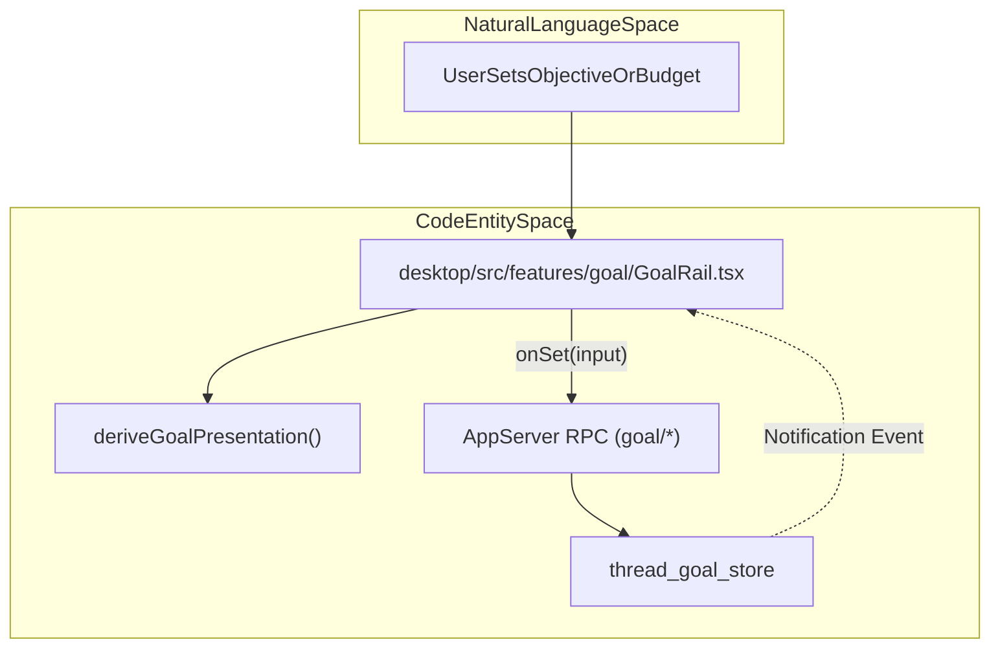
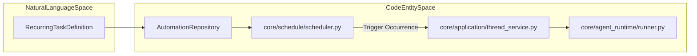
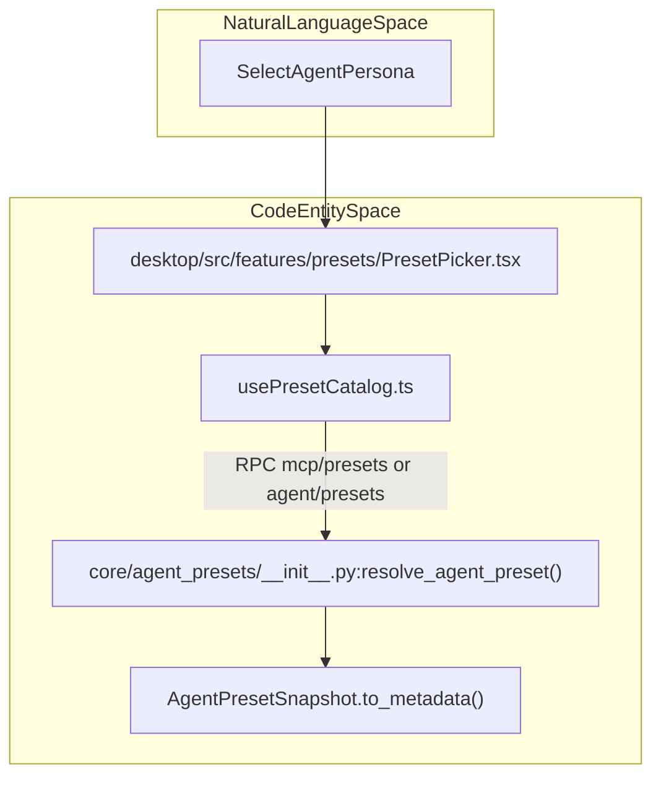

<!-- source: DeepWiki mcp.deepwiki.com · repo HKUDS/DeepCode · extra page Desktop Automations, Goals and Presets · fetched 2026-11-09 -->

# Desktop Automations, Goals and Presets

Relevant source files

The following files were used as context for generating this wiki page:

- [desktop/src/assets/flaticon/README.md](desktop/src/assets/flaticon/README.md)
- [desktop/src/assets/flaticon/robot.png](desktop/src/assets/flaticon/robot.png)
- [desktop/src/components/RuntimeNotice.tsx](desktop/src/components/RuntimeNotice.tsx)
- [desktop/src/features/execution/ApprovalCard.tsx](desktop/src/features/execution/ApprovalCard.tsx)
- [desktop/src/features/goal/GoalRail.tsx](desktop/src/features/goal/GoalRail.tsx)
- [desktop/src/features/inspector/Inspector.tsx](desktop/src/features/inspector/Inspector.tsx)
- [desktop/src/features/mcp/useMcpCatalog.test.tsx](desktop/src/features/mcp/useMcpCatalog.test.tsx)
- [desktop/src/features/mcp/useMcpCatalog.ts](desktop/src/features/mcp/useMcpCatalog.ts)
- [desktop/src/features/presets/PresetPicker.module.css](desktop/src/features/presets/PresetPicker.module.css)
- [desktop/src/features/presets/PresetPicker.test.tsx](desktop/src/features/presets/PresetPicker.test.tsx)
- [desktop/src/features/presets/PresetPicker.tsx](desktop/src/features/presets/PresetPicker.tsx)
- [desktop/src/features/presets/usePresetCatalog.ts](desktop/src/features/presets/usePresetCatalog.ts)
- [desktop/src/features/settings/sections/DiagnosticsCard.tsx](desktop/src/features/settings/sections/DiagnosticsCard.tsx)
- [desktop/src/features/settings/sections/UpdatesCard.tsx](desktop/src/features/settings/sections/UpdatesCard.tsx)
- [desktop/src/features/thread/ThreadHeader.tsx](desktop/src/features/thread/ThreadHeader.tsx)
- [tests/test_agent_presets.py](tests/test_agent_presets.py)

This page details the implementation, data flow, and user interface components for durable objectives (`Goals`), recurring task execution (`Automations`), and session persona management (`Agent Presets`) within the DeepCode Desktop application. It explains how Desktop surfaces the underlying domain objects shared with the CLI and background App Server.

---

## 1. GoalRail and Durable Objectives

The **GoalRail** component (`desktop/src/features/goal/GoalRail.tsx:42-55]()`) surfaces session-level `ThreadGoal` objects, allowing users to define, pause, resume, edit, or clear durable agent objectives that persist across ordinary turns.

### Goal State Management & Presentation
The component interacts with workspace controllers and App Server RPC endpoints to mutate goal states. It relies on presentation derivation logic to map raw goals and turns into actionable user statuses [desktop/src/features/goal/GoalRail.tsx:67-77]().

*Sources: [desktop/src/features/goal/GoalRail.tsx:42-105](), [desktop/src/features/goal/goalPresentation.ts]()*.

### Key Implementation Details
* **Objective & Token Budgeting**: Users define an `objective`, optional `tokenBudget`, and `skillIds` via an embedded form modal [desktop/src/features/goal/GoalRail.tsx:87-104](). The component renders progress meters when a token budget is configured [desktop/src/features/goal/GoalRail.tsx:153-161]().
* **Execution Actions**: Depending on the state (`active`, `complete`, `paused`), `GoalRail` exposes controls for pausing execution, resuming, continuing once ready, or reopening completed goals [desktop/src/features/goal/GoalRail.tsx:164-215]().

---

## 2. Automations and Scheduling in Desktop

Automations manage recurring execution of goals. The Desktop Automations page exposes the same underlying automation state machine as the CLI scheduler (`core/schedule/`).

### Automation Hierarchy and Data Flow
An automation acts as a template that spawns discrete execution runs over time, progressing through revisions, occurrences, and thread goals.

*Sources: [core/persistence/automation_repository.py:37](), [core/application/application.py:92]()*.

---

## 3. Preset Picker and Agent Presets Integration

The `PresetPicker` component (`desktop/src/features/presets/PresetPicker.tsx:30-132]()`) enables users to select agent presets for a session. It supports zero-copy interop with Claude Code agent definition files and enforces locking once a conversation has started.

### Preset Selection & Trust Hierarchy
Agent presets follow a strict discovery and resolution hierarchy across trust roots (`project > user > system`) [tests/test_agent_presets.py:61-83]() where the file stem serves as the identity.

*Sources: [desktop/src/features/presets/PresetPicker.tsx:30-132](), [tests/test_agent_presets.py:61-177]()*.

### Implementation Aspects
* **Roster Filtering**: Broken presets (e.g., malformed YAML frontmatter) are retained on the roster with an error reason but are filtered out of selectable options to prevent runtime failures [desktop/src/features/presets/PresetPicker.tsx:57-59](), [tests/test_agent_presets.py:119-130]().
* **Session Locking**: Once a thread contains any turn (`locked: true`), the preset control disables interaction to maintain session integrity, reflecting the persisted snapshot [desktop/src/features/presets/PresetPicker.tsx:32-35](), [tests/test_agent_presets.py:167-173]().

---

## 4. Inspector, Approval Cards, and Runtime Notices

Desktop surfaces runtime state, file diffs, and execution approvals through dedicated workspace panels and overlay cards.

### Key Surfacing Components
* **Inspector Component** (`desktop/src/features/inspector/Inspector.tsx:48-201]()`): Manages tabbed views for `changes`, `files`, `artifacts`, `tests`, `terminal`, and `details`, integrating code workbench state and unsaved changes warnings (`beforeunload`) [desktop/src/features/inspector/Inspector.tsx:89-102]().
* **Approval Cards** (`desktop/src/features/execution/ApprovalCard.tsx`): Prompts users for permission when agents attempt high-impact tool calls or shell operations under restricted trust configurations.
* **Runtime Notices** (`desktop/src/components/RuntimeNotice.tsx:16-61]()`): Monitors sidecar and App Server status, surfacing crash notifications, authentication requirements for browser access, and manual restart/reconnect triggers [desktop/src/components/RuntimeNotice.tsx:25-31]().

---

## 5. Domain Synchronization (CLI vs Desktop)

Both the CLI and Desktop operate as thin clients over the same core application services. 

* **State Projection**: CLI executions (logged via JSONL files) and Desktop interactions (persisted in SQLite via `ThreadService`) undergo reconciliation to maintain consistent item mappings (`COMMAND_EXECUTION`, `FILE_CHANGE`) [core/application/thread_service.py:59-78]() and `DiagnosticsCard` metrics [desktop/src/features/settings/sections/DiagnosticsCard.tsx:75-119]().
* **Preset & Goal Parity**: Automated runs initiated via headless CLI utilities or scheduled jobs utilize identical snapshot resolution mechanics as the Desktop UI to ensure consistent tool availability [tests/test_agent_presets.py:108-117]().

---
*Sources: [desktop/src/features/goal/GoalRail.tsx](), [desktop/src/features/presets/PresetPicker.tsx](), [tests/test_agent_presets.py](), [desktop/src/components/RuntimeNotice.tsx](), [desktop/src/features/inspector/Inspector.tsx]()*

---

