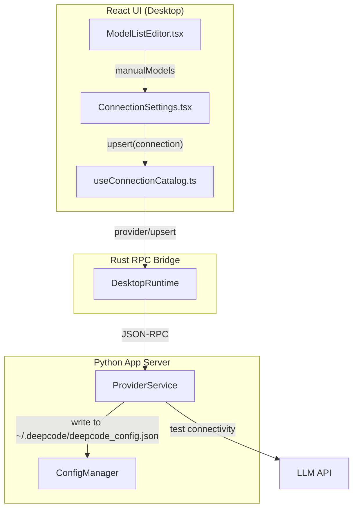
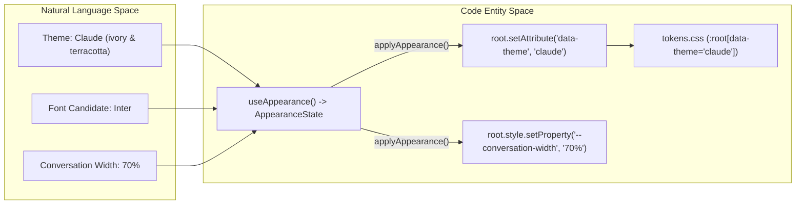

<!-- source: DeepWiki mcp.deepwiki.com · repo HKUDS/DeepCode · extra page Desktop Settings and Provider Configuration · fetched 2026-11-09 -->

# Desktop Settings and Provider Configuration

Relevant source files

The following files were used as context for generating this wiki page:

- [core/application/settings_service.py](core/application/settings_service.py)
- [desktop/src-tauri/src/lib.rs](desktop/src-tauri/src/lib.rs)
- [desktop/src/App.test.tsx](desktop/src/App.test.tsx)
- [desktop/src/app/appearance.test.ts](desktop/src/app/appearance.test.ts)
- [desktop/src/app/composerBehavior.ts](desktop/src/app/composerBehavior.ts)
- [desktop/src/app/escapeLayer.ts](desktop/src/app/escapeLayer.ts)
- [desktop/src/app/fontCandidates.test.ts](desktop/src/app/fontCandidates.test.ts)
- [desktop/src/app/fontCandidates.ts](desktop/src/app/fontCandidates.ts)
- [desktop/src/app/importedTheme.test.ts](desktop/src/app/importedTheme.test.ts)
- [desktop/src/app/importedTheme.ts](desktop/src/app/importedTheme.ts)
- [desktop/src/app/useDesktopUi.ts](desktop/src/app/useDesktopUi.ts)
- [desktop/src/features/management/ManagementWorkspace.tsx](desktop/src/features/management/ManagementWorkspace.tsx)
- [desktop/src/features/settings/AppearanceSettings.module.css](desktop/src/features/settings/AppearanceSettings.module.css)
- [desktop/src/features/settings/AppearanceSettings.tsx](desktop/src/features/settings/AppearanceSettings.tsx)
- [desktop/src/features/settings/ConnectionSettings.module.css](desktop/src/features/settings/ConnectionSettings.module.css)
- [desktop/src/features/settings/ConnectionSettings.tsx](desktop/src/features/settings/ConnectionSettings.tsx)
- [desktop/src/features/settings/ModelListEditor.test.tsx](desktop/src/features/settings/ModelListEditor.test.tsx)
- [desktop/src/features/settings/ModelListEditor.tsx](desktop/src/features/settings/ModelListEditor.tsx)
- [desktop/src/features/settings/SettingsDialog.module.css](desktop/src/features/settings/SettingsDialog.module.css)
- [desktop/src/features/settings/SettingsDialog.tsx](desktop/src/features/settings/SettingsDialog.tsx)
- [desktop/src/features/settings/sections/AgentModelCard.tsx](desktop/src/features/settings/sections/AgentModelCard.tsx)
- [desktop/src/features/settings/sections/ComposerBehaviorCard.tsx](desktop/src/features/settings/sections/ComposerBehaviorCard.tsx)
- [desktop/src/features/settings/sections/DefaultPresetCard.tsx](desktop/src/features/settings/sections/DefaultPresetCard.tsx)
- [desktop/src/features/settings/sections/GeneralSection.tsx](desktop/src/features/settings/sections/GeneralSection.tsx)
- [desktop/src/features/settings/sections/ModelsSection.tsx](desktop/src/features/settings/sections/ModelsSection.tsx)
- [desktop/src/features/settings/sections/PermissionCard.tsx](desktop/src/features/settings/sections/PermissionCard.tsx)
- [desktop/src/features/settings/settingsSections.tsx](desktop/src/features/settings/settingsSections.tsx)
- [desktop/src/styles/tokens.css](desktop/src/styles/tokens.css)
- [desktop/src/styles/tokens.test.ts](desktop/src/styles/tokens.test.ts)

The DeepCode Desktop settings interface provides a centralized workbench for managing LLM provider connections, model routing, security permissions, and visual preferences. It acts as a graphical frontend to the underlying `deepcode_config.json` system [desktop/src/features/settings/ConnectionSettings.tsx:1](), orchestrating communication between the React-based UI and the Python App Server via a Rust Tauri bridge.

## Connection Settings and Provider CRUD

The `ConnectionSettings` component is the primary surface for managing LLM provider configurations [desktop/src/features/settings/ConnectionSettings.tsx:40-44](). It handles the creation, updating, and deletion (CRUD) of provider profiles, including specialized handling for credentials, model discovery, and manual model overrides.

### Provider Configuration Lifecycle
1.  **Template Selection**: Users choose from predefined templates via `chooseTemplate()` which references available server connection templates [desktop/src/features/settings/ConnectionSettings.tsx:114-141]().
2.  **Credential Management**: API keys are treated as write-only fields (`apiKey`). The UI supports direct input or referencing an environment variable via `apiKeyEnv` [desktop/src/features/settings/ConnectionSettings.tsx:93-111]().
3.  **Environment Shadowing**: If a key is already present in the launch environment (`credentialSource === "environment"`), the UI indicates that environment variables shadow manual input to prevent configuration conflicts [desktop/src/features/settings/ConnectionSettings.tsx:109]().
4.  **Verification**: After saving via `controller.upsert()`, the `ConnectionCatalogController` triggers a test via `controller.test()` to ensure live connectivity [desktop/src/features/settings/ConnectionSettings.tsx:143-157]().

### Model Discovery and Adoption
The system supports two parallel methods for managing model catalogs:
*   **Automatic Discovery**: Probes the live provider API using the current form state (unsaved base URLs or typed keys participate without writing to disk) [desktop/src/features/settings/ConnectionSettings.tsx:186-196]().
*   **Manual Adoption**: Through `ModelListEditor.tsx`, users can explicitly define manual model entries containing IDs, display labels, context windows, and maximum output tokens [desktop/src/features/settings/ConnectionSettings.tsx:106-108]().

**Provider Configuration Data Flow**

Sources: [desktop/src/features/settings/ConnectionSettings.tsx:40-196](), [desktop/src/features/settings/ModelListEditor.tsx:1-90]()

## Agent Model Routing

The `AgentModelCard` component manages default model routing and advanced phase-specific overrides [desktop/src/features/settings/sections/AgentModelCard.tsx:77-83](). DeepCode permits splitting agentic execution across specialized models for distinct phases.

| Routing Tier | Description | Configuration Key |
| :--- | :--- | :--- |
| **Default** | The fallback model for general agent turns and initialization. | `agents.defaults` |
| **Planning** | Specialized model for generating structured implementation plans. | `agents.planning` |
| **Implementation** | Model optimized for executing code modifications and tool calls. | `agents.implementation` |

Users can also configure `reasoningEffort` for models supporting advanced reasoning and global `maxTokens` constraints [desktop/src/features/settings/sections/AgentModelCard.tsx:22-31]().

Sources: [desktop/src/features/settings/sections/AgentModelCard.tsx:57-75](), [desktop/src/features/settings/sections/AgentModelCard.tsx:115-141]()

## Security and Permissions

The `PermissionCard` component surfaces the underlying three-valued permission engine (`allow`, `ask`, `deny`).

*   **Access Presets**: Users toggle between `full_access`, `read_only`, and `ask` profiles, modifying execution mode, command sandboxing, filesystem scoping, and approval policies [desktop/src/App.test.tsx:63-88]().
*   **Scope Management**: Settings can be written globally to user configuration or locally to project configuration, where project configuration writes are gated by workspace trust validation [desktop/src/App.test.tsx:221]().

Sources: [desktop/src/features/settings/sections/PermissionCard.tsx:1](), [desktop/src/App.test.tsx:63-88]()

## Appearance and Visual Tokens

Appearance settings are per-machine display properties managed by `AppearanceSettings.tsx` and backed by client-side persistence and CSS custom properties [desktop/src/features/settings/AppearanceSettings.tsx:81-82]().

### Visual Configuration Entities
*   **Theme Engine**: Supports tri-state mode cards (`light`, `dark`, `system`) and a broad palette registry (`paper`, `midnight`, `claude`, `contrast`, and VS Code-imported themes) [desktop/src/features/settings/AppearanceSettings.tsx:26-48]().
*   **Typography**: Probes available system fonts asynchronously via `availableFontCandidates()` using temporary `FontFace` local lookups, appending selections to the font stack without invasive global overrides [desktop/src/app/fontCandidates.ts:28-100]().
*   **Layout**: The `conversationWidth` control adjusts the width of the central interaction column dynamically [desktop/src/app/appearance.test.ts:96-98]().

**Appearance Natural Language to Code Entity Mapping**

Sources: [desktop/src/features/settings/AppearanceSettings.tsx:26-111](), [desktop/src/app/fontCandidates.ts:28-100](), [desktop/src/styles/tokens.css:1-134]()

## Modal Management (`escapeLayer`)

To prevent conflicting keyboard event handling across layered UI elements (such as opening a provider editor modal over the main settings dialog), DeepCode utilizes a stack-based `escapeLayer` management system [desktop/src/app/escapeLayer.ts:1-10]().

*   **Stack Priority**: The `useEscapeLayer` hook registers cleanup callbacks onto a global active modal stack [desktop/src/app/escapeLayer.ts:26-33]().
*   **Event Interception**: A window-level `keydown` listener checks for the `Escape` key, invoking exclusively the topmost active layer's callback and calling `event.stopPropagation()` to prevent underlying containers from dismissing prematurely [desktop/src/app/escapeLayer.ts:17-23]().

Sources: [desktop/src/app/escapeLayer.ts:1-52](), [desktop/src/features/settings/ConnectionSettings.tsx:90]()

---

