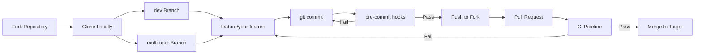
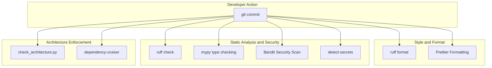
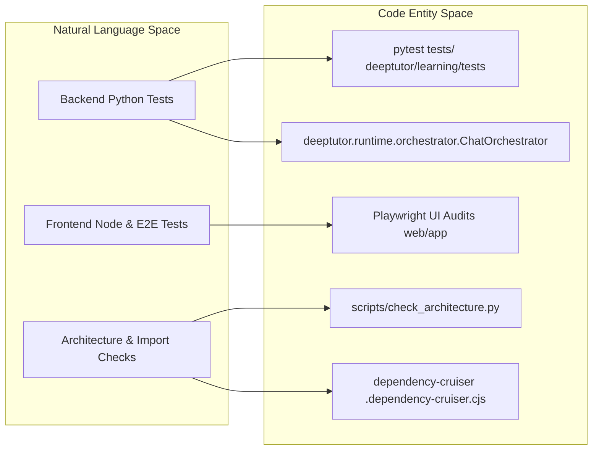

<!-- source: DeepWiki mcp.deepwiki.com · repo HKUDS/DeepTutor · page 10 Development Guide · fetched 2026-11-09 -->

# Development Guide

Relevant source files

The following files were used as context for generating this wiki page:

- [AGENTS.md](AGENTS.md)
- [SKILL.md](SKILL.md)
- [deeptutor_cli/README.md](deeptutor_cli/README.md)
- [deeptutor_cli/provider_cmd.py](deeptutor_cli/provider_cmd.py)
- [tests/cli/test_provider_cli.py](tests/cli/test_provider_cli.py)
- [tests/multi_user/test_owner_bound_models.py](tests/multi_user/test_owner_bound_models.py)

This page serves as the high-level parent guide for contributing to, testing, and maintaining code quality across the DeepTutor codebase. It outlines the overall developer workflow, code quality guardrails, testing infrastructures, and CI/CD automation pipelines. 

As a PARENT page, this document provides a broad conceptual overview of our development lifecycle. For comprehensive, step-by-step instructions and deep technical specifications, please consult the child pages:
- [Contributing Guidelines](#10.1) — Covers git branching conventions, pull request standards, issue templates, `AGENTS.md` rules, and Architecture Decision Records (ADRs).
- [Code Quality and Architecture Boundaries](#10.2) — Covers pre-commit hooks, static analysis tools (`Ruff`, `MyPy`, `Bandit`), secret scanning (`detect-secrets`), import boundaries (`check_architecture.py`), and frontend layering (`dependency-cruiser`).
- [Testing and CI/CD](#10.3) — Covers `pytest` suites, conftest fixtures, Python matrix testing, Playwright UI audits, and GitHub Actions workflow definitions.

---

## Development Workflow and Contributing Overview

DeepTutor enforces a structured contribution workflow to maintain stability across its multi-layer agent architecture. Developers submit changes via feature branches targeting the core integration branches (`dev` or `multi-user`), ensuring all local checks pass before pull requests are opened [CONTRIBUTING.md:32-61]().

### Git Branch Strategy and Lifecycle

**Diagram Title: Git Workflow and Pre-commit Gate**

| Branch / Target | Primary Role | Associated Code Entities / Configs |
|-----------------|--------------|------------------------------------|
| `dev` | Main integration branch for features and bug fixes | `deeptutor/` backend modules |
| `multi-user` | Experimental multi-tenant branch | `deeptutor/multi_user/` [tests/multi_user/test_owner_bound_models.py:1-26]() |
| Feature Branches | Isolated work on specific tasks | `AGENTS.md` guidelines [AGENTS.md:1-41]() |

For details on commit message formats, PR templates, and documentation-for-dev conventions, see [Contributing Guidelines](#10.1).

Sources: [CONTRIBUTING.md:32-61](), [.github/pull_request_template.md:1-39]()

---

## Code Quality and Architecture Boundaries

Code quality is automatically validated at commit time and in CI using a strict battery of linters, type checkers, and security scanners. These tools enforce stylistic uniformity, static type safety, and rigid architectural layering.

### Pre-Commit and Static Verification Pipeline

**Diagram Title: Quality Toolchain Execution**

| Tool | Target Domain | Key Configuration |
|------|--------------|-------------------|
| `Ruff` | Python linting & formatting | `pyproject.toml` [CONTRIBUTING.md:181-181]() |
| `MyPy` | Python static typing | `pyproject.toml` [CONTRIBUTING.md:186-186]() |
| `Bandit` | Python vulnerability scanning | `.pre-commit-config.yaml` [CONTRIBUTING.md:185-185]() |
| `detect-secrets` | Secret leak protection | `.secrets.baseline` [.secrets.baseline:1-88]() |
| `dependency-cruiser` | Frontend dependency layering | `.dependency-cruiser.cjs` [web/package.json:20-20]() |

For complete setup guides on import-linter rules, packaging extras, and architectural constraints, see [Code Quality and Architecture Boundaries](#10.2).

Sources: [CONTRIBUTING.md:175-188](), [.secrets.baseline:1-88](), [web/package.json:20-20]()

---

## Testing Infrastructure and CI/CD

The testing framework combines backend Python testing (`pytest`) with frontend validation (`Vitest`, Node checks, and Playwright UI audits). GitHub Actions orchestrates these tests across multiple Python versions to prevent regressions.

### Natural Language to Code Entity Mapping

**Diagram Title: Testing and Verification Mapping**

| Testing Domain | Execution Command / Script | Primary Code Targets |
|----------------|----------------------------|----------------------|
| Backend Units | `pytest -q tests` [.github/workflows/tests.yml:1-50]() | `deeptutor/` core services & agents |
| Architecture Guard | `python scripts/check_architecture.py` | Import boundaries & module manifests |
| Frontend E2E | `npm run test:e2e:critical` [web/package.json:28-28]() | `web/app/` and component layers |
| CI Pipeline Matrix | GitHub Actions workflow [.github/workflows/tests.yml:164-175]() | Python 3.11, 3.12, 3.13, 3.14 |

For detailed documentation on conftest fixtures, route budgets, and release pipelines, see [Testing and CI/CD](#10.3).

Sources: [.github/workflows/tests.yml:1-209](), [web/package.json:14-32]()

---

## Summary Table of Development Operations

| Operational Phase | Key Responsibilities | Related Child Page |
|---|---|---|
| Contribution Workflow | Git branch policies, PR templates, commit sign-offs | [Contributing Guidelines](#10.1) |
| Quality Assurance | Ruff formatting, MyPy typing, Bandit audits, secrets scanning | [Code Quality and Architecture Boundaries](#10.2) |
| Test Execution | Pytest suites, Playwright E2E checks, GitHub Actions CI matrix | [Testing and CI/CD](#10.3) |

Sources: [CONTRIBUTING.md:32-188](), [.github/workflows/tests.yml:1-209]()

---

