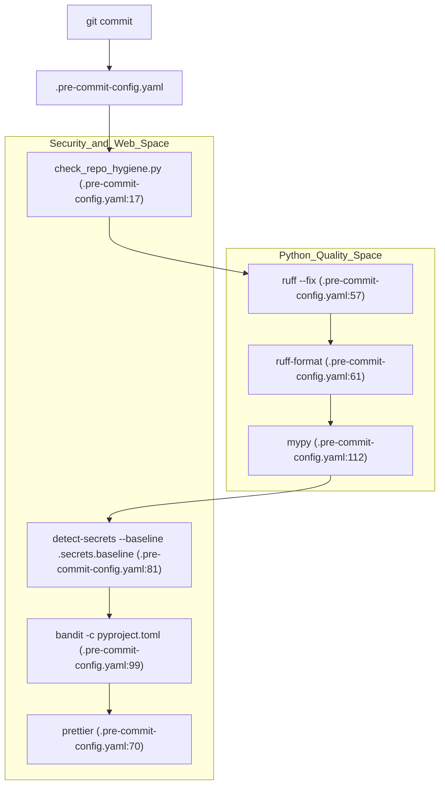
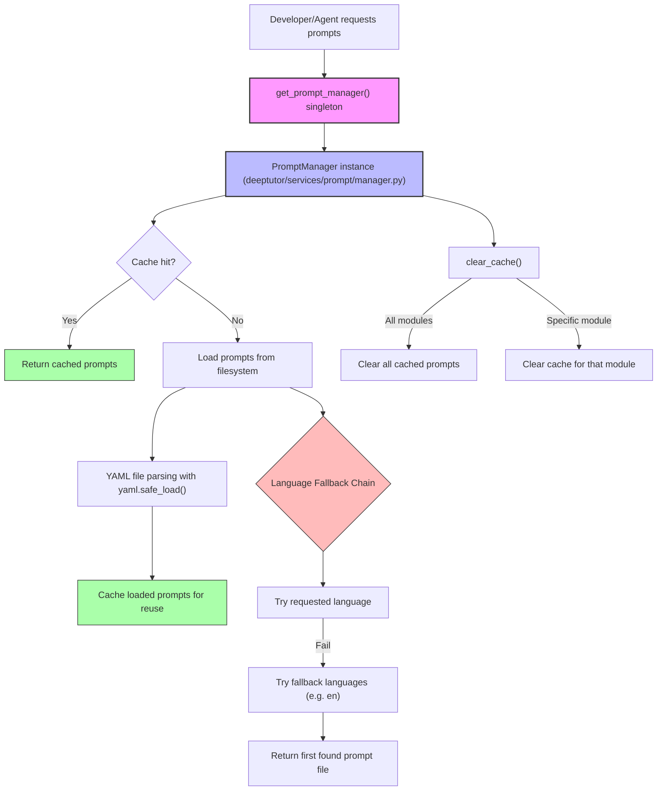

<!-- source: DeepWiki mcp.deepwiki.com · repo HKUDS/DeepTutor · page 10.2 Code Quality and Architecture Boundaries · fetched 2026-11-09 -->

# Code Quality and Architecture Boundaries

<details>
<summary>Relevant source files</summary>

The following files were used as context for generating this wiki page:

- [.gitignore](.gitignore)
- [.pre-commit-config.yaml](.pre-commit-config.yaml)
- [deeptutor/agents/math_animator/agents/code_generator_agent.py](deeptutor/agents/math_animator/agents/code_generator_agent.py)
- [deeptutor/agents/math_animator/agents/concept_analysis_agent.py](deeptutor/agents/math_animator/agents/concept_analysis_agent.py)
- [deeptutor/agents/math_animator/agents/concept_design_agent.py](deeptutor/agents/math_animator/agents/concept_design_agent.py)
- [deeptutor/agents/math_animator/agents/summary_agent.py](deeptutor/agents/math_animator/agents/summary_agent.py)
- [deeptutor/learning/tests/test_prompt_language_fallback.py](deeptutor/learning/tests/test_prompt_language_fallback.py)
- [deeptutor/multi_user/session_handoff.py](deeptutor/multi_user/session_handoff.py)
- [deeptutor/services/prompt/manager.py](deeptutor/services/prompt/manager.py)
- [deeptutor/services/rag/smart_retriever.py](deeptutor/services/rag/smart_retriever.py)
- [packaging/deeptutor-cli/pyproject.toml](packaging/deeptutor-cli/pyproject.toml)
- [pyproject.toml](pyproject.toml)
- [requirements.txt](requirements.txt)
- [requirements/cli.txt](requirements/cli.txt)
- [requirements/dev.txt](requirements/dev.txt)
- [requirements/math-animator.txt](requirements/math-animator.txt)
- [requirements/partners.txt](requirements/partners.txt)
- [scripts/start_tour.py](scripts/start_tour.py)
- [tests/agents/math_animator/test_code_generator_agent.py](tests/agents/math_animator/test_code_generator_agent.py)
- [tests/agents/math_animator/test_reasoning_retry.py](tests/agents/math_animator/test_reasoning_retry.py)
- [tests/api/test_session_handoff.py](tests/api/test_session_handoff.py)
- [tests/core/test_prompt_manager.py](tests/core/test_prompt_manager.py)
- [tests/multi_user/test_admin_user_batches.py](tests/multi_user/test_admin_user_batches.py)
- [tests/multi_user/test_session_handoff.py](tests/multi_user/test_session_handoff.py)
- [tests/scripts/test_start_tour.py](tests/scripts/test_start_tour.py)
- [tests/services/mcp/test_missing_mcp_dependency.py](tests/services/mcp/test_missing_mcp_dependency.py)
- [tests/services/partners/test_weixin_onboarding.py](tests/services/partners/test_weixin_onboarding.py)
- [tests/services/rag/test_pipeline_integration.py](tests/services/rag/test_pipeline_integration.py)
- [tests/services/rag/test_rag_pipelines.py](tests/services/rag/test_rag_pipelines.py)
- [tests/services/rag/testfile.txt](tests/services/rag/testfile.txt)
- [tests/services/test_parse_language.py](tests/services/test_parse_language.py)
- [tests/test_packaging_metadata.py](tests/test_packaging_metadata.py)
- [web/app/handoff/page.tsx](web/app/handoff/page.tsx)
- [web/lib/backend-forward.ts](web/lib/backend-forward.ts)
- [web/lib/streaming-upload-proxy.ts](web/lib/streaming-upload-proxy.ts)
- [web/proxy.ts](web/proxy.ts)
- [web/tests/admin-user-batches.test.ts](web/tests/admin-user-batches.test.ts)
- [web/tests/handoff-effect-replay.spec.tsx](web/tests/handoff-effect-replay.spec.tsx)
- [web/tests/proxy-policy.test.ts](web/tests/proxy-policy.test.ts)
- [web/tests/streaming-upload-proxy.test.ts](web/tests/streaming-upload-proxy.test.ts)

</details>


This page documents the automated code quality infrastructure used in DeepTutor. It covers pre-commit hooks, linting and formatting tools (Ruff, Prettier), security scanning (detect-secrets, Bandit), static analysis (MyPy), architecture boundary checks (import-linter and `check_architecture.py`), frontend layering with dependency-cruiser, and their integration with the development workflow. It also covers Python requirements and packaging extras for flexible installation profiles.

---

## Overview

DeepTutor maintains high standards for code quality, security, and architectural boundaries through a comprehensive set of automated tools and policies configured at the repository root. These tools ensure consistency and correctness across both the Python backend and the Next.js frontend `[.pre-commit-config.yaml:1-119]()`.

- **Ruff**: High-performance Python linting and automatic formatting, fulfilling the roles of both linter and formatter `[.pre-commit-config.yaml:54-62]().`
- **Prettier**: Formatting enforcement for frontend assets such as TypeScript, CSS, and Markdown `[.pre-commit-config.yaml:67-73]()`.
- **detect-secrets**: Scans for accidental high-entropy strings and secrets leakages `[.pre-commit-config.yaml:78-84]()`.
- **Bandit**: Performs security-focused static analysis on Python code `[.pre-commit-config.yaml:96-103]()`.
- **MyPy**: Static type checking with gradual typing support `[.pre-commit-config.yaml:109-119]()`.
- **Repo Hygiene**: Custom script to enforce repository cleanliness and basic checks `[.pre-commit-config.yaml:15-20]()`.
- **import-linter & `check_architecture.py`**: Enforce architectural import boundaries and inter-module dependencies.
- **dependency-cruiser**: Ensures strict layering in frontend code imports.
- **Requirements and packaging extras**: Manage dependencies flexibly for CLI, server, partners, video-learning, and more, with Python version guards.

Sources: `[.pre-commit-config.yaml:1-119]()`, `[pyproject.toml:1-162]()`, `[requirements/cli.txt:1-2]()`, `[packaging/deeptutor-cli/pyproject.toml:1-10]()`

---

## Pre-commit Infrastructure

### Installation and Usage

DeepTutor uses the `pre-commit` framework to run checks automatically before every `git commit`. Developers set up the hooks locally as follows:

```bash
# Install pre-commit framework
pip install pre-commit

# Install git hooks for local repo
pre-commit install

# Run checks manually on all files (e.g., before making a PR)
pre-commit run --all-files
```

This ensures consistent enforcement of code quality, formatting, static analysis, and security scanning as part of the normal development workflow.

Sources: `[.pre-commit-config.yaml:4-10]()`

### Hook Execution Architecture

The following diagram illustrates how a single developer action (such as `git commit`) triggers the configured hooks defined in `.pre-commit-config.yaml`. Each hook runs tools targeting different aspects of code quality and security.

**Git Hook Integration Flow**



Sources: `[.pre-commit-config.yaml:12-119]()`

---

## Python Code Quality

### Ruff (Linter & Formatter)

DeepTutor uses Ruff as a unified tool for Python linting and formatting. This approach handles import sorting, style consistency, code quality mistakes, and automatic fixes.

- **Hook `ruff`**: Runs with `--fix` and `--quiet` for auto-correcting issues during pre-commit checks `[.pre-commit-config.yaml:57-59]()`.
- **Hook `ruff-format`**: Runs quietly to verify code style integrity `[.pre-commit-config.yaml:61-62]()`.

Ruff configurations complement project coding standards enforcing type hints, docstrings, and f-string usage `[pyproject.toml:157-179]()`.

Sources: `[.pre-commit-config.yaml:54-62]()`, `[pyproject.toml:157-179]()`

### Type Checking with MyPy

MyPy provides static type checking with current relaxed checks to accommodate gradual typing adoption. Configured options:

- **Ignore missing imports** to reduce noise on third-party stubs.
- **No strict optional** and **no error summary** for smoother developer experience.
- **Exclusions**: directories with incomplete typing like `deeptutor/agents/` and `deeptutor/services/rag/` are skipped `[.pre-commit-config.yaml:114-118]()`.

Sources: `[.pre-commit-config.yaml:109-119]()`

---

## Frontend and Web Quality

### Prettier Formatting

Prettier is used for consistent formatting of the frontend codebase and assets in the `web/` directory. It targets CSS, SCSS, JSON, YAML, Markdown, GraphQL, HTML, and various JS/TS files `[.pre-commit-config.yaml:67-73]()`.

- **File targets**: `web/**/*.{css,scss,json,jsonc,yaml,yml,md,graphql,html,ts,tsx,js,jsx}`.
- **Exclusions**: build outputs and node_modules directories `[.pre-commit-config.yaml:76]()`.

Sources: `[.pre-commit-config.yaml:67-77]()`

### Frontend Layering with Dependency-Cruiser

DeepTutor enforces a layered import architecture in the frontend using `dependency-cruiser`, part of the build linting toolchain aimed at preventing higher-level code from depending on lower-level internals, ensuring modularity and maintainability.

For example, core utilities do not import UI components directly—only allowed boundaries exist between directory layers.

Sources: `[.pre-commit-config.yaml:67-77]()`

---

## Security Scanning

### detect-secrets

The `detect-secrets` tool statically scans the codebase for high-entropy strings or accidental secrets. It uses a baseline file `.secrets.baseline` to record known false positives in order to reduce noise `[.pre-commit-config.yaml:78-84]().`

- Excludes `package-lock.json` files from scanning `[.pre-commit-config.yaml:86]()`.
- Regularly updated baseline preserves guardrails against accidental commit of API keys or private tokens.

Sources: `[.pre-commit-config.yaml:78-87]()`

### Bandit Security Linter

`Bandit` performs static security analysis targeting common Python vulnerabilities. It uses the configuration from `pyproject.toml`, excluding the `tests/` directory `[.pre-commit-config.yaml:96-104]()`.

Sources: `[.pre-commit-config.yaml:99-105]()`, `[pyproject.toml:1-162]()`

---

## Architecture Boundaries: Import-linter and `check_architecture.py`

DeepTutor enforces inter-module architectural boundaries via import-linter rules and a dedicated check script:

- **`import-linter`**: A Python tool used to specify allowed import patterns explicitly, preventing unintended dependencies and cycles between packages or layers.
- **`scripts/check_architecture.py`**: Custom script complementing import-linter, enforcing project-specific architectural constraints not easily expressed in import-linter configs.

Together, these ensure modules, especially capability and service layers, adhere to the intended modular design and do not violate boundaries, maintaining a clean layered system.

Sources: `[.pre-commit-config.yaml:12-21]()`

---

## Requirements and Packaging Extras

### Single Source of Truth: `pyproject.toml`

The Python dependencies are centrally defined in `pyproject.toml` under `[project.dependencies]` and `[project.optional-dependencies]` `[pyproject.toml:19-47](), [pyproject.toml:52-94]()`. This file manages:

- Core runtime dependencies `[pyproject.toml:19-47]()`.
- Extra dependencies for CLI, server, partners, and plugin capabilities `[pyproject.toml:52-94]()`.
- Python version compatibility guarded at `3.11 <= python < 3.15` `[pyproject.toml:16]()`.

Sources: `[pyproject.toml:16-94]()`

### Extras Groups and Purpose

- **`cli` extra**: All dependencies required by the DeepTutor CLI application `[pyproject.toml:54]()`.
- **`server` extra**: Adds server-centric libraries such as FastAPI, Uvicorn, websockets, authentication libraries, and process monitoring tools `[pyproject.toml:60]()`.
- **`partners` extra**: Contains IM channel SDKs and integrations for persistent AI companions `[pyproject.toml:61]()`.
- **Parser extras**: Specialized extras for different document parsing engines (`markitdown`, `pymupdf4llm`, `liteparse`, `docling`) `[pyproject.toml:62-66]()`.
- **RAG extras**: For different RAG engines like `rag-lightrag` and `graphrag` `[pyproject.toml:71-73]()`.

Sources: `[pyproject.toml:52-94](), [tests/test_packaging_metadata.py:37-79]()`

### Python Version Compatibility

The dependencies especially those including compiled components are guarded for Python 3.11 to under 3.15 to avoid incompatible dependency or extension builds `[pyproject.toml:16]()`. For example, the BM25 retriever pins dependencies to `<3.14` Python versions, while alternate builds for `faiss-cpu` exist for Python ≥3.14 `[tests/test_packaging_metadata.py:65-79]()`.

Sources: `[pyproject.toml:16](), [tests/test_packaging_metadata.py:65-79]()`

### Core MCP Client is Not an Extra

The `mcp` client library, critical to the Multi-Agent Collaboration Protocol, is a core dependency installed by default rather than included behind an optional extra `[pyproject.toml:40]()`. This guarantees configured MCP servers integrate seamlessly without runtime errors due to missing dependencies.

Sources: `[pyproject.toml:40](), [tests/test_packaging_metadata.py:37-46]()`

### Synchronization with `requirements/`

The `requirements/` folder contains plaintext files like `cli.txt` which mirror the `pyproject.toml` extras dependency sets `[requirements/cli.txt:1-2]()`. These are used primarily by Docker and CI flows where `pyproject.toml` processing is not as straightforward.

Sources: `[requirements/cli.txt:1-2](), [tests/test_packaging_metadata.py:32-35]()`

---

## Prompt Management Testing Bridge Diagram

This diagram bridges the natural language concept of prompt management with the code entities (`PromptManager`, `load_prompts`, `clear_cache`) responsible for prompt loading, caching, and language fallback.

**Prompt Manager Cache and Loading Flow**



Sources: `[deeptutor/services/prompt/manager.py:1-192]()`, `[tests/core/test_prompt_manager.py:11-194]()`

---

## Summary

This page details how DeepTutor integrates several modern tools and scripts to maintain code quality, architectural boundaries, and security hygiene. The system is designed to support a complex, multi-layered architecture with Python and web frontend parts while ensuring consistency via automated hooks, static analysis, and dependency management.

Key takeaways:

- The `pre-commit` framework enforces tools like Ruff, MyPy, Bandit, detect-secrets, and Prettier on every commit `[.pre-commit-config.yaml:1-119]()`.
- Python and frontend codebases have separate but integrated tooling for style and dependency rules.
- Import-linter and dedicated scripts maintain clean, layered architecture between modules.
- The dependency graph and packaging extras are engineered to provide modular and compatible installation options, compatible with Python 3.11 to <3.15 `[pyproject.toml:16]()`.
- Prompt loading logic is carefully tested to handle multi-language fallback and caching to optimize agent capabilities `[tests/core/test_prompt_manager.py:11-194]()`.

Sources: `[.pre-commit-config.yaml:1-119]()`, `[pyproject.toml:1-162]()`, `[requirements/cli.txt:1-2]()`, `[packaging/deeptutor-cli/pyproject.toml:1-10]()`, `[tests/core/test_prompt_manager.py:11-194]()`, `[tests/test_packaging_metadata.py:1-124]()`

---

