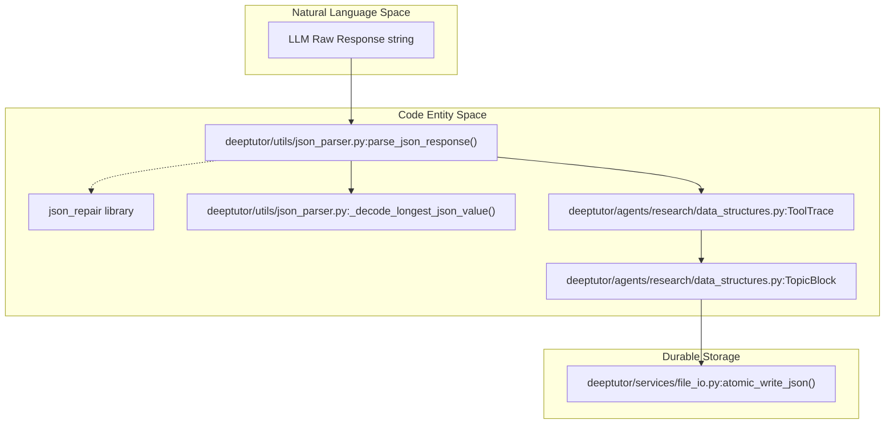
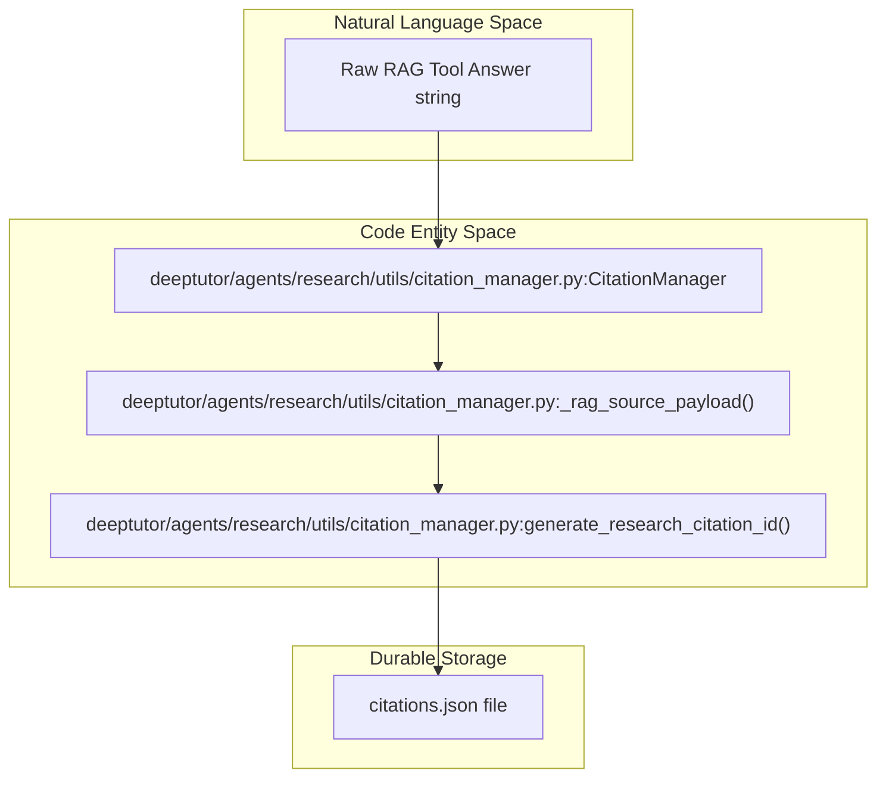

<!-- source: DeepWiki mcp.deepwiki.com · repo HKUDS/DeepTutor · page 11 Utilities and Helpers · fetched 2026-11-09 -->

# Utilities and Helpers

Relevant source files

The following files were used as context for generating this wiki page:

- [deeptutor/agents/research/data_structures.py](deeptutor/agents/research/data_structures.py)
- [deeptutor/agents/research/utils/citation_manager.py](deeptutor/agents/research/utils/citation_manager.py)
- [deeptutor/services/llm/provider_core/openai_compat_provider.py](deeptutor/services/llm/provider_core/openai_compat_provider.py)
- [deeptutor/services/llm/provider_core/openai_responses/converters.py](deeptutor/services/llm/provider_core/openai_responses/converters.py)
- [deeptutor/services/llm/provider_core/openai_responses/parsing.py](deeptutor/services/llm/provider_core/openai_responses/parsing.py)
- [deeptutor/services/llm/usage_frame.py](deeptutor/services/llm/usage_frame.py)
- [deeptutor/utils/json_parser.py](deeptutor/utils/json_parser.py)
- [tests/agents/research/test_citation_manager.py](tests/agents/research/test_citation_manager.py)
- [tests/core/test_agentic_messages.py](tests/core/test_agentic_messages.py)
- [tests/services/llm/test_native_web_search.py](tests/services/llm/test_native_web_search.py)
- [tests/services/llm/test_openai_compat_reasoning_content.py](tests/services/llm/test_openai_compat_reasoning_content.py)
- [tests/services/llm/test_openai_responses_converters.py](tests/services/llm/test_openai_responses_converters.py)
- [tests/services/llm/test_openai_responses_parsing.py](tests/services/llm/test_openai_responses_parsing.py)
- [tests/services/llm/test_responses_tool_strict.py](tests/services/llm/test_responses_tool_strict.py)
- [tests/services/llm/test_usage_frame.py](tests/services/llm/test_usage_frame.py)
- [tests/utils/test_json_parser.py](tests/utils/test_json_parser.py)

## Purpose and Scope

This page provides a high-level overview of common utility functions and helper modules used throughout the DeepTutor codebase. These utilities handle cross-cutting concerns such as robust JSON parsing from LLM outputs, URL sanitization, reasoning parameter negotiation, atomic file operations, and unified logging infrastructure. These helpers bridge the gap between raw LLM outputs and the structured data required by agent orchestration and knowledge management layers.

**Detailed Coverage:**
- [JSON and Text Utilities](#11.1) — Robust JSON extraction from LLM output, structured retry, response parsing, text display helpers, and secret file handling.
- [Network, URL and Proxy Utilities](#11.2) — URL sanitization, local server detection, proxy policy, single-flight, iframe HTML sanitization, and network helpers.
- [Logging Infrastructure](#11.3) — Unified logging system, process stream logging, adapters, stats, selective access logs, and log levels.

Sources: [deeptutor/utils/json_parser.py:1-183](), [deeptutor/agents/research/utils/citation_manager.py:1-188]()

---

## Utility Module Architecture

*Diagram: JSON Extraction and Structuring Flow*

Sources: [deeptutor/utils/json_parser.py:34-181](), [deeptutor/agents/research/data_structures.py:67-133](), [deeptutor/services/file_io.py:13-61]()

---

## JSON and Text Utilities

DeepTutor provides robust JSON extraction utilities crafted to handle the common complexities of LLM output, including JSON payloads embedded within markdown fences, chain-of-thought `<think>` tags wrapping reasoning text, truncation or minor malformations, and prose interspersed with small valid JSON fragments [deeptutor/utils/json_parser.py:3-10]().

### Key Utilities

- `parse_json_response(response: str, fallback: Any = {}) -> Any`  
  Parses JSON from a raw LLM response string using a tiered strategy involving direct decoding, markdown fence extraction, `<think>` tag stripping, and `json_repair` integration [deeptutor/utils/json_parser.py:66-182]().

- `_decode_longest_json_value(text: str) -> Any`  
  Finds the longest JSON object or array decodable in text, prioritizing the actual payload over smaller schema or example fragments [deeptutor/utils/json_parser.py:34-64]().

- `safe_json_loads(text: str, fallback: Any = {}) -> Any`  
  A lightweight wrapper that tries `json.loads` and returns a fallback on failure [tests/utils/test_json_parser.py:116-128]().

For details, see [JSON and Text Utilities](#11.1).

Sources: [deeptutor/utils/json_parser.py:34-182](), [tests/utils/test_json_parser.py:116-128]()

---

## Network, URL and Proxy Utilities

The network and URL helpers standardize URL handling for agent capabilities and backend services, supporting features like proxying and iframe content sanitization [deeptutor/services/llm/provider_core/openai_compat_provider.py:171-176]().

- URL sanitization ensures safe outgoing URLs, removing private IPs or localhost where not allowed.
- Proxy policies manage when and how requests are proxied for external providers.
- Utilities detect local servers versus external servers for proper routing.
- Single-flight mechanisms prevent redundant concurrent network calls.

For details, see [Network, URL and Proxy Utilities](#11.2).

Sources: [deeptutor/services/llm/provider_core/openai_compat_provider.py:171-176]()

---

## Logging Infrastructure and Citation Management

DeepTutor combines process stream logging with citation and trace management to ensure auditability across asynchronous worker tasks.

*Diagram: Research Citation Pipeline Flow*

### Citation and Trace Logging

- `CitationManager` provides structured management of citations covering planning and research phases with unique stable citation IDs [deeptutor/agents/research/utils/citation_manager.py:62-144]().
- It loads and persists citation data atomically, recovering counters after restarts to prevent ID collisions [deeptutor/agents/research/utils/citation_manager.py:157-188]().
- The citation system supports diverse RAG results and heterogeneous metadata [deeptutor/agents/research/utils/citation_manager.py:27-60]().

For details, see [Logging Infrastructure](#11.3).

Sources: [deeptutor/agents/research/utils/citation_manager.py:27-188]()

---

## Child Pages for Details

This parent page acts as a gateway to focused utility topics:

- **[JSON and Text Utilities](#11.1)** — Deep dive into JSON extraction strategies, structured retry, LLM output sanitization, and secret file handling.
- **[Network, URL and Proxy Utilities](#11.2)** — Comprehensive coverage of URL validation, proxy policy, single-flight network calls, local server detection, and iframe HTML sanitization.
- **[Logging Infrastructure](#11.3)** — Detailed explanations of the unified logging system, process stream handlers, adapters for various outputs, logging statistics, selective access logging, and log level configurations.

Sources: [deeptutor/utils/json_parser.py:1-183](), [deeptutor/agents/research/utils/citation_manager.py:1-188]()

---

