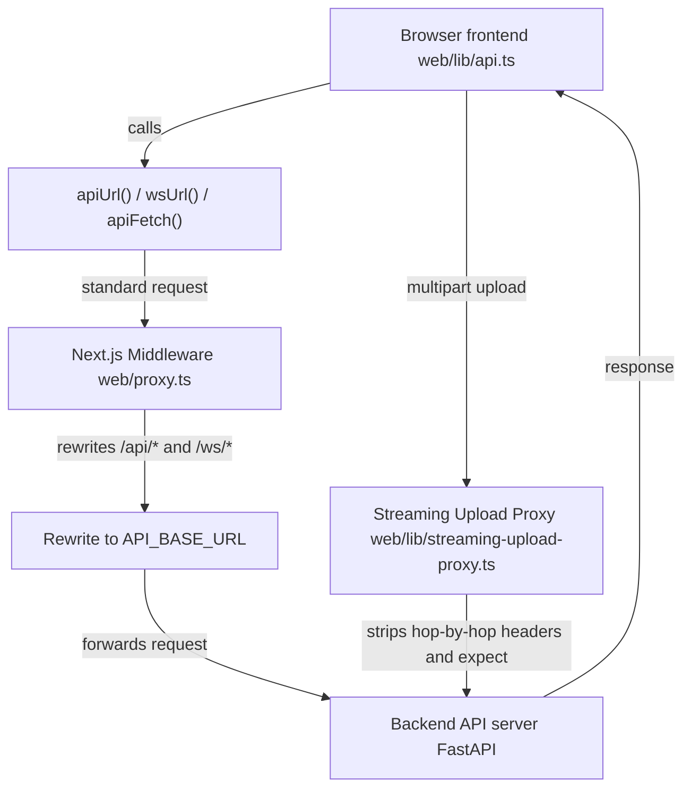
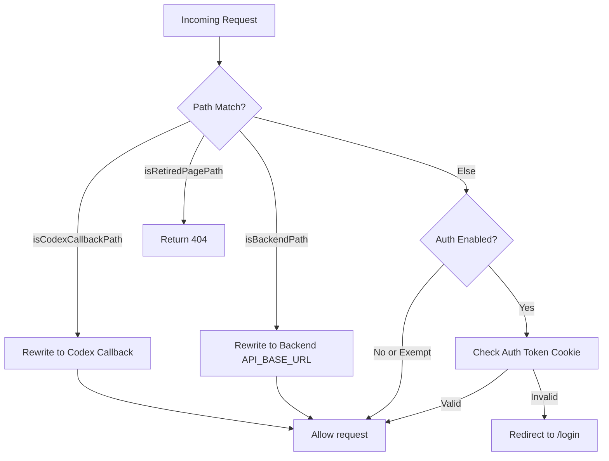
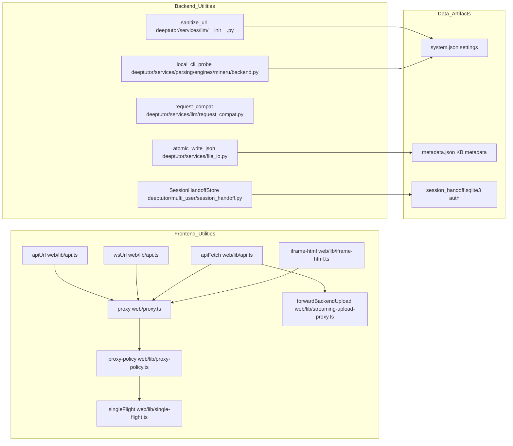

<!-- source: DeepWiki mcp.deepwiki.com · repo HKUDS/DeepTutor · page 11.2 Network, URL and Proxy Utilities · fetched 2026-11-09 -->

# Network, URL and Proxy Utilities

Relevant source files

The following files were used as context for generating this wiki page:

- [.gitignore](.gitignore)
- [deeptutor/multi_user/session_handoff.py](deeptutor/multi_user/session_handoff.py)
- [requirements.txt](requirements.txt)
- [requirements/dev.txt](requirements/dev.txt)
- [requirements/math-animator.txt](requirements/math-animator.txt)
- [tests/api/test_session_handoff.py](tests/api/test_session_handoff.py)
- [tests/multi_user/test_admin_user_batches.py](tests/multi_user/test_admin_user_batches.py)
- [tests/multi_user/test_session_handoff.py](tests/multi_user/test_session_handoff.py)
- [web/app/handoff/page.tsx](web/app/handoff/page.tsx)
- [web/components/UserAvatar.tsx](web/components/UserAvatar.tsx)
- [web/components/auth/AdminLink.tsx](web/components/auth/AdminLink.tsx)
- [web/components/auth/LogoutButton.tsx](web/components/auth/LogoutButton.tsx)
- [web/components/auth/ProfileLink.tsx](web/components/auth/ProfileLink.tsx)
- [web/components/common/BrandIcon.tsx](web/components/common/BrandIcon.tsx)
- [web/components/common/ToastViewport.tsx](web/components/common/ToastViewport.tsx)
- [web/components/reading/workspace/YouTubeReadingPlayer.tsx](web/components/reading/workspace/YouTubeReadingPlayer.tsx)
- [web/hooks/useAuthStatus.ts](web/hooks/useAuthStatus.ts)
- [web/lib/api.ts](web/lib/api.ts)
- [web/lib/auth.ts](web/lib/auth.ts)
- [web/lib/backend-forward.ts](web/lib/backend-forward.ts)
- [web/lib/streaming-upload-proxy.ts](web/lib/streaming-upload-proxy.ts)
- [web/proxy.ts](web/proxy.ts)
- [web/tests/admin-user-batches.test.ts](web/tests/admin-user-batches.test.ts)
- [web/tests/api-auth-redirect.test.ts](web/tests/api-auth-redirect.test.ts)
- [web/tests/auth-enabled.test.ts](web/tests/auth-enabled.test.ts)
- [web/tests/handoff-effect-replay.spec.tsx](web/tests/handoff-effect-replay.spec.tsx)
- [web/tests/native-button-title.test.ts](web/tests/native-button-title.test.ts)
- [web/tests/proxy-policy.test.ts](web/tests/proxy-policy.test.ts)
- [web/tests/streaming-upload-proxy.test.ts](web/tests/streaming-upload-proxy.test.ts)

## Purpose and Scope

This document provides an in-depth overview of the network, URL, proxy, and related utility functions in the DeepTutor codebase. These utilities facilitate:

- URL sanitization and normalization to ensure safe and consistent API interactions.
- Detection of local LLM servers for adaptive configuration.
- Proxy policies and request routing in the Next.js frontend middleware, including streaming multipart uploads.
- Secure private-to-public session handoffs using JWE encryption and cryptographic fingerprints.
- Single-flight request coordination to avoid duplicate simultaneous calls.
- Secure and sanitized iframe HTML generation for embedded visualization components.
- Atomic file I/O to safely update configuration files.
- Network helpers related to error classification, transport transport errors, and request compatibility.

Together, these utilities enable robust, secure, and efficient networking and embedding of external and internal services within DeepTutor’s multi-layered architecture.

Sources: [`web/proxy.ts:1-110`](), [`web/lib/streaming-upload-proxy.ts:1-89`](), [`deeptutor/multi_user/session_handoff.py:1-200`](), [`web/lib/proxy-policy.ts:1-160`]()

---

## Runtime API Base Resolution and Streaming Upload Proxy

Unlike typical frontends that bake environment variables into their build, DeepTutor’s frontend bundle is origin-agnostic and relies on runtime-base URL resolution.

- The browser issues requests relative to the frontend origin at paths like `/api/*` or `/ws/*`.
- Middleware in [`web/proxy.ts:51-92`]() intercepts these requests and rewrites them on the fly to the actual backend URL resolved via configuration.
- For large multipart payloads (such as Knowledge Base document uploads), Next.js middleware is bypassed to avoid cloning or truncating large request bodies in memory. Instead, dedicated endpoints stream directly via [`web/lib/streaming-upload-proxy.ts:53-88`]().

### Streaming Upload Proxy Implementation

The function `forwardBackendUpload` streams requests directly to FastAPI without materialization [web/lib/streaming-upload-proxy.ts:53-88]():
- Strips HTTP/1.1 hop-by-hop headers (such as `connection`, `expect`, `transfer-encoding`, `upgrade`) using `forwardedHeaders` [web/lib/streaming-upload-proxy.ts:34-46]().
- Specifically removes the `expect` header to prevent `undici` transport rejections (`"expect header not supported"`), which can otherwise cause mid-upload failures on large payloads.
- Sets `init.duplex = "half"` when passing the request body stream [web/lib/streaming-upload-proxy.ts:73-80]().

### Key Helpers

| Function | Location | Description |
|----|----|----|
| `apiUrl` | `web/lib/api.ts` | Returns API path unchanged; actual routing handled by proxy middleware |
| `wsUrl` | `web/lib/api.ts` | Returns WebSocket URL with protocol adjusted to backend schema |
| `apiFetch` | `web/lib/api.ts` | Wrapper around fetch with authentication handling and 401 redirect |
| `forwardBackendUpload` | `web/lib/streaming-upload-proxy.ts` | Streams large multipart files directly to FastAPI backend [web/lib/streaming-upload-proxy.ts:53-88]() |
| `sanitize_url` | `deeptutor/services/llm/__init__.py` | Normalizes and cleans LLM provider base URLs |

### Data Flow Diagram: Runtime API Call and Streaming Upload Flow

Sources: [`web/proxy.ts:51-92`](), [`web/lib/streaming-upload-proxy.ts:34-88`]()

---

## Session Handoff and Security Utilities

DeepTutor supports secure private-to-public session handoffs for multi-user and deployment scaling scenarios. Managed by [`deeptutor/multi_user/session_handoff.py`][deeptutor/multi_user/session_handoff.py:1-7](), pairing codes and tickets are protected via SHA-256 hashing and short-lived JSON Web Encryption (JWE).

### Key Mechanics
- **Fingerprinting:** Pairing codes and tickets are represented exclusively by SHA-256 hashes inside SQLite (`SessionHandoffStore`) to prevent plaintext exposure in the database [deeptutor/multi_user/session_handoff.py:1-7, 183-200]().
- **JWE Protection:** Short-lived JWE tokens (`encrypt_ticket_payload` / `decrypt_ticket_payload`) carry credentials between public POST calls using AES-256-GCM (`A256GCM`) encryption [deeptutor/multi_user/session_handoff.py:158-180]().
- **Host & Origin Validation:** `canonical_host` and `public_origin` rigorously sanitize URLs, rejecting path traversal attempts, credentials, and insecure loopback bindings on public handoffs [deeptutor/multi_user/session_handoff.py:69-145]().

Sources: [`deeptutor/multi_user/session_handoff.py:1-200`]()

---

## URL Sanitization and Local Backend Detection

### `sanitize_url`

The backend sanitizes LLM provider URLs to ensure consistent formatting and to detect local servers:
- URLs ending with a trailing slash have it removed.
- Hostnames are inspected to identify local domains (`localhost`, `127.0.0.1`, `.local`).
- This determines if a server is 'local', allowing customized timeouts or feature flags.

### Local LLM Server Detection

The utility `is_local_llm_server` returns `True` if the sanitized host implies a local machine, tuning behavior for local models like Ollama or custom FastAPI endpoints.

Sources: [`deeptutor/services/llm/__init__.py:90-108`]()

---

## Durable Atomic File I/O for Configuration

Ensuring consistency and atomicity when writing configuration or metadata files is critical:
- The module `deeptutor.services.file_io` provides `atomic_write_json` and `atomic_write_text`.
- These functions write to a temporary file in the target directory, flush, and then atomically rename (`os.replace`).
- On Windows, which can lock files temporarily, a retry loop with exponential backoff protects against `PermissionError`s [`deeptutor/services/file_io.py:7-82`]().

Sources: [`deeptutor/services/file_io.py:7-82`]()

---

## Provider Request Compatibility Checks and Error Handling

DeepTutor supports many LLM providers, each with varying levels of support for newer OpenAI-style APIs.

### Predicate Checks in `request_compat.py`

These predicates detect specific API rejection messages and enable the system to retry calls without advanced features:

| Predicate | Purpose | Implementation Highlights |
|---|---|---|
| `is_stream_options_unsupported` | Detects providers that reject the streaming parameter | Searches error message substrings for `"stream_options"` or `"unknown parameter"` [deeptutor/services/llm/request_compat.py:61-75]() |
| `is_tool_schema_unsupported` | Detects rejection of native function calling schemas | Searches for `"function_declaration"`, `"tool_choice"`, or `"tools"` in error [deeptutor/services/llm/request_compat.py:78-124]() |
| `is_image_input_unsupported` | Detects rejection of multimodal/image input | Looks for indication of unsupported `"image"`, `"vision"`, or `"multimodal"` parameters [deeptutor/services/llm/request_compat.py:127-143]() |
| `is_transient_transport_error` | Determines if exception chain includes transport-level errors | Walks through exception chain to identify HTTPX `TransportError` or connection issues [deeptutor/services/llm/request_compat.py:146-183]() |

Sources: [`deeptutor/services/llm/request_compat.py:22-183`]()

---

## Frontend Proxy Policy and Middleware

The Next.js middleware in [`web/proxy.ts:51-92`]() governs request routing, authentication gating, and rewrites:
- Paths starting with `/api/*` or `/ws/*` are rewritten to backend target URLs dynamically [web/proxy.ts:67-76]().
- Special case: Requests to the OpenAI Codex callback path `/auth/callback` are rewritten to the Codex API callback before other rewrites [web/proxy.ts:54-58]().
- Certain retired pages return 404 immediately [web/proxy.ts:60-62]().
- Auth gating is driven by the `AUTH_ENABLED` flag and exempts static resources and login pages [web/proxy.ts:78-84]().
- Invalid or expired user tokens cause redirect to `/login`, with invalid cookies cleared to prevent repeated bad requests [web/proxy.ts:86-89]().

The accompanying policy module [`web/lib/proxy-policy.ts`]() encapsulates functions defining which paths are backend, which are auth-exempt, and how tokens are classified (tested extensively in [`web/tests/proxy-policy.test.ts`][web/tests/proxy-policy.test.ts:1-170]()).

### Proxy Middleware Flow Diagram

Sources: [`web/proxy.ts:51-110`](), [`web/lib/proxy-policy.ts:1-50`](), [`web/tests/proxy-policy.test.ts:1-170`]()

---

## Single-Flight Request Utility

To prevent duplicate concurrent HTTP requests for the same resource key, the frontend uses a single-flight pattern:
- Implemented in [`web/lib/single-flight.ts`][web/lib/single-flight.ts:1-22]().
- A central map stores active promises keyed by a unique key string.
- Subsequent calls for the same key share the original promise.
- Upon promise resolution or rejection, the entry is cleared, allowing fresh calls later.

Sources: [`web/lib/single-flight.ts:1-22`]()

---

## Iframe HTML Sanitization and Enhancement

For AI-generated HTML content rendered in sandboxed iframes, DeepTutor applies sanitization and necessary injections to maintain safety and functionality in [`web/lib/iframe-html.ts`][web/lib/iframe-html.ts:20-171]().

### Key Functions
- `injectKaTeX(html: string)`: Injects KaTeX CSS and JS includes plus auto-render script if not already present [web/lib/iframe-html.ts:32-64]().
- `sanitizeIframeHtml(html: string)`: Strips `javascript:` URLs and rewrites links with `target="_top"` or `target="_parent"` to `target="_self"`, while preserving sandboxed script execution [web/lib/iframe-html.ts:76-83]().
- `BRIDGE_SCRIPT`: Injected script enabling cross-frame messaging (`postMessage`) for dynamic resizing and prompt dispatching [web/lib/iframe-html.ts:94-171]().

Sources: [`web/lib/iframe-html.ts:20-171`]()

---

## MinerU Local PDF Parsing Engine Detection

DeepTutor’s ingestion pipeline includes support for MinerU, a local PDF parsing backend engine.
- The function `local_cli_probe` checks for the presence of the MinerU CLI executable (`mineru` or `magic-pdf`) on system PATH or via explicit configuration [deeptutor/services/parsing/engines/mineru/backend.py:63-87]().
- On Windows, environment variable injection `MINERU_PDF_RENDER_THREADS=1` serializes parallel rendering threads to avoid heap corruption.

Sources: [`deeptutor/services/parsing/engines/mineru/backend.py:63-87`]()

---

## Entity Mapping: Utilities and Sanitizers

Sources: [`web/proxy.ts:1-110`](), [`web/lib/streaming-upload-proxy.ts:1-89`](), [`deeptutor/multi_user/session_handoff.py:1-200`](), [`deeptutor/services/file_io.py:1-82`]()

---

# Summary

This page detailed the network, URL, proxy, and security utilities that form the foundational plumbing for DeepTutor’s communication and frontend/backend coordination. It spans lifecycle-safe atomic file updates, backend URL resolution, streaming multipart upload proxies, session handoff cryptographic protection, proxy middleware with authentication, multi-provider compatibility checks, front-end request deduplication, and iframe HTML sanitization.

---

