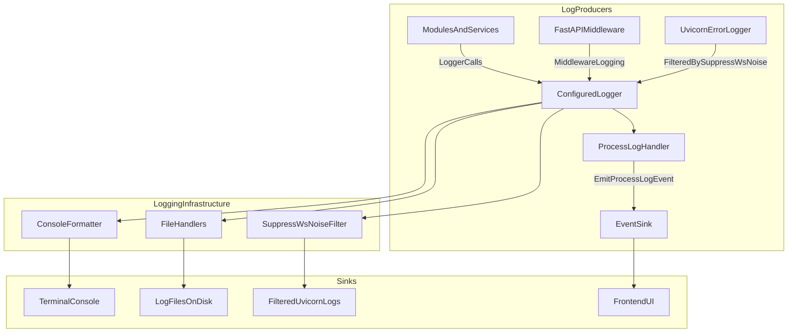
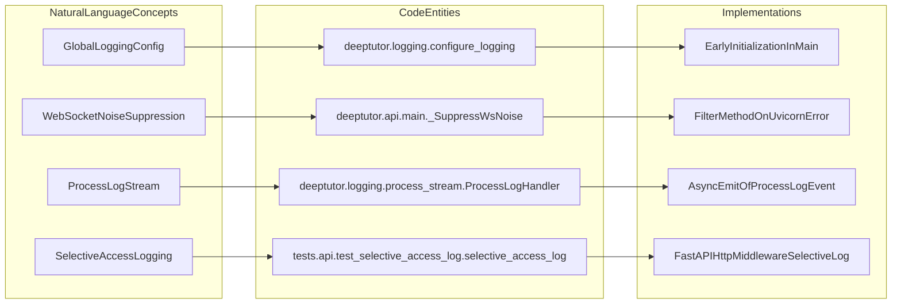

<!-- source: DeepWiki mcp.deepwiki.com · repo HKUDS/DeepTutor · page 11.3 Logging Infrastructure · fetched 2026-11-09 -->

# Logging Infrastructure

<details>
<summary>Relevant source files</summary>

The following files were used as context for generating this wiki page:

- [deeptutor/api/main.py](deeptutor/api/main.py)
- [deeptutor/logging/process_stream.py](deeptutor/logging/process_stream.py)
- [deeptutor/services/config/__init__.py](deeptutor/services/config/__init__.py)
- [deeptutor/services/rag/query_rewrite.py](deeptutor/services/rag/query_rewrite.py)
- [deeptutor/services/rag/service.py](deeptutor/services/rag/service.py)
- [tests/api/test_main_exception_handler.py](tests/api/test_main_exception_handler.py)
- [tests/api/test_selective_access_log.py](tests/api/test_selective_access_log.py)
- [tests/cli/test_kb_eval_cli.py](tests/cli/test_kb_eval_cli.py)
- [tests/logging/test_process_logs.py](tests/logging/test_process_logs.py)
- [tests/services/rag/eval/test_eval_diff.py](tests/services/rag/eval/test_eval_diff.py)
- [tests/services/rag/eval/test_eval_runner.py](tests/services/rag/eval/test_eval_runner.py)
- [tests/services/rag/test_query_rewrite.py](tests/services/rag/test_query_rewrite.py)
- [tests/services/rag/test_rag_service_rewrite.py](tests/services/rag/test_rag_service_rewrite.py)

</details>


The DeepTutor logging infrastructure delivers a unified, robust, and extensible logging system designed for the agent-native architecture's complex asynchronous and multi-process environment. It enables consistent real-time and persistent logging across CLI and server contexts, supports selective message filtering, integrates process stream event emission for UI updates, and provides noise suppression for verbose subsystem logs like WebSocket connections.

---

## Purpose and Scope

This subsystem offers:

- Centralized logging configuration and filtering to maintain log clarity and relevance.
- Middleware-driven selective access logging, capturing non-200 HTTP responses for audit and diagnostic needs.
- An asynchronous process log event capture and streaming handler to support real-time frontend updates.
- Noise suppression filters to reduce repetitive log pollution from subsystems (e.g., Uvicorn's WebSocket noise).
- Subprocess output relay and encoding resilience for local runtime launchers.
- Level and context-aware log emission with support for privacy-preserving log suppression.

This page details components, data flows, key classes/functions, and integration within DeepTutor.

Sources:
- `deeptutor/api/main.py:1-38`
- `deeptutor/logging/process_stream.py:1-53`

---

## Architecture Overview

At its core, DeepTutor's logging system extends Python’s standard `logging` library with custom filters, handlers, and formatters. Initialization occurs early in the FastAPI app module via the `configure_logging()` call to establish consistent logging behavior across all modules [deeptutor/api/main.py:11]().

Key features include:
- **Global Configuration & Early Initialization**: Called in `deeptutor/api/main.py` to configure handlers, formats, and filters [deeptutor/api/main.py:24]().
- **Noise Filtering**: Implements `_SuppressWsNoise` filter to mute verbose, repetitive WebSocket connection logs from the Uvicorn error logger (`uvicorn.error`) [deeptutor/api/main.py:28-38]().
- **Selective Access Logging Middleware**: Captures HTTP error responses selectively while leaving 200 responses silent [tests/api/test_selective_access_log.py:35-46]().
- **ProcessLogHandler & ProcessLogEvent**: Custom handler `ProcessLogHandler` captures and asynchronously emits structured process log events [deeptutor/logging/process_stream.py:54-114]().

### Log Record Routing and Handling



Sources:
- `deeptutor/api/main.py:10-38`
- `deeptutor/logging/process_stream.py:54-114`
- `tests/api/test_selective_access_log.py:35-46`

---

## Core Components

### 1. Unified Logging Configuration

The `configure_logging()` function is invoked during API initialization to set global loggers with appropriate handlers, filters, and formats ensuring early lifecycle coverage [deeptutor/api/main.py:24](). This includes registering the `_SuppressWsNoise` filter on `uvicorn.error` to reduce WebSocket noise [deeptutor/api/main.py:38]().

Sources:
- `deeptutor/api/main.py:24-38`

### 2. WebSocket Noise Suppression Filter

The `_SuppressWsNoise` class inherits from `logging.Filter` and overrides the `filter` method to exclude log records whose messages contain `"connection open"` or `"connection closed"`, effectively silencing high-churn WebSocket connection logs from Uvicorn's error logger [deeptutor/api/main.py:28-38]().

Sources:
- `deeptutor/api/main.py:28-38`

### 3. Selective Access Logging Middleware

To avoid spam logging of routine HTTP 200 responses, a middleware intercepts HTTP requests and logs only non-200 responses via the specialized `deeptutor.access` logger [tests/api/test_selective_access_log.py:35-46](). It logs a 5-element tuple: `(client_addr, method, path, http_version, status_code)` needed for correct access log formatting [tests/api/test_selective_access_log.py:96-103]().

Sources:
- `tests/api/test_selective_access_log.py:29-56`

### 4. Process Stream Logging: `ProcessLogEvent` and `ProcessLogHandler`

DeepTutor provides a sophisticated process-level structured logging facility to stream rich log events to the UI or other clients:

- **`ProcessLogEvent`** is a dataclass wrapping essential log information: `type`, `level`, `message`, `logger`, `timestamp`, and `context` [deeptutor/logging/process_stream.py:19-41]().
- **`ProcessLogHandler`** is a `logging.Handler` subclass that filters out logs marked private (`PROCESS_LOG_PRIVATE_ATTR`) and asynchronously emits `ProcessLogEvent` objects [deeptutor/logging/process_stream.py:54-114]().
- To handle asynchronous `emit` callables safely from threads, it schedules async emission using `asyncio.run_coroutine_threadsafe` or `asyncio.ensure_future` on the event loop owning the capture context [deeptutor/logging/process_stream.py:78-99]().
- The `capture_process_logs` context manager installs a scoped `ProcessLogHandler` on the root logger for capturing and relaying logs during specific asynchronous tasks [deeptutor/logging/process_stream.py:116-137]().

Sources:
- `deeptutor/logging/process_stream.py:19-137`
- `tests/logging/test_process_logs.py:14-100`

---

## Implementation Details

### `_SuppressWsNoise` Filter Class

```python
class _SuppressWsNoise(logging.Filter):
    _SUPPRESSED = ("connection open", "connection closed")

    def filter(self, record: logging.LogRecord) -> bool:
        msg = record.getMessage()
        return not any(f in msg for f in self._SUPPRESSED)
```
Applied specifically to the `uvicorn.error` logger to silence ephemeral WebSocket connect/disconnect logs [deeptutor/api/main.py:28-38]().

### ProcessLogEvent Dataclass

```python
@dataclass(frozen=True)
class ProcessLogEvent:
    type: str = "process_log"
    level: str = "INFO"
    message: str = ""
    logger: str = ""
    timestamp: float = 0.0
    context: dict[str, Any] = field(default_factory=dict)
```
Encapsulates structured attributes for log streaming consumers [deeptutor/logging/process_stream.py:19-52]().

Sources:
- `deeptutor/api/main.py:28-38`
- `deeptutor/logging/process_stream.py:19-52`

---

## Integration with System Modules

- **Startup and Lifecycle Logging**: The lifespan context manager in `deeptutor/api/main.py` logs major application lifecycle events (`"Application startup"`, configuration validation failure, LLM client initialization) to track system health and bootstrap integrity [deeptutor/api/main.py:108-176]().
- **Exception Handling**: Global exception handling logs unhandled exceptions and ensures JSON error responses carry correct CORS headers [tests/api/test_main_exception_handler.py:16-47]().

Sources:
- `deeptutor/api/main.py:108-176`
- `tests/api/test_main_exception_handler.py:16-48`

---

## Code Entity Mapping Bridging Conceptual Logging to Code



Sources:
- `deeptutor/api/main.py:11-38`
- `deeptutor/logging/process_stream.py:54-114`
- `tests/api/test_selective_access_log.py:35-46`

---

## Summary

DeepTutor’s logging infrastructure leverages and extends Python's logging module to provide a unified system suitable for asynchronous, multi-threaded, multi-process environments. Its key strengths lie in noise suppression, selective access logging, process stream capture for frontend integration, and structured event emission.

Sources:
- `deeptutor/api/main.py:1-38`
- `deeptutor/logging/process_stream.py:1-137`

---

