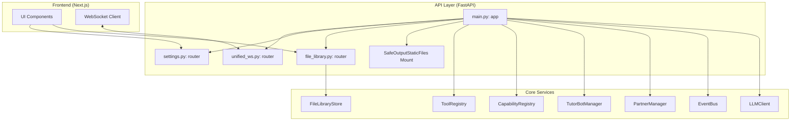
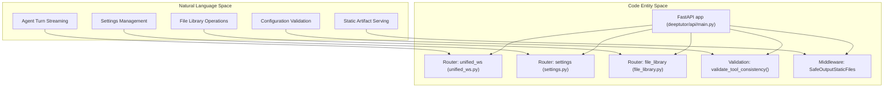

<!-- source: DeepWiki mcp.deepwiki.com · repo HKUDS/DeepTutor · page 12 API Layer · fetched 2026-11-09 -->

# API Layer

<details>
<summary>Relevant source files</summary>

The following files were used as context for generating this wiki page:

- [deeptutor/api/main.py](deeptutor/api/main.py)
- [deeptutor/api/router_index.json](deeptutor/api/router_index.json)
- [tests/api/test_main_exception_handler.py](tests/api/test_main_exception_handler.py)
- [tests/api/test_selective_access_log.py](tests/api/test_selective_access_log.py)
- [web/components/reading/workspace/ReadingCompanion.tsx](web/components/reading/workspace/ReadingCompanion.tsx)
- [web/components/space/learning/MasteryStudy.tsx](web/components/space/learning/MasteryStudy.tsx)
- [web/contracts/generated/api.ts](web/contracts/generated/api.ts)
- [web/contracts/schema/openapi.json](web/contracts/schema/openapi.json)
- [web/features/chat/ChatStateAdapter.tsx](web/features/chat/ChatStateAdapter.tsx)
- [web/features/chat/components/ChatWorkspace.tsx](web/features/chat/components/ChatWorkspace.tsx)
- [web/features/chat/messages/ChatMessageList.tsx](web/features/chat/messages/ChatMessageList.tsx)
- [web/lib/failed-submissions.ts](web/lib/failed-submissions.ts)
- [web/locales/de/app.json](web/locales/de/app.json)
- [web/locales/en/app.json](web/locales/en/app.json)
- [web/locales/fr/app.json](web/locales/fr/app.json)
- [web/locales/pl/app.json](web/locales/pl/app.json)
- [web/locales/uk/app.json](web/locales/uk/app.json)
- [web/locales/zh/app.json](web/locales/zh/app.json)
- [web/tests/chat-failed-submission-recovery.spec.tsx](web/tests/chat-failed-submission-recovery.spec.tsx)
- [web/tests/integration/chat-messages.spec.tsx](web/tests/integration/chat-messages.spec.tsx)
- [web/tests/session-failed-submission-cleanup.spec.ts](web/tests/session-failed-submission-cleanup.spec.ts)

</details>


The API Layer is the backbone of DeepTutor's backend, implemented using **FastAPI** (`deeptutor/api/main.py`). It provides the RESTful and WebSocket endpoints that power communication between the Next.js frontend (`web/`) and core backend services. It orchestrates application lifecycle management, config validation, routing registration, exception handling, and supplies runtime settings and file management capabilities.

This page is a parent overview. For detailed endpoint definitions and behaviors, see the child pages:
- [Settings and Catalog API](#12.1)
- [Unified WebSocket and Session API](#12.2)

---

## Architecture Overview

At the top level, the API Layer exposes HTTP REST routers for managing settings, sessions, file libraries, and other backend resources, alongside a unified WebSocket router enabling full-duplex, streaming-capable agent interaction.



**Sources:** [deeptutor/api/main.py:44-54](), [deeptutor/api/main.py:126-130](), [deeptutor/api/main.py:135-144](), [deeptutor/api/main.py:202-205](), [deeptutor/api/routers/file_library.py:54-82]()

---

## Core Responsibilities

- **Application Lifecycle & Configuration Validation:** Managed through an asynchronous lifespan context on startup [deeptutor/api/main.py:44-64](). It verifies tool consistency, initializes runtime dependency containers, and executes storage migrations.
- **CORS Configuration:** Dynamically builds CORS policies based on auth settings, ensuring secure cross-origin requests [deeptutor/api/main.py:73-101]().
- **Exception Handling & Logging:** Suppresses noisy Uvicorn WebSocket logs [deeptutor/api/main.py:25-35]() and handles unhandled exceptions to return friendly JSON error responses with correct headers [tests/api/test_main_exception_handler.py:36-47]().
- **Static File Serving:** Serves generated outputs via `SafeOutputStaticFiles`, validating paths against a whitelist [deeptutor/api/main.py:202-205]().

---

## Key Data Entities and API Contracts

```mermaid
classDiagram
    class FastAPI_App {
        +lifespan()
        +validate_tool_consistency()
    }
    class UISettingsUpdate {
        +theme: Literal
        +language: Literal
        +response_language: Literal
        +sidebar_nav_order: SidebarNavOrder
    }
    class NetworkSettingsUpdate {
        +backend_port: int
        +frontend_port: int
        +public_api_base: str
        +cors_origins: list
    }
    class CatalogPayload {
        +catalog: dict
    }
    class FetchModelsPayload {
        +binding: str
        +base_url: str
        +api_key: str
    }
    class FileLibraryEntry {
        +id: str
        +sha256: str
        +filename: str
        +mime_type: str
        +size_bytes: int
        +is_deleted: bool
    }

    FastAPI_App <|-- "deeptutor/api/main.py"
    UISettingsUpdate <|-- "deeptutor/api/routers/settings.py: PATCH /ui"
    NetworkSettingsUpdate <|-- "deeptutor/api/routers/settings.py: PUT /network"
    CatalogPayload <|-- "deeptutor/api/routers/settings.py: POST /catalog"
    FetchModelsPayload <|-- "deeptutor/api/routers/settings.py: POST /fetch-models"
    FileLibraryEntry <|-- "deeptutor/api/routers/file_library.py: POST/GET /files/library/"
```

**Sources:** [deeptutor/api/main.py:44-63](), [deeptutor/api/routers/settings.py:30-37](), [deeptutor/api/routers/settings.py:133-154](), [deeptutor/api/routers/settings.py:184-198](), [deeptutor/api/routers/file_library.py:54-82]()

---

## Relationship between Natural Language Concepts and Code Entities



**Sources:** [deeptutor/api/main.py:20-130](), [deeptutor/api/main.py:44-64](), [deeptutor/api/routers/settings.py:30-37](), [deeptutor/api/routers/file_library.py:54-82]()

---

## Child Pages

- [Settings and Catalog API](#12.1) — Focuses on runtime settings, secret redactions, model choices, document parsing, and dashboard/tools routers.
- [Unified WebSocket and Session API](#12.2) — Covers the unified WebSocket turn protocol, session endpoints, file library routes, and regenerate workflows.

---

**Sources:**
- deeptutor/api/main.py:1-176
- deeptutor/api/routers/settings.py:30-37, 133-154, 184-198, 200-207
- deeptutor/api/routers/file_library.py:54-169
- tests/api/test_selective_access_log.py:29-115
- tests/api/test_main_exception_handler.py:36-47

---

