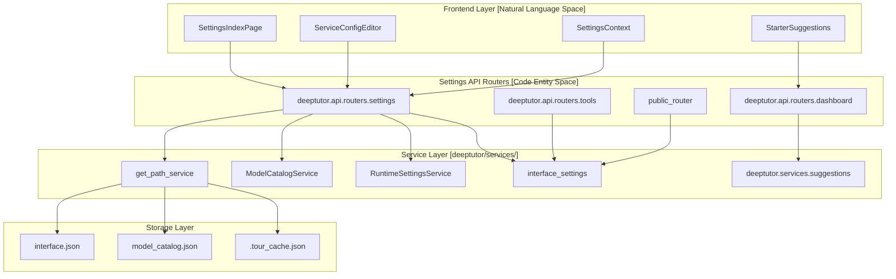
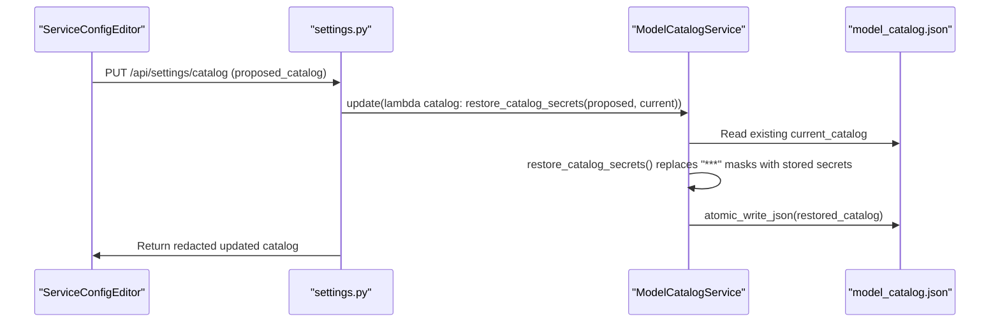

<!-- source: DeepWiki mcp.deepwiki.com · repo HKUDS/DeepTutor · page 12.1 Settings and Catalog API · fetched 2026-11-09 -->

# Settings and Institutional Catalog API

<details>
<summary>Relevant source files</summary>

The following files were used as context for generating this wiki page:

- [deeptutor/api/routers/dashboard.py](deeptutor/api/routers/dashboard.py)
- [deeptutor/api/routers/settings.py](deeptutor/api/routers/settings.py)
- [deeptutor/services/config/model_catalog.py](deeptutor/services/config/model_catalog.py)
- [deeptutor/services/model_selection/tasks.py](deeptutor/services/model_selection/tasks.py)
- [deeptutor/services/provider_registry.py](deeptutor/services/provider_registry.py)
- [deeptutor/services/suggestions.py](deeptutor/services/suggestions.py)
- [tests/api/test_dashboard_suggestions.py](tests/api/test_dashboard_suggestions.py)
- [tests/api/test_settings_router.py](tests/api/test_settings_router.py)
- [tests/core/test_agentic_client_provider_kwargs.py](tests/core/test_agentic_client_provider_kwargs.py)
- [tests/services/config/test_provider_runtime.py](tests/services/config/test_provider_runtime.py)
- [tests/services/test_model_catalog.py](tests/services/test_model_catalog.py)
- [tests/services/test_provider_registry.py](tests/services/test_provider_registry.py)
- [tests/services/test_suggestions.py](tests/services/test_suggestions.py)
- [tests/services/test_task_model_call_sites.py](tests/services/test_task_model_call_sites.py)
- [tests/services/test_task_models.py](tests/services/test_task_models.py)
- [web/components/chat/home/StarterSuggestions.tsx](web/components/chat/home/StarterSuggestions.tsx)
- [web/lib/provider-branding.ts](web/lib/provider-branding.ts)
- [web/public/provider-icons/cloudgpu.png](web/public/provider-icons/cloudgpu.png)
- [web/public/provider-icons/llmtr.png](web/public/provider-icons/llmtr.png)
- [web/public/provider-icons/microsoft-color.svg](web/public/provider-icons/microsoft-color.svg)
- [web/public/provider-icons/onomeo.svg](web/public/provider-icons/onomeo.svg)
- [web/public/provider-icons/runcrate.png](web/public/provider-icons/runcrate.png)
- [web/public/provider-icons/sources.json](web/public/provider-icons/sources.json)

</details>


The Settings API provides REST endpoints for managing DeepTutor's runtime configuration, including UI preferences, model and provider catalogs, multi-user access control, capability tunables, document parsing engines, and diagnostic tests. It is the primary interface for users and administrators to configure LLM providers, embedding models, agent behaviors, parsing backends, and frontend tools.

---

## Overview and Scope

This API is implemented primarily in `deeptutor/api/routers/settings.py` and related services. It orchestrates several distinct configuration layers:

1. **UI Preferences**: Manage user interface settings such as theme, language, sidebar ordering, and enabled optional tools, persisted in JSON files (e.g., `interface.json`) `[deeptutor/api/routers/settings.py:131-159]()`.

2. **Model and Provider Catalog**: Manage structured LLM, embedding, search, TTS, STT, and media generation profiles utilizing the `ModelCatalogService` `[deeptutor/api/routers/settings.py:25-40]()`, `[deeptutor/services/config/model_catalog.py:50-140]()`.

3. **Tool Management**: Enable or disable user-toggleable chat tools via settings interfaces with persistent state, driven by `USER_TOGGLEABLE_TOOL_NAMES` `[deeptutor/api/routers/settings.py:90-91]()`.

4. **Network and Environment Settings**: Define backend and frontend ports, CORS origins, and public API base URLs in runtime configuration `[deeptutor/services/config/origins.py]`.

5. **Document Parsing Configuration**: Support multi-backend parsing for document ingestion (MinerU local/cloud, Docling, etc.) with attachment file size and character limits `[deeptutor/api/routers/settings.py:43-48]()`.

6. **Tunable Hyperparameters**: Capability-specific fine tuning for modules like solver, research, quiz generation, etc.

7. **Dashboard and Tools Routers**: Endpoints for dashboard starter suggestions and optional tool listing `[deeptutor/services/suggestions.py:1-52]()`.

Sources: `[deeptutor/api/routers/settings.py:1-99]`, `[deeptutor/services/config/model_catalog.py:30-76]`

---

## Settings API Architecture

The Settings API leverages FastAPI and is structured around several routers:

- `router` — the main settings endpoints requiring authentication.
- `public_router` — read-only UI preferences for initial app shell rendering, accessible before login.
  
The API integrates tightly with service layers including:

- `PathService` — manages filesystem paths for config storage `[deeptutor/services/path_service.py]`.
- `ModelCatalogService` — manages model catalog persistence and redaction `[deeptutor/services/config/model_catalog.py:62-76]()`.
- `RuntimeSettingsService` — manages runtime environment and network settings `[deeptutor/services/config/runtime_settings.py]`.
- `interface_settings` — manages UI state (theme, language, tool toggles) `[deeptutor/services/settings/interface_settings.py:69-81]()`.

### Data and Control Flow Diagram

Title: "Settings API Request and Component Flow"



Sources: `[deeptutor/api/routers/settings.py:19-99]`, `[deeptutor/services/config/model_catalog.py:30-76]`, `[deeptutor/services/settings/interface_settings.py:69-81]`

---

## UI and Tool Management

### UI Settings

- The UI configuration model (`UISettings`) defines user interface preferences such as `theme` and language controls: `language` (interface locale) and `response_language` (model output language) `[deeptutor/api/routers/settings.py:182-197]()`.
- Defaults are specified in `DEFAULT_UI_SETTINGS` combining interface defaults with custom defaults including sidebar description and navigation ordering `[deeptutor/api/routers/settings.py:141-169]()`.
- Language normalization and legacy migration are handled by the service layer to ensure backward compatibility `[tests/api/test_settings_router.py:25-36]()`.

### Tool Management

- Tools that users can toggle in chat are defined by `USER_TOGGLEABLE_TOOL_NAMES` `[deeptutor/api/routers/settings.py:90]`.
- The `public_router` exposes read-only UI preferences (theme and language) without sensitive data, enabling bootstrapping of unauthenticated pages `[deeptutor/api/routers/settings.py:93-99]()`.

Sources: `[deeptutor/api/routers/settings.py:90-197]`, `[tests/api/test_settings_router.py:25-61]`

---

## Model Catalog and Provider Configuration

### Model Catalog Management and Secret Redaction

- Managed via `ModelCatalogService` which supports loading, saving, applying, and redacting secret keys in the catalog `[deeptutor/services/config/model_catalog.py:62-132]()`.
- Secret fields like API keys or tokens within model profiles are masked using `CATALOG_SECRET_MASK` (`***`) before sending to the frontend to protect sensitive info `[deeptutor/services/config/model_catalog.py:32-75]()`.
- When saving, secrets are restored from stored current profiles via `restore_catalog_secrets` so credentials are preserved even if the user interface sends redacted versions `[deeptutor/services/config/model_catalog.py:99-132]()`.

### Provider and Runtime Resolution

- Provider metadata, bindings, model overrides, and capabilities are defined centrally in `provider_registry.py`, with `ProviderSpec` describing each capability `[deeptutor/services/provider_registry.py:18-70]()`.
- Providers are detected automatically by API keys, base URLs, or binding names; aliases normalize common names `[deeptutor/services/provider_registry.py:130-176]()`.

### Model Catalog API Calls Flow

Title: "Model Catalog Update and Secret Restoration Flow"



Sources: `[deeptutor/services/config/model_catalog.py:62-132]`, `[deeptutor/api/routers/settings.py:33-40]`

---

## Network and Performance Configuration

- Runtime network and environment parameters such as ports and CORS origins are configurable through endpoints like `/api/settings/runtime`.
- Chat attachment limits (max size per file, total size, character budget) are validated within defined secure ranges to prevent abuses `[deeptutor/api/routers/settings.py:43-48]()`.

Sources: `[deeptutor/api/routers/settings.py:43-48]`, `[deeptutor/services/config/runtime_settings.py]`

---

## Provider Choices, Model Overrides, and Reasoning Parameters

- The `ProviderSpec` governs provider metadata such as authentication type (`api_key` or `oauth`), backend implementation, gateway status, and capability flags `[deeptutor/services/provider_registry.py:18-86]()`.
- The call-building logic automatically configures enablement or disablement of advanced reasoning features like `reasoning_effort` and thinking flags based on the model and provider `[tests/core/test_agentic_client_provider_kwargs.py:26-89]()`.
- Search providers have metadata describing credential requirements, fallback behavior, and answer synthesis capability `[tests/services/config/test_provider_runtime.py:5-12]()`.

Sources: `[deeptutor/services/provider_registry.py:18-86]`, `[tests/core/test_agentic_client_provider_kwargs.py:26-89]`

---

## Document Parsing Configuration Endpoints

- The API exposes endpoints to query and modify document parsing runtime settings, supporting different backends:
  - `miner_u_local` / `miner_u_cloud`
  - `docling`
  - `pymupdf4llm`
- Attachment constraints and parsing cache options are exposed for user tuning.

Sources: `[deeptutor/api/routers/settings.py:43-48]`

---

## Dashboard and Tools Routers

### Dashboard Suggestions

DeepTutor provides a `/api/dashboard/suggestions` API returning starter prompts for the chat UI, designed as actionable "next steps" for the learner `[deeptutor/services/suggestions.py:1-52]()`.

- Suggestions comprise a tuple of `label` (display text) and `prompt` (sent to the agent as user input) `[deeptutor/services/suggestions.py:136-144]()`.
- The data is cached and refreshed asynchronously due to LLM latency, with TTL and fingerprinting logic `[deeptutor/services/suggestions.py:33-52]()`.
- Sanitization ensures response validity, truncating or discarding suggestions that violate length or format constraints `[deeptutor/services/suggestions.py:114-124]()`, `[tests/services/test_suggestions.py:110-179]()`.

### Tools Router

- Endpoint listing user-toggleable tools available for the chat workspace `[deeptutor/api/routers/settings.py:90-91]()`.
- The list is derived from user-toggleable tool constants imported from `deeptutor.tools.builtin`.

Sources: `[deeptutor/services/suggestions.py:1-155]`, `[tests/services/test_suggestions.py:1-192]`

---

## Natural Language Space to Code Entity Space

Title: "Provider and Model Configuration Bridge"

```mermaid
graph LR
    UserUI[""User Interface (Settings & Catalog View)""] -->|HTTP REST| SettingsRouter[""deeptutor.api.routers.settings""]

    SettingsRouter -->|Persists Catalog| ModelCatalogService[""ModelCatalogService (deeptutor.services.config.model_catalog)""]
    ModelCatalogService -->|Reads/Writes| CatalogFile[""model_catalog.json (disk storage)""]

    SettingsRouter -->|Resolves Metadata| ProviderRegistry[""provider_registry.py (ProviderSpec)""]
    ProviderRegistry -->|Configures Bindings| LLMBackend[""OpenAICompatProvider / Anthropic Provider""]

    ModelCatalogService -->|Masks Secrets| SecretRedaction[""redact_catalog_secrets() / restore_catalog_secrets()""]
```

Sources: `[deeptutor/api/routers/settings.py:33-40]`, `[deeptutor/services/config/model_catalog.py:62-132]`, `[deeptutor/services/provider_registry.py:18-70]`

---

# References

- `deeptutor/api/routers/settings.py` — primary router implementation for Settings API endpoints.
- `deeptutor/services/config/model_catalog.py` — model catalog loading, saving, redaction, and secret restoration.
- `deeptutor/services/provider_registry.py` — central LLM provider metadata and matching specs.
- `deeptutor/services/settings/interface_settings.py` — UI settings persistence and normalization.
- `deeptutor/services/suggestions.py` — starter suggestions generation and caching.
- `tests/api/test_settings_router.py` — test suite for settings endpoints.

---

