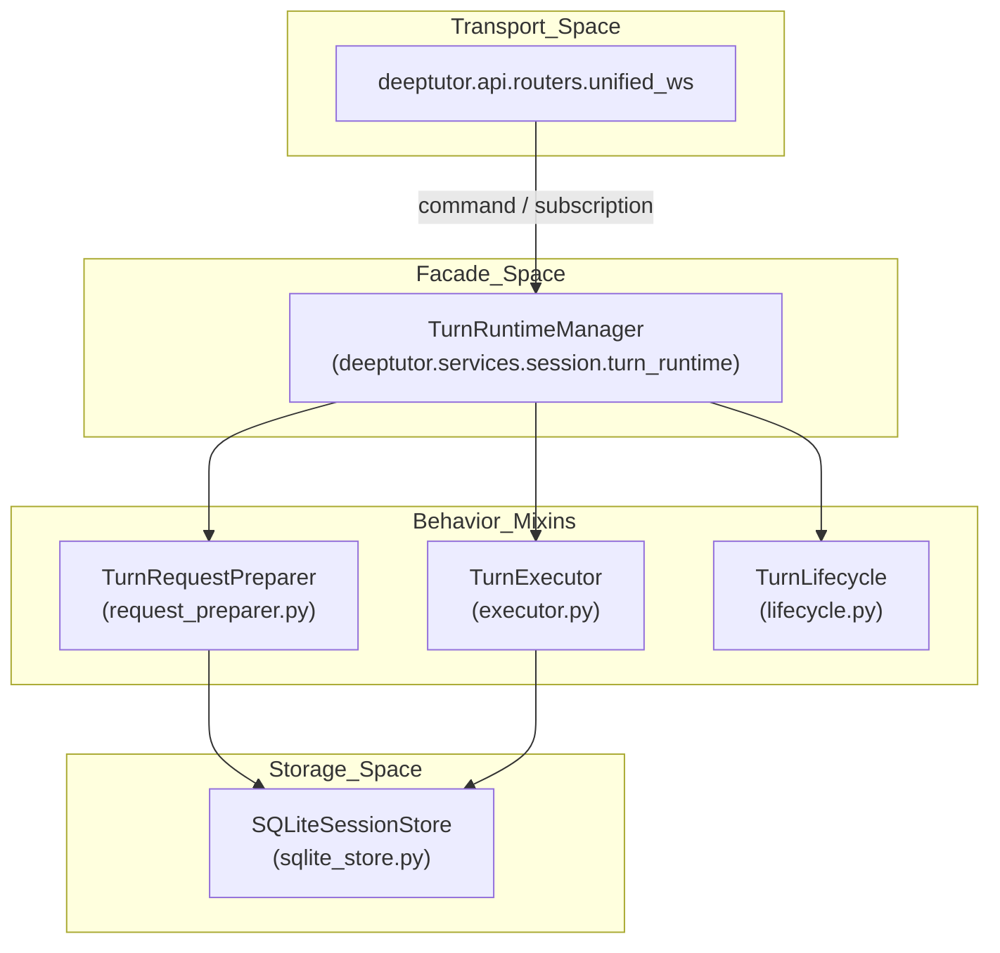
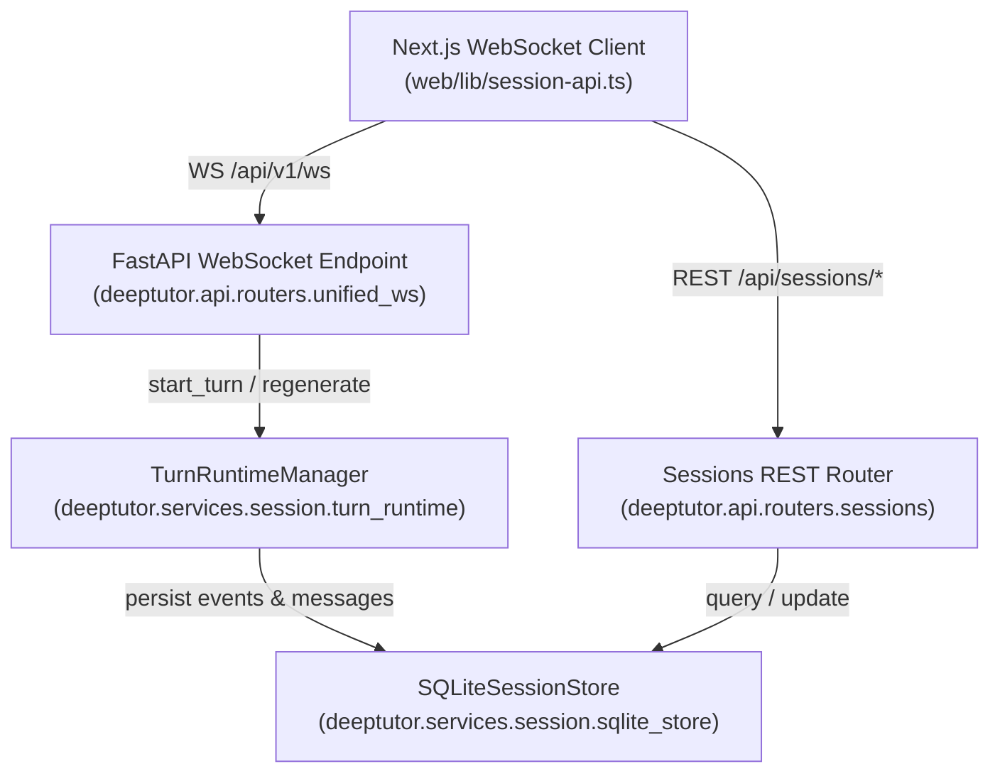

<!-- source: DeepWiki mcp.deepwiki.com · repo HKUDS/DeepTutor · page 12.2 Unified WebSocket and Session API · fetched 2026-11-09 -->

# Unified WebSocket and Session API

Relevant source files

The following files were used as context for generating this wiki page:

- [deeptutor/api/routers/outputs.py](deeptutor/api/routers/outputs.py)
- [deeptutor/api/routers/sessions.py](deeptutor/api/routers/sessions.py)
- [deeptutor/api/routers/unified_ws.py](deeptutor/api/routers/unified_ws.py)
- [deeptutor/app/service.py](deeptutor/app/service.py)
- [deeptutor/runtime/coordination/memory.py](deeptutor/runtime/coordination/memory.py)
- [deeptutor/runtime/coordination/recovery.py](deeptutor/runtime/coordination/recovery.py)
- [deeptutor/services/path_service.py](deeptutor/services/path_service.py)
- [deeptutor/services/session/attachment_parsing.py](deeptutor/services/session/attachment_parsing.py)
- [deeptutor/services/session/pocketbase_store.py](deeptutor/services/session/pocketbase_store.py)
- [deeptutor/services/session/protocol.py](deeptutor/services/session/protocol.py)
- [deeptutor/services/session/sqlite_store.py](deeptutor/services/session/sqlite_store.py)
- [deeptutor/services/session/thread_attribution.py](deeptutor/services/session/thread_attribution.py)
- [deeptutor/services/session/turn_runtime.py](deeptutor/services/session/turn_runtime.py)
- [deeptutor/services/session/turns/executor.py](deeptutor/services/session/turns/executor.py)
- [deeptutor/services/session/turns/lifecycle.py](deeptutor/services/session/turns/lifecycle.py)
- [deeptutor/services/session/turns/request_preparer.py](deeptutor/services/session/turns/request_preparer.py)
- [tests/agents/video_lesson/test_public_output.py](tests/agents/video_lesson/test_public_output.py)
- [tests/api/test_output_files.py](tests/api/test_output_files.py)
- [tests/api/test_session_organization.py](tests/api/test_session_organization.py)
- [tests/api/test_unified_ws_turn_runtime.py](tests/api/test_unified_ws_turn_runtime.py)
- [tests/app/test_multiworker_turn_reply_after_queue_drop.py](tests/app/test_multiworker_turn_reply_after_queue_drop.py)
- [tests/app/test_turn_application_service.py](tests/app/test_turn_application_service.py)
- [tests/app/test_turn_parked_on_ask_user_is_reclaimable.py](tests/app/test_turn_parked_on_ask_user_is_reclaimable.py)
- [tests/app/test_waiting_turn_recovery.py](tests/app/test_waiting_turn_recovery.py)
- [tests/runtime/coordination/test_journal_recovery.py](tests/runtime/coordination/test_journal_recovery.py)
- [tests/runtime/coordination/test_memory_coordinator.py](tests/runtime/coordination/test_memory_coordinator.py)
- [tests/runtime/coordination/test_redis_integration.py](tests/runtime/coordination/test_redis_integration.py)
- [tests/services/session/test_attachment_parsing.py](tests/services/session/test_attachment_parsing.py)
- [tests/services/session/test_pocketbase_store_fallbacks.py](tests/services/session/test_pocketbase_store_fallbacks.py)
- [tests/services/session/test_regenerate.py](tests/services/session/test_regenerate.py)
- [tests/services/session/test_sqlite_store.py](tests/services/session/test_sqlite_store.py)
- [tests/services/session/test_thread_attribution.py](tests/services/session/test_thread_attribution.py)
- [tests/services/session/test_turn_event_flush.py](tests/services/session/test_turn_event_flush.py)
- [tests/services/session/test_turn_runtime_subscribe.py](tests/services/session/test_turn_runtime_subscribe.py)
- [web/lib/session-api.ts](web/lib/session-api.ts)

The API layer provides a unified communication interface for real-time agent interaction, event streaming, and persistent session management. It centers around a single WebSocket endpoint (`/api/v1/ws`) for streaming turn execution, alongside a suite of FastAPI routers for session history, organization, submission replacement, and file outputs.

---

## Unified WebSocket Protocol

DeepTutor uses a single WebSocket endpoint at `/api/v1/ws` to handle all interactive agent capabilities, including starting new turns, subscribing to active or historical turns, resuming interrupted streams, and delivering user inputs for paused agents (`ask_user` triggers) [deeptutor/api/routers/unified_ws.py:43-178]().

### Client-to-Server Commands

The WebSocket protocol parses JSON client commands validated against Pydantic type adapters [deeptutor/api/routers/unified_ws.py:18-27]():

| Message Type        | Purpose                                                                 | Key Fields / Implementation Notes                           |
|---------------------|-------------------------------------------------------------------------|-------------------------------------------------------------|
| `start_turn`        | Initiates a new interaction turn with a full turn request payload       | `content`, `capability`, `session_id`, `attachments`, `tools` |
| `subscribe_turn`    | Streams events of a specific existing turn (supports replay via `after_seq`) | `turn_id`, `after_seq`                                      |
| `subscribe_session` | Streams events for the active turn of a session                         | `session_id`, `after_seq`                                   |
| `cancel_turn`       | Requests abort of a running turn                                        | `turn_id`                                                   |
| `regenerate`        | Re-runs the last user message, replacing the trailing assistant message | `session_id`, `overrides`                                   |
| `check_active_turn` | Checks if a session has an actively running turn                        | `session_id`                                                |
| `user_input`        | Delivers user input to resolve a paused turn (e.g., `ask_user` pause)   | `content`, `turn_id`                                        |
| `ping`              | Heartbeat message from client; backend replies with `pong`              | —                                                           |

### Server-to-Client Events and Protocol Versioning

Every message sent from the backend attaches the global `PROTOCOL_VERSION` constant to ensure client-server contract synchronization [deeptutor/api/routers/unified_ws.py:70-71](). Stream events are forwarded asynchronously using queues managed by the turn services.

Sources: `[deeptutor.api.routers.unified_ws.py:18-178]()`

---

## Turn Runtime Interplay and Regeneration

The backend decouples transport from execution using the `TurnRuntimeManager` facade, which composes specialized mixins: `TurnRequestPreparer`, `TurnContextAssembler`, `LearningTurnAdapter`, `TurnExecutor`, `TurnLifecycle`, and `SessionTitleService` [deeptutor/services/session/turn_runtime.py:26-33]().

### Regeneration Flow

When a client issues a `regenerate` command, the runtime interacts with the session store to perform tail rollback:
1. **Extract Flag**: The runtime identifies the regeneration request flag from session metadata or overrides [tests/services/session/test_regenerate.py:42-63]().
2. **Delete Trailing Assistant Message**: The store removes the most recent assistant message from the branch while preserving the target user message [tests/services/session/test_regenerate.py:69-115]().
3. **Re-Run Turn**: `TurnRuntimeManager` invokes `start_turn` using the existing user message snapshot, bypassing long-term memory refresh overhead during the repetition [tests/services/session/test_regenerate.py:122-145]().

Sources: `[deeptutor/services/session/turn_runtime.py:26-55]()`, `[tests/services/session/test_regenerate.py:42-145]()`

---

## Session Routers and Persistence API

The REST API layer (`deeptutor/api/routers/sessions.py`) offers administrative and session management routes that interface with underlying session storage engines (`SQLiteSessionStore` or `PocketBaseSessionStore`).

### Key REST Endpoints

| Endpoint | Method | Description |
|----------|--------|-------------|
| `/api/sessions/capabilities` | `GET` | Exposes atomic store capabilities (e.g. `submission_replacement`) [deeptutor/api/routers/sessions.py:49-54]() |
| `/api/sessions/submission-replacement` | `POST` | Resolves admission atomically before an edited retry is sent [deeptutor/api/routers/sessions.py:69-80]() |
| `/api/sessions/{session_id}/rename` | `PATCH` | Updates conversation title [deeptutor/api/routers/sessions.py:82-85]() |
| `/api/sessions/{session_id}/organization` | `PATCH` | Manages workspace allocation, pinned/archived flags, and session kind [deeptutor/api/routers/sessions.py:96-107]() |

### Storage Backends

- **`SQLiteSessionStore`**: Default local file-based storage located in user data directories (`data/user/chat_history.db`), providing atomic submission reservation and tail rollback [deeptutor/services/session/sqlite_store.py:25-36]().
- **`PocketBaseSessionStore`**: Remote multi-user collection backend that mirrors SQLite durability contracts by flushing turn events before committing terminal states [deeptutor/services/session/pocketbase_store.py:1-14]().

Sources: `[deeptutor/api/routers/sessions.py:45-108]()`, `[deeptutor/services/session/sqlite_store.py:25-46]()`, `[deeptutor/services/session/pocketbase_store.py:1-15]()`

---

## Outputs and File-Library Routes

Generated code, analysis artifacts, and exported files produced during turn execution are cataloged as assistant message attachments and exposed via outputs routes (`deeptutor/api/routers/outputs.py`). 

- **Artifact Attachment Extraction**: `artifact_attachments` scans tool results and assistant message outputs for generated files, populating preview text and storage pointers [deeptutor/services/session/turns/executor.py:13-17]()
- **File Library Integration**: Stored assets link back to the workspace file library, allowing users to inspect, download, or re-inject generated files into subsequent turns.

Sources: `[deeptutor/services/session/turns/executor.py:13-25]()`, `[deeptutor/api/routers/outputs.py:1-50]()`

---

## Summary Diagram: Natural Language to Code Entity Space

Sources: `[deeptutor/api/routers/unified_ws.py:43-178]()`, `[deeptutor/services/session/turn_runtime.py:26-55]()`, `[deeptutor/services/session/sqlite_store.py:1-30]()`, `[deeptutor/api/routers/sessions.py:35-80]()`, `[web/lib/session-api.ts:1-20]()`

---

# Sources

- `deeptutor/api/routers/unified_ws.py:18-178`
- `deeptutor/services/session/turn_runtime.py:26-55`
- `deeptutor/services/session/sqlite_store.py:25-46`
- `deeptutor/services/session/pocketbase_store.py:1-15`
- `deeptutor/api/routers/sessions.py:35-108`
- `deeptutor/services/session/turns/executor.py:13-25`
- `tests/services/session/test_regenerate.py:42-145`
- `web/lib/session-api.ts:1-20`

---

