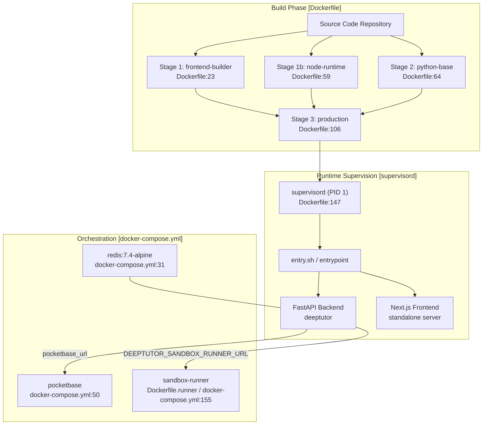
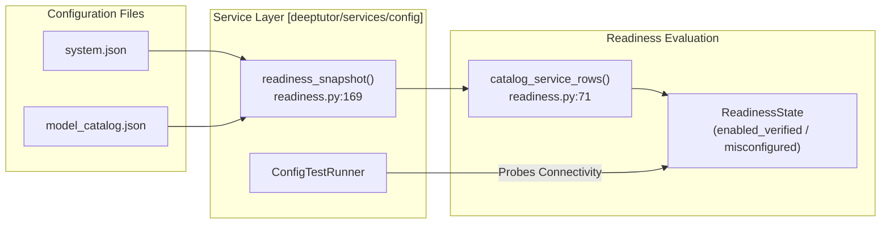

<!-- source: DeepWiki mcp.deepwiki.com · repo HKUDS/DeepTutor · page 13 Deployment and Operations · fetched 2026-11-09 -->

# Deployment and Operations

Relevant source files

The following files were used as context for generating this wiki page:

- [.dockerignore](.dockerignore)
- [.env.example](.env.example)
- [Dockerfile](Dockerfile)
- [assets/releases/past_releases/ver1-6-2.md](assets/releases/past_releases/ver1-6-2.md)
- [deeptutor/services/config/readiness.py](deeptutor/services/config/readiness.py)
- [deeptutor/services/parsing/engines/_install.py](deeptutor/services/parsing/engines/_install.py)
- [deeptutor/services/parsing/engines/mineru/readiness.py](deeptutor/services/parsing/engines/mineru/readiness.py)
- [deeptutor/services/partners/workspace.py](deeptutor/services/partners/workspace.py)
- [deeptutor/services/workspace/service.py](deeptutor/services/workspace/service.py)
- [docker-compose.dev.yml](docker-compose.dev.yml)
- [docker-compose.ghcr.yml](docker-compose.ghcr.yml)
- [docker-compose.yml](docker-compose.yml)
- [docs-for-dev/MODULES.md](docs-for-dev/MODULES.md)
- [tests/scripts/test_docker_compose.py](tests/scripts/test_docker_compose.py)
- [tests/scripts/test_install_extras.py](tests/scripts/test_install_extras.py)
- [tests/services/config/test_readiness.py](tests/services/config/test_readiness.py)
- [tests/services/parsing/test_engines.py](tests/services/parsing/test_engines.py)
- [tests/services/partners/test_partner_workspace.py](tests/services/partners/test_partner_workspace.py)
- [web/features/settings/sections/DocumentParsingSettingsSection.tsx](web/features/settings/sections/DocumentParsingSettingsSection.tsx)

This page provides a high-level overview of production deployment strategies, container orchestration, runtime configuration, and operational considerations for running DeepTutor. DeepTutor is engineered to run seamlessly across local development environments, self-hosted Docker/Podman stacks, and robust multi-user production servers.

**Scope and Child Pages**: This page serves as a high-level parent guide. For granular technical details, refer to the following child pages:
- **Environment Variables Reference**: Complete reference of environment variables (`.env.example`, docker-compose env) and their effects. For details, see [Environment Variables Reference](#13.1).
- **Multi-User Mode and Administration**: Identity management, `AUTH_ENABLED`, roles and grants, guardians, per-user paths/workspaces, audit logging, learner profiles, and the admin dashboard. For details, see [Multi-User Mode and Administration](#13.2).
- **Data Persistence and Backups**: Data directory layouts, index versioning, workspace roots, data migration, and backup strategies. For details, see [Data Persistence and Backups](#13.3).

---

## Deployment Architecture Overview

DeepTutor uses a containerized deployment architecture centered around a production-ready multi-stage `Dockerfile` and a modular `docker-compose.yml` configuration [Dockerfile:1-173](), [docker-compose.yml:26-160](). The architecture cleanly separates frontend compilation, backend service execution, and sandboxed code execution.

### System Deployment and Supervision Flow

The following diagram maps natural language system components to their corresponding code entities and configuration files during build and runtime phases:

Sources: [Dockerfile:1-173](), [docker-compose.yml:26-160]()

---

## Docker and Podman Deployment

Production deployments rely on Docker or Podman containers. The multi-stage `Dockerfile` constructs a lightweight production image containing both the FastAPI backend and the Next.js frontend, pre-configured with required system libraries such as LibreOffice for document previews and Rust toolchains for tokenizers [Dockerfile:1-173]().

To isolate untrusted code execution from the main application, DeepTutor deploys a separate **sandbox-runner** sidecar container via `docker-compose.yml` [docker-compose.yml:155-162](). This sidecar executes arbitrary shell commands in an unprivileged, isolated container environment, ensuring that a security breach or runaway process cannot compromise the main application container or its secrets.

For details on configuration files, see [Environment Variables Reference](#13.1).

Sources: [Dockerfile:1-173](), [docker-compose.yml:155-162]()

---

## Process Management

Inside the main DeepTutor container, process supervision is handled by `supervisord`, which manages both the FastAPI backend server and the Next.js frontend standalone server under the unprivileged `deeptutor` user [Dockerfile:140-165](). 

Environment variables and runtime configurations are ingested on startup from JSON files located in `data/user/settings/` (such as `system.json` and `model_catalog.json`) [.env.example:6-16](). The Next.js frontend communicates with the backend through an internal proxy (`web/proxy.ts`), routing all API and WebSocket traffic seamlessly.

Sources: [Dockerfile:140-165](), [.env.example:6-16]()

---

## Runtime Configuration and Readiness Probing

DeepTutor evaluates system health and configuration status through a value-free capability readiness matrix defined in `deeptutor/services/config/readiness.py` [deeptutor/services/config/readiness.py:1-46](). This service inspects active provider profiles, document parsers, and tool dependencies without exposing sensitive credentials or making unauthenticated network calls.

### Configuration and Readiness Flow

The following diagram illustrates how runtime configurations are validated by backend services:

Sources: [deeptutor/services/config/readiness.py:38-170]()

---

## Operational Considerations and Child Pages

Managing a production instance of DeepTutor involves careful handling of environment variables, multi-user permissions, and persistent data volumes. 

- **Environment Variables**: Control port bindings, backend URLs, and runtime features. For complete documentation, see [Environment Variables Reference](#13.1).
- **Multi-User Administration**: Manage user authentication (`AUTH_ENABLED`), roles, grants, and audit logging. For complete documentation, see [Multi-User Mode and Administration](#13.2).
- **Data Persistence and Backups**: Safeguard SQLite/PocketBase databases, vector indices, and workspace files stored under `/app/data`. For complete documentation, see [Data Persistence and Backups](#13.3).

Sources: [docker-compose.yml:88-100]()

---

