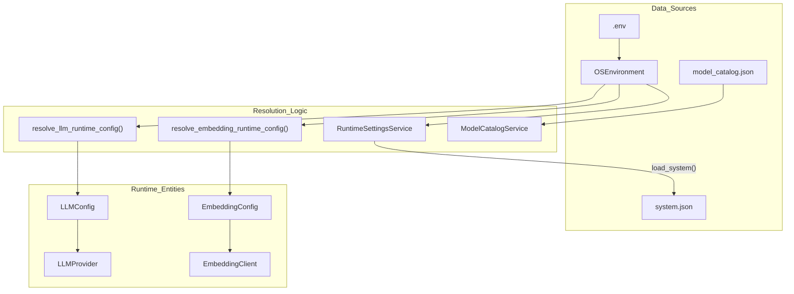
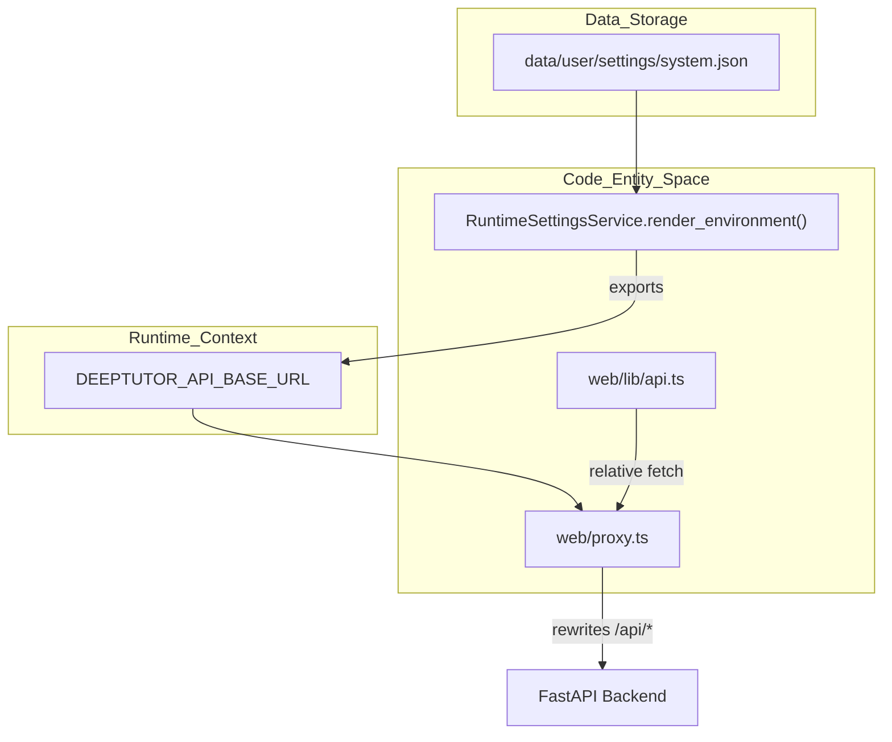

<!-- source: DeepWiki mcp.deepwiki.com · repo HKUDS/DeepTutor · page 13.1 Environment Variables Reference · fetched 2026-11-09 -->

# Environment Variables Reference

Relevant source files

The following files were used as context for generating this wiki page:

- [.dockerignore](.dockerignore)
- [.env.example](.env.example)
- [Dockerfile](Dockerfile)
- [README.md](README.md)
- [assets/README/README_AR.md](assets/README/README_AR.md)
- [assets/README/README_CN.md](assets/README/README_CN.md)
- [assets/README/README_ES.md](assets/README/README_ES.md)
- [assets/README/README_FR.md](assets/README/README_FR.md)
- [assets/README/README_HI.md](assets/README/README_HI.md)
- [assets/README/README_JA.md](assets/README/README_JA.md)
- [assets/README/README_PL.md](assets/README/README_PL.md)
- [assets/README/README_PT.md](assets/README/README_PT.md)
- [assets/README/README_RU.md](assets/README/README_RU.md)
- [assets/README/README_TH.md](assets/README/README_TH.md)
- [assets/releases/past_releases/ver1-6-2.md](assets/releases/past_releases/ver1-6-2.md)
- [deeptutor/__version__.py](deeptutor/__version__.py)
- [deeptutor/services/config/readiness.py](deeptutor/services/config/readiness.py)
- [deeptutor/services/parsing/engines/_install.py](deeptutor/services/parsing/engines/_install.py)
- [deeptutor/services/parsing/engines/mineru/readiness.py](deeptutor/services/parsing/engines/mineru/readiness.py)
- [deeptutor/services/partners/workspace.py](deeptutor/services/partners/workspace.py)
- [deeptutor/services/workspace/service.py](deeptutor/services/workspace/service.py)
- [docker-compose.dev.yml](docker-compose.dev.yml)
- [docker-compose.ghcr.yml](docker-compose.ghcr.yml)
- [docker-compose.yml](docker-compose.yml)
- [docs-for-dev/MODULES.md](docs-for-dev/MODULES.md)
- [tests/scripts/test_docker_compose.py](tests/scripts/test_docker_compose.py)
- [tests/scripts/test_install_extras.py](tests/scripts/test_install_extras.py)
- [tests/services/config/test_readiness.py](tests/services/config/test_readiness.py)
- [tests/services/parsing/test_engines.py](tests/services/parsing/test_engines.py)
- [tests/services/partners/test_partner_workspace.py](tests/services/partners/test_partner_workspace.py)
- [web/features/settings/sections/DocumentParsingSettingsSection.tsx](web/features/settings/sections/DocumentParsingSettingsSection.tsx)

This page provides a complete technical reference for all environment variables used in DeepTutor. Environment variables control deployment configuration, API credentials, service endpoints, and runtime behavior. They are loaded from a `.env` file at startup and can be modified at runtime through the Settings API.

DeepTutor uses a multi-layer configuration system where environment variables define infrastructure (ports, API keys, hosts), while JSON-backed runtime settings and the model catalog define agent behaviors and application logic.

Sources: [.env.example:1-25](), [deeptutor/services/config/runtime_settings.py:1-159]()

---

## Environment Variable System Architecture

DeepTutor employs a unified configuration loading mechanism that merges environment variables from the OS environment and `.env` files with JSON-based settings stored in `data/user/settings/`. The JSON settings files such as `system.json`, `auth.json`, and `integrations.json` are authoritative at runtime. On application start, these JSON settings are exported back into the environment variables, ensuring consistency between stored configuration and runtime environment.

The key service managing this is `RuntimeSettingsService`, which loads, saves, and renders these configurations to environment variables used by runtime processes [deeptutor/services/config/runtime_settings.py:1-159](). The resolution logic converts raw environment strings or model catalog entries into typed configuration objects like `LLMConfig` and providers like `LLMProvider` via `resolve_llm_runtime_config`, `resolve_embedding_runtime_config`, and `resolve_search_runtime_config` [deeptutor/services/config/runtime_settings.py:100-101](), [deeptutor/services/llm/config.py:111-131](), [deeptutor/services/llm/provider_factory.py:111-121]().

### Configuration Loading and Resolution Flow

Sources: [deeptutor/services/config/runtime_settings.py:100-101](), [deeptutor/services/llm/config.py:111-131](), [deeptutor/services/llm/provider_factory.py:111-121]()

---

## Frontend Proxy and URL Resolution

The DeepTutor frontend is designed to be network flexible and does not hardcode API endpoints during build time. Instead, the API base URL is dynamically injected and managed with environment variables at runtime.

The Next.js frontend middleware at `web/proxy.ts` rewrites API requests (`/api/*` and `/ws/*`) to the backend API base defined by the environment variable `DEEPTUTOR_API_BASE_URL`. This variable is dynamically constructed and exported by `RuntimeSettingsService` from values stored in `data/user/settings/system.json` prioritizing:
1. `next_public_api_base`
2. `next_public_api_base_external`
3. Fallback to `http://127.0.0.1:${BACKEND_PORT}` (IPv4 loopback)

This dynamic environment export and proxying allows flexible deployment topologies without rebuilding the frontend [web/proxy.ts:13-23](), [deeptutor/services/config/runtime_settings.py:100-101]().

### Frontend API Resolution

Sources: [web/proxy.ts:13-23](), [deeptutor/services/config/runtime_settings.py:100-101]()

---

## Complete Environment Variable Reference

### Docker and Network Configuration

These environment variables configure host-to-container port mappings and loopback addresses primarily for Docker/Podman Compose orchestration. They are declared in `.env.example` and consumed by `docker-compose.yml` for port bindings [.env.example:19-25](), [docker-compose.yml:55]().

| Variable | Default | Description |
|---|---|---|
| `HOST_PORT_BACKEND` | `8001` | Host loopback port for the FastAPI backend service. |
| `HOST_PORT_FRONTEND` | `3782` | Host loopback port for the Next.js frontend service. |
| `HOST_PORT_POCKETBASE` | `8090` | Host loopback port for the PocketBase authentication & storage service. |
| `TZ` | `UTC` | Time zone setting passed to backend and frontend containers. |
| `DEEPTUTOR_DOCKER_BACKEND_PORT` | `8001` | In-container port exposed for backend health checks and service bindings. |
| `DEEPTUTOR_DOCKER_FRONTEND_PORT` | `3782` | In-container port exposed for frontend service. |
| `DEEPTUTOR_DOCKER_POCKETBASE_PORT` | `8090` | In-container port exposed for PocketBase. |

Sources: [.env.example:19-25](), [docker-compose.yml:55]()

---

### Runtime Deployment Overrides

These environment variables are consumed directly by backend Python services and the frontend Next.js server at runtime. Typically set by the container entrypoint or launcher after reading JSON settings from `data/user/settings` [deeptutor/services/config/runtime_settings.py:100-101]().

| Variable | Default | Description |
|---|---|---|
| `DEEPTUTOR_API_BASE_URL` | `http://127.0.0.1:8001` | Backend API base URL for frontend proxy rewrites and internal API calls. |
| `DEEPTUTOR_AUTH_ENABLED` | `false` | Enables multi-user authentication. Controls gating of protected pages via frontend proxy middleware. |
| `DEEPTUTOR_SANDBOX_RUNNER_URL` | *unset* | URL for isolated sandbox-runner sidecar to execute untrusted shell commands remotely. |
| `NODE_ENV` | `production` | Node.js environment for the frontend build/runtime. |
| `PYTHONDONTWRITEBYTECODE` | `1` | Prevent Python from writing `.pyc` files to container filesystem. |
| `PYTHONUNBUFFERED` | `1` | Force Python to flush stdout/stderr without buffering. |
| `PYTHONIOENCODING` | `utf-8` | Set Python standard I/O encoding to UTF-8. |
| `BACKEND_PORT` | `8001` | Port on which the backend FastAPI server listens. |
| `FRONTEND_PORT` | `3782` | Port on which frontend Next.js server listens. |
| `DISABLE_SSL_VERIFY` | `false` | Disable SSL certificate verification for outgoing HTTP requests. |
| `DEEPTUTOR_IGNORE_PROCESS_ENV_OVERRIDES` | *unset* | If set to `1`, runtime JSON settings override host process environment variables. |

Sources: [Dockerfile:113-120](), [deeptutor/services/config/runtime_settings.py:15-108]()

---

### Service Specific Configuration Variables

| Variable | Scope | Description |
|---|---|---|
| `DEEPTUTOR_SANDBOX_ALLOW_SUBPROCESS` | Sandbox | Enables restricted subprocess fallback when `DEEPTUTOR_SANDBOX_RUNNER_URL` is unset. Defaults to `True`. |
| `NEXT_PUBLIC_APP_VERSION` | Frontend | Application version inlined into the frontend bundle during build time (derived from `deeptutor/__version__.py`). |
| `PIP_NO_CACHE_DIR` | Build | Disables pip cache during package installation to keep image sizes small. |
| `DEEPTUTOR_HOME` | Launcher | Overrides the default base directory for DeepTutor data and runtime state. |
| `DEEPTUTOR_EXTRAS` | Deployment | Comma-separated list of optional extras (Python dependencies) installed on container start. |
| `DEEPTUTOR_APT_PACKAGES` | Deployment | Comma-separated list of APT system packages to install during container startup. |
| `DEEPTUTOR_WORKSPACE_ROOT` | Service | In-container path to the content workspace, usually `/workspace`. |
| `OPENAI_API_KEY` | LLM Service | API key for OpenAI-compatible LLM providers. |
| `OPENAI_BASE_URL` | LLM Service | Base URL for OpenAI-compatible API endpoints. |

Sources: [Dockerfile:70-125](), [deeptutor/services/llm/config.py:75-95]()

---

### Document Parsing Engine Configuration

DeepTutor supports multiple document parsing engines through a pluggable registry implemented in `deeptutor.services.parsing.engines.factory` [deeptutor/services/parsing/engines/factory.py:70-78]().

| Engine ID | Display Name | Description | Needs Local Models |
|---|---|---|---|
| `text_only` | Text-only | Built-in plain text extraction for PDF/Office/text files, no optional packages required. | No |
| `mineru` | MinerU | High-fidelity multimodal parsing with layout, tables, formulas; local CLI requires model downloads or hosted cloud. | Yes |
| `docling` | Docling | Structured conversion for documents, images, e-books, audio/video; supports local and remote modes. | Yes |
| `markitdown` | markitdown | Microsoft Markdown extraction supporting multiple modern formats. | No |
| `liteparse` | LiteParse | Fast Rust-backed parser for various document formats; requires LibreOffice for Office formats. | No |
| `pymupdf4llm` | PyMuPDF4LLM | PyMuPDF-based CPU OCR and layout conversion supporting many formats. | No |
| `tika` | Tika | Remote Apache Tika server extraction with content detection for 1000+ types. | No |

Sources: [deeptutor/services/parsing/engines/factory.py:70-78](), [deeptutor/services/parsing/engines/factory.py:83-146]()

---

