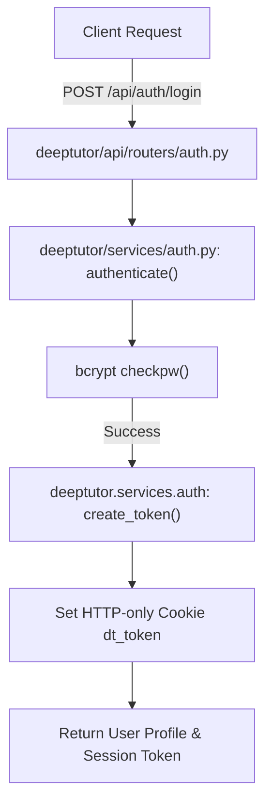
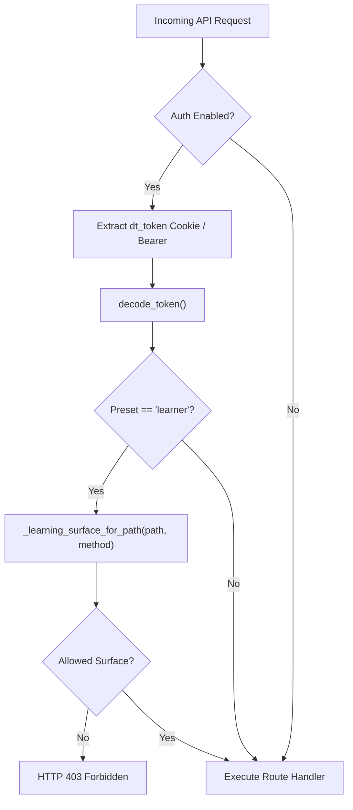
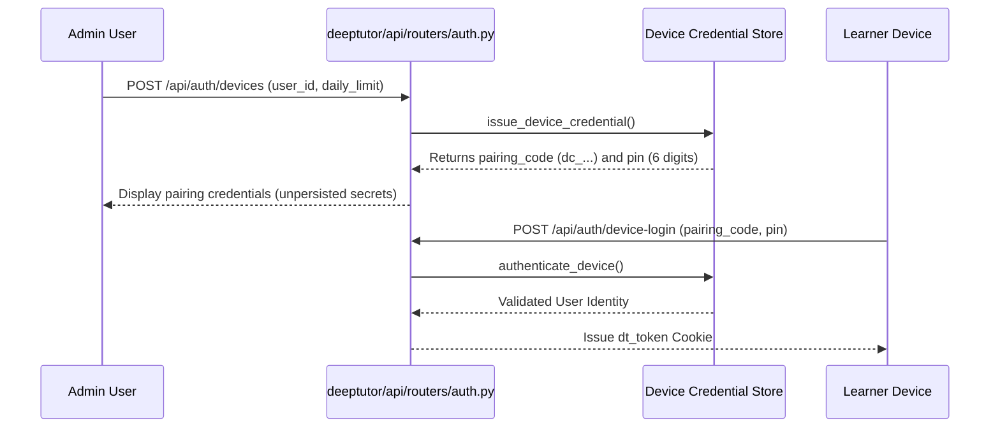

<!-- source: DeepWiki mcp.deepwiki.com · repo HKUDS/DeepTutor · page 13.2 Multi-User Mode and Administration · fetched 2026-11-09 -->

# Multi-User Mode and Administration

Relevant source files

The following files were used as context for generating this wiki page:

- [deeptutor/api/routers/auth.py](deeptutor/api/routers/auth.py)
- [deeptutor/api/routers/multi_user.py](deeptutor/api/routers/multi_user.py)
- [deeptutor/api/routers/task_board.py](deeptutor/api/routers/task_board.py)
- [deeptutor/multi_user/audit.py](deeptutor/multi_user/audit.py)
- [deeptutor/multi_user/context.py](deeptutor/multi_user/context.py)
- [deeptutor/multi_user/device_credentials.py](deeptutor/multi_user/device_credentials.py)
- [deeptutor/multi_user/guardians.py](deeptutor/multi_user/guardians.py)
- [deeptutor/multi_user/identity.py](deeptutor/multi_user/identity.py)
- [deeptutor/multi_user/learner_profile.py](deeptutor/multi_user/learner_profile.py)
- [deeptutor/multi_user/models.py](deeptutor/multi_user/models.py)
- [deeptutor/multi_user/paths.py](deeptutor/multi_user/paths.py)
- [deeptutor/services/auth.py](deeptutor/services/auth.py)
- [deeptutor/services/partners/scope.py](deeptutor/services/partners/scope.py)
- [tests/agents/visualize/test_agent_llm_calls.py](tests/agents/visualize/test_agent_llm_calls.py)
- [tests/api/test_auth_password.py](tests/api/test_auth_password.py)
- [tests/multi_user/conftest.py](tests/multi_user/conftest.py)
- [tests/multi_user/test_device_credentials.py](tests/multi_user/test_device_credentials.py)
- [tests/multi_user/test_env_bootstrap_admin.py](tests/multi_user/test_env_bootstrap_admin.py)
- [tests/multi_user/test_guardians.py](tests/multi_user/test_guardians.py)
- [tests/multi_user/test_learner_profile.py](tests/multi_user/test_learner_profile.py)
- [tests/multi_user/test_learning_policy_http.py](tests/multi_user/test_learning_policy_http.py)
- [tests/multi_user/test_learning_surface_map.py](tests/multi_user/test_learning_surface_map.py)
- [tests/multi_user/test_login_username_contract.py](tests/multi_user/test_login_username_contract.py)
- [tests/multi_user/test_owner_path_service.py](tests/multi_user/test_owner_path_service.py)
- [tests/multi_user/test_role_normalization.py](tests/multi_user/test_role_normalization.py)
- [tests/multi_user/test_task_board.py](tests/multi_user/test_task_board.py)
- [web/app/(admin)/admin/users/page.tsx](web/app/(admin)/admin/users/page.tsx)
- [web/app/(auth)/login/page.tsx](web/app/(auth)/login/page.tsx)
- [web/app/(auth)/register/page.tsx](web/app/(auth)/register/page.tsx)
- [web/app/(utility)/profile/page.tsx](web/app/(utility)/profile/page.tsx)
- [web/components/ui/ConfirmDialog.tsx](web/components/ui/ConfirmDialog.tsx)
- [web/features/multi-user/components/GuardianRelationshipsEditor.tsx](web/features/multi-user/components/GuardianRelationshipsEditor.tsx)
- [web/lib/account-role.ts](web/lib/account-role.ts)
- [web/lib/admin-api.ts](web/lib/admin-api.ts)
- [web/lib/admin-users.ts](web/lib/admin-users.ts)
- [web/lib/guardian-api.ts](web/lib/guardian-api.ts)
- [web/lib/profile-api.ts](web/lib/profile-api.ts)
- [web/tests/admin-users-filter.test.ts](web/tests/admin-users-filter.test.ts)
- [web/tests/guardian-management.test.ts](web/tests/guardian-management.test.ts)

DeepTutor includes an optional, robust multi-user layer designed for shared deployments where an administrator manages resources (LLMs, Knowledge Bases, and Skills) and assigns access to individual users. This system ensures strict per-user workspace isolation, fine-grained resource governance, and comprehensive audit logging.

---

## Overview and Activation

Multi-user mode is enabled via the `AUTH_ENABLED` flag, a runtime configuration parameter read from JSON settings [deeptutor/services/auth.py:43-43](). When `AUTH_ENABLED` is true, the system activates identity management, authentication, role-based access control (RBAC), and workspace isolation features. This transforms DeepTutor from a local single-user tool into a multi-tenant platform with an administrative dashboard and per-user environments.

Key components in this mode include:

- **Identity Store & Authentication**: Managed via `deeptutor/services/auth.py` and `deeptutor/multi_user/identity.py`, handling user records, login, logout, registration, and session management using JWT bearer tokens [deeptutor/api/routers/auth.py:1-98](), [deeptutor/services/auth.py:70-79]().
- **Roles and Grants**: Defines user roles (`admin`, `user`, `teacher`), account presets (`standard`, `learner`, `custom`), and the Grant v2 system to control resource access [deeptutor/api/routers/multi_user.py:1-62](), [deeptutor/multi_user/models.py]().
- **Guardians**: Supports guardian relationships allowing delegated management of learner accounts, age bands, and surface restrictions [deeptutor/api/routers/multi_user.py:37-44](), [deeptutor/multi_user/guardians.py]().
- **Per-User Paths and Workspace Isolation**: Each user is assigned an isolated filesystem workspace under `multi-user/users/{user_id}/` [tests/multi_user/conftest.py:21-84]().
- **Audit Logging**: Records usage and admin actions to `multi-user/_system/audit/usage.jsonl` [deeptutor/multi_user/audit.py:18-108]().
- **Learner Profiles**: Maintains per-user learner preferences (age, grade level, curriculum, language) [deeptutor/multi_user/learner_profile.py:4-11]().
- **Admin Dashboard & Auth Router**: Web UI components and FastAPI endpoints for user administration, bulk import, password resets, and device pairing [web/app/(admin)/admin/users/page.tsx:1-110](), [deeptutor/api/routers/auth.py:196-210]().

Sources: `deeptutor/services/auth.py:40-61](), [deeptutor/api/routers/auth.py:1-98](), [deeptutor/multi_user/identity.py:1-42]()`

---

## Identity, Authentication and Token Lifecycle

DeepTutor stores user identities in canonical JSON records located at `multi-user/_system/auth/users.json` (with fallback migration support for legacy paths) [deeptutor/multi_user/identity.py:37-42](). Authentication relies on bcrypt password hashing and JWT token issuance [deeptutor/services/auth.py:70-99]().

### Key Functions and Classes
- `authenticate(username, password)`: Validates credentials against the canonical user store or PocketBase [deeptutor/services/auth.py:75-77]()
- `create_token(username, role, user_id)`: Generates a signed JWT payload (`TokenPayload`) [deeptutor/services/auth.py:70-79]()
- `decode_token(token)`: Extracts and verifies JWT claims [deeptutor/services/auth.py:79-79]()
- `save_user(username, password_hash, role, preset)`: Canonical user persistence with automatic first-user admin bootstrapping [deeptutor/multi_user/identity.py:1-125]()

Sources: `deeptutor/services/auth.py:70-99](), [deeptutor/multi_user/identity.py:37-125]()`

---

## Roles, Account Presets, and Learning Surfaces

DeepTutor classifies accounts via two orthogonal attributes:
1. **Roles**: `admin`, `user`, or `teacher` [deeptutor/multi_user/models.py]().
2. **Presets**: `standard` (full access), `learner` (restricted by age/surfaces/guardians), or `custom` [deeptutor/multi_user/models.py]().

When operating under a `learner` preset, incoming requests pass through `_learning_surface_for_path()` in `deeptutor/api/routers/auth.py` to verify that endpoints map strictly to permitted learning domains (e.g., chat, books, reading) [tests/multi_user/test_learning_surface_map.py:20-68]().

Sources: `deeptutor/api/routers/auth.py:1-216](), [tests/multi_user/test_learning_surface_map.py:20-68]()`

---

## Grant System (v2) and Model Access

The Grant system manages access to fine-grained capabilities:
- **LLM Profiles**: Assigned model pools from the catalog.
- **Knowledge Bases**: Accessible KB identifiers.
- **Skills & Tools**: Allowed extension packages and built-in tools.
- **Code Execution**: `exec_enabled` flag [deeptutor/api/routers/multi_user.py:26-36]()

Managed model access ensures that credential-bound OAuth profiles (like OpenAI Codex) are locked to individual users and never exposed via global grants [deeptutor/api/routers/multi_user.py:151-190]().

Sources: `deeptutor/api/routers/multi_user.py:26-190]()`

---

## Device Credentials and Secure Pairing

For shared hardware or locked-down tablets (e.g., learner deployments), administrators can issue device credentials via `deeptutor/multi_user/device_credentials.py` [tests/multi_user/test_device_credentials.py:38-79]().

Sources: `deeptutor/multi_user/device_credentials.py](), [tests/multi_user/test_device_credentials.py:38-198]()`

---

## Workspace Isolation and Path Resolution

Filesystem isolation is enforced through `deeptutor/multi_user/paths.py`, which resolves absolute directories based on the execution context:
- **Admin Workspace**: `data/` [tests/multi_user/conftest.py:21-84]()
- **User Workspace**: `multi-user/users/{user_id}/` containing `sessions/`, `knowledge_bases/`, and user-specific workspace state [tests/multi_user/conftest.py:21-84]()
- **System Root**: `multi-user/_system/` containing `auth/`, `grants/`, `audit/`, and `device_credentials.json` [tests/multi_user/test_device_credentials.py:69-71]()

Sources: `deeptutor/multi_user/paths.py](), [tests/multi_user/conftest.py:21-84]()`

---

## Audit Logging and Guardian Relationships

- **Audit Logging**: Handled by `deeptutor/multi_user/audit.py`, writing JSONL records to `multi-user/_system/audit/usage.jsonl` for actions such as `log_admin_action`, `log_guardian_action`, and `log_usage` [tests/multi_user/test_device_credentials.py:74-78]()
- **Guardians**: Managed via `deeptutor/multi_user/guardians.py`, permitting designated mentors to authorize materials, alter age bands, restrict learning surfaces, and reset passwords [deeptutor/api/routers/multi_user.py:37-44]()

Sources: `deeptutor/multi_user/audit.py](), [deeptutor/multi_user/guardians.py](), [deeptutor/api/routers/multi_user.py:37-44]()`

---

## Admin Dashboard, Profile, and Auth Router Implementation

The web interface integrates multi-user administration directly into the Next.js app router:
- **Admin Users Page**: `web/app/(admin)/admin/users/page.tsx` renders user tables, batch deletions, CSV imports (`importUsers`), and permission editors (`GrantEditor`, `BookPermissionEditor`, `LearnerProfileEditor`) [web/app/(admin)/admin/users/page.tsx:1-210]().
- **Profile Page**: `web/app/(utility)/profile/page.tsx` provides client-side square cropping (`cropToSquareBlob`) and profile management via `web/lib/profile-api.ts` [web/app/(utility)/profile/page.tsx:1-116](), [web/lib/profile-api.ts:58-140]().
- **Auth Router**: `deeptutor/api/routers/auth.py` houses endpoints for login, registration, password updates (`PUT /profile/password`), and avatar uploads [deeptutor/api/routers/auth.py:1-216]().

Sources: `web/app/(admin)/admin/users/page.tsx:1-210](), [web/app/(utility)/profile/page.tsx:1-116](), [web/lib/profile-api.ts:1-140](), [deeptutor/api/routers/auth.py:1-216]()`

---

## Sources

- `deeptutor/services/auth.py:40-99`
- `deeptutor/api/routers/auth.py:1-216`
- `deeptutor/api/routers/multi_user.py:1-190`
- `deeptutor/multi_user/identity.py:1-125`
- `deeptutor/multi_user/audit.py:1-108`
- `deeptutor/multi_user/paths.py`
- `deeptutor/multi_user/device_credentials.py`
- `deeptutor/multi_user/learner_profile.py:4-11`
- `tests/multi_user/test_learning_surface_map.py:20-68`
- `tests/multi_user/test_device_credentials.py:38-198`
- `tests/multi_user/conftest.py:21-84`
- `web/app/(admin)/admin/users/page.tsx:1-210`
- `web/app/(utility)/profile/page.tsx:1-116`
- `web/lib/profile-api.ts:1-140`
- `web/lib/admin-api.ts:1-191`

---

