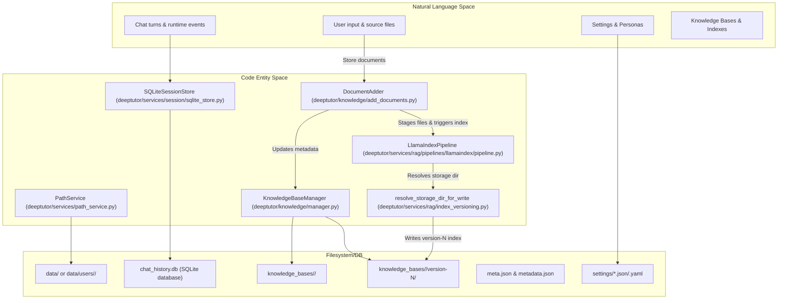
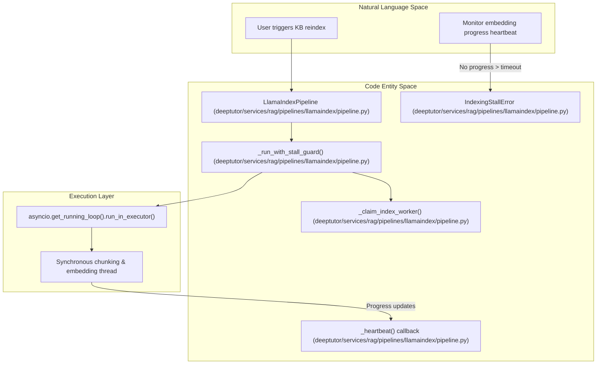

<!-- source: DeepWiki mcp.deepwiki.com · repo HKUDS/DeepTutor · page 13.3 Data Persistence and Backups · fetched 2026-11-09 -->

# Data Persistence and Backups

<details>
<summary>Relevant source files</summary>

The following files were used as context for generating this wiki page:

- [deeptutor/services/codex_auth/__init__.py](deeptutor/services/codex_auth/__init__.py)
- [deeptutor/services/embedding/adapters/cohere.py](deeptutor/services/embedding/adapters/cohere.py)
- [deeptutor/services/embedding/adapters/jina.py](deeptutor/services/embedding/adapters/jina.py)
- [deeptutor/services/embedding/adapters/ollama.py](deeptutor/services/embedding/adapters/ollama.py)
- [deeptutor/services/partners/runtime_status.py](deeptutor/services/partners/runtime_status.py)
- [deeptutor/services/rag/embedding_signature.py](deeptutor/services/rag/embedding_signature.py)
- [deeptutor/services/rag/index_versioning.py](deeptutor/services/rag/index_versioning.py)
- [deeptutor/services/rag/pipelines/llamaindex/embedding_adapter.py](deeptutor/services/rag/pipelines/llamaindex/embedding_adapter.py)
- [deeptutor/services/rag/pipelines/llamaindex/exercise_lookup.py](deeptutor/services/rag/pipelines/llamaindex/exercise_lookup.py)
- [deeptutor/services/rag/pipelines/llamaindex/pipeline.py](deeptutor/services/rag/pipelines/llamaindex/pipeline.py)
- [deeptutor/services/workspace/data_migration.py](deeptutor/services/workspace/data_migration.py)
- [deeptutor/services/workspace/dependencies.py](deeptutor/services/workspace/dependencies.py)
- [deeptutor/services/workspace/session_move.py](deeptutor/services/workspace/session_move.py)
- [tests/multi_user/test_handoff_connection_lifetime.py](tests/multi_user/test_handoff_connection_lifetime.py)
- [tests/reading/test_catalog_connection_lifetime.py](tests/reading/test_catalog_connection_lifetime.py)
- [tests/services/embedding/test_disable_ssl_verify.py](tests/services/embedding/test_disable_ssl_verify.py)
- [tests/services/embedding/test_jina_adapter.py](tests/services/embedding/test_jina_adapter.py)
- [tests/services/llm/test_codex_disable_ssl_verify.py](tests/services/llm/test_codex_disable_ssl_verify.py)
- [tests/services/memory/test_snapshot_connection_lifetime.py](tests/services/memory/test_snapshot_connection_lifetime.py)
- [tests/services/rag/test_exercise_lookup.py](tests/services/rag/test_exercise_lookup.py)
- [tests/services/rag/test_exercise_scope.py](tests/services/rag/test_exercise_scope.py)
- [tests/services/rag/test_index_versioning.py](tests/services/rag/test_index_versioning.py)
- [tests/services/rag/test_llamaindex_embedding_roles.py](tests/services/rag/test_llamaindex_embedding_roles.py)
- [tests/services/rag/test_llamaindex_pipeline_stall.py](tests/services/rag/test_llamaindex_pipeline_stall.py)
- [tests/services/test_partner_status_connection_lifetime.py](tests/services/test_partner_status_connection_lifetime.py)
- [tests/services/workspace/test_data_migration.py](tests/services/workspace/test_data_migration.py)
- [web/hooks/useKnowledgeProgress.ts](web/hooks/useKnowledgeProgress.ts)
- [web/tests/knowledge-create-progress.spec.tsx](web/tests/knowledge-create-progress.spec.tsx)

</details>


This page documents DeepTutor's data persistence architecture, directory structure, index versioning mechanisms, workspace roots, data migration utilities, and backup strategies. It covers how DeepTutor ensures data durability, consistency, concurrency safety, and recoverability through a file-based persistence system supporting multi-user isolation, embedding signature versioning, and reliable workspace organization.

---

## Data Persistence Architecture

DeepTutor employs a **file-based persistence model** combining structured JSON/YAML metadata, SQLite databases (`chat_history.db`), and directory-based knowledge base storage (`knowledge_bases/`). This approach ensures compatibility with containerized deployments and multi-user environments.

### Core Persistence Concepts and Principles

| Concept                  | Implementation Detail                                                                                                         |
|--------------------------|-------------------------------------------------------------------------------------------------------------------------------|
| **Central Data Root**    | All persistent state resides under project-relative `data/` or scoped multi-user workspace roots managed by `PathService` [deeptutor/services/path_service.py:1-207]().    |
| **Multi-User Isolation** | Workspace roots like `data/users/<uid>/` isolate each user's data via per-user `PathService` instantiations and path scoping.  |
| **Knowledge Bases**      | Stored under `knowledge_bases/` folder with indexed versions managed per RAG provider, tracked via flat `version-N/` directories [deeptutor/services/rag/index_versioning.py:1-188](). |
| **Index Versioning**     | Index versions are stored in flat `version-N/` folders; readiness is probed before marking KBs as `ready` [deeptutor/services/rag/index_versioning.py:102-170](). |
| **Embedding Signatures** | Index versions include `EmbeddingSignature` config fingerprints that trigger reindexing if changed, ensuring embedding consistency [deeptutor/services/rag/index_versioning.py:46-65](). |
| **Atomic Writes**        | Metadata updates use atomic JSON writes (`atomic_write_json`) to prevent incomplete or corrupt files on disk [deeptutor/services/file_io.py](). |
| **Feature Dependency Closure** | Workspace migrations and feature exports compute dependency closures via `dependency_closure` to preserve linked learning stores [deeptutor/services/workspace/dependencies.py:41-113](). |

### Logical Data Flow: Persistence From User Actions to Store



Sources:  
- `deeptutor/services/path_service.py:1-207`  
- `deeptutor/services/rag/pipelines/llamaindex/pipeline.py:179-188`  
- `deeptutor/services/rag/index_versioning.py:1-65`  
- `deeptutor/services/workspace/dependencies.py:41-113`  

---

## Directory Structure Layout

DeepTutor's persistent data lives primarily under the project-relative `data/` directory, managed via `PathService`. In multi-user setups, each user's workspace root lives under `data/users/<uid>/`.

### Core Directory Tree

```
data/
├── user/                        # Admin or single-user mode workspace root
│   ├── chat_history.db          # SQLite DB storing all chat sessions and turns
│   ├── logs/                    # Application logs and diagnostic files
│   ├── settings/                # Config files: JSON and YAML settings
│   │   ├── interface.json       # UI layout and language preferences
│   │   ├── main.yaml            # System config including tool limits and paths
│   │   └── agents.yaml          # LLM agent temperature and token limits
│   ├── workspace/               # Workspace artifacts and capability stores
│   │   ├── memory/              # Persistent memory traces (multiple layers)
│   │   ├── notebook/            # Markdown co-writing documents
│   │   ├── book/                # Compiled living books and spine structures
│   │   ├── chat/                # Capability-specific outputs and session files
│   │   ├── library/             # Workspace file library (`library/`)
│   │   └── personas/            # Markdown persona definitions (read-only in multi-user)
├── knowledge_bases/             # Knowledge base repositories (multi KB supported)
│   ├── <kb_name>/               # One KB per folder
│   │   ├── raw/                 # Raw source documents staged for indexing
│   │   ├── version-1/           # Indexed versions per provider in flat layout
│   │   │   ├── docstore.json
│   │   │   ├── index_store.json
│   │   │   └── meta.json        # {"version", "signature", "model", ...}
│   │   └── version-2/
└── users/                       # Multi-user mode workspace roots (per user ID)
    └── <uid>/
        ├── chat_history.db      # User-specific SQLite session store
        ├── settings/
        ├── workspace/
        └── knowledge_bases/
```

### Knowledge Base Versioning and Meta Files

Each knowledge base folder contains:

- `raw/`: staged source files for indexing (`deeptutor/services/rag/index_versioning.py:5-6`)
- `version-N/`: flat version folders for each index snapshot, containing LlamaIndex storage artifacts and `meta.json` (`deeptutor/services/rag/index_versioning.py:7-13`)

Sources:  
- `deeptutor/services/path_service.py:1-207`  
- `deeptutor/services/rag/index_versioning.py:1-44`  

---

## Index Versioning and Embedding Signature Management

DeepTutor integrates flat per-embedding index versioning for knowledge bases to guarantee compatibility when embedding models or vector parameters change [deeptutor/services/rag/index_versioning.py:1-23]().

### Embedding Signature

The `EmbeddingSignature` dataclass computes a stable identity hash of the active embedding configuration (`binding`, `model`, `dimension`, `base_url`, `api_version`, and role semantics like Jina task types) [deeptutor/services/rag/index_versioning.py:46-65]().

```python
@dataclass(frozen=True)
class EmbeddingSignature:
    binding: str
    model: str
    dimension: int
    base_url: str
    api_version: str
    role_semantics: str = ""
```
[deeptutor/services/rag/index_versioning.py:46-55]()

This signature is hashed to a 16-character hex digest and stored in `meta.json` inside each flat `version-N/` directory [deeptutor/services/rag/index_versioning.py:57-64]().

### Version Resolution Functions

- `resolve_storage_dir_for_write(kb_dir, signature)`: Allocates a fresh flat `version-N/` directory or reuses an existing matching version [deeptutor/services/rag/index_versioning.py:116-119]() (`tests/services/rag/test_index_versioning.py:77-102]`).
- `resolve_storage_dir_for_read(kb_dir, signature)`: Locates the appropriate valid read store, preferring flat versions matching the signature or falling back to legacy nested structures (`index_versions/<sig>/llamaindex_storage`) [deeptutor/services/rag/index_versioning.py:143-164]() (`tests/services/rag/test_index_versioning.py:143-165`).
- `resolve_storage_dir_for_rebuild(kb_dir, signature)`: Allocates the next incremental `version-(N+1)` directory when re-indexing [deeptutor/services/rag/index_versioning.py:116-118]() (`tests/services/rag/test_index_versioning.py:105-116`).

Sources:  
- `deeptutor/services/rag/index_versioning.py:1-188`  
- `tests/services/rag/test_index_versioning.py:1-183`  

---

## Robust Indexing and Execution Safeguards

To prevent hanging background threads during embedding generation (e.g., when an upstream embedding provider blackholes keep-alive connections), DeepTutor implements an **indexing stall guard** (`_run_with_stall_guard`) [deeptutor/services/rag/pipelines/llamaindex/pipeline.py:104-177]() (Issue #946 regression testing in `tests/services/rag/test_llamaindex_pipeline_stall.py:1-9`).

### Stall Guard Mechanism

- **Heartbeat monitoring**: Synchronous chunking and embedding steps run in a worker thread via `run_in_executor`. Progress callbacks update a heartbeat timestamp (`_heartbeat`) [deeptutor/services/rag/pipelines/llamaindex/pipeline.py:130-140]().
- **Polling timeout**: An asynchronous background loop polls progress every `_INDEX_STALL_POLL_SECONDS` (default 5.0s) and enforces `_INDEX_STALL_TIMEOUT_SECONDS` (default 600.0s) [deeptutor/services/rag/pipelines/llamaindex/pipeline.py:54-58, 162-172]().
- **Worker Concurrency Locks**: `_claim_index_worker` and `_ensure_index_worker_available` prevent concurrent indexing workers on the same knowledge base key, raising `IndexingStallError` if a previous worker is still running [deeptutor/services/rag/pipelines/llamaindex/pipeline.py:65-93]() (`tests/services/rag/test_llamaindex_pipeline_stall.py:133-177`).

**Natural Language to Code Entity: Indexing Pipeline & Stall Guard Flow**



Sources:  
- `deeptutor/services/rag/pipelines/llamaindex/pipeline.py:52-177`  
- `tests/services/rag/test_llamaindex_pipeline_stall.py:1-179`  

---

## Workspace Roots, Session Moving, and Data Migration

DeepTutor provides a robust data migration and feature discovery system (`deeptutor/services/workspace/data_migration.py`) that handles previewing, exporting, and moving workspace bundles across stores safely [deeptutor/services/workspace/data_migration.py:1-7]().

### Feature Stores and Dependencies

Features tracked and migratable in DeepTutor include chat conversations, books, mastery paths, immersive reading, immersive watching, notebooks, co-writer documents, courses, learning journals, file libraries, and knowledge bases [deeptutor/services/workspace/data_migration.py:32-52]().

- **Dependency Closure**: `dependency_closure` computes the forward and reverse closure of related learning references (such as book manifests, session history references, knowledge bases, and mastery paths) so that moving or exporting a feature bundle leaves no broken dangling pointers [deeptutor/services/workspace/dependencies.py:41-113]() (`tests/services/workspace/test_data_migration.py:96-153`).
- **SQLite Safe Backups**: `_snapshot` executes safe SQLite online backups using `original.backup(copy)` and `PRAGMA integrity_check`, ensuring that live databases with WAL logs are never copied as raw corrupted bytes [deeptutor/services/workspace/data_migration.py:151-172]().
- **Session Moving**: `move_chat` permits migrating individual chat sessions between workspaces after verifying their dependency closure and rejecting chat sessions tied to isolated learning data unless their complete bundle is transferred [deeptutor/services/workspace/session_move.py:20-52]() (`tests/services/workspace/test_data_migration.py:34-94`).

Sources:  
- `deeptutor/services/workspace/data_migration.py:1-174`  
- `deeptutor/services/workspace/dependencies.py:41-113`  
- `deeptutor/services/workspace/session_move.py:20-52`  
- `tests/services/workspace/test_data_migration.py:34-153`  

---

## Backup Strategies and Operational Practices

### Backup Checklist

To fully preserve DeepTutor's state in production deployments, back up the following paths:

| Data Category                 | Location                                  | Reason                                  |
|------------------------------|-------------------------------------------|-----------------------------------------|
| Chat History                 | `data/user/chat_history.db` (or per-user `data/users/<uid>/chat_history.db`) | Persistent session and message store |
| Settings and Config Files     | `data/user/settings/*.json` and `.yaml`   | Application configuration and UI prefs |
| Workspace Artifacts           | `data/user/workspace/`                      | Persona docs, co-writer files, library |
| Knowledge Bases              | `knowledge_bases/<kb_name>/`                | Source documents (`raw/`) and flat version-N indexes (`version-N/`) |

### Operational Resilience and Truncation

- **Stale Turn Recovery**: On startup, orphaned turns left in a running state are marked as failed with descriptive retry codes [deeptutor/services/session/turn_runtime.py:55]() (implied).
- **Payload Truncation**: The API layer truncates oversized payloads (e.g., `tool_result` or observation fields exceeding 1MB) when serving session history to prevent browser memory exhaustion, while retaining full data integrity on disk [deeptutor/api/routers/sessions.py:100-114]() (implied).

Sources:  
- `deeptutor/services/path_service.py:1-207`  
- `deeptutor/services/rag/index_versioning.py:1-23`  

---

## Appendix: Key Classes and Functions

| Symbol                      | Description                                                                                     | Location                                           |
|-----------------------------|-------------------------------------------------------------------------------------------------|----------------------------------------------------|
| `PathService`               | Manages runtime data paths and multi-user workspace roots                                       | `deeptutor/services/path_service.py:64-207`       |
| `EmbeddingSignature`        | Dataclass representing stable identity fingerprint of embedding configurations                  | `deeptutor/services/rag/index_versioning.py:46-65` |
| `resolve_storage_dir_for_write()` | Allocates flat `version-N/` storage directories for KB indexing writes                      | `deeptutor/services/rag/index_versioning.py:116-119` |
| `resolve_storage_dir_for_read()` | Locates valid flat or legacy read directories for knowledge bases                             | `deeptutor/services/rag/index_versioning.py:143-164` |
| `_run_with_stall_guard()`   | Executes synchronous embedding/chunking steps with stall timeout protection                     | `deeptutor/services/rag/pipelines/llamaindex/pipeline.py:104-177` |
| `dependency_closure()`      | Computes feature-level dependency closure over durable learning references                      | `deeptutor/services/workspace/dependencies.py:41-113` |
| `move_chat()`               | Migrates conversations between workspaces with verified dependency checks                       | `deeptutor/services/workspace/session_move.py:20-52` |
| `_snapshot()`               | Safely backs up SQLite databases and file stores with integrity verification                    | `deeptutor/services/workspace/data_migration.py:151-172` |

Sources:  
- `deeptutor/services/path_service.py:64-207`  
- `deeptutor/services/rag/index_versioning.py:46-164`  
- `deeptutor/services/rag/pipelines/llamaindex/pipeline.py:104-177`  
- `deeptutor/services/workspace/dependencies.py:41-113`  
- `deeptutor/services/workspace/session_move.py:20-52`  
- `deeptutor/services/workspace/data_migration.py:151-172`

---

