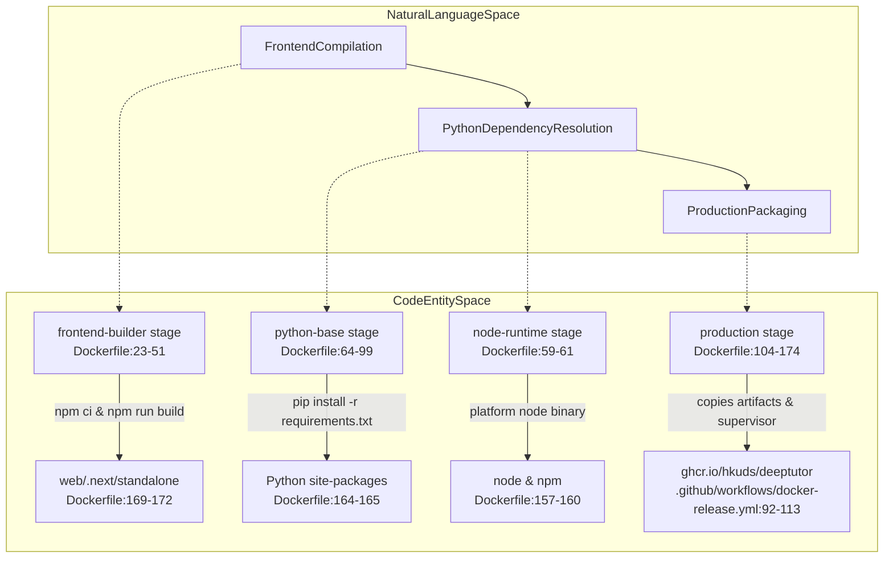
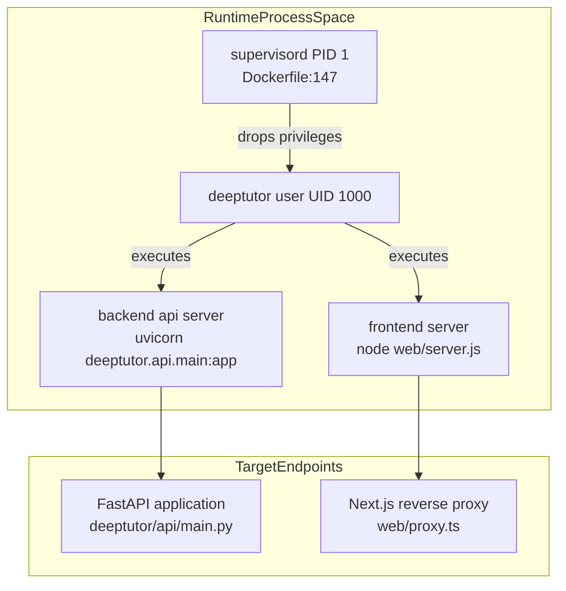
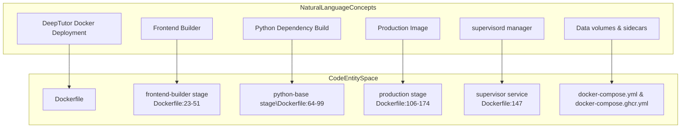

<!-- source: DeepWiki mcp.deepwiki.com · repo HKUDS/DeepTutor · page 2.1 Docker Deployment · fetched 2026-11-09 -->

# Docker Deployment

Relevant source files

The following files were used as context for generating this wiki page:

- [.dockerignore](.dockerignore)
- [.env.example](.env.example)
- [Dockerfile](Dockerfile)
- [assets/releases/past_releases/ver1-6-2.md](assets/releases/past_releases/ver1-6-2.md)
- [deeptutor/services/config/readiness.py](deeptutor/services/config/readiness.py)
- [deeptutor/services/parsing/engines/_install.py](deeptutor/services/parsing/engines/_install.py)
- [deeptutor/services/parsing/engines/mineru/readiness.py](deeptutor/services/parsing/engines/mineru/readiness.py)
- [deeptutor/services/partners/workspace.py](deeptutor/services/partners/workspace.py)
- [deeptutor/services/workspace/service.py](deeptutor/services/workspace/service.py)
- [docker-compose.dev.yml](docker-compose.dev.yml)
- [docker-compose.ghcr.yml](docker-compose.ghcr.yml)
- [docker-compose.yml](docker-compose.yml)
- [docs-for-dev/MODULES.md](docs-for-dev/MODULES.md)
- [tests/scripts/test_docker_compose.py](tests/scripts/test_docker_compose.py)
- [tests/scripts/test_install_extras.py](tests/scripts/test_install_extras.py)
- [tests/services/config/test_readiness.py](tests/services/config/test_readiness.py)
- [tests/services/parsing/test_engines.py](tests/services/parsing/test_engines.py)
- [tests/services/partners/test_partner_workspace.py](tests/services/partners/test_partner_workspace.py)
- [web/features/settings/sections/DocumentParsingSettingsSection.tsx](web/features/settings/sections/DocumentParsingSettingsSection.tsx)

## Purpose and Scope

This page documents DeepTutor's containerized deployment architecture. It covers the multi-stage `Dockerfile` design [Dockerfile:1-175](), process orchestration, runtime configuration handling, server-side proxying for Next.js (`web/proxy.ts`), persistent volume layouts, sidecar orchestration via `docker-compose.yml` [docker-compose.yml:1-162](), and multi-platform image publishing via GitHub Container Registry (GHCR).

Sources: [`Dockerfile:1-15`](), [`docker-compose.yml:1-24`]()

---

## Multi-Stage Build Process

DeepTutor uses a multi-stage Docker build to decouple frontend compilation and Python package resolution from the final runtime image. The overall process compiles static frontend assets, installs Python dependencies, and assembles a production image with all components [Dockerfile:1-175]().

### Build Stages and Component Mapping

The following diagram bridges the deployment build phases to the concrete builder stages and related code artifacts:

**Sources:** [`Dockerfile:23-172`](), [`.github/workflows/docker-release.yml:1-113`]()

### 1. Frontend Builder (`frontend-builder`)

- **Platform Isolation:** Runs with `--platform=$BUILDPLATFORM` pinned, ensuring native execution on the build host without QEMU overhead [Dockerfile:23]().
- **Dependency Installation:** Uses `npm config set fetch-timeout 600000` and `npm ci --legacy-peer-deps` to install frontend dependencies [Dockerfile:31-33]().
- **Standalone Next.js Build:** Runs `npm run build`, outputting a standalone Node server configuration [Dockerfile:49-51]().

### 2. Python Base (`python-base`)

- **System Dependencies:** Installs OpenCV libraries (`libgl1`, `libglib2.0-0`, etc.) and sets up the Rust compiler via rustup for building native packages like `tiktoken` [Dockerfile:75-95]().
- **Python Packages:** Executes `pip install -r requirements.txt` under Python 3.11-slim [Dockerfile:97-101]().

### 3. Node Runtime (`node-runtime`)

- **Target Platform Binary:** Pulls the architecture-matched `node:22.23.4-slim` binary to ensure correct target execution [Dockerfile:59-61]().

### 4. Production Image (`production`)

- **Runtime Base:** Uses `python:3.11-slim` [Dockerfile:106]().
- **System Utilities:** Installs `supervisor`, `git`, `libreoffice-*`, and fonts (`fonts-noto-cjk`, `fonts-liberation`) for document rendering and sandboxed execution [Dockerfile:131-158]().
- **Artifact Integration:** Copies Node binary, Python site-packages, and the built frontend standalone bundle [Dockerfile:160-172]().

Sources: [`Dockerfile:23-175`]()

---

## Process Orchestration and Security

DeepTutor uses `supervisord` inside the container to manage concurrent processes while enforcing a security model with user privilege dropping [Dockerfile:147]().

### Process Supervision and Runtime Components

- **Privilege Model:** `supervisord` starts as root to initialize system resources and then drops privileges to the unprivileged `deeptutor` user (UID 1000) [Dockerfile:147]().
- **Service Management:** Manages Uvicorn running the FastAPI backend and Node serving the Next.js frontend.
- **Security Isolation:** Code execution is delegated to the sandbox runner sidecar container (`sandbox-runner`) rather than running untrusted code in the main app process [docker-compose.yml:145-160]().

Sources: [`Dockerfile:147`](), [`docker-compose.yml:145-160`]()

---

## Runtime Configuration and Proxying

- **Dynamic API Forwarding:** The frontend serves browser requests and proxies `/api/*` and `/ws/*` calls to the backend API base URL specified by `DEEPTUTOR_API_BASE_URL` [web/proxy.ts](), [`.env.example:11-16`].
- **JSON-Driven Settings:** The entrypoint reads settings from `data/user/settings/system.json` to configure runtime properties [`.env.example:6-9`]().

Sources: [`.env.example:1-26`](), [`docker-compose.yml:1-24`]()

---

## Data Persistence, Volumes, and Sidecars

To ensure durability, persistent volumes map host directories to container paths [docker-compose.yml:88-98]().

### Volume Layout

| Container Path               | Purpose                                                        | Reference                 |
|-----------------------------|----------------------------------------------------------------|---------------------------|
| `/app/data`                 | Unified data volume (settings, KBs, memory, accounts, workspace) | [`docker-compose.yml:97`]() |
| `/workspace`                | Host-mapped Content Workspace mount point                       | [`docker-compose.yml:98`]() |

### Sidecar Containers

- **Redis:** Internal-only coordination state (`redis:7.4-alpine`) with AOF persistence [docker-compose.yml:30-43]().
- **PocketBase:** Optional auth and storage sidecar (`ghcr.io/muchobien/pocketbase:latest`) running on port 8090 [docker-compose.yml:50-66]().
- **Sandbox Runner:** Dedicated isolated container executing untrusted shell commands (`sandbox-runner`) [docker-compose.yml:145-160]().

Sources: [`docker-compose.yml:26-162`]()

---

## Multi-Platform Releases and GHCR Images

Official production images are built via GitHub Actions targeting `amd64` and `arm64` architectures [`.github/workflows/docker-release.yml:1-113`]().

- **Registry:** Pushed to GitHub Container Registry (GHCR) under `ghcr.io/hkuds/deeptutor` [docker-compose.ghcr.yml:60]().
- **Composition:** Users can launch pre-built images instantly using `docker-compose.ghcr.yml` [docker-compose.ghcr.yml:1-118]().

Sources: [`docker-compose.ghcr.yml:1-119`], [`.github/workflows/docker-release.yml:1-113`]()

---

# Summary Diagram: From Deployment Concepts to Code Entities

**Sources:** [`Dockerfile:1-175`](), [`docker-compose.yml:1-162`](), [`docker-compose.ghcr.yml:1-119`]()

---

# Notes on Containerization and Best Practices

- **Non-root Operation:** Runs under the `deeptutor` non-root user (UID 1000) for enhanced security [Dockerfile:147]().
- **Port Mapping:** Host ports are rendered dynamically via helper scripts from `system.json` configurations [tests/scripts/test_docker_compose.py:25-50]().
- **Sandboxing:** Shell code execution is isolated within the `sandbox-runner` sidecar container [docker-compose.yml:145-160]().

Sources: [`Dockerfile:1-175`](), [`docker-compose.yml:1-162`](), [`tests/scripts/test_docker_compose.py:1-100`]()

---

