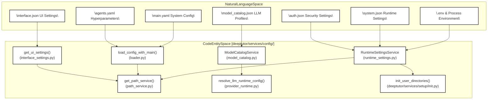

<!-- source: DeepWiki mcp.deepwiki.com · repo HKUDS/DeepTutor · page 2.2 Configuration Guide · fetched 2026-11-09 -->

# Configuration Guide

<details>
<summary>Relevant source files</summary>

The following files were used as context for generating this wiki page:

- [deeptutor/agents/loop/prompt_blocks.py](deeptutor/agents/loop/prompt_blocks.py)
- [deeptutor/api/routers/knowledge.py](deeptutor/api/routers/knowledge.py)
- [deeptutor/knowledge/manager.py](deeptutor/knowledge/manager.py)
- [deeptutor/services/config/launch_settings.py](deeptutor/services/config/launch_settings.py)
- [deeptutor/services/config/loader.py](deeptutor/services/config/loader.py)
- [deeptutor/services/config/runtime_settings.py](deeptutor/services/config/runtime_settings.py)
- [deeptutor/services/config/settings_spec.py](deeptutor/services/config/settings_spec.py)
- [deeptutor/services/config/test_runner.py](deeptutor/services/config/test_runner.py)
- [deeptutor/services/prompt/language.py](deeptutor/services/prompt/language.py)
- [deeptutor/services/settings/interface_settings.py](deeptutor/services/settings/interface_settings.py)
- [deeptutor/services/setup/init.py](deeptutor/services/setup/init.py)
- [tests/api/test_knowledge_router.py](tests/api/test_knowledge_router.py)
- [tests/api/test_main_notebook_router.py](tests/api/test_main_notebook_router.py)
- [tests/config/test_reasoning_probe_budget.py](tests/config/test_reasoning_probe_budget.py)
- [tests/knowledge/test_manager_list.py](tests/knowledge/test_manager_list.py)
- [tests/multi_user/test_ui_language_scoping.py](tests/multi_user/test_ui_language_scoping.py)
- [tests/services/config/test_launch_settings.py](tests/services/config/test_launch_settings.py)
- [tests/services/config/test_llm_probe_config.py](tests/services/config/test_llm_probe_config.py)
- [tests/services/config/test_runtime_settings.py](tests/services/config/test_runtime_settings.py)
- [tests/services/config/test_task_probe.py](tests/services/config/test_task_probe.py)
- [tests/services/config/test_visualize_params.py](tests/services/config/test_visualize_params.py)
- [tests/services/prompt/test_language_directive.py](tests/services/prompt/test_language_directive.py)
- [web/components/knowledge/CreateKbModal.tsx](web/components/knowledge/CreateKbModal.tsx)
- [web/components/knowledge/KbIndexVersionsSection.tsx](web/components/knowledge/KbIndexVersionsSection.tsx)
- [web/components/knowledge/KbSettingsSection.tsx](web/components/knowledge/KbSettingsSection.tsx)
- [web/components/knowledge/KnowledgeBaseDetail.tsx](web/components/knowledge/KnowledgeBaseDetail.tsx)
- [web/components/knowledge/KnowledgeHome.tsx](web/components/knowledge/KnowledgeHome.tsx)
- [web/components/knowledge/KnowledgePage.tsx](web/components/knowledge/KnowledgePage.tsx)
- [web/components/settings/MinerUEngineSettings.tsx](web/components/settings/MinerUEngineSettings.tsx)
- [web/context/AppShellContext.tsx](web/context/AppShellContext.tsx)
- [web/context/app-shell-storage.ts](web/context/app-shell-storage.ts)
- [web/features/settings/store/SettingsStore.tsx](web/features/settings/store/SettingsStore.tsx)
- [web/features/settings/store/response-language-options.ts](web/features/settings/store/response-language-options.ts)
- [web/hooks/useKnowledgeBases.ts](web/hooks/useKnowledgeBases.ts)
- [web/i18n/init.ts](web/i18n/init.ts)
- [web/i18n/languages.ts](web/i18n/languages.ts)
- [web/lib/datetime.ts](web/lib/datetime.ts)
- [web/lib/knowledge-helpers.ts](web/lib/knowledge-helpers.ts)
- [web/lib/marginnote4-api.ts](web/lib/marginnote4-api.ts)
- [web/tests/account-role.test.ts](web/tests/account-role.test.ts)
- [web/tests/app-shell-language-bootstrap.test.ts](web/tests/app-shell-language-bootstrap.test.ts)
- [web/tests/knowledge-helpers.test.ts](web/tests/knowledge-helpers.test.ts)
- [web/tests/language-preferences.test.ts](web/tests/language-preferences.test.ts)
- [web/tests/lightrag-embedding-compatibility.spec.tsx](web/tests/lightrag-embedding-compatibility.spec.tsx)
- [web/tests/marginnote4-api.test.ts](web/tests/marginnote4-api.test.ts)
- [web/tests/settings-unified-draft.spec.tsx](web/tests/settings-unified-draft.spec.tsx)

</details>


This page details the configuration architecture of DeepTutor, covering environment variables, YAML configuration files, JSON settings stores (`model_catalog`, `system`, `auth`, `interface`), document parsing JSON files, and the runtime settings service.

---

## 1. Configuration Architecture Overview

DeepTutor uses a multi-layered configuration hierarchy that unifies environment variables, operator YAML files, and user-editable JSON settings. Configuration loading centralizes path resolution (`PathService`) and agent hyperparameters to guarantee consistency across FastAPI backend, Next.js frontend, and agentic pipelines.

### Code Entity Configuration Map



**Configuration Priority Order** (highest to lowest):
1. **Process Environment Variables:** Explicitly exported environment variables override file-backed runtime settings [deeptutor/services/config/runtime_settings.py:60-79]().
2. **Model Catalog:** Managed LLM profiles and active models stored in `model_catalog.json` [deeptutor/services/config/provider_runtime.py:41-42]().
3. **JSON Runtime Settings:** User-configurable runtime stores including `system.json`, `auth.json`, `interface.json`, and `integrations.json` [deeptutor/services/config/runtime_settings.py:15-105]() and [deeptutor/services/settings/interface_settings.py:10-180]().
4. **YAML Configuration:** Operator configurations (`main.yaml` and `agents.yaml`) loaded and merged during initialization [deeptutor/services/setup/init.py:24-201]().
5. **Hardcoded Defaults:** Fallback values seeded on first use and in default dicts [deeptutor/services/config/runtime_settings.py:15-68]().

Sources: `[deeptutor/services/config/runtime_settings.py:15-79]`, `[deeptutor/services/config/provider_runtime.py:1-150]`, `[deeptutor/services/settings/interface_settings.py:1-180]`, `[deeptutor/services/setup/init.py:24-201]`, `[deeptutor/services/config/loader.py:23-79]`

---

## 2. Runtime Settings Service and JSON Stores

The `RuntimeSettingsService` class (in `runtime_settings.py`) orchestrates loading, saving, and atomic updates of runtime JSON configurations stored under the project data root at `data/user/settings/`. The runtime settings persist system-level, authentication, integration, and document parsing configuration:

### JSON Runtime Settings Files

| Filename               | Purpose                                          | Main Keys / Schema Highlights                                                                                                   |
|------------------------|-------------------------------------------------|-------------------------------------------------------------------------------------------------------------------------------|
| `system.json`          | Core server runtime settings                     | `backend_port`, `frontend_port`, `version_check_enabled`, `sandbox_allow_subprocess`, `capability_routing_enabled`             |
| `auth.json`            | Authentication and multi-user access control    | `enabled`, `username`, `password_hash`, `token_expire_hours`, `cookie_secure`                                                  |
| `integrations.json`    | External service URLs and distributed backends  | `pocketbase_url`, `turn_coordination` (with Redis lease config)                                                                |
| `document_parsing.json`| Document parsing engine and mode configuration   | `version`, `engine` (active), `engines` (configuration per engine, e.g. MinerU, Docling, MarkItDown, PyMuPDF4LLM)                |
| `interface.json`       | User interface preferences (theme, language)     | `theme`, `language`, `response_language`, `voice_math_speak`                                                                    |

### RuntimeSettingsService Key Methods

- `load_system(include_process_overrides: bool = True)`: Load the system JSON with optional environment variable overrides.
- `load_auth(include_process_overrides: bool = True)`: Load authentication configuration.
- `load_integrations(include_process_overrides: bool = True)`: Load integrations config.
- `save_system(data: dict)`, `save_auth(data: dict)`, `save_integrations(data: dict)`: Persist settings atomically.
- `render_environment()`: Convert JSON runtime settings and environment overrides into normalized environment variables consumable by backend and frontend.

### Example JSON fragment from `system.json`

```json
{
  "version": 1,
  "version_check_enabled": true,
  "backend_port": 8001,
  "frontend_port": 3782,
  "sandbox_allow_subprocess": true,
  "capability_routing_enabled": false,
  "web_search_source_filtering": {
    "enabled": true,
    "blocked_domains": [],
    "trusted_domains": [],
    "content_filtering": true,
    "use_educational_trusted_domains": false,
    "use_moderation": false
  },
  "chat_attachment_max_file_mb": 20,
  "chat_attachment_max_total_mb": 25
}
```

### Document Parsing Settings Highlights

`document_parsing.json` stores the active document parsing engine and its configuration per engine type. Supported engines include `"mineru"`, `"text_only"`, `"docling"`, `"markitdown"`, `"pymupdf4llm"`, `"liteparse"`, and `"tika"`. This controls how uploaded documents are extracted into Markdown or structured formats prior to ingestion [deeptutor/services/config/runtime_settings.py:108-152]().

Sources: `[deeptutor/services/config/runtime_settings.py:15-105]`, `[deeptutor/services/settings/interface_settings.py:1-180]`, `[tests/services/config/test_runtime_settings.py:10-185]`

---

## 3. Environment Variables and Rendering

DeepTutor uses environment variables for container-based deployment overrides and launch-time configuration. The `.env.example` file and shell environment variables serve as the first-order overrides for runtime JSON files.

### Environment Variable Rendering Flow

```mermaid
graph TB
    EnvExample["\".env or Process Env Variables\""]
    RuntimeJson["\"system.json, auth.json, integrations.json\""]
    RuntimeSettings["\"RuntimeSettingsService.render_environment()\""]
    BackendServer["\"Uvicorn / FastAPI BACKEND_PORT\""]
    NextProxy["\"Next.js Proxy DEEPTUTOR_API_BASE_URL\""]
    AuthModule["\"Auth Module AUTH_ENABLED\""]

    EnvExample --> RuntimeSettings
    RuntimeJson --> RuntimeSettings
    RuntimeSettings --> BackendServer
    RuntimeSettings --> NextProxy
    RuntimeSettings --> AuthModule
```

### Key Environment Variables Rendered

| Env Variable                 | Source / Purpose                                                        |
|-----------------------------|------------------------------------------------------------------------|
| `BACKEND_PORT`               | `system.json.backend_port` override                                   |
| `FRONTEND_PORT`              | `system.json.frontend_port` override                                  |
| `DEEPTUTOR_API_BASE_URL`     | `http://127.0.0.1:<backend_port>` to avoid IPv6 localhost resolution issues |
| `DEEPTUTOR_VERSION_CHECK_ENABLED` | `system.json.version_check_enabled` supports disabling update checks   |
| `AUTH_ENABLED`               | `auth.json.enabled` propagates login activation status                |
| `NEXT_PUBLIC_AUTH_ENABLED`   | Same as `AUTH_ENABLED` but exposed to Next.js frontend                |
| `POCKETBASE_URL`             | Integration settings for PocketBase endpoint URL                      |

### Implementation Details

`RuntimeSettingsService.render_environment()` reads current runtime JSON settings, merges any explicit process environment overrides (e.g., from container `-e` flags), coerces boolean and list types to lowercase strings or comma-joined strings, and ensures consistent mappings [deeptutor/services/config/runtime_settings.py:126-183]().

Notably, `DEEPTUTOR_API_BASE_URL` always uses IPv4 loopback instead of `localhost` due to Docker and networking complexities on dual-stack hosts to prevent connectivity failures [tests/services/config/test_runtime_settings.py:170-185]().

Sources: `[deeptutor/services/config/runtime_settings.py:126-183]`, `[tests/services/config/test_runtime_settings.py:126-185]`

---

## 4. YAML Configuration and Initialization

DeepTutor supports operator YAML configurations (`main.yaml` and `agents.yaml`) housed outside the JSON runtime settings.

### YAML Configuration Role

- `main.yaml`: Contains system-level definitions such as tool permissions, routing, and logging levels.
- `agents.yaml`: Contains hyperparameters for agent capabilities, such as LLM temperature, max tokens, and rate limits.

### Initialization and Defaults

At the first run or when settings files are missing, `init_user_directories()` seeds default files and directories in the data root (`data/user/`), including initial JSON and YAML files [deeptutor/services/setup/init.py:24-201]().

```mermaid
flowchart LR
    Start["\"DeepTutor launch\""]
    InitDirs["\"init_user_directories()\""]
    CheckInterface["\"Check or create interface.json\""]
    SeedMainYaml["\"Seed main.yaml defaults\""]
    SeedAgentsYaml["\"Seed agents.yaml defaults\""]
    Finish["\"Ready for runtime\""]

    Start --> InitDirs --> CheckInterface --> SeedMainYaml --> SeedAgentsYaml --> Finish
```

### Example Defaults

- **`interface.json` defaults:**

  ```json
  {
    "theme": "snow",
    "language": "en",
    "sidebar_nav_order": [
      "workspace",
      "partners",
      "notes",
      "books",
      "video",
      "quiz",
      "reading",
      "research",
      "settings"
    ]
  }
  ```

- **`main.yaml` defaults** include system logging level ("WARNING"), allowed tool roots (`./data/user`), and capability parameters (e.g., `"capabilities.solve.max_rounds": 8`).

- **`agents.yaml` defaults** set agent hyperparameters like `temperature: 0.3`, `max_tokens: 400`, `rate_limit_tokens_total: 20000` for `solve` and other agents, ensuring consistent runtime behaviour [deeptutor/services/setup/init.py:18-201]().

Sources: `[deeptutor/services/setup/init.py:18-201]`, `[deeptutor/services/config/loader.py:23-79]`

---

## 5. User Interface Settings and Language Scoping

User interface preferences such as theme and language are stored in `interface.json` located under the per-user settings path.

### UI Settings Schema and Defaults

| Key               | Description                                     | Default        |
|-------------------|-------------------------------------------------|----------------|
| `theme`           | Selected UI theme (`"snow"`, `"light"`, `"dark"`, `"glass"`) | `"snow"`       |
| `language`        | Interface language code, normalized (`en`, `zh`, `fr`, `uk`) | `"en"`         |
| `response_language` | Language for LLM model responses (independent from UI language) | `"en"`         |
| `voice_math_speak` | Whether text-to-speech verbalizes math expressions in LaTeX form   | `True`         |

### Language Normalization and Resolution

The `interface_settings.py` module provides logic for normalizing various language inputs including aliases, region variants, and fallbacks so that the system supports consistent and predictable i18n behaviour.

- Interface language and response language are scoped independently but coherently normalized [deeptutor/services/settings/interface_settings.py:79-157]().

- Per-user interface language is resolved from the interface JSON with fallback to English for missing or unsupported codes. Response language normalization accepts a broader list of target languages commonly used by response LLM prompts [tests/multi_user/test_ui_language_scoping.py:1-84]().

### Thread-safe File Access

Per-user settings files are guarded by dedicated locks keyed by resolved paths to allow concurrent safe updates in multi-user environments [deeptutor/services/settings/interface_settings.py:35-70]().

Sources: `[deeptutor/services/settings/interface_settings.py:1-180]`, `[tests/multi_user/test_ui_language_scoping.py:1-85]`

---

## 6. Model Catalog and Provider Runtime Configuration

DeepTutor stores its LLM providers and models in `model_catalog.json`, managed by the `ModelCatalogService`. This catalog defines profiles used for task-specific routing and supports dynamic runtime integration.

### Provider Configuration Flow

```mermaid
graph LR
    ModelCatalog["\"ModelCatalogService (model_catalog.py)\""]
    ProviderRuntime["\"resolve_llm_runtime_config() (provider_runtime.py)\""]
    RuntimeSettings["\"RuntimeSettingsService\""]
    RuntimeEnv["\"Render environment variables\""]

    ModelCatalog --> ProviderRuntime --> RuntimeSettings --> RuntimeEnv
```

- `resolve_llm_runtime_config()` processes active service profiles and converts them to `LLMConfig` structures used by runtime agent components.

- Provider runtime resolution accounts for gateway prefixes, base URL normalization, and custom HTTP headers [deeptutor/services/config/provider_runtime.py:40-150]().

Sources: `[deeptutor/services/config/provider_runtime.py:1-150]`, `[deeptutor/services/config/runtime_settings.py:15-79]`

---

## 7. Document Parsing Configuration and Engine Selection

The document parsing subsystem supports multiple pluggable parsing engines configurable via JSON runtime settings.

| Engine ID                   | Description                                                                                                        |
|-----------------------------|--------------------------------------------------------------------------------------------------------------------|
| `"text_only"`               | Basic plain text extraction for PDF, Office, and text files; no external dependencies                               |
| `"mineru"`                  | Full-featured multimodal parsing supporting layouts, tables, formulas; local models or hosted API                   |
| `"docling"`                 | Structured conversion across many formats including images, ebooks, audio/video; local or remote modes             |
| `"markitdown"`              | Full Microsoft MarkItDown parser with broad format support; markdown output without local model requirement         |
| `"pymupdf4llm"`             | CPU-only PyMuPDF based parser with OCR and image extraction                                                        |
| `"liteparse"`               | Rust-backed parser from LlamaIndex for PDF and office formats with optional image extraction                         |
| `"tika"`                    | Apache Tika server remote parser supporting thousands of types                                                    |

The active engine and per-engine settings reside in `document_parsing.json`, and the parsing subsystem dynamically loads parser classes via a factory [deeptutor/services/config/runtime_settings.py:107-152]().

Sources: `[deeptutor/services/config/runtime_settings.py:107-152]`

---

## 8. Launch Settings Service and CLI Init

The `load_launch_settings()` function reads runtime ports and UI language settings for launcher-style entrypoints.

- It prefers `system.json` for backend/frontend ports but falls back to environment variables like `BACKEND_PORT` or `.env`.

- UI language is loaded from `interface.json` or overridden by environment `UI_LANGUAGE` or `LANGUAGE`.

- The function composes a source string reflecting which source contributed the final values [deeptutor/services/config/launch_settings.py:18-119]().

Sources: `[deeptutor/services/config/launch_settings.py:18-119]`

---

# Summary

DeepTutor's configuration system is an interplay of:

- **Process environment variables** overriding  
- **JSON runtime settings** (`system.json`, `auth.json`, `interface.json`, `integrations.json`, `document_parsing.json`) read by `RuntimeSettingsService`  
- **YAML operator configs** (`main.yaml`, `agents.yaml`) for system and agent hyperparameters  
- **Model catalog JSON** for LLM provider profiles  

All configuration data is stored under `data/user/settings/` or equivalent multi-user paths and cast into runtime environment variables for consistent consumption across backend services and frontend clients.

Sources: `[deeptutor/services/config/runtime_settings.py:1-159]`, `[deeptutor/services/setup/init.py:18-201]`

---

# Appendix: Architecture Diagrams Bridging Config Concepts to Code

### 1. JSON Settings to RuntimeSettingsService

```mermaid
graph LR
    RuntimeSettingsService["\"RuntimeSettingsService (runtime_settings.py)\""]
    SystemJson["\"system.json (data/user/settings/)\""]
    AuthJson["\"auth.json (data/user/settings/)\""]
    IntegrationsJson["\"integrations.json (data/user/settings/)\""]
    DocumentParsingJson["\"document_parsing.json (data/user/settings/)\""]
    PathService["\"PathService (path_service.py)\""]
    EnvRender["\"render_environment()\""]

    SystemJson --> RuntimeSettingsService
    AuthJson --> RuntimeSettingsService
    IntegrationsJson --> RuntimeSettingsService
    DocumentParsingJson --> RuntimeSettingsService

    RuntimeSettingsService --> PathService
    RuntimeSettingsService --> EnvRender
```

### 2. Interface Settings Scoping

```mermaid
graph LR
    InterfaceSettingsModule["\"interface_settings.py\""]
    UserInterfaceJson["\"interface.json (per-user settings path)\""]
    PathService["\"get_path_service()\""]
    UISettingsCache["\"Thread-safe Locks Per-File\""]
    UISettings["\"Returned normalized UI settings\""]

    UserInterfaceJson --> InterfaceSettingsModule
    InterfaceSettingsModule --> UISettingsCache
    InterfaceSettingsModule --> PathService
```

Sources:  
`[deeptutor/services/config/runtime_settings.py:1-159]`  
`[deeptutor/services/settings/interface_settings.py:1-180]`  
`[deeptutor/services/config/launch_settings.py:1-120]`  
`[deeptutor/services/config/provider_runtime.py:1-150]`  
`[deeptutor/services/setup/init.py:18-201]`  
`[tests/services/config/test_runtime_settings.py:1-186]`

---

