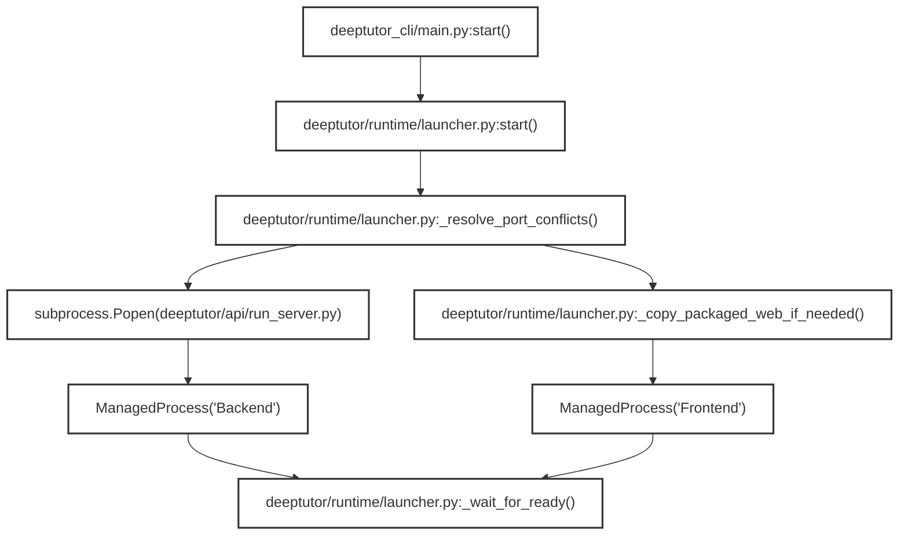
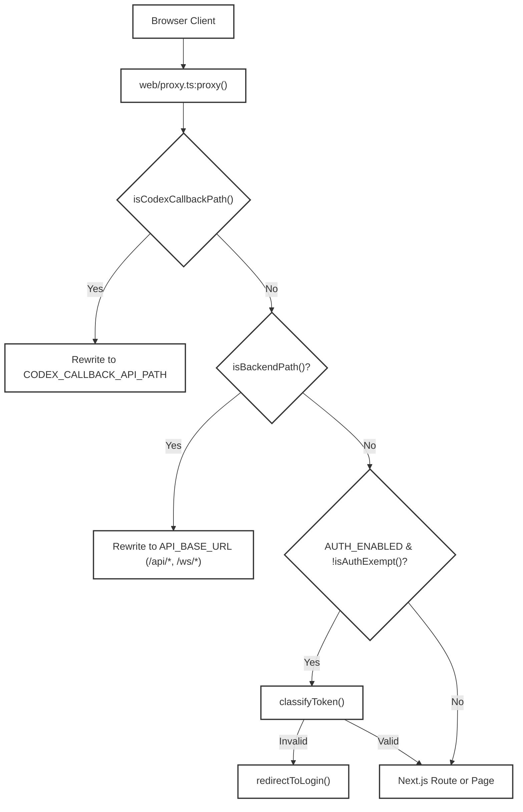

<!-- source: DeepWiki mcp.deepwiki.com · repo HKUDS/DeepTutor · page 2.3 Local Runtime and Launcher · fetched 2026-11-09 -->

# Local Runtime and Launcher

Relevant source files

The following files were used as context for generating this wiki page:

- [.gitignore](.gitignore)
- [deeptutor/api/routers/system.py](deeptutor/api/routers/system.py)
- [deeptutor/api/run_server.py](deeptutor/api/run_server.py)
- [deeptutor/multi_user/session_handoff.py](deeptutor/multi_user/session_handoff.py)
- [deeptutor/runtime/launcher.py](deeptutor/runtime/launcher.py)
- [deeptutor/runtime/process.py](deeptutor/runtime/process.py)
- [deeptutor/runtime/update_worker.py](deeptutor/runtime/update_worker.py)
- [deeptutor/services/app_update.py](deeptutor/services/app_update.py)
- [deeptutor_cli/main.py](deeptutor_cli/main.py)
- [requirements.txt](requirements.txt)
- [requirements/dev.txt](requirements/dev.txt)
- [requirements/math-animator.txt](requirements/math-animator.txt)
- [tests/api/test_session_handoff.py](tests/api/test_session_handoff.py)
- [tests/api/test_system_router.py](tests/api/test_system_router.py)
- [tests/cli/test_chat_cli.py](tests/cli/test_chat_cli.py)
- [tests/multi_user/test_admin_user_batches.py](tests/multi_user/test_admin_user_batches.py)
- [tests/multi_user/test_session_handoff.py](tests/multi_user/test_session_handoff.py)
- [tests/runtime/test_launcher.py](tests/runtime/test_launcher.py)
- [tests/runtime/test_launcher_lifecycle.py](tests/runtime/test_launcher_lifecycle.py)
- [tests/runtime/test_run_server_memory_mode.py](tests/runtime/test_run_server_memory_mode.py)
- [tests/runtime/test_uvicorn_launch_flags.py](tests/runtime/test_uvicorn_launch_flags.py)
- [tests/services/test_app_update.py](tests/services/test_app_update.py)
- [web/app/handoff/page.tsx](web/app/handoff/page.tsx)
- [web/lib/backend-forward.ts](web/lib/backend-forward.ts)
- [web/lib/streaming-upload-proxy.ts](web/lib/streaming-upload-proxy.ts)
- [web/proxy.ts](web/proxy.ts)
- [web/tests/admin-user-batches.test.ts](web/tests/admin-user-batches.test.ts)
- [web/tests/handoff-effect-replay.spec.tsx](web/tests/handoff-effect-replay.spec.tsx)
- [web/tests/proxy-policy.test.ts](web/tests/proxy-policy.test.ts)
- [web/tests/streaming-upload-proxy.test.ts](web/tests/streaming-upload-proxy.test.ts)

## Purpose and Scope

This page provides a comprehensive technical overview of the local runtime environment and launcher for DeepTutor. It covers the mechanisms for starting and constraining the DeepTutor backend and frontend processes, managing process groups, resolving loopback port conflicts, caching and injecting packaged web assets, enabling the durable self-update worker lifecycle, and configuring the Next.js-to-FastAPI proxy layer (`web/proxy.ts`). 

This subsystem forms the backbone of local developer setups, standalone desktop packaging, and single-machine production deployments.

Sources: `[deeptutor/runtime/launcher.py:1-216]()`, `[deeptutor_cli/main.py:124-160]()`, `[web/proxy.ts:1-92]()`

---

## 1. Launcher Architecture and Process Management

DeepTutor’s local runtime launcher orchestrates two distinct primary services:
- **Backend:** A FastAPI server hosted on Uvicorn (`[deeptutor/api/run_server.py:30-96]()`), exposing REST endpoints and the real-time WebSocket protocol.
- **Frontend:** A Next.js React application, running either via a compiled production standalone build or through the development server (`--dev`).

The command-line interface commands `deeptutor start` and `deeptutor stop` (`[deeptutor_cli/main.py:124-160]`) act as the entry points, which invoke `deeptutor.runtime.launcher.start()` and `stop()` respectively. 

The launcher uses the `ManagedProcess` dataclass (`[deeptutor/runtime/launcher.py:112-117]()`) to track child processes, capturing their name, `subprocess.Popen` handles, and process group IDs (`pgid`) to cleanly propagate termination signals. For detached or daemonized deployments (`--detach`), runtime status and control flags are written to `data/user/runtime/launcher.json` (`[deeptutor/runtime/launcher.py:165-172]()`).

*Figure 1: Launcher Startup Flow from CLI to Managed Processes.*

### Key Functions and Classes:
- **`start()`**: Initializes the runtime home (`[deeptutor/runtime/home.py]()`), binds environment tuning (`MALLOC_ARENA_MAX`), and coordinates child process startup.
- **`ManagedProcess`**: Encapsulates `name`, `process`, and `pgid` for signal routing (`[deeptutor/runtime/launcher.py:112-117]()`).
- **`_wait_for_http()`**: Polls loopback health endpoints using a proxy-free opener (`[deeptutor/runtime/launcher.py:87]`) to verify service readiness.

Sources: `[deeptutor/runtime/launcher.py:5-216]()`, `[deeptutor_cli/main.py:124-160]()`, `[deeptutor/api/run_server.py:30-96]()`

---

## 2. Port Conflict Resolution and Probing

Before spawning background workers, the launcher checks whether required backend and frontend ports are occupied by probing standard loopback targets (`127.0.0.1` and `::1`) (`[deeptutor/runtime/launcher.py:77, 162-172]()`).

- **IPv6 and IPv4 Dual Probing:** Unix sockets may bind exclusively to `::1` while IPv4 services bind to `127.0.0.1`. The helper `_port_accepts_connection()` attempts connections across both families (`[tests/runtime/test_launcher.py:87-103]()`).
- **Proxy Bypass:** Health and port probes construct a dedicated proxy-free urllib opener (`_LOOPBACK_OPENER`) so that system-wide or environment proxy variables (`http_proxy`) do not cause false-positive readiness failures (`[deeptutor/runtime/launcher.py:87]()`, `[tests/runtime/test_launcher.py:37-85]()`).
- **Error Reporting:** When a conflict occurs, the launcher aborts and outputs localized messages via translation templates (`_t()`).

Sources: `[deeptutor/runtime/launcher.py:72-88, 162-172]()`, `[tests/runtime/test_launcher.py:37-103]()`

---

## 3. Frontend Build Caching & Packaged Web Assets

To eliminate the need for Node.js compilation on end-user machines, packaged releases embed a pre-built standalone Next.js artifact (`.next-deeptutor`) (`[deeptutor/runtime/launcher.py:68]()`).

- **Asset Copying and Injection:** When starting from a packaged distribution, `_copy_packaged_web_if_needed()` copies the static assets and server scripts into the runtime cache directory `data/user/runtime/web` (`[deeptutor/runtime/launcher.py:67]()`).
- **Placeholder Replacement:** During copying, build-time string tokens are dynamically swapped out with active runtime variables (`[tests/runtime/test_launcher.py:104-127]()`):
  - `__NEXT_PUBLIC_API_BASE_PLACEHOLDER__` $\rightarrow$ Converted to the live backend URL (e.g., `http://localhost:8001`).
  - `__NEXT_PUBLIC_AUTH_ENABLED_PLACEHOLDER__` $\rightarrow$ Converted to `"true"` or `"false"`.

Sources: `[deeptutor/runtime/launcher.py:62-76]()`, `[tests/runtime/test_launcher.py:104-127]()`

---

## 4. Next.js to FastAPI Proxy Layer

The frontend application uses a Next.js middleware router defined in `web/proxy.ts` to forward backend traffic, handle OAuth callbacks, and enforce multi-user authentication (`[web/proxy.ts:1-92]()`).

*Figure 2: Next.js Proxy Routing Flow and Authentication Gate (`web/proxy.ts`).*

### Proxy Processing Stages:
1. **Codex Callback Interception:** Exact matches for `isCodexCallbackPath()` are rewritten to the backend OAuth callback API route (`[web/proxy.ts:54-58]()`).
2. **Backend Forwarding:** Requests matching `isBackendPath()` (`/api/*` and `/ws/*`) are rewritten to `API_BASE_URL` using `prepareBackendForwardHeaders()` to strip untrusted client forwarding headers while retaining WebSocket upgrade parameters (`[web/proxy.ts:67-76]()`, `[web/tests/proxy-policy.test.ts:132-161]()`).
3. **Authentication Gate:** When `AUTH_ENABLED` is active and the path is not covered by `isAuthExempt()`, the middleware inspects the `dt_token` cookie via `classifyToken()`. Invalid credentials trigger a redirect to `LOGIN_PATH` (`[web/proxy.ts:82-89]()`, `[web/tests/proxy-policy.test.ts:104-130]()`).

Sources: `[web/proxy.ts:1-109]()`, `[web/lib/proxy-policy.ts:1-90]()`, `[web/tests/proxy-policy.test.ts:1-170]()`

---

## 5. Self-Update Worker & Version Lifecycle

DeepTutor includes a managed update subsystem coordinated by `deeptutor/services/app_update.py` and background launcher routines (`[deeptutor/services/app_update.py:1-126]()`, `[tests/runtime/test_launcher.py:151-194]()`).

- **Update Jobs:** Scheduled upgrades are recorded via `UpdateJobStore`, which tracks job status across states (`pending`, `handoff`, `running`, `restarting`, `succeeded`, `failed`) (`[deeptutor/services/app_update.py:38-126]()`).
- **Handoff Sequence:** When an update is approved, the launcher spawns an isolated update worker process passing restart arguments and termination tokens (`[tests/runtime/test_launcher.py:151-174]()`). Under systemd environments, in-app self-updates are safely disabled to respect system service boundaries (`[deeptutor/services/app_update.py:31-35, 175-194]()`).

Sources: `[deeptutor/services/app_update.py:1-126]()`, `[tests/runtime/test_launcher.py:140-194]()`, `[deeptutor/runtime/update_worker.py:1-100]()`

---

## Summary Table of Key Launcher Components

| Component | Description | Source File and Lines |
| :--- | :--- | :--- |
| `ManagedProcess` | Dataclass holding subprocess handles and process group identifiers | `[deeptutor/runtime/launcher.py:112-117]()` |
| Detached Runtime State | JSON state and control files under `data/user/runtime/` for daemon execution | `[deeptutor/runtime/launcher.py:165-172]()` |
| Web Build Cache | Runtime cache at `data/user/runtime/web` populated from packaged assets | `[deeptutor/runtime/launcher.py:62-76]()` |
| CLI Entry Points | Typer commands defining `deeptutor start`, `stop`, and `serve` | `[deeptutor_cli/main.py:124-180]()` |
| Port Conflict Checker | Dual-stack loopback probes verifying availability before binding | `[deeptutor/runtime/launcher.py:162-172]()`, `[tests/runtime/test_launcher.py:87-103]()` |
| Next.js Proxy Middleware | Rewrites API/WebSocket calls to FastAPI and enforces multi-user auth gates | `[web/proxy.ts:1-109]()`, `[web/lib/proxy-policy.ts:1-90]()` |
| UpdateJobStore | Durable JSON store managing self-update states and worker handoffs | `[deeptutor/services/app_update.py:38-126]()` |

Sources: `[deeptutor/runtime/launcher.py:1-216]()`, `[deeptutor_cli/main.py:124-180]()`, `[web/proxy.ts:1-109]()`, `[deeptutor/services/app_update.py:38-126]()`

---

