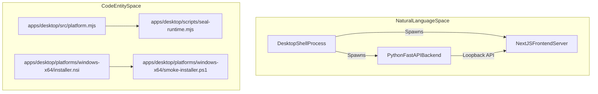
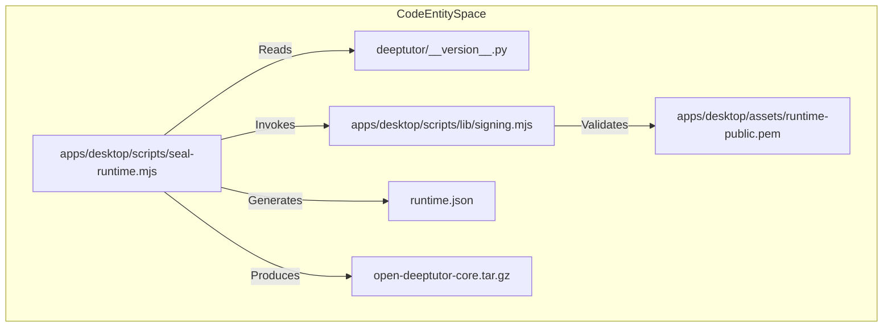
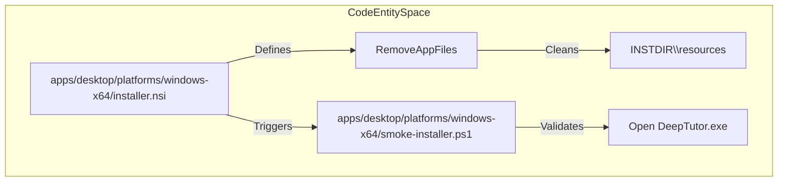
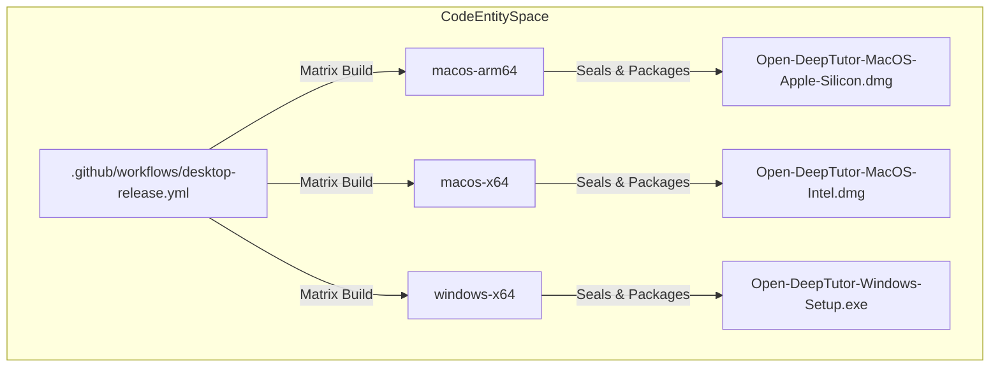

<!-- source: DeepWiki mcp.deepwiki.com · repo HKUDS/DeepTutor · page 2.4 Desktop App Packaging · fetched 2026-11-09 -->

# Desktop App Packaging

<details>
<summary>Relevant source files</summary>

The following files were used as context for generating this wiki page:

- [.github/workflows/desktop-release.yml](.github/workflows/desktop-release.yml)
- [.github/workflows/docker-release.yml](.github/workflows/docker-release.yml)
- [.github/workflows/pypi-release.yml](.github/workflows/pypi-release.yml)
- [apps/desktop/README.md](apps/desktop/README.md)
- [apps/desktop/assets/entitlements.runtime.mac.plist](apps/desktop/assets/entitlements.runtime.mac.plist)
- [apps/desktop/platforms/windows-x64/installer.nsi](apps/desktop/platforms/windows-x64/installer.nsi)
- [apps/desktop/platforms/windows-x64/smoke-installer.ps1](apps/desktop/platforms/windows-x64/smoke-installer.ps1)
- [apps/desktop/scripts/lib/macos-runtime-signing.mjs](apps/desktop/scripts/lib/macos-runtime-signing.mjs)
- [apps/desktop/scripts/lib/signing.mjs](apps/desktop/scripts/lib/signing.mjs)
- [apps/desktop/scripts/notarize.mjs](apps/desktop/scripts/notarize.mjs)
- [apps/desktop/scripts/seal-runtime.mjs](apps/desktop/scripts/seal-runtime.mjs)
- [apps/desktop/test/macos-runtime-signing.test.mjs](apps/desktop/test/macos-runtime-signing.test.mjs)
- [apps/desktop/test/notarize.test.mjs](apps/desktop/test/notarize.test.mjs)
- [apps/desktop/test/signing.test.mjs](apps/desktop/test/signing.test.mjs)
- [tests/test_release_workflow_guards.py](tests/test_release_workflow_guards.py)

</details>


## Purpose and Scope

The `apps/desktop` package provides a double-clickable, self-contained Electron-style desktop preview of DeepTutor. It bundles a target-specific Python runtime, Node.js interpreter, production Next.js standalone build, and the core DeepTutor codebase into a single distributable application. Users can launch DeepTutor without manual terminal interaction, global Python/Node installations, or source code checkouts. This page documents the runtime sealing mechanism, cryptographic verification, Windows NSIS installer configuration, macOS signing and notarization, and the automated desktop release pipeline.

Sources: [`apps/desktop/README.md:1-68`]()

---

## 1. Desktop Architecture and Runtime Bundling

The desktop app follows a strict separation between the desktop shell (Node.js/Electron main process) and the managed backend services (FastAPI Python backend and Next.js frontend). The desktop shell is responsible exclusively for startup orchestration, health readiness polling, graceful shutdown signaling, and native window management (`apps/desktop/README.md:48-55`). No business logic or React component execution occurs directly inside the shell process; web content runs with isolated permissions.



Sources: [`apps/desktop/README.md:48-68`]()

---

## 2. Runtime Sealing and Ed25519 Cryptographic Signatures

To ensure integrity and prevent tampering with bundled interpreter binaries or Python modules, the desktop build pipeline executes a runtime sealing step via `apps/desktop/scripts/seal-runtime.mjs`. This process archives the core bundle, computes its SHA-256 hash, and signs it using an Ed25519 private key.

### Key Sealing Steps
1. **Version Extraction**: Extracts the core release version from `deeptutor/__version__.py` and the git commit hash from `BUILD_COMMIT` [`apps/desktop/scripts/seal-runtime.mjs:32-34`]().
2. **Mach-O Signing (macOS)**: For macOS targets, binaries and shared libraries inside the runtime are signed with designated entitlements prior to compression [`apps/desktop/scripts/seal-runtime.mjs:37-40`].
3. **Archive Generation**: Packs the runtime folder into a `.tar.gz` tarball [`apps/desktop/scripts/seal-runtime.mjs:41`].
4. **Manifest and Signature Generation**: Constructs a `runtime.json` manifest containing format versions, target platform/architecture descriptors, file hashes, and an Ed25519 base64 signature [`apps/desktop/scripts/seal-runtime.mjs:42-47`].

The key verification logic is enforced by `apps/desktop/scripts/lib/signing.mjs`, which compares DER-exported public keys to guarantee that the signing key matches `assets/runtime-public.pem` [`apps/desktop/scripts/lib/signing.mjs:4-10`].



Sources: [`apps/desktop/scripts/seal-runtime.mjs:1-49`][], [`apps/desktop/scripts/lib/signing.mjs:1-10`]()

---

## 3. Windows Packaging and NSIS In-User Installation

Windows distribution is handled via an NSIS (Nullsoft Scriptable Install System) installer script [`apps/desktop/platforms/windows-x64/installer.nsi:1-93`]. The installer is configured to install exclusively for the current user (`RequestExecutionLevel user`), eliminating the need for administrative privilege prompts (`apps/desktop/platforms/windows-x64/installer.nsi:3-17`).

### Key Installer Mechanics
* **Installation Directory**: Defaults to `%LOCALAPPDATA%\Programs\Open DeepTutor` [`apps/desktop/platforms/windows-x64/installer.nsi:15`].
* **File Cleanup**: The `RemoveAppFiles` macro clears previous versions of resources, locales, and Electron binaries while preserving user learning data located in `%LOCALAPPDATA%\Open DeepTutor` [`apps/desktop/platforms/windows-x64/installer.nsi:43-63`].
* **Registry Entries**: Registers application uninstall strings, display names, and versions under `HKCU\Software\Microsoft\Windows\CurrentVersion\Uninstall\Open DeepTutor` [`apps/desktop/platforms/windows-x64/installer.nsi:74-81`].

End-to-end installation behavior, path handling with spaces/non-ASCII characters, and uninstallation preservation are validated by `apps/desktop/platforms/windows-x64/smoke-installer.ps1` [`apps/desktop/platforms/windows-x64/smoke-installer.ps1:1-75`].



Sources: [`apps/desktop/platforms/windows-x64/installer.nsi:1-93`][], [`apps/desktop/platforms/windows-x64/smoke-installer.ps1:1-75`]()

---

## 4. macOS Runtime Signing and Notarization

For macOS targets (`macos-arm64` and `macos-x64`), runtime distribution requires strict code signing and notarization to comply with Apple's Gatekeeper requirements.

* **Binary Discovery**: The utility script traverses the runtime tree to locate extensionless executables, Mach-O binaries, and hidden dynamic libraries (`.dylib`), ensuring symlinks are not recursively followed [`apps/desktop/test/macos-runtime-signing.test.mjs:9-27`].
* **Entitlements**: Node.js/V8 Just-In-Time (JIT) compilation and Python native callback mechanisms require specific execution memory entitlements defined in `apps/desktop/assets/entitlements.runtime.mac.plist` [`apps/desktop/assets/entitlements.runtime.mac.plist:1-9`]:
  ```xml
  <key>com.apple.security.cs.allow-jit</key><true/>
  <key>com.apple.security.cs.allow-unsigned-executable-memory</key><true/>
  ```
* **Notarization**: Bundled DMGs are submitted via Apple's notarization service (`apps/desktop/scripts/notarize.mjs`), after which successful results are stapled to the package.

Sources: [`apps/desktop/assets/entitlements.runtime.mac.plist:1-9`][], [`apps/desktop/test/macos-runtime-signing.test.mjs:9-27`]()

---

## 5. Desktop Release and CI/CD Workflow

The desktop release lifecycle is fully automated via GitHub Actions in `.github/workflows/desktop-release.yml` [`/.github/workflows/desktop-release.yml:1-232`].

### Workflow Triggers and Jobs
* **Triggers**: Executed on pushes to `dev` affecting `apps/desktop/**`, published GitHub releases, pull requests, and manual dispatches [`/.github/workflows/desktop-release.yml:24-46`].
* **Matrix Strategy**: Builds simultaneously across three runner environments [`/.github/workflows/desktop-release.yml:60-74`]:
  * `macos-arm64` (`macos-15`)
  * `macos-x64` (`macos-15-intel`)
  * `windows-x64` (`windows-2025`)
* **Tag Enforcement**: Validates that the GitHub release tag matches the version declared in `deeptutor/__version__.py` [`/.github/workflows/desktop-release.yml:90-98`].
* **Signing Secrets**: In production releases, `DESKTOP_RUNTIME_SIGNING_KEY` is required. Pull requests automatically fall back to disposable throwaway signing keys [`/.github/workflows/desktop-release.yml:109-116`].



Sources: [`/.github/workflows/desktop-release.yml:1-232`]()

---

