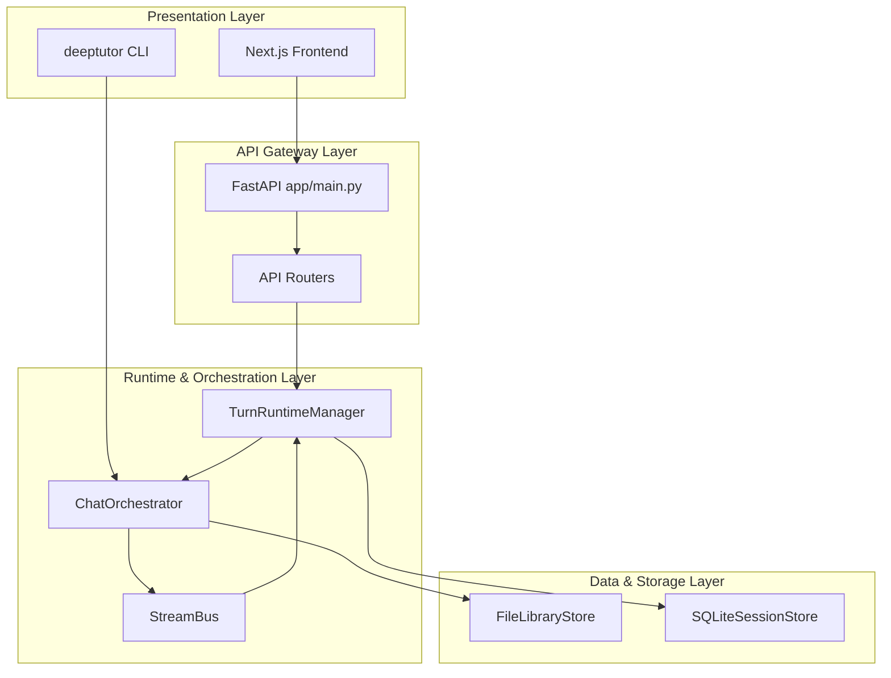
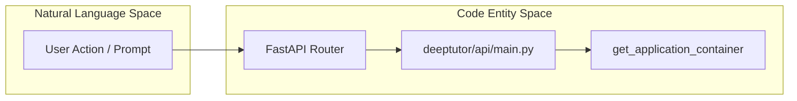
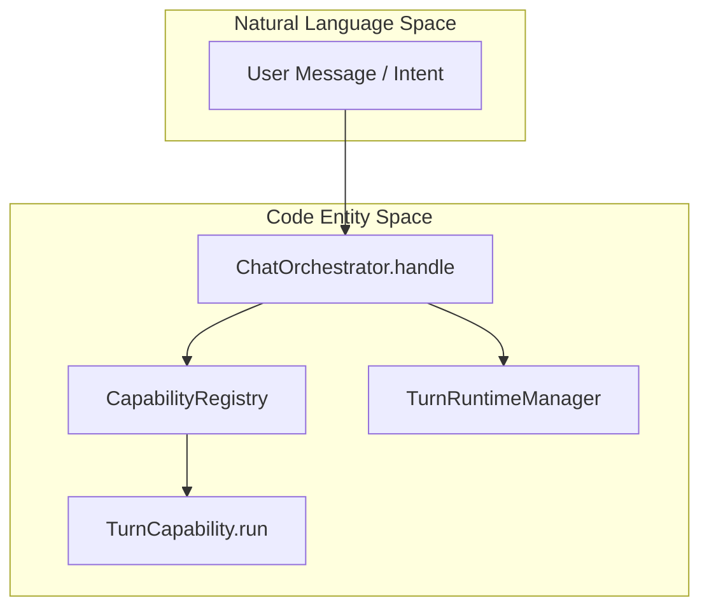
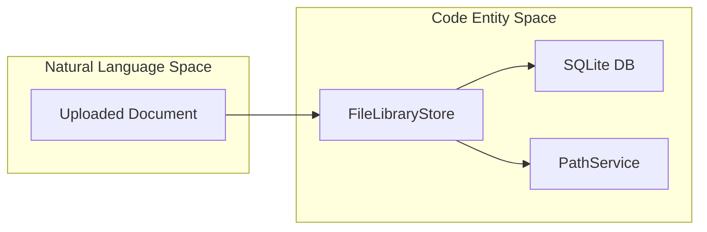

<!-- source: DeepWiki mcp.deepwiki.com · repo HKUDS/DeepTutor · page 3 System Architecture · fetched 2026-11-09 -->

# System Architecture

Relevant source files

The following files were used as context for generating this wiki page:

- [README.md](README.md)
- [assets/README/README_AR.md](assets/README/README_AR.md)
- [assets/README/README_CN.md](assets/README/README_CN.md)
- [assets/README/README_ES.md](assets/README/README_ES.md)
- [assets/README/README_FR.md](assets/README/README_FR.md)
- [assets/README/README_HI.md](assets/README/README_HI.md)
- [assets/README/README_JA.md](assets/README/README_JA.md)
- [assets/README/README_PL.md](assets/README/README_PL.md)
- [assets/README/README_PT.md](assets/README/README_PT.md)
- [assets/README/README_RU.md](assets/README/README_RU.md)
- [assets/README/README_TH.md](assets/README/README_TH.md)
- [deeptutor/__version__.py](deeptutor/__version__.py)
- [deeptutor/api/main.py](deeptutor/api/main.py)
- [tests/api/test_main_exception_handler.py](tests/api/test_main_exception_handler.py)
- [tests/api/test_selective_access_log.py](tests/api/test_selective_access_log.py)

**Purpose**: This page provides a high-level overview of DeepTutor's four-layer architecture, detailing how the presentation, API gateway, runtime orchestration, and data persistence layers interact. For deep technical implementation details, refer to the child pages: [Frontend Architecture](#3.1), [Data Flow and Storage](#3.3), [Runtime and Orchestration](#3.4), [Agent Loop and Tool Dispatch](#3.5), [Experimental TypeScript Chat Engine](#3.6), and [Module Manifests and Plugins](#3.7).

---

## Architectural Overview

DeepTutor uses a four-layer design pattern to separate concerns between user presentation, HTTP/WebSocket routing, agentic capability execution, and state persistence. The system is initialized via container structures and unified event busses.

### Diagram: System Layer Architecture

Sources: [deeptutor/api/main.py:108-130](), [deeptutor/api/routers/unified_ws.py:10-12]()

---

## Presentation and API Gateway Layers

The presentation layer handles client interaction via the Next.js web application and the CLI launcher. Requests enter the system through the FastAPI application defined in `deeptutor/api/main.py` [deeptutor/api/main.py:108-130]() and `deeptutor/api/routers/unified_ws.py` [deeptutor/api/routers/unified_ws.py:10-12]() which configures lifespan handlers, container bootstrapping, and WebSocket streams.

### Diagram: Request Routing and Presentation Bridge

Sources: [deeptutor/api/main.py:108-130](), [deeptutor/api/routers/unified_ws.py:10-12]()

For frontend specifics, see [Frontend Architecture](#3.1).

---

## Intelligent Agent and Orchestration Layer

The orchestration layer coordinates agent execution. `ChatOrchestrator` resolves user context and maps active capabilities to specific execution pipelines, routing progress events through `StreamBus` [deeptutor/runtime/orchestrator.py:51-67](). State synchronization and turn lifecycle management are handled by `TurnRuntimeManager` [deeptutor/services/session/turn_runtime.py:26-34]().

### Diagram: Capability Dispatch and Orchestration

Sources: [deeptutor/runtime/orchestrator.py:51-180](), [deeptutor/services/session/turn_runtime.py:26-53]()

For deeper execution details, see [Runtime and Orchestration](#3.4) and [Agent Loop and Tool Dispatch](#3.5).

---

## Data Flow and Storage Layer

Persistence is managed through modular storage adapters. The `FileLibraryStore` handles disk-based and SQLite-indexed file deduplication, while session states, knowledge base vector indexes, and user configurations are segregated into workspace directories.

### Diagram: Storage and Persistence Bridge

Sources: [deeptutor/services/session/turn_runtime.py:43-53]()

For persistence layout details, see [Data Flow and Storage](#3.3).

---

## Module Manifests and Plugins

Modular capability extension is managed via module manifests and the plugin loader. System checks validate tool consistency against the runtime `ToolRegistry` at startup using `validate_tool_consistency` [deeptutor/api/main.py:47-75](). For details on loading extensions and gating optional dependencies, see [Module Manifests and Plugins](#3.7).

Sources: [deeptutor/api/main.py:47-75]()

---

## Experimental TypeScript Chat Engine

In parallel with the Python orchestration layer, DeepTutor includes an experimental TypeScript chat engine profile (`packages/chat-engine`) supporting native model rounds, stream decoding, tool dispatchers, and stdio transport. For full profiling and bridge specifications, see [Experimental TypeScript Chat Engine](#3.6).

Sources: [deeptutor/api/main.py:108-130]()

---

