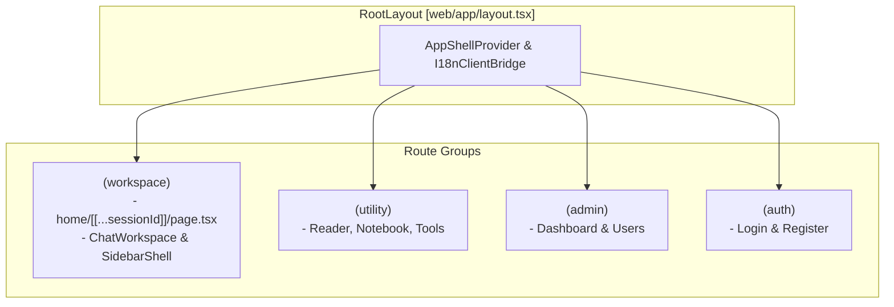
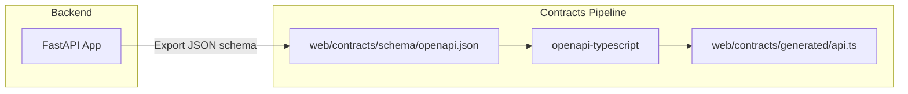
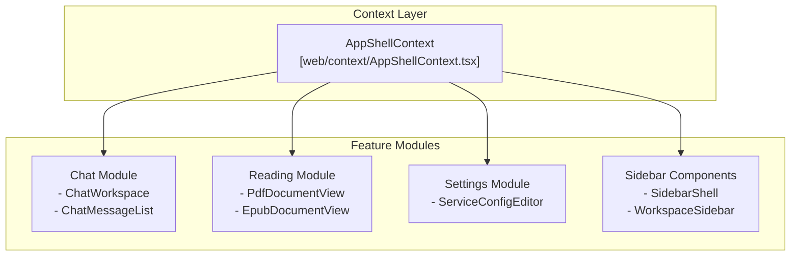
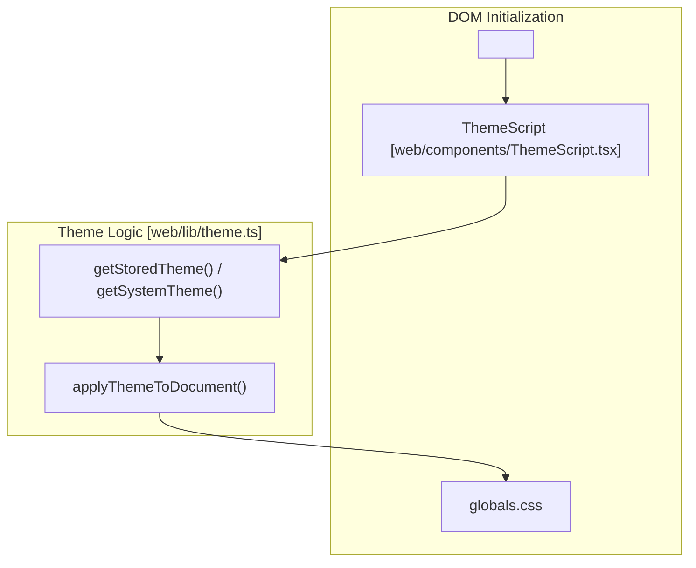
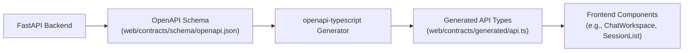

<!-- source: DeepWiki mcp.deepwiki.com · repo HKUDS/DeepTutor · page 3.1 Frontend Architecture · fetched 2026-11-09 -->

# Frontend Architecture

<details>
<summary>Relevant source files</summary>

The following files were used as context for generating this wiki page:

- [deeptutor/api/router_index.json](deeptutor/api/router_index.json)
- [tests/runtime/test_runtime_home_reset.py](tests/runtime/test_runtime_home_reset.py)
- [web/components/reading/PdfDocumentView.tsx](web/components/reading/PdfDocumentView.tsx)
- [web/components/reading/workspace/ReadingCompanion.tsx](web/components/reading/workspace/ReadingCompanion.tsx)
- [web/components/sidebar/SidebarNav.tsx](web/components/sidebar/SidebarNav.tsx)
- [web/components/sidebar/SidebarShell.tsx](web/components/sidebar/SidebarShell.tsx)
- [web/components/sidebar/UtilitySidebar.tsx](web/components/sidebar/UtilitySidebar.tsx)
- [web/components/sidebar/VersionBadge.tsx](web/components/sidebar/VersionBadge.tsx)
- [web/components/sidebar/WorkspaceSidebar.tsx](web/components/sidebar/WorkspaceSidebar.tsx)
- [web/components/space/learning/MasteryStudy.tsx](web/components/space/learning/MasteryStudy.tsx)
- [web/contracts/generated/api.ts](web/contracts/generated/api.ts)
- [web/contracts/schema/openapi.json](web/contracts/schema/openapi.json)
- [web/eslint.config.mjs](web/eslint.config.mjs)
- [web/features/chat/ChatStateAdapter.tsx](web/features/chat/ChatStateAdapter.tsx)
- [web/features/chat/components/ChatWorkspace.tsx](web/features/chat/components/ChatWorkspace.tsx)
- [web/features/chat/messages/ChatMessageList.tsx](web/features/chat/messages/ChatMessageList.tsx)
- [web/lib/failed-submissions.ts](web/lib/failed-submissions.ts)
- [web/lib/pdfjs-loader.ts](web/lib/pdfjs-loader.ts)
- [web/lib/proxy-policy.ts](web/lib/proxy-policy.ts)
- [web/locales/de/app.json](web/locales/de/app.json)
- [web/locales/en/app.json](web/locales/en/app.json)
- [web/locales/fr/app.json](web/locales/fr/app.json)
- [web/locales/pl/app.json](web/locales/pl/app.json)
- [web/locales/uk/app.json](web/locales/uk/app.json)
- [web/locales/zh/app.json](web/locales/zh/app.json)
- [web/next-env.d.ts](web/next-env.d.ts)
- [web/next.config.js](web/next.config.js)
- [web/package-lock.json](web/package-lock.json)
- [web/package.json](web/package.json)
- [web/playwright.config.ts](web/playwright.config.ts)
- [web/scripts/build.mjs](web/scripts/build.mjs)
- [web/scripts/copy-pdfjs-assets.mjs](web/scripts/copy-pdfjs-assets.mjs)
- [web/tests/build-wrapper.test.ts](web/tests/build-wrapper.test.ts)
- [web/tests/chat-failed-submission-recovery.spec.tsx](web/tests/chat-failed-submission-recovery.spec.tsx)
- [web/tests/e2e/fixtures/runtime.ts](web/tests/e2e/fixtures/runtime.ts)
- [web/tests/e2e/multi-worker-turns.audit.ts](web/tests/e2e/multi-worker-turns.audit.ts)
- [web/tests/e2e/turn-lifecycle.audit.ts](web/tests/e2e/turn-lifecycle.audit.ts)
- [web/tests/integration/chat-messages.spec.tsx](web/tests/integration/chat-messages.spec.tsx)
- [web/tests/mastery-study-route.test.ts](web/tests/mastery-study-route.test.ts)
- [web/tests/pdf-reading-resize.spec.tsx](web/tests/pdf-reading-resize.spec.tsx)
- [web/tests/session-failed-submission-cleanup.spec.ts](web/tests/session-failed-submission-cleanup.spec.ts)
- [web/tests/sidebar-lazy-history.spec.tsx](web/tests/sidebar-lazy-history.spec.tsx)
- [web/tests/sidebar-prefetch.spec.tsx](web/tests/sidebar-prefetch.spec.tsx)
- [web/tsconfig.json](web/tsconfig.json)

</details>


## Purpose and Scope

This document describes the architecture of DeepTutor's web frontend, a Next.js application that provides the user interface for all intelligent agent modules. The frontend implements a modern single-page application using the Next.js App Router, structured around route groups (`(workspace)`, `(utility)`, `(admin)`, and `(auth)`), automated API contract generation, feature modules, and unified theming entrypoints.

The frontend is designed as an agent-native interface, specifically optimized for real-time streaming, long-running asynchronous tasks (such as deep research and interactive book generation), and multi-user authentication.

Sources: [web/app/layout.tsx:1-61](), [web/package.json:1-70]()

---

## App Router Structure and Route Groups

DeepTutor uses the Next.js App Router (`web/app/`) with route groups to organize layouts, authentication boundaries, and workspace views without modifying URL segments.

Title: App Router Route Groups and Layout Structure


- **`(workspace)`**: This route group contains the core user-facing workspace and chat environment. The main page at `web/app/(workspace)/home/[[...sessionId]]/page.tsx` loads the interactive chat hub (`ChatWorkspace`) and sidebar (`WorkspaceSidebar`). It controls the session and turn runtime state adapters that handle conversational interactions and multi-agent collaboration [web/features/chat/components/ChatWorkspace.tsx:37-78]().
- **`(utility)`**: Provides auxiliary application features distinct from the chat workspace, such as the immersive PDF/EPUB reader, Notebook document pages, and various tool utilities designed for specialized user tasks.
- **`(admin)`**: Hosts administrative interfaces that manage users, services, multi-user permissions, and system configurations, segmented from normal user flow.
- **`(auth)`**: Handles authentication workflows and identity management UI including login, registration, device pairing, and security tokens. This is an authentication boundary that controls access to the rest of the app.

Sources: [web/app/layout.tsx:35-61](), [web/components/chat/HistorySessionPicker.tsx:1-57]()

---

## Contracts Generation and API Clients

DeepTutor enforces strong typing and consistency between backend FastAPI endpoints and the frontend via generated TypeScript API contracts from OpenAPI schema.

Title: OpenAPI Contract Generation Pipeline


- The backend FastAPI app exports a full OpenAPI-compliant JSON schema describing all API operations, request and response data models, and enumerations. This file is located at `web/contracts/schema/openapi.json`.
- The TypeScript generation tool `openapi-typescript` consumes this schema and outputs strongly typed frontend API interfaces at `web/contracts/generated/api.ts`.
- Feature frontend modules import these generated types to define explicitly typed API calls, ensuring compile-time validation of all data structures such as `ActionPayload`, `AddRecordRequest`, and related entities [web/contracts/schema/openapi.json:1-50]().
- This contract-first approach minimizes runtime deserialization errors and accelerates developer productivity via autocompletion and exhaustive type coverage [web/contracts/generated/api.ts:1-50]().

Sources: [web/contracts/schema/openapi.json:1-250](), [web/contracts/generated/api.ts:1-218](), [web/contracts/schema/openapi.json:1-50]()

---

## Feature Modules and Component Architecture

The frontend is architected as a composition of feature modules implemented as React components under `web/components/` and `web/features/`. Each module owns its domain logic, UI, and state adaption, composed under global application context providers.

Title: Feature Module Interaction Hierarchy


- **Chat Workspace Module**: At the core is `ChatWorkspace` which handles conversation rendering, message composition, and tool interactions [web/features/chat/components/ChatWorkspace.tsx:37-40](). It uses `ChatStateAdapter` to sync session and turn runtime state with backend APIs and WebSocket events [web/features/chat/ChatStateAdapter.tsx:35-45]().
- **Reading Module**: Contains dynamic React components like `PdfDocumentView` which handle document viewing with efficient windowed rendering and integration of `pdfjs-dist` libraries.
- **Settings Module**: Includes configuration UIs managing editing of backend service parameters.
- **Sidebar Components**: `SidebarShell` provides the left rail layout with session lists and navigation. `WorkspaceSidebar` fetches and organizes session and course data, interfaces with chat state adapters, and manages selections and session lifecycle actions.

Sources: [web/features/chat/ChatStateAdapter.tsx:35-50](), [web/features/chat/components/ChatWorkspace.tsx:37-40](), [web/components/sidebar/WorkspaceSidebar.tsx:1-162]()

---

## Theming and Design System Entrypoints

DeepTutor supports a flexible and performant theming system with multiple named themes (`light`, `dark`, `glass`, `snow`), user preference persistence, and Flash of Unstyled Content (FOUC) prevention.

Title: Theming Initialization and Script Flow


- **ThemeScript Component**: Injected inline into the document `<head>` in `web/app/layout.tsx` - the script runs immediately on page load before React hydration, reading the stored theme setting from localStorage or falling back to system preferences, and applies the appropriate CSS theme classes to the `<html>` element [web/components/ThemeScript.tsx:1-30](), [web/app/layout.tsx:43-67]().
- **Theme Utilities** (`web/lib/theme.ts`): Provide runtime functions that retrieve theme settings, normalize values, and mutate document classes to enable dark mode (`dark`), glass effect (`theme-glass`), or snow effect (`theme-snow`). All theme state changes are synchronized and persisted for user consistency.

Sources: [web/app/layout.tsx:40-60](), [web/components/ThemeScript.tsx:1-49](), [web/lib/theme.ts:1-50]()

---

## Appendix: Natural Language to Code Entity Mapping

To help bridge conceptual understanding of DeepTutor’s frontend architecture, below are two diagrams relating system features in natural language to their exact code entities.

### Diagram 1: Route Groups to Code Entities

```mermaid
graph TB
    SUBGRAPH_Root["Root App Layout (web/app/layout.tsx)"]
    SUBGRAPH_Workspace["Workspace Group (web/app/(workspace))"]
    SUBGRAPH_Utility["Utility Group (web/app/(utility))"]
    SUBGRAPH_Admin["Admin Group (web/app/(admin))"]
    SUBGRAPH_Auth["Auth Group (web/app/(auth))"]

    SUBGRAPH_Root --> SUBGRAPH_Workspace
    SUBGRAPH_Root --> SUBGRAPH_Utility
    SUBGRAPH_Root --> SUBGRAPH_Admin
    SUBGRAPH_Root --> SUBGRAPH_Auth

    SUBGRAPH_Workspace --> "home/[[...sessionId]]/page.tsx"
    SUBGRAPH_Workspace --> "components/chat/ChatWorkspace.tsx"
    SUBGRAPH_Workspace --> "components/sidebar/WorkspaceSidebar.tsx"

    SUBGRAPH_Utility --> "components/reading/PdfDocumentView.tsx"
    SUBGRAPH_Utility --> "components/notebook/NotebookView.tsx"

    SUBGRAPH_Admin --> "components/admin/DashboardPage.tsx"

    SUBGRAPH_Auth --> "components/auth/LoginCard.tsx"
```
Sources: [web/app/layout.tsx:1-61](), [web/features/chat/components/ChatWorkspace.tsx:37-40]()

### Diagram 2: API Contracts to Frontend Use


Sources: [web/contracts/schema/openapi.json:1-50](), [web/contracts/generated/api.ts:1-50]()

---

# Summary

- The frontend uses Next.js AppRouter with four route groups `(workspace)`, `(utility)`, `(admin)`, and `(auth)` to organize the UI and manage authentication boundaries.
- API contracts between backend and frontend are rigorously typed through OpenAPI JSON and TypeScript generation, improving maintainability and correctness.
- The UI is modularized into feature modules exposing components with localized state, data fetching, and reuse of shared global contexts.
- Theming entrypoints use client-side scripts and CSS variables, enabling theme persistence and instant application on startup for a smooth user experience.

Sources: [web/app/layout.tsx:1-61](), [web/contracts/schema/openapi.json:1-250](), [web/contracts/generated/api.ts:1-218](), [web/lib/theme.ts:1-50]()

---

