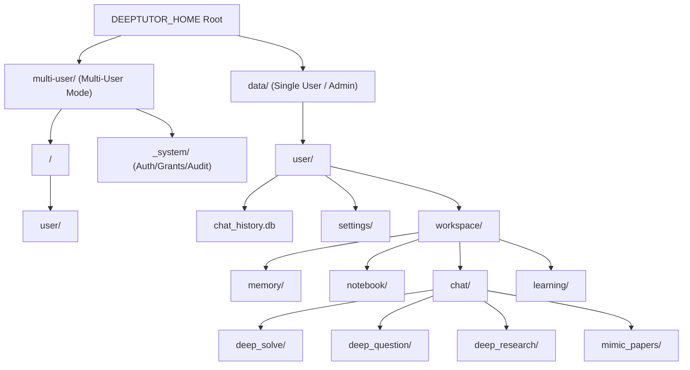
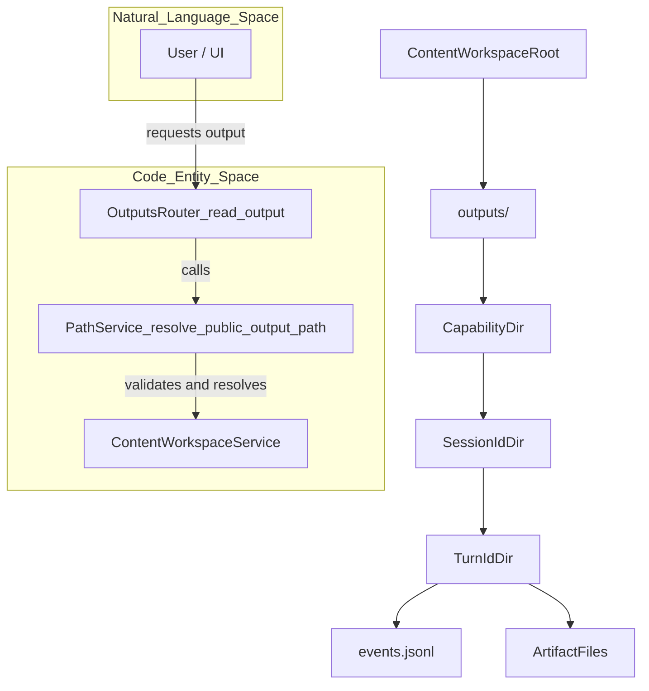
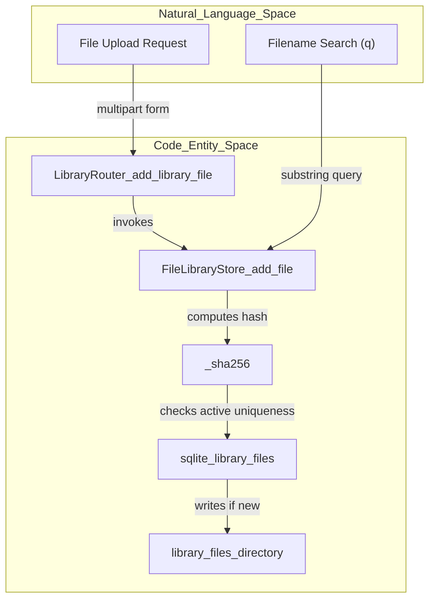
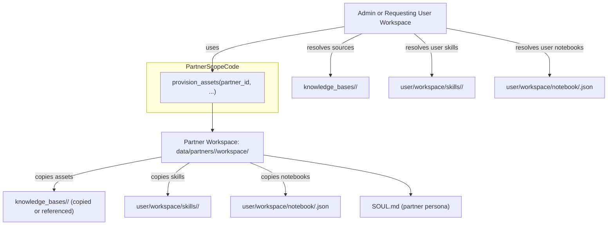
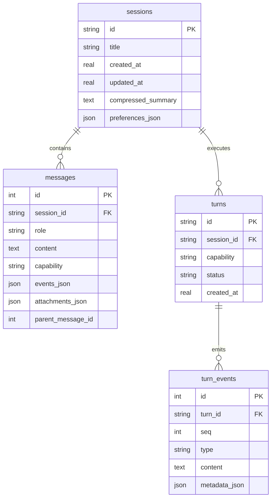

<!-- source: DeepWiki mcp.deepwiki.com · repo HKUDS/DeepTutor · page 3.3 Data Flow and Storage · fetched 2026-11-09 -->

# Data Flow and Storage

Relevant source files

The following files were used as context for generating this wiki page:

- [deeptutor/api/routers/file_library.py](deeptutor/api/routers/file_library.py)
- [deeptutor/api/routers/outputs.py](deeptutor/api/routers/outputs.py)
- [deeptutor/services/partners/runtime_status.py](deeptutor/services/partners/runtime_status.py)
- [deeptutor/services/path_service.py](deeptutor/services/path_service.py)
- [deeptutor/services/storage/__init__.py](deeptutor/services/storage/__init__.py)
- [deeptutor/services/storage/file_library.py](deeptutor/services/storage/file_library.py)
- [deeptutor/services/workspace/data_migration.py](deeptutor/services/workspace/data_migration.py)
- [deeptutor/services/workspace/dependencies.py](deeptutor/services/workspace/dependencies.py)
- [deeptutor/services/workspace/session_move.py](deeptutor/services/workspace/session_move.py)
- [tests/agents/video_lesson/test_public_output.py](tests/agents/video_lesson/test_public_output.py)
- [tests/api/test_file_library_router.py](tests/api/test_file_library_router.py)
- [tests/api/test_output_files.py](tests/api/test_output_files.py)
- [tests/multi_user/test_handoff_connection_lifetime.py](tests/multi_user/test_handoff_connection_lifetime.py)
- [tests/reading/test_catalog_connection_lifetime.py](tests/reading/test_catalog_connection_lifetime.py)
- [tests/services/memory/test_snapshot_connection_lifetime.py](tests/services/memory/test_snapshot_connection_lifetime.py)
- [tests/services/storage/test_file_library.py](tests/services/storage/test_file_library.py)
- [tests/services/storage/test_file_library_unicode_search.py](tests/services/storage/test_file_library_unicode_search.py)
- [tests/services/test_partner_status_connection_lifetime.py](tests/services/test_partner_status_connection_lifetime.py)
- [tests/services/workspace/test_data_migration.py](tests/services/workspace/test_data_migration.py)

## Purpose and Scope

This document describes DeepTutor's data persistence architecture, directory structures, and file formats. It details how the system manages the `DEEPTUTOR_HOME` layout, isolation of data for single-user vs multi-user modes, Content Workspace outputs directory, file libraries, and workspace services. The design ensures secure multi-tenant data handling, flexible workspace management, and consistent artifact generation and retrieval.

Key components include `PathService` managing runtime storage layout and scoped user directories [deeptutor/services/path_service.py:66-94](), and `ContentWorkspaceService` offering confined content workspace resolution with secure overrides and output publication. Partner workspace provisioning adds multi-user partner-specific clones of knowledge bases, skills, and notebooks. The outputs router (`deeptutor/api/routers/outputs.py`) and file library store (`deeptutor/services/storage/file_library.py`) mediate authorized retrieval of generated artifacts and reusable uploaded assets.

---

## DEEPTUTOR_HOME Layout and Directory Structures

DeepTutor organizes persistent data under a root home directory (`DEEPTUTOR_HOME`), defaulting to the install/runtime data root or an explicitly configured path [deeptutor/services/path_service.py:88-92](). The structure splits between single-user/admin mode under `data/` and multi-user mode under `multi-user/`.

- In **single-user mode**, everything lives under `data/user/` including:
  - `chat_history.db`: central SQLite DB for unified session messages and turns [deeptutor/services/path_service.py:137-138]()
  - `settings/`: JSON files for UI preferences, model/system config [deeptutor/services/path_service.py:11()]()
  - `workspace/`: content workspace root for agent capabilities output and user data [deeptutor/services/path_service.py:12-23]()

- In **multi-user mode**, each user gets an isolated workspace under `multi-user/<user_id>/user/` mirroring the above tree, with an additional internal `_system/` directory for shared admin and security state.

This layout, managed by `PathService`, enables layered isolation while keeping API surfaces consistent regardless of multi-user setting [deeptutor/services/path_service.py:66-94]().

---

### Directory Purpose Table

| Directory Path                  | Purpose                                           | Key Code / Service                                                         |
|--------------------------------|-------------------------------------------------|---------------------------------------------------------------------------|
| `.../user/chat_history.db`      | SQLite backend session store (messages, turns)  | `SQLiteSessionStore` [deeptutor/services/path_service.py:137-138]() |
| `.../user/settings/`            | UI prefs, model catalogs, global/system configs | `PathService` [deeptutor/services/path_service.py:10-11]()                  |
| `.../user/workspace/`           | Content Workspace root; capability outputs       | `PathService.workspace_root` [deeptutor/services/path_service.py:114-115]() |
| `.../workspace/memory/`         | Stores learning memory profiles and summaries    | `PathService` [deeptutor/services/path_service.py:55-56]()                  |
| `.../workspace/notebook/`       | Personal notebooks, bookmarks, draft stores     | `PathService` [deeptutor/services/path_service.py:57-58]()                  |
| `.../workspace/chat/deep_solve` | Capability-specific chat workspace partitions    | `PathService` [deeptutor/services/path_service.py:47-48]()                  |

**Sources:** [deeptutor/services/path_service.py:3-24](), [deeptutor/services/path_service.py:66-140]()

---

## Content Workspace and `outputs/` Architecture

DeepTutor's Content Workspace is a dedicated, user- or session-scoped directory where agents read and write artifacts such as downloaded source materials, generated files, code execution outputs, and rendered assets. It is isolated from user runtime settings and databases.

### Workspace Output Layout and Execution Flow

- Each capability's execution outputs are organized below `workspace/outputs/chat/<session>/<turn>/<kind>/` [deeptutor/services/path_service.py:179-184]().
- Relative paths given to user or UI resolve via `PathService.resolve_public_output_path()` with strict sandbox and extension-based filtering to avoid unauthorized exposure [deeptutor/services/path_service.py:143-209]().
- The `outputs/` root allows content publication without exposing private workspace internals.
- The FastAPI outputs router (`deeptutor/api/routers/outputs.py`) serves artifacts after scope-sensitive authorization using the user's `PathService` context, including partner scopes [deeptutor/api/routers/outputs.py:39-88]().

**Sources:** [deeptutor/services/path_service.py:143-209](), [deeptutor/api/routers/outputs.py:25-97]()

---

## File Library and Workspace Services

DeepTutor uses layered services for workspace management, content indexing, and file access:

- **`FileLibraryStore`** manages reusable file storage across conversations under `data/user/workspace/library/files` [deeptutor/services/storage/file_library.py:1-105]().
  - **Deduplication:** Incoming file bytes are hashed using SHA-256 (`_sha256`). When `add_file` is called, the store checks for an active (non-deleted) entry with the same hash, returning the existing record without duplicating disk writes [deeptutor/services/storage/file_library.py:11-13]().
  - **Thread Safety:** Uses a threading lock (`_add_lock`) to serialize check-then-write sequences across concurrent uploads [deeptutor/services/storage/file_library.py:107-110]().
  - **Soft Delete:** `delete_file` sets `is_deleted=1` and records `deleted_at` timestamp. `hard_delete_file` permanently removes the record and disk file [deeptutor/services/storage/file_library.py:15-18]().

### File Library Data Flow

- The FastAPI file library router (`deeptutor/api/routers/file_library.py`) exposes endpoints for listing, uploading, searching, downloading, deleting, and restoring library files [deeptutor/api/routers/file_library.py:54-172]().

**Sources:** [deeptutor/services/storage/file_library.py:1-173](), [deeptutor/api/routers/file_library.py:1-172]()

---

## Partner Workspace Provisioning and Multi-User Isolation

In multi-user scenarios, DeepTutor supports persistent AI companions ("Partners") with their own synthesized workspaces:

- Partners get a workspace clone under `data/partners/<partner_id>/workspace/` with subfolders for knowledge bases, skills, notebooks, and the `SOUL.md` persona file.
- Connected/pointer knowledge bases register config entries without physical copies.
- Partner workspace tooling reuses the chat user workspace layout for native compatibility.
- Each partner workspace is isolated but accessible by the requester's `PathService` and authorized in output serving [deeptutor/api/routers/outputs.py:46-80]().

**Sources:** [deeptutor/api/routers/outputs.py:46-80](), [deeptutor/services/workspace/data_migration.py:55-92]()

---

## Unified Session Storage and Turn Lifecycle Data Flow

DeepTutor implements a unified session store abstracted over SQLite or remote PocketBase, managing all sessions, messages, and turn data consistently:

- `sessions` store entire conversation sessions with metadata and compressed summaries (Layer 2 Memory).
- `messages` hold chat utterances with branching pointers (`parent_message_id`) for edit/alternate paths.
- `turns` represent computation turns executed by an agent for a request; capture stages, status, capability.
- `turn_events` log detailed turn lifecycle events (thinking, tool results, content emissions).

**Sources:** [deeptutor/services/session/sqlite_store.py:1-100](), [deeptutor/services/session/pocketbase_store.py:1-100]()

---

## Conversation History, Edit-Branching & Optimistic Reconciliation

- Messages sustain `parent_message_id` to preserve branching conversations for editing or alternative lines.
- Migration and dependency closure tools (`deeptutor/services/workspace/dependencies.py` and `deeptutor/services/workspace/data_migration.py`) inspect and transfer chat sessions alongside linked learning stores, notebooks, and reader materials without breaking relational integrity [deeptutor/services/workspace/dependencies.py:41-113](), [deeptutor/services/workspace/data_migration.py:131-152]().

**Sources:** [deeptutor/services/workspace/dependencies.py:41-113](), [deeptutor/services/workspace/data_migration.py:131-152]()

---

# Summary

DeepTutor's data flow and storage system robustly integrates:

- Root `DEEPTUTOR_HOME` directory with split single-user vs multi-user workspaces.
- Per-user isolated `user/` workspaces for chat history, settings, and content workspace directories.
- Capability-driven outputs directories under `workspace/outputs/` with turn/session scoped subfolders managed via `PathService`.
- Persistent file libraries (`FileLibraryStore`) providing SHA-256 deduplication and soft-delete capabilities.
- Unified SQLite or PocketBase session stores with detailed turn lifecycles and message branching.
- Authenticated, request-scoped output artifact serving respecting multi-user and partner visibility.

---

**Sources:**  
- deeptutor/services/path_service.py:66-209  
- deeptutor/services/storage/file_library.py:1-173  
- deeptutor/api/routers/outputs.py:25-97  
- deeptutor/api/routers/file_library.py:54-173  
- deeptutor/services/workspace/data_migration.py:32-92  
- deeptutor/services/workspace/dependencies.py:41-113

---

