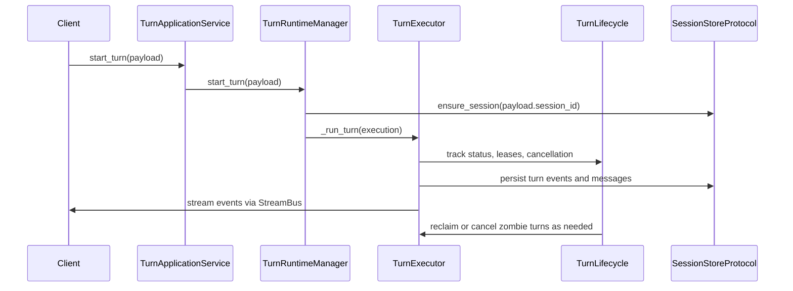

<!-- source: DeepWiki mcp.deepwiki.com · repo HKUDS/DeepTutor · page 3.4 Runtime and Orchestration · fetched 2026-11-09 -->

# Runtime and Orchestration

<details>
<summary>Relevant source files</summary>

The following files were used as context for generating this wiki page:

- [deeptutor/agents/chat/capability.py](deeptutor/agents/chat/capability.py)
- [deeptutor/agents/question/capability.py](deeptutor/agents/question/capability.py)
- [deeptutor/app/service.py](deeptutor/app/service.py)
- [deeptutor/capabilities/ask_questions/__init__.py](deeptutor/capabilities/ask_questions/__init__.py)
- [deeptutor/capabilities/ask_questions/capability.py](deeptutor/capabilities/ask_questions/capability.py)
- [deeptutor/capabilities/ask_questions/loop.py](deeptutor/capabilities/ask_questions/loop.py)
- [deeptutor/capabilities/ask_questions/prompts/en/system.md](deeptutor/capabilities/ask_questions/prompts/en/system.md)
- [deeptutor/capabilities/ask_questions/prompts/zh/system.md](deeptutor/capabilities/ask_questions/prompts/zh/system.md)
- [deeptutor/capabilities/prompts/en/turn_status.yaml](deeptutor/capabilities/prompts/en/turn_status.yaml)
- [deeptutor/capabilities/prompts/zh/turn_status.yaml](deeptutor/capabilities/prompts/zh/turn_status.yaml)
- [deeptutor/learning/tests/test_visual_learning_workflow.py](deeptutor/learning/tests/test_visual_learning_workflow.py)
- [deeptutor/runtime/bootstrap/builtin_capabilities.py](deeptutor/runtime/bootstrap/builtin_capabilities.py)
- [deeptutor/runtime/coordination/memory.py](deeptutor/runtime/coordination/memory.py)
- [deeptutor/runtime/coordination/recovery.py](deeptutor/runtime/coordination/recovery.py)
- [deeptutor/runtime/orchestrator.py](deeptutor/runtime/orchestrator.py)
- [deeptutor/runtime/stream_bus.py](deeptutor/runtime/stream_bus.py)
- [deeptutor/services/session/turns/lifecycle.py](deeptutor/services/session/turns/lifecycle.py)
- [tests/agents/chat/test_language_prompts.py](tests/agents/chat/test_language_prompts.py)
- [tests/app/test_multiworker_turn_reply_after_queue_drop.py](tests/app/test_multiworker_turn_reply_after_queue_drop.py)
- [tests/app/test_turn_application_service.py](tests/app/test_turn_application_service.py)
- [tests/app/test_turn_parked_on_ask_user_is_reclaimable.py](tests/app/test_turn_parked_on_ask_user_is_reclaimable.py)
- [tests/app/test_waiting_turn_recovery.py](tests/app/test_waiting_turn_recovery.py)
- [tests/capabilities/test_mastery_teaching_delivery.py](tests/capabilities/test_mastery_teaching_delivery.py)
- [tests/core/test_capabilities_runtime.py](tests/core/test_capabilities_runtime.py)
- [tests/core/test_stream_bus_cross_loop_input.py](tests/core/test_stream_bus_cross_loop_input.py)
- [tests/runtime/coordination/test_journal_recovery.py](tests/runtime/coordination/test_journal_recovery.py)
- [tests/runtime/coordination/test_memory_coordinator.py](tests/runtime/coordination/test_memory_coordinator.py)
- [tests/runtime/coordination/test_redis_integration.py](tests/runtime/coordination/test_redis_integration.py)
- [tests/runtime/test_orchestrator.py](tests/runtime/test_orchestrator.py)
- [tests/services/session/test_turn_event_flush.py](tests/services/session/test_turn_event_flush.py)

</details>


The Runtime and Orchestration layer serves as the central coordination engine of DeepTutor, bridging high-level **Capabilities** (complex multi-agent workflows) and low-level **Tools** (atomic functions) through a unified execution environment. This layer manages capability registry lookups, plugin loading, tool dispatch, turn execution lifecycles (`TurnRuntimeManager`, `TurnLifecycle`), and the streaming event bus (`StreamBus`) that delivers real-time trace data to clients.

Sources:
- `deeptutor/runtime/orchestrator.py` [1-50]()
- `deeptutor/app/service.py` [1-18]()

---

## 1. ChatOrchestrator and Registries

The `ChatOrchestrator` class is the primary coordinator responsible for processing a single user turn. It accepts a `UnifiedContext` object reflecting the current conversation state and user input, resolves the active capability to handle the turn (defaulting to `"chat"` if none is specified), manages a streaming event bus lifecycle, and publishes completion events along with metadata [deeptutor/runtime/orchestrator.py:54-135]().

### Key Functions and Classes

- `ChatOrchestrator.__init__` — Initializes with optional injected `capability_registry` and acquires the singleton `tool_registry` [deeptutor/runtime/orchestrator.py:60-63]().

- `ChatOrchestrator.handle(context: UnifiedContext) -> AsyncIterator[StreamEvent]` — Core asynchronous method executing the user turn by validating knowledge base selections, resolving the capability, creating a `StreamBus` instance, yielding session bindings, running `capability.run(context, bus)`, and handling termination and cleanup [deeptutor/runtime/orchestrator.py:64-149]().

- `completion_event_fields(context, cap_name)` — Helper function that prepares standard capability-complete event fields and metadata [deeptutor/runtime/orchestrator.py:31-52]().

### Registries

- **Capability Registry** (`get_capability_registry()`): Manages discovery and lookup of all agent-native capabilities (e.g., `"chat"`, `"deep_solve"`, `"deep_research"`). The orchestrator uses it to resolve the requested active capability [deeptutor/runtime/orchestrator.py:22, 114]().

- **Tool Registry** (`get_tool_registry()`): Holds the catalog of tools available for execution within capabilities, exposing schema generation and dispatch metadata [deeptutor/runtime/orchestrator.py:23, 62]().

### Data Flow Diagram: From User Message to Capability Execution

```mermaid
graph TD
    UserMsg[""User Message""] --> Ctx[""UnifiedContext""]
    Ctx --> Orch[""ChatOrchestrator""]
    Orch -- "1. lookup active_capability" --> CapReg[""get_capability_registry()""]
    CapReg -- "2. resolve TurnCapability" --> Cap[""TurnCapability (e.g., ChatCapability)""]
    Cap -- "3. capability.run(context, bus)" --> Bus[""StreamBus""]
    Bus -- "yields StreamEvents" --> Client[""Client (Web, CLI, SDK)""]

    classDef codeEntity fill:#fff,stroke:#333,stroke-width:2px;
    Orch,CapReg,Cap,Bus class codeEntity;
```

Sources:
- `deeptutor/runtime/orchestrator.py` [17-115]()
- `tests/runtime/test_orchestrator.py` [74-120]()

---

## 2. Turn Runtime, Executor, and Lifecycle

At the core of managing individual chat conversation turns is the `TurnRuntimeManager` class, composed as a backward-compatible facade over several focused turn sub-services [deeptutor/services/session/turn_runtime.py:26-34]().

### Key Classes

- `TurnRequestPreparer` — Validates and prepares incoming requests, sets defaults, and ensures session existence [deeptutor/services/session/turns/request_preparer.py:80-183]().

- `TurnContextAssembler` — Builds expanded context scopes including memory references, conversation history, and document contexts for the turn.

- `TurnExecutor` — Runs the execution loop of a turn managing streaming outputs, attachments, and user input pauses [deeptutor/services/session/turns/executor.py:69-186]().

- `TurnLifecycle` — Manages active execution tracking, work lease coordination, cancellation, and recovery from worker crashes or zombie turns [deeptutor/services/session/turns/lifecycle.py:34-128]().

- `TurnApplicationService` — Unified application service used by WebSocket, CLI, and Python SDK adapters to handle turn starts, edits, submissions, and cancellations [deeptutor/app/service.py:21-97]().

### Zombie Turn Reclamation

If a worker crashes while a turn is paused awaiting user input (e.g., an `ask_user` interaction), subsequent synchronous checks by another worker detect the "zombie" execution state and mark the turn failed with a `worker_lost` code, allowing the session to resume safely [deeptutor/services/session/turns/lifecycle.py:34-128](), [tests/app/test_turn_parked_on_ask_user_is_reclaimable.py:90-114]().

### Data Flow Diagram: Turn Execution Lifecycle



Sources:
- `deeptutor/app/service.py` [113-157]()
- `deeptutor/services/session/turns/lifecycle.py` [34-128]()
- `tests/app/test_turn_parked_on_ask_user_is_reclaimable.py` [25-52]()

---

## 3. Streaming Event Bus and Trace

The `StreamBus` class implements a streaming event bus for asynchronously publishing discrete trace frames (`StreamEvent`) related to a turn execution [deeptutor/runtime/stream_bus.py:32-58]().

### StreamEvent Model

`StreamEvent` instances represent different event types during a turn’s lifecycle:

- **SESSION**: Sent initially to bind the `session_id` and `turn_id` for the streaming session.
- **CONTENT**: Streaming user and assistant-generated textual fragments and partial results.
- **TOOL_CALL / TOOL_RESULT**: Diagnostic events marking tool invocation start and completion.
- **ERROR**: Runtime or execution errors. Metadata keys include `turn_terminal` (bool), `error_code` (str), and `retryable` (bool).
- **DONE**: Indicates the completion of streaming for the turn with `status` metadata.

### Event Delivery Flow

The `ChatOrchestrator` creates a new `StreamBus` per turn, registers it by turn ID, and awaits completion of the capability's `run()` coroutine emitting events on it [deeptutor/runtime/orchestrator.py:145-176](). Events are broadcast to all active subscribers with cross-loop thread safety [deeptutor/runtime/stream_bus.py:96-138]().

### Data Flow Diagram: Internal Agent States to Streaming Event Types

```mermaid
graph LR
    AssistantOutput[""Assistant Agent Output""] --> StreamEvt[""StreamEvent""]
    SystemError[""System Exception""] --> StreamEvt
    
    subgraph CodeEntitySpace
        StreamEvt --> Type[""StreamEventType""]
        Type -->|CONTENT| Bus[""StreamBus.emit()""]
        Type -->|ERROR| Bus
        Type -->|DONE| Bus
        Bus --> Orch[""ChatOrchestrator""]
    end

    classDef codeEntity fill:#fff,stroke:#333,stroke-width:2px;
    AssistantOutput,StreamEvt,Bus,Orch class codeEntity;
```

Sources:
- `deeptutor/runtime/stream_bus.py` [32-138]()
- `deeptutor/runtime/orchestrator.py` [136-176]()

---

## 4. Capability and Plugin Discovery

DeepTutor supports modular extension via capabilities and builtin manifest catalogs that define available modes without heavy upfront imports [deeptutor/runtime/bootstrap/builtin_capabilities.py:1-40]().

### Capability Registry and Builtins

- **Builtin Capabilities (`BUILTIN_CAPABILITY_SPECS`)**: Declares built-in capabilities (such as `chat`, `ask_questions`, `deep_solve`, `deep_research`, `visualize`, `mastery_path`, `immersive_reading`, `video_lesson`) mapping configuration specs to their respective implementation classes [deeptutor/runtime/bootstrap/builtin_capabilities.py:17-30]().

- **Module Manifests**: Modules declare capabilities and tools within package manifests (`manifests()`), which are loaded dynamically during bootstrap [deeptutor/runtime/bootstrap/builtin_capabilities.py:8-27]().

### Diagram: Natural Language to Code Entity Bridge for Capability Discovery

```mermaid
graph TD
    UserRequest[""User Request specifies capability 'ask_questions'""] --> BuiltinSpecs[""BUILTIN_CAPABILITY_SPECS""]
    BuiltinSpecs -->|lookup| Manifest[""CapabilityManifest""]
    Manifest --> ClassPath[""BuiltinCapabilitySpec.class_path""]
    ClassPath --> Runtime[""AskQuestionsCapability.run()""]

    classDef codeEntity fill:#fff,stroke:#333,stroke-width:2px;
    BuiltinSpecs,Manifest,ClassPath,Runtime class codeEntity;
```

Sources:
- `deeptutor/runtime/bootstrap/builtin_capabilities.py` [1-48]()
- `tests/core/test_capabilities_runtime.py` [70-84]()

---

# Summary

The runtime and orchestration in DeepTutor encapsulate the interaction between user requests, capability modules, tools, and session management. The `ChatOrchestrator` directs high-level turn execution, backed by the `TurnRuntimeManager` for detailed lifecycle control of conversational turns. Streaming events enable responsive UI updates and diagnostics. Modular registries and manifests maintain extensibility, empowering DeepTutor as a lifelong personalized tutoring agent framework.

# References to Code Artifacts

| Component             | Main Code Entities / Modules                                       |
|-----------------------|-------------------------------------------------------------------|
| ChatOrchestrator      | `deeptutor/runtime/orchestrator.py` [54-135]()                    |
| Builtin Capabilities  | `deeptutor/runtime/bootstrap/builtin_capabilities.py` [11-31]()    |
| Turn Application Svc  | `deeptutor/app/service.py` [21-97]()                              |
| Turn Lifecycle        | `deeptutor/services/session/turns/lifecycle.py` [34-128]()       |
| Streaming Event Bus   | `deeptutor/runtime/stream_bus.py` [32-158]()                     |

Sources:
- As above across sections.

# End of 3.4 Runtime and Orchestration

---

